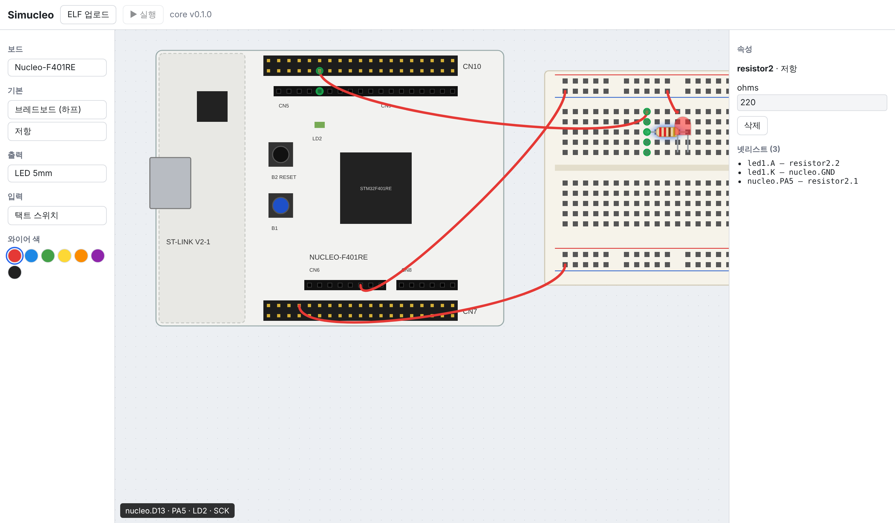

# Simucleo

교육용 **STM32 Nucleo-F401RE 시뮬레이터**. 브라우저에서 펌웨어(ELF)를 업로드하면 Cortex-M4F 코어가
기계어를 실행하고, 내부 Peripheral과 브레드보드 위 외부 부품(LED, 버저, 모터, 센서, OLED 등)을 함께
시뮬레이션해 준실시간으로 보여 준다.



> **상태: 초기 골격(v0).** 배선 편집기와 넷리스트 추출은 동작하고, CPU 명령어 실행은 M0에서 구현한다.
> 진행 상황은 [로드맵](docs/roadmap.md)을 참고.

## 특징 (목표)
- 수정하지 않은 **베어메탈 / CubeMX HAL / CubeMX FreeRTOS** 펌웨어 실행
- Arduino 헤더와 **Morpho 헤더**를 모두 갖춘 Nucleo 보드, 브레드보드 드래그 앤 드롭 배선, 실행 중 배선 변경
- PWM 밝기, 부저 소리, 모터 회전, OLED 화면 등 실제와 비슷한 표시
- 교육용 진단: 미구현 레지스터 접근, `Error_Handler`/HardFault 원인, 저항 없는 LED 같은 전기 규칙 위반
- 가상 콘솔(UART), 파형 뷰, 레지스터/메모리 뷰, RTOS 태스크 뷰

## 문서
- [아키텍처](docs/architecture.md)
- [로드맵](docs/roadmap.md)
- [외부 부품 계획](docs/parts.md)
- ADR: [Rust+WASM](docs/adr/0001-rust-wasm-web.md) · [CPU 백엔드](docs/adr/0002-cpu-backends.md) · [펌웨어 범위](docs/adr/0003-firmware-scope.md) · [배선 편집기](docs/adr/0004-wiring-editor.md)

## 구조
```
crates/
  core/            Bus, CpuBackend trait, 사이클 스케줄러
  cpu-armv7m/      자체 Cortex-M4F 인터프리터
  periph-stm32f4/  F401RE 메모리 맵, Peripheral
  circuit/         넷리스트 추출, 부품 모델
  elf/             ELF 로더
  cli/             헤드리스 실행기 (simucleo)
  wasm/            웹용 WASM 바인딩
web/               React + SVG 배선 편집기
firmware/          테스트 펌웨어 (arm-none-eabi-gcc)
docs/              설계 문서, ADR
```

## 빌드
필요한 도구: Rust(stable), Node.js 20+, `wasm-bindgen-cli`(Cargo.lock의 `wasm-bindgen`과 같은 버전), 예제 펌웨어용 `arm-none-eabi-gcc`.

```bash
rustup target add wasm32-unknown-unknown
cargo install wasm-bindgen-cli --version 0.2.130 --locked
```

```bash
cargo test --workspace
```

```bash
cd web && npm install && npm run wasm && npm run dev
```

```bash
make -C firmware/bare-blinky && cargo run -p simucleo-cli -- info firmware/bare-blinky/build/bare-blinky.elf
```

## 라이선스
MIT. Unicorn/QEMU(GPLv2)는 기본 배포판에 포함하지 않는다([ADR 0002](docs/adr/0002-cpu-backends.md)).
