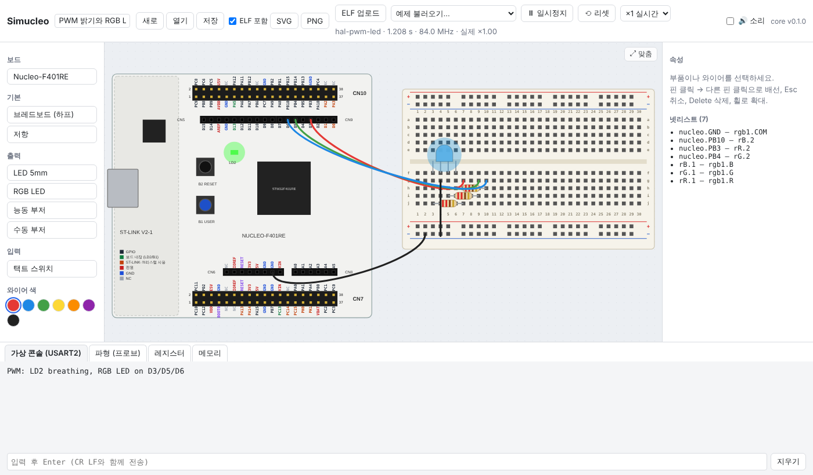

# Simucleo

교육용 **STM32 Nucleo-F401RE 시뮬레이터**. 브라우저에서 펌웨어(ELF)를 업로드하면 Cortex-M4F 코어가
기계어를 실행하고, 내부 Peripheral과 브레드보드 위 외부 부품(LED, 버저, 모터, 센서, OLED 등)을 함께
시뮬레이션해 준실시간으로 보여 준다.

**웹에서 바로 써 보기: https://elecage.github.io/Simucleo/** (`main`에 병합될 때마다 자동 배포)



> **M19: 부품 추가.** 74HC595 시프트 레지스터(SPI로 LED 8개 나이트라이더, Q7' 체인), TM1637 4자리
> 7세그먼트(비트뱅잉, ACK), KY-023 조이스틱(손잡이를 끌면 OLED의 점이 움직임), HC-SR501 PIR 센서(사람을
> 끌어 센서 앞을 지나가게 하면 LED가 켜짐), BMP280 기압계(Bosch 보정 코드로 온도·기압·고도), NeoPixel
> 부품끼리 DOUT → DIN 체인.
>
> **M18: 회로도에서 배선.** 회로도의 핀 끝에서 다른 핀 끝으로 끌면 와이어가 생겨 브레드보드에도 바로
> 나타나고(직각으로 꺾어서), 핀을 골라 **연결 끊기**로 지운다. **모든 MCU 핀**을 켜면 아직 쓰지 않는 핀과
> 전원 핀에도 배선할 수 있다. 펌웨어는 배선하는 동안에도 계속 실행된다.
>
> **M17: 부품 추가.** DS18B20 여러 개를 한 1-Wire 선에 이어 SEARCH ROM으로 찾고, HC-05 블루투스 모듈로
> 휴대폰 탭에서 펌웨어와 대화하며(보레이트가 다르면 글자가 깨짐), 5 V 릴레이 모듈의 접점으로 다른 전원의
> LED를 켜고, 서보 여러 개를 타이머 채널마다 따로 움직인다.
>
> **M16: 수업용 실습.** 툴바의 **📝 실습**에서 단계별 과제를 고르면 배선은 바로바로, 동작은 **채점**으로
> 자동 검사하고 틀린 이유를 한국어로 알려 준다. 학생은 결과를 CSV/JSON으로 내보내 제출한다
> ([선생님용 안내](docs/lessons.md)).
>
> **M12:** 브레드보드 배선에서 회로도를 자동으로 만들어, 어느 MCU 핀이 어느 부품에 이어지는지
> 신호 이름으로 보여 준다. 실행 중에는 넷의 High/Low/PWM과 LED 밝기가 회로도에 나타난다.
>
> **M11:** 디버거에서 변수 값을 바꾸고, 변수가 바뀌는 순간 멈추는 감시점을 걸고,
> FreeRTOS의 대기 중인 태스크마다 호출 스택과 지역 변수를 본다.
>
> **M10:** GDB로 접속해 디버깅할 수 있고(`simucleo gdb`), 웹 소스 탭에서 기계어를 보고,
> 감시식(C 식)과 조건부 중단점을 쓴다.
>
> **M9:** 소스 탭에서 C 코드에 중단점을 걸고 한 줄씩 실행하며 호출 스택과 변수 값을 본다
> (DWARF 디버그 정보 사용, 인터럽트 핸들러 안에서도).
>
> **M8:** 실습에 흔히 쓰는 부품을 더했다: 7세그먼트(멀티플렉싱), 4×4 키패드, 로터리 엔코더(타이머
> 엔코더 모드), 서미스터, 초음파 거리센서, DS18B20(1-Wire), I2C 문자 LCD, 스테퍼 모터.
>
> **M7:** DMA가 타이머 PWM에 듀티 값을 넣어 NeoPixel에 무지개를 그리고, 입력 캡처로 DHT22를 읽는다.
>
> **M6:** I2C·SPI로 OLED에 그림을 그리고, RTC 시계와 온습도 센서를 읽고, SD 카드에 FatFs로 기록한다.
> SD 카드 내용은 디스크 이미지로 내려받거나 넣을 수 있다.
>
> **M5:** 가변저항·조도센서·온도센서를 ADC로 읽고, 서보와 DC 모터를 움직인다.
>
> **M4:** CubeMX로 만든 FreeRTOS(CMSIS-RTOS v2) 펌웨어가 수정 없이 실행되고, RTOS 탭에서 태스크 상태·스택·CPU 사용률·실행 타임라인을 본다.
>
> **M3:** 브레드보드에 꽂은 LED, RGB LED, 택트 스위치, 부저가 실행 중인 펌웨어와 연결된다.
> 배선된 회로를 DC 해석해 PWM 밝기, 부저 음, 버튼 인터럽트(EXTI)를 보여 주고, 저항 없는 LED 같은
> 전기 규칙 위반을 알려 준다. 파형(로직 프로브) 뷰, 프로젝트 파일 저장·열기·자동 저장, 배선도 그림 내보내기,
> 배선이 포함된 예제가 있다. CPU 코어는 Unicorn과 명령어 단위로 검증했고, STM32CubeMX HAL 펌웨어가
> 84 MHz로 실시간 실행된다. 이후 계획(추가 부품 등)과 진행 상황은 [로드맵](docs/roadmap.md)을 참고.

## 특징 (목표)
- 수정하지 않은 **베어메탈 / CubeMX HAL / CubeMX FreeRTOS** 펌웨어 실행
- Arduino 헤더와 **Morpho 헤더**를 모두 갖춘 Nucleo 보드, 브레드보드 드래그 앤 드롭 배선, 실행 중 배선 변경
- PWM 밝기, 부저 소리, 모터 회전, OLED 화면 등 실제와 비슷한 표시
- 교육용 진단: 미구현 레지스터 접근, `Error_Handler`/HardFault 원인, 저항 없는 LED 같은 전기 규칙 위반
- 수업용 실습: 단계별 안내, 배선·동작 자동 채점, 진행 상황 저장, 결과 내보내기
- 가상 콘솔(UART), 소스 수준 디버깅(중단점·조건부 중단점·감시점·스텝·변수 보기와 바꾸기·감시식·기계어·RTOS 태스크별 스택), GDB 원격 서버, 파형 뷰, 레지스터/메모리 뷰, RTOS 태스크 뷰

## 문서
- [아키텍처](docs/architecture.md)
- [로드맵](docs/roadmap.md)
- [실습(레슨) 안내 — 선생님용](docs/lessons.md): 수업에서 쓰기, 새 실습 파일 쓰기(모든 검사 종류), 결과 제출받기
- [외부 부품 계획](docs/parts.md)
- ADR: [Rust+WASM](docs/adr/0001-rust-wasm-web.md) · [CPU 백엔드](docs/adr/0002-cpu-backends.md) · [펌웨어 범위](docs/adr/0003-firmware-scope.md) · [배선 편집기](docs/adr/0004-wiring-editor.md)

## 구조
```
crates/
  core/            Bus, CpuBackend trait, 사이클 스케줄러, Cortex-M 시스템(NVIC/SCB/SysTick)
  cpu-armv7m/      자체 Cortex-M4F 인터프리터 (Thumb-2, DSP, FPv4-SP)
  periph-stm32f4/  F401RE Peripheral: RCC/PWR/FLASH/GPIO/EXTI/SYSCFG/USART/TIM/ADC/I2C/SPI/DMA, SVD 레지스터 맵, 비트밴딩
  nucleo/          보드 단위 머신 (ELF 로드, 리셋, 실행)
  difftest/        Unicorn과 lock-step 비교 (테스트 전용)
  circuit/         넷리스트 추출, 회로 DC 해석(LED·스위치·부저), 전기 규칙 검사
  elf/             ELF 로더
  cli/             헤드리스 실행기 (simucleo)
  wasm/            웹용 WASM 바인딩
web/               React + SVG 배선 편집기
web/lessons/       실습 파일 (자동 채점 레슨)
firmware/          테스트 펌웨어 (arm-none-eabi-gcc)
docs/              설계 문서, ADR
```

## 빌드
필요한 도구: Rust(stable), Node.js 20+, `wasm-bindgen-cli`(Cargo.lock의 `wasm-bindgen`과 같은 버전), 예제 펌웨어용 `arm-none-eabi-gcc`.

```bash
rustup target add wasm32-unknown-unknown
cargo install wasm-bindgen-cli --version 0.2.130 --locked
```

```bash
cargo test --workspace
```

```bash
cd web && npm install && npm run wasm && npm run dev
```

내장 예제를 쓰려면 먼저 펌웨어를 빌드하고 `npm run examples`로 `web/public/examples`에 복사한다(아래 펌웨어 README 참고).

```bash
make -C firmware/hal-uart-printf && cargo run --release -p simucleo-cli -- run firmware/hal-uart-printf/build/hal-uart-printf.elf --input "hi" --input-at 300
```

```text
Hello from Simucleo! SystemCoreClock = 84000000 Hz
HCLK 84000000, PCLK1 42000000, PCLK2 84000000
tick 0 at 259 ms
HI
...
```

펌웨어가 멈추면 이유를 알려 준다(예: `STOP: Error_Handler() was called from SystemClock_Config(): a HAL call returned an error`).

GDB로 디버깅하려면 서버를 띄우고 다른 터미널에서 접속한다(VS Code Cortex-Debug는 `servertype: "external"`, `gdbTarget: "localhost:3333"`).

```bash
cargo run --release -p simucleo-cli -- gdb firmware/hal-7seg-keypad/build/hal-7seg-keypad.elf --port 3333
```

```bash
gdb-multiarch firmware/hal-7seg-keypad/build/hal-7seg-keypad.elf -ex "target extended-remote :3333" -ex "break main" -ex continue
```

펌웨어 테스트와 Unicorn 차분 테스트는 [firmware/README.md](firmware/README.md)를 참고.

## 라이선스
MIT. Unicorn/QEMU(GPLv2)는 기본 배포판에 포함하지 않는다([ADR 0002](docs/adr/0002-cpu-backends.md)).
