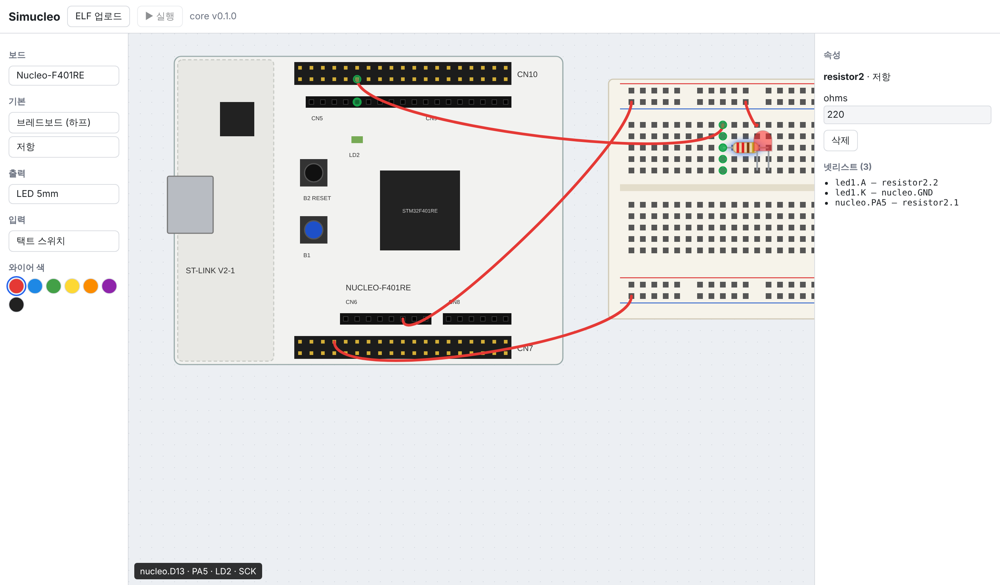

# Simucleo 아키텍처

교육용 **STM32 Nucleo-F401RE 시뮬레이터**. 브라우저에서 ELF를 업로드하면 Cortex-M4F 코어가
기계어를 실행하고, 내부 Peripheral과 브레드보드 위 외부 부품을 함께 시뮬레이션해 준실시간으로 보여 준다.



## 목표와 비목표

**목표**
- 수정하지 않은 펌웨어 실행: 베어메탈, **CubeMX HAL**, **CubeMX FreeRTOS(CMSIS-RTOS v2)**
- 실제와 유사한 브레드보드 배선 GUI. 실행 중 배선 변경(hot-plug) 허용
- 학생이 "왜 안 되는지" 볼 수 있는 진단: 미구현 레지스터 접근, `Error_Handler`/HardFault 진입 원인, 전기 규칙 위반
- 설치 없이 브라우저에서 동작 (Rust → WASM)

**비목표 (당분간)**
- 사이클 정확(cycle-accurate) 파이프라인 모델. 명령어당 사이클 근사로 충분하다
- SPICE 수준의 과도 해석
- 다중 보드/다른 MCU 계열 (구조는 열어 두되 구현은 F401RE에 집중)
- 회로도 뷰 (M12): 브레드보드 배선의 넷리스트에서 자동 생성. M18부터 회로도에서 배선·연결 끊기도 됨(결과는 프로젝트의 와이어)

## 구성도

```
 브라우저 UI 스레드 (TypeScript + React)          Web Worker (WASM)
┌──────────────────────────────────┐   postMessage   ┌──────────────────────────────┐
│ 배선 편집기 (SVG)                  │ ─ Circuit JSON ─▶│ simucleo-wasm                 │
│ 부품 라이브러리 / 속성 패널          │ ─ 입력 이벤트 ──▶│  ├ Machine (스케줄러, 시간 동기) │
│ 가상 콘솔 · 파형 · 레지스터 · RTOS   │◀─ VisualState ──│  ├ CPU backend (Rust 코어)     │
│ AudioWorklet (부저)               │◀─ 오디오 엣지 ───│  ├ STM32F401 Peripherals       │
└──────────────────────────────────┘    (~60 Hz)     │  └ Circuit (넷리스트, 부품 모델) │
                                                     └──────────────────────────────┘
```

시뮬레이터는 Web Worker(`web/src/sim/worker.ts`)에서 돌고, UI 스레드에는 약 60 Hz로 프레임 스냅샷(`Simulator.frame()`)을 보낸다. 배선 편집기의 넷리스트 계산은 UI 스레드의 별도 WASM 인스턴스가 맡는다.

## Rust 크레이트

| 크레이트 | 역할 |
|---|---|
| `simucleo-core` | `Bus`, `Memory`, `CpuBackend` trait, `Registers`, 사이클 기반 `Scheduler`, **`cortexm`**(NVIC/SCB/SysTick/예외 모델, 모든 백엔드 공용) |
| `simucleo-cpu-armv7m` | 자체 Thumb/Thumb-2 + DSP + FPv4-SP 인터프리터 (기본 백엔드, WASM 지원) |
| `simucleo-periph-stm32f4` | F401RE 버스 라우팅, 비트밴딩, RCC(클럭 트리)/PWR/FLASH/SYSCFG/GPIO/EXTI/USART/TIM 모델, SVD에서 생성한 레지스터 맵과 범용 레지스터 파일, 이벤트 스케줄러, 외부 회로 연결(`ExternalCircuit`) |
| `simucleo-nucleo` | 보드 단위 머신: CPU + 버스 + 시스템, ELF 로드, 리셋(원인별), 이벤트 기반 시간 진행과 ns 타임라인, B1 버튼, 가상 콘솔, 정지 원인 진단 |
| `simucleo-difftest` | Unicorn과 lock-step 비교 (테스트 전용, `unicorn` feature, GPLv2 의존성 격리) |
| `simucleo-circuit` | 배선 → 넷리스트(Union-Find), 회로 DC 해석(`CircuitSim`), 부품 표시값 적분, 전기 규칙 검사 |
| `simucleo-elf` | ELF 로더: LMA 기준 세그먼트, 심볼 테이블 |
| `simucleo-cli` | 헤드리스 실행기 (`simucleo info|run fw.elf`). 회귀 테스트에 사용 |
| `simucleo-wasm` | `wasm-bindgen` 바인딩 |

## 핵심 설계 결정

### 1. 시간은 CPU 사이클로만 표현한다
- 모든 Peripheral은 매 사이클 틱하지 않고, 관찰 가능한 일이 생기는 사이클에 이벤트를 예약한다
  (`Scheduler::schedule_in`).
- Machine 루프: `cpu.run(next_deadline - now)` → 기한이 된 이벤트 처리 → 반복.
- WFI/WFE이면 다음 이벤트 시각으로 시간을 건너뛴다. FreeRTOS Idle 태스크에서 성능이 크게 좋아진다.
- **실시간 동기**: 프레임마다 실제 경과 시간만큼 시뮬레이션 시간을 진행하고, 따라가지 못하면
  배속을 낮추며 `0.73x`처럼 표시한다. 0.01x 같은 느린 재생도 지원한다.

**바쁜 대기 루프 건너뛰기 (M2)**: CPU는 뒤로 가는 분기에서 루프 머리의 상태를 이전 방문과 비교한다. 레지스터·플래그·마스크가 같고, 그 사이 저장·FP 명령·외부 변화(epoch: SysTick 0 도달, 새 대기 예외)가 없었다면 이후 반복도 모두 같다. 그래서 다음 변화 시점(머신의 이벤트 기한, SysTick 0 도달, 실행 예산 끝)까지 반복 단위로 시간을 건너뛴다. 관찰 가능한 동작은 그대로이고, `HAL_Delay`나 플래그 폴링이 거의 비용 없이 지나간다.

### 2. 예외/NVIC 모델은 CPU 백엔드 밖의 공용 모듈
- 스택 프레임(기본/FP 확장), EXC_RETURN, tail-chaining, BASEPRI/PRIMASK 마스킹, SVC/PendSV/SysTick.
- Rust 코어와 Unicorn 백엔드가 같은 구현을 사용하므로 인터럽트 동작이 동일하다.
- FreeRTOS `ARM_CM4F` 포트 요구사항: IPR 우선순위 비트 4개(`0xFF` 쓰기 → `0xF0` 읽힘),
  PSP 전환, FP 문맥(lazy stacking은 즉시 저장으로 단순화).

### 3. Peripheral은 "HAL이 기대하는 만큼" 정확하게

**버스, 이벤트, 인터럽트 (M1 구현)**
- Peripheral은 시간이 걸리는 일(예: UART 한 프레임)을 버스의 스케줄러에 사이클 단위로 예약한다.
- 머신은 CPU를 다음 이벤트 시각까지만 실행하고, 이벤트를 처리한 뒤 다시 실행한다.
- CPU는 Peripheral 공간에 접근한 명령어 직후 `Bus::poll`을 호출한다. 이 호출에서 IRQ 라인을 NVIC에 바로 반영하고, 더 이른 이벤트가 새로 생겼거나 클럭이 바뀌었으면 제어를 머신에 돌려준다(`Yield`).
- 클럭은 `Yield` 지점에서만 바뀌므로, 사이클을 실제 시간(ns)으로 바꾸는 타임라인이 정확하다.
- 레지스터 정의는 ST SVD에서 생성한다(`tools/svdgen.py`). 동작 모델이 없는 Peripheral은 SVD 리셋 값으로 시작하는 레지스터 파일이 받고, 접근 기록이 진단에 쓰인다.

- 레지스터 맵과 리셋 값은 ST SVD에서 생성한다(M1).
- `SystemClock_Config` 대응: 레디 플래그, `CFGR.SWS`, FLASH 레이턴시 읽기 확인, PWR VOS.
- 미구현 레지스터 접근은 0을 읽고 기록하며, GUI에 "어떤 Peripheral을 기다리는지" 보여 준다.
- `Error_Handler`, `HardFault_Handler` 진입은 ELF 심볼로 감지해 콜스택과 함께 보고한다.

### 4. 외부 회로: 넷 단위 DC 해석 (M3)
- 편집기가 보내는 `Circuit`(부품 + 속성 + 와이어)을 `build_netlist`가 넷으로 묶는다. 이때 브레드보드 행,
  전원 레일, 스위치 내부 연결 같은 **부품 내부 버스**와 **같은 그리드 점에 놓인 핀**도 연결로 친다.
  보드 핀은 신호 이름으로 바꿔(D13, CN10-11 → PA5) 같은 신호끼리 한 넷이 된다.
- `CircuitSim`은 넷마다 노드 하나를 두고 저항, LED(Vf + 15 Ω, 켜짐/꺼짐을 일관될 때까지 반복), 부저 부하,
  전원(3V3/5V), 핀 드라이버(출력 = 3.3 V/0 V와 40 Ω, 풀업/풀다운 = 40 kΩ)를 노드 해석으로 푼다.
  눌린 스위치는 넷을 합친다. 보드의 LD2와 B1도 같은 방식으로 들어 있다.
- 결과는 **핀 구동 조합**에만 의존하므로 캐시한다. 버스는 GPIO 쓰기·AF 출력 변화마다 구동 조합을 넘기고,
  돌아온 입력 레벨을 바로 GPIO에 반영한다(`ExternalCircuit`). 그래서 출력 → 회로 → 입력 → EXTI가 같은 시각에 일어난다.
- 표시값(LED 밝기, 부저 켜짐·주파수)은 사이클 단위로 적분해 프레임마다 내보낸다. 위반(과전류, 단락)은 경고가 된다.
- ADC(M5)는 변환이 끝나는 시점의 해석 결과에서 핀 전압을 읽는다(`ExternalCircuit::voltage`). 가변저항·LDR·온도센서 값은 부품 속성이라, 편집기에서 바꾸면 회로가 다시 만들어진다.
- 서보는 신호선의 상승·하강 시각으로 펄스 폭을 재고, 모터는 두 입력의 듀티를 적분해 속도를 정한다. 기계적 상태(각도, 속도)는 프레임마다 시간에 따라 갱신한다.
- I2C/SPI 장치(M6)는 MCU Peripheral과 **트랜잭션 단위**로 연결한다. I2C 컨트롤러는 START+주소, 바이트 쓰기/읽기, STOP을,
  SPI 컨트롤러는 바이트 교환을 `ExternalCircuit::i2c`/`spi`로 넘긴다. 회로는 컨트롤러가 쓰는 AF 핀이 속한 넷에 연결된 장치 중
  전원이 들어온 것(I2C는 주소가 맞는 것, SPI는 CS 넷이 Low인 것)에 전달한다. 풀업이 없어 Low인 I2C 선은 경고가 된다.
- 장치 상태(OLED RAM, RTC, SD 카드 내용)는 부품 id로 보관해 배선을 바꾸거나 펌웨어를 다시 올려도 유지된다(전원이 끊기면 OLED는 초기화).
  RTC 같은 시간 의존 장치는 보드가 넘겨 주는 시간 기준(사이클 → 초)으로 진행한다.
- 비트뱅잉(GPIO로 직접 만든 버스)은 이후 핀 레벨 디코더 어댑터로 같은 장치 모델에 연결한다.
- 단선 장치(M7)는 핀 레벨과 시각으로 동작한다. NeoPixel은 회로 갱신마다 받는 DIN 엣지 시각으로 펄스 폭을 재고,
  DHT처럼 스스로 선을 당기는 장치는 그 출력을 구동 조합의 일부(캐시 키)로 넣는다. 회로는 다음 변화 시각을
  `ExternalCircuit::next_event`로 알려 주고, 버스는 그 시각에 이벤트를 예약해 회로를 다시 계산한다. 그래서 센서의
  응답이 EXTI·입력 캡처·GPIO 폴링에 실제 시각으로 보인다.
- DMA(M7)는 데이터를 CPU와 같은 레지스터 경로로 옮긴다. Peripheral 접근과 이벤트가 끝날 때마다 버스가 요청선
  (USART TXE+DMAT, SPI RXNE+RXDMAEN, ADC EOC+DMA, 타이머 업데이트·비교 이벤트)을 보고 활성 스트림을 처리한다.
  전송 시간은 0으로 둔다.
- 넷리스트는 결정적(정렬된) 출력이라 hot-plug 시 이전 넷리스트와 비교해 바뀐 부분만 반영할 수 있다.

### 5. 표시는 적분값으로
MCU 신호는 MHz 단위로 바뀌는데 화면은 60 Hz다. 부품 모델은 프레임 동안 신호를 적분해
`VisualState`(밝기, 각도, 주파수, 프레임버퍼)를 만든다. 예를 들어 PWM LED의 밝기는 켜진 시간의
비율이고, 7세그먼트 멀티플렉싱은 잔상으로 보인다. 수동 부저는 엣지 타임스탬프를
AudioWorklet으로 보내 실제 소리를 만든다.

### 6. RTOS 인식 (M4)
- `simucleo-nucleo::rtos`는 디버거의 RTOS 플러그인처럼, 펌웨어를 고치지 않고 ELF 심볼(`pxCurrentTCB`, `pxReadyTasksLists`, 지연·일시중단·삭제 대기 리스트, `xIdleTaskHandles` 등)로 FreeRTOS 커널 자료구조를 읽는다.
- TCB 배치(이름 길이, `pxEndOfStack` 유무)는 idle 태스크의 TCB에서 알아낸다. 스택 high-water는 채움 패턴(0xA5)으로 계산한다.
- 문맥 교환은 버스의 SRAM 쓰기 감시로 `pxCurrentTCB`가 바뀔 때마다 사이클과 함께 기록한다. 웹은 이를 실행 타임라인과 CPU 사용률로 보여 준다.

### 7. 소스 수준 디버깅 (M9)
- `simucleo_elf::debug`가 gimli로 DWARF를 읽는다: 줄 표, 함수 범위, 파일 범위 변수, `.debug_frame`.
  보드는 ELF 바이트를 들고 있다가 디버깅 기능을 처음 쓸 때 파싱한다.
- 호출 스택은 CFI 규칙으로 한 프레임씩 되감는다. 반환 주소가 EXC_RETURN이면 그 값의 비트로 MSP/PSP와
  FP 확장 프레임 여부를 정해 쌓인 레지스터(r0–r3, r12, lr, pc, xPSR)에서 끼어든 코드의 문맥을 복원한다.
- 변수 위치는 gimli의 DWARF 식 평가기에 레지스터, 프레임 베이스(CFA), 메모리를 공급해 구한다. 값은 메모리
  읽기 콜백으로 읽어 C 타입대로 문자열로 만든다(UI는 트리로 보여 줄 뿐).
- 중단점은 CPU 백엔드의 주소 중단점이다. 줄 단위 스텝은 명령을 하나씩 실행하다가, 함수 진입(심볼 주소)이나
  인터럽트 진입을 만나면 되감기로 얻은 반환 주소에 임시 중단점을 걸고 전속력으로 실행한다. 그래서
  `HAL_Delay`나 `printf`를 넘어가도 빠르다. 새 줄의 문(statement) 시작 주소에 도착하면 멈춘다.

### 8. 디버그 확장 (M10)
- **GDB 서버**(`crates/cli/src/gdb.rs`): 단일 연결 TCP 서버. 보드는 `Send`가 아니어서 서버 스레드 안에서 만든다.
  계속 실행(`c`)은 1 ms 시뮬레이션 시간씩 돌며 사이마다 소켓에서 Ctrl-C(0x03)를 확인한다. 중단점은 CPU
  백엔드 주소 중단점을 그대로 쓰고, 메모리 쓰기는 버스의 디버그 접근(플래시면 이미지 다시 쓰기)으로 한다.
- **디스어셈블리**(`simucleo_elf::disasm`): yaxpeax-arm으로 Thumb 명령을 디코드한다. Thumb는 길이가 섞여
  있어서 임의의 주소부터 거꾸로 읽을 수 없으므로 pc가 속한 함수의 시작(심볼)부터 앞으로 디코드한다.
- **식 평가기**(`simucleo_elf::expr`): 손으로 쓴 어휘 분석기와 우선순위 등반 파서가 바로 값을 계산한다(AST 없음).
  변수는 프레임의 DWARF 범위(어휘 블록 포함) → 전역 → enum 상수 순으로 찾는다. 값은 아직 읽지 않은 ‘객체’
  (단위, 타입 DIE, 메모리 주소나 레지스터 바이트)로 다니다가 연산이 필요할 때 스칼라로 읽는다. 그래서
  `htim10.Instance->ARR`이나 `KEYS[2]` 같은 식이 필요한 바이트만 읽고, 결과가 배열·구조체면 변수 트리와 같은
  렌더러로 보여 준다. `&&`·`||`는 왼쪽이 결과를 정하면 오른쪽 오류를 무시한다(`p && p->x`).
- **조건부 중단점**: 조건은 주소별로 보드에 저장한다. CPU가 중단점에서 멈추면 0번 프레임에서 조건을 평가하고,
  거짓이면 같은 시간 예산 안에서 바로 이어 실행한다(CPU는 방금 멈춘 중단점을 한 번 건너뛴다). 매번 멈춰서
  평가하므로 자주 지나는 줄의 조건부 중단점은 실행을 느리게 한다.

### 9. 디버거 마무리 (M11)
- **값 바꾸기**: 식 평가기가 대상 식을 평가하되 값을 읽지 않고 ‘어디에 있는지’(메모리 주소나 레지스터 번호, 비트 필드면
  비트 위치)와 타입을 얻은 뒤 `Write`(메모리 바이트 / 레지스터 값)를 만든다. 보드가 그것을 적용한다. 메모리는 정렬된
  워드·하프워드면 한 번에 써서 주변장치 레지스터도 CPU 저장과 같은 효과가 난다(플래시는 이미지에 직접).
  변수 위치를 구할 때 레지스터 하나에 통째로 있는 값은 레지스터 번호를 함께 기억한다(`Src::Reg`).
- **감시점**: CPU 백엔드의 데이터 읽기·쓰기 경로에서 주소 범위를 확인해 첫 일치를 기록하고, 그 명령(또는 예외 진입의
  스택 쌓기)이 끝난 뒤 실행 루프 맨 앞에서 `StopReason::Watchpoint`로 멈춘다. 감시점이 없으면 빈 목록 검사 하나뿐이다.
  디버거의 메모리 보기(`peek`)는 CPU를 거치지 않으므로 걸리지 않는다.
- **태스크별 호출 스택**: `pxCurrentTCB`가 아닌 태스크는 TCB 첫 워드(`pxTopOfStack`)에서 ARM_CM4F 포트가 PendSV에서
  저장한 순서대로 레지스터를 복원하고(EXC_RETURN의 비트 4로 FPU 문맥 여부, xPSR 비트 9로 정렬 패딩), 그 레지스터로
  보통의 CFI 되감기를 한다. 태스크 함수의 반환 주소는 포트가 넣은 `prvTaskExitError`이므로 거기서 자른다.
  보고 있는 태스크(`select_task`)는 지역 변수·식·값 바꾸기·감시점 주소의 기준이 된다.

### 10. 회로도 뷰 (M12)
- `web/src/schematic/layout.ts`는 순수 함수다: 프로젝트와 코어가 돌려준 넷리스트를 받아 기호 위치, 핀 끝점,
  넷 이름을 계산한다. 넷리스트는 시뮬레이터가 쓰는 것과 같아서(브레드보드 줄, 같은 점에 꽂힌 다리, 부품 내부 버스
  포함) 회로도와 시뮬레이션이 어긋나지 않는다.
- 배선 대신 **넷 이름표**로 연결을 나타낸다(EDA의 전역 라벨처럼). 자동 배선 없이도 읽기 쉽고, 부품이 많아져도
  선이 엉키지 않는다. 같은 넷은 마우스를 올리면 강조된다.
- 배치: 보드 상자를 왼쪽에, 다른 부품은 오른쪽 열에 위에서부터 쌓는다. 순서는 각 부품이 닿는 MCU 핀 중 가장
  앞 신호 순서라서 MCU 핀 목록과 대략 같은 높이에 놓인다.
- 회로도에서 배선(M18): 프로젝트가 유일한 원본이다. 핀 끝에서 핀 끝으로 끌면 두 부품 핀 사이의 진짜 `WireModel`을
  만들고(버스로 묶인 핀·보드 신호는 `choosePin`이 빈 Arduino 헤더 핀부터 고르고, `routePoints`가 직각으로 꺾는 점을
  넣음), 연결 끊기는 그 핀에 붙은 와이어를 지운다. 회로도는 바뀐 프로젝트에서 다시 만들어지므로 두 보기가 어긋날
  일이 없다. 순수 도우미는 `web/src/schematic/wiring.ts`(부품·React를 import하지 않아 `npm test`가 바로 읽음).
  배치는 이전 그림의 부품 순서를 넘겨 받아(`stableOrder`) 와이어 하나로 기호들이 뒤섞이지 않게 한다.
- 실시간 표시는 워커의 프레임(핀 레벨·듀티, 부품 시각 상태)을 그대로 쓴다. 브레드보드 편집기는 숨겨진 채로
  마운트되어 있어 확대·위치·선택이 유지된다.

### 11. 프런트엔드
- React는 패널 UI에만 쓴다. 캔버스는 SVG이고, 실행 중 애니메이션은 React 재렌더링 대신
  DOM 속성을 직접 갱신한다(M3).
- 0.1인치 그리드 스냅. 핀은 와이어보다 위 레이어에 있어 이미 연결된 핀도 다시 선택할 수 있다.
- 프로젝트 저장(M3): `.simucleo.json`(형식·버전, 부품, 와이어, 속성, 펌웨어는 예제 이름 또는 base64 ELF, M25부터 파형 설정 `scope`).
  열 때 버전 마이그레이션과 검증(없는 부품·핀 제거)을 거친다. 자동 저장은 IndexedDB. 배선도는 SVG/PNG로 내보낸다.
- 파형 뷰: 버스가 프로브한 핀의 레벨 변화(입력 포함)를 CPU 사이클 시각으로 남기고(`level_events`), `Simulator::feed_scope`가 `runForMs` 조각마다 이를 ns로 바꿔 두 곳에 나눈다. (1) 프레임별 목록(핀당 4000개까지, 넘으면 `dense`) — UI의 실시간 보기와 채점이 쓴다. (2) 트리거·캡처 엔진(`crates/wasm/src/scope.rs`) — 핀마다 링 버퍼(65,536 에지)를 두고 소스 핀의 에지에서만 트리거(에지·펄스 폭)를 검사해, 트리거 앞뒤 창의 모든 에지를 빠짐없이 모은 캡처를 완성되는 프레임에 `scope.capture`로 한 번 보낸다(시각은 트리거 기준 ns). 설정은 `setTrigger`(JSON), 단일 모드의 재대기는 `armTrigger`. "트리거 시 일시정지"면 `runForMs`가 짧은 조각으로 돌다 캡처가 끝나면 멈추고 `triggerPaused`로 알려, 워커가 `paused`(`trigger`)를 보낸다. UI(`web/src/run/Waveform.tsx`, 계산은 `scope.ts`)는 캡처를 시간축(1 µs–200 ms/div, 휠 확대·끌어 이동)에 그리고 펄스 폭·주기·듀티와 커서 Δt를 잰다.
- 파형 뷰 M22 확장: (1) **합성 에지** — USART·I2C·SPI는 바이트 단위 모델이라 핀이 토글하지 않으므로, 프로브 마스크에 걸린 핀으로 라우팅된 주변장치가 옮긴 바이트를 버스가 `wire_events`(`crates/periph-stm32f4/src/wire.rs`의 `WireEvent`: UART는 프레임 시작, SPI는 프레임 끝, I2C는 ACK 끝과 STOP)로 남기고(USART는 `sync_wire_logging`이 켠 `Usart::wire_log`, I2C·SPI는 `CircuitI2c`·`CircuitSpi`가 그 자리에서), `WireEvent::edges`가 비트 타이밍대로 에지를 만든다. `Simulator::feed_scope`는 대체 기능으로 라우팅된 핀(`wire_signal`)이면 GPIO 레벨 변화를 버리고 합성 에지를 쓴다. (2) **아날로그 채널** — `setAnalogProbes(["PA1","pot.W"])`가 `CircuitSim::set_voltage_probes`를 부르고, 회로가 동작점(해)이 바뀔 때마다 그 넷 전압을 `voltage_log`에 남긴다(넷이 없는 MCU 핀은 논리 레벨). (3) 이 셋(GPIO 에지, 합성 에지, 전압 샘플)을 `pending`에 모아 시각 순으로 정렬한 뒤 `holdback_ns`(끝난 뒤에 알려지는 I2C·SPI 바이트의 최대 지연, 없으면 0)만큼 늦게 프레임 목록(`probes`, `analog`)과 트리거 엔진에 넣는다. 엔진은 아날로그 채널마다 링 버퍼(샘플 65,536개)를 두고 레벨 트리거(레벨·히스테리시스)를 검사하며, 캡처에 `analog` 채널을 함께 담는다. UI의 디코더(`web/src/run/decode.ts`)와 CSV·VCD 내보내기(`export.ts`)는 순수 함수로 캡처(또는 실시간 창)의 에지 위에서 돈다.
- 파형 뷰 M25 확장: 1-Wire·TM1637·WS2812 디코더(`decode.ts`)와 **해독 내용 트리거**. 해독 트리거는 엔진 밖, UI에서 돈다 — 소스가 디코더면 `setTrigger(null)`로 엔진을 끄고, `Waveform`이 프레임마다 실시간 기록(프레임별 `probes`, 4 s)을 마지막 동기점부터 해독해(`scanStep`) 일치하면 창이 찬 뒤 그 기록에서 캡처(`ScopeCapture`, 소스 `dec:<id>`)를 잘라 낸다(`contentStep`). 일시정지는 워커의 `pause` 메시지(`reason: "trigger"`). 파형 설정(`ScopeSettings`, `scopeSettings.ts`)은 `Project.scope`로 프로젝트 파일(`editor/projectFormat.ts`의 `serialize`·`parseWith`, 열 때 `sanitizeScope`)과 자동 저장에 들어간다. `App`이 프로젝트를 열 때마다 `scopeSeq`를 올리면 `Waveform`이 그 설정을 받아들이고(없으면 지금 설정 유지), 바뀐 설정은 `onSettings`로 프로젝트에 돌려준다.
- 파형 뷰 M26: **해독 트리거가 엔진 안으로.** `setTrigger` JSON의 `content: { decoder, match }`(UI의 `DecoderCfg`·`ContentMatch`)가 있으면 엔진(`scope.rs`의 `ContentRun`)이 디코더 핀을 채널 번호로 바꾸고(필요한 핀이 프로브되지 않았으면 `nosource`), 링에 남은 기록을 시각 순으로 다시 흘려 스트리밍 디코더(`crates/wasm/src/decode.rs`의 `Decoder`: UART·I2C/TM1637(`TwoWire`)·SPI·1-Wire·WS2812·NEC)를 지금까지 맞춰 둔다. 그 뒤 데이터 경로는 이렇다: 버스의 `level_events`·`wire_events`·전압 → `Simulator::feed_scope`(ns, `pending`을 시각 순으로, `holdback_ns`만큼 늦게) → `Scope::push(ch, t, level)`이 링에 넣고 캡처를 모은 다음 그 채널이 디코더 핀이면 `Decoder::edge(role, t, level)`, `Scope::advance(now)`는 `Decoder::advance(now)`(에지 없이 끝나는 UART 프레임, 같은 시각에 모인 에지를 TS 순서대로 처리) → 끝난 항목(`Item`: 종류·시작·끝·값·MISO·주소·R/W·번호·오류 종류) → `Matcher::item`이 조건과 비교해 일치한 항목의 시작 → 대기 중이고 그 시작이 대기 시각(또는 지난 창 끝)보다 뒤면 `start(t0)` — 창의 앞부분은 링에서, 나머지는 이어서 모으고, 창이 끝나면 캡처(소스 `dec:<id>`)와 일시정지(`pause_hit`)는 에지 트리거와 같은 길로 간다. 해독 트리거가 없으면 `content`가 `None`이라 에지마다 검사 하나뿐이다. UI는 `exactContent`로 엔진이 아는 조건이면 이 길을("정확(시뮬레이터)"), 아니면 M25의 화면 해독을("화면 해독") 쓴다. 두 디코더 구현이 같은지는 `web/test/parity.ts`가 만든 `crates/wasm/tests/fixtures/decode-parity.json`(TS가 해독한 항목과 일치)을 `npm test`와 `crates/wasm/tests/decode_parity.rs`가 양쪽에서 확인한다.

## 검증 전략
- **명령어 단위 테스트**: 디코더/실행기 단위 테스트
- **차분 테스트**(`crates/difftest`): `firmware/difftest`의 C/어셈블리 프로그램(-O0/-O1/-O2/-Os/-O3)을 Rust 코어와 Unicorn에서 동시에 실행하고, Unicorn이 명령어를 실행할 때마다 R0–R15·APSR·S0–S31·FPSCR를 비교한 뒤 마지막에 SRAM을 비교한다. Unicorn은 IT 조건이 거짓인 명령어에서 훅을 부르지 않으므로 IT 블록 안에서만 따라잡기를 허용한다
- **예외 모델 자가 테스트**(`firmware/exceptions`): Unicorn에는 NVIC가 없으므로, 예외·인터럽트·FreeRTOS 방식 문맥 교환은 펌웨어가 스스로 검사하고 결과를 SRAM에 남긴다
- **QEMU lockstep**: `qemu-system-arm -M netduinoplus2`(STM32F405, 같은 Cortex-M4F)와 GDB 스텁으로 한 명령어씩 비교
- **펌웨어 회귀 테스트**: `firmware/` 예제를 CI에서 빌드한 뒤 `simucleo-cli`로 실행하고 UART 출력과 핀 변화 기록 비교
- **E2E**: Playwright로 배선 → 넷리스트 → 동작 확인

## 라이선스
저장소는 MIT다. Unicorn과 QEMU는 GPLv2이므로 Unicorn 백엔드는 feature flag로 분리해 기본(웹) 배포에
포함하지 않고, QEMU는 별도 프로세스로만 사용한다. STM32CubeF4 HAL(BSD-3)과 FreeRTOS(MIT)는
예제 펌웨어에 포함할 수 있다.
