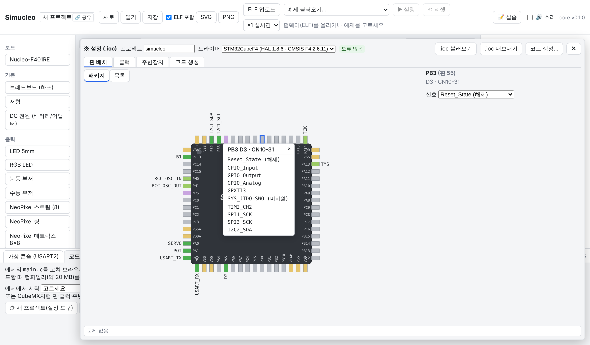
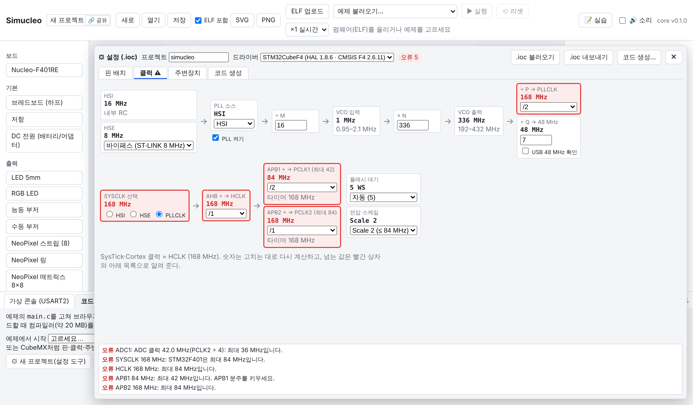
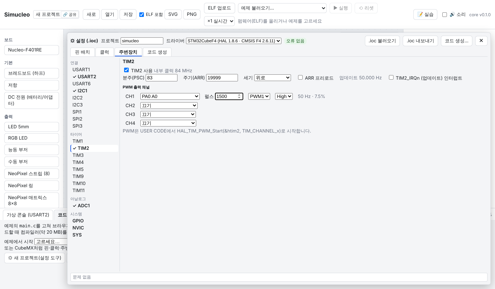
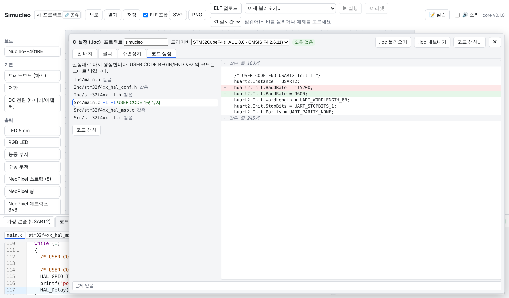
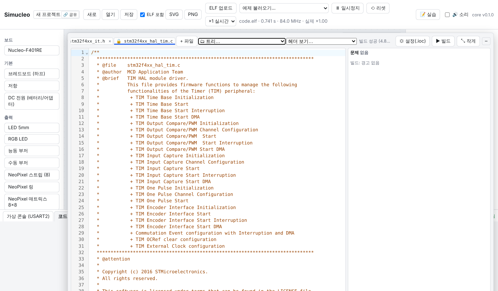

# CubeMX식 설정 도구로 프로젝트 만들기

STM32CubeMX처럼 핀·클럭·주변장치를 고르면 `MX_*_Init` 코드가 든 STM32CubeIDE식 프로젝트를 만들어 준다(M36). 만든 프로젝트는
**코드** 탭에서 고치고 브라우저 안에서 빌드해 바로 시뮬레이터에서 돌린다([브라우저 안에서 C 코드 고치고 빌드하기](editor.md)).
설정을 바꿔 다시 생성해도 `USER CODE BEGIN`/`END` 사이에 쓴 코드는 남고, zip으로 내보내 CubeIDE에서 이어 할 수 있다. 모두 브라우저
안에서 하고, 서버는 없다.

## 시작하기

1. **코드** 탭을 연다. 코드가 없으면 **⚙ 새 프로젝트(설정 도구)**(Nucleo 기본값: LD2 = PA5 출력, B1 = PC13 EXTI, USART2 =
   PA2/PA3, SWD, HSE 바이패스)나 **빈 MCU로**(SWD만)를 누른다. 코드가 있으면 툴바의 **⚙ 설정(.ioc)**.
2. 설정 창이 회로 위에 뜬다(툴바와 회로는 그대로). 위쪽에 프로젝트 이름, 드라이버 버전, 오류 수가 있고, 탭은 **핀 배치**,
   **클럭**, **주변장치**, **코드 생성**이다.
3. 핀과 주변장치를 정하고 **코드 생성** 탭에서 바뀔 파일을 본 뒤 **프로젝트 만들기**(처음) 또는 **코드 생성**(다시)을 누른다.
4. 창을 닫으면 코드 탭에 `Core/Src/main.c` 등이 열려 있다. `USER CODE` 영역에 코드를 쓰고 **▶ 빌드**.

예: PA5를 `GPIO_Output` 라벨 `LD2`로, USART2를 켜고 생성한 뒤 `/* USER CODE BEGIN 3 */` 아래에
`HAL_GPIO_TogglePin(LD2_GPIO_Port, LD2_Pin); printf("tick\r\n"); HAL_Delay(200);`를 쓰고 빌드하면 LD2가 200 ms마다 바뀌고
가상 콘솔에 `tick`이 나온다. `printf`는 새 프로젝트의 `USER CODE 0`에 든 `__io_putchar`가 USART2로 보낸다.

## 핀 배치

- **패키지**: STM32F401RETx LQFP64 그림. 핀을 누르면 그 핀이 낼 수 있는 신호(GPIO 입력·출력·아날로그, `GPXTIn`, 대체 기능)가
  뜬다. 핀 이름 옆에 Nucleo 헤더 이름(`D13 · CN10-11`)이 보인다. 초록은 쓰는 핀, 빨강은 오류가 있는 핀이다.
- **목록**: 핀·보드 헤더·신호·라벨 표.
- 고른 핀의 설정: 라벨(`LD2` → `main.h`의 `LD2_Pin`·`LD2_GPIO_Port`), 풀업·풀다운, 속도, 푸시풀·오픈 드레인, 처음 출력 값,
  EXTI 에지(상승·하강·양쪽).
- 신호를 고르면 그 주변장치가 기본값으로 켜지고, 마지막 핀을 풀면 꺼진다. **(미지원)**이 붙은 신호는 설정만 저장하고 코드는
  만들지 않는다.

## 클럭

HSI 16 MHz·HSE 8 MHz(끄기, 바이패스 = ST-LINK의 8 MHz, 크리스털) → PLL 소스 → ÷M → VCO 입력 → ×N → VCO 출력 → ÷P(PLLCLK)·÷Q(48 MHz)
→ SYSCLK 선택 → AHB → APB1·APB2(타이머 클럭은 분주가 1이 아니면 ×2), 플래시 대기, 전압 스케일. 기본은 CubeMX의 Nucleo 값
HSI/16 × 336 / 4 = 84 MHz, APB1 42 MHz, 대기 2다.

숫자를 고치면 바로 다시 계산하고, 넘는 값은 빨간 상자와 아래 목록으로 알려 준다: SYSCLK·HCLK 84 MHz, APB1 42 MHz, APB2 84 MHz,
VCO 입력 0.95–2.1 MHz·출력 192–432 MHz, PLLM·N·P·Q 범위, 전압 스케일 3에서 HCLK 60 MHz, 모자란 플래시 대기, (확인을 켰을 때)
USB 48 MHz. 오류가 있으면 코드를 생성하지 않는다.

Nucleo-F401RE에는 HSE 크리스털(X3)이 없다. 크리스털로 두면 경고가 나오고, 만든 코드는 실제 보드처럼 HSE가 준비되지 않아
`Error_Handler()`로 간다. ST-LINK의 8 MHz를 쓰려면 **바이패스**.

## 주변장치

| 무엇 | 고를 수 있는 것 |
|---|---|
| USART1·2·6 (비동기) | 보레이트(실제 값의 오차가 2 %를 넘으면 경고), 워드 길이, 패리티, 정지 비트, 송수신·송신만·수신만 |
| I2C1–3 | 표준 100 kHz·빠른 400 kHz, 빠른 모드 듀티, 자기 주소 |
| SPI1–3 | 전이중 마스터·송신 전용 마스터·전이중 슬레이브, 8·16비트, 분주(SCK 최대 42 MHz), CPOL·CPHA, MSB·LSB 먼저 |
| TIM1–5, TIM9–11 | 분주(PSC), 주기(ARR), 세기 방향(위·아래·가운데 정렬 1–3), ARR 프리로드, TIM1 반복 카운터, 채널마다 **PWM 출력**(핀, 펄스, PWM1·2, 극성) — 계산한 주파수·듀티가 옆에 보인다 |
| ADC1 | 분해능, 스캔, 연속, 랭크 순서의 채널과 샘플링 시간(ADC 클럭 36 MHz까지) |
| GPIO, NVIC, SYS | 핀 설정 모음, 인터럽트 켜기와 선점 우선순위(그룹 4), SysTick 우선순위, 디버그(SWD·없음) |

주변장치를 켜면 흔히 쓰는 핀(USART2 → PA2/PA3)에, 없으면 빈 핀에 신호를 둔다. PWM은 생성 코드가 시작하지 않는다 —
`USER CODE BEGIN 2`에서 `HAL_TIM_PWM_Start(&htim2, TIM_CHANNEL_1);`처럼 시작한다(CubeMX와 같음).

## 문제 목록과 배선 대조

창 아래 목록이 오류·경고를 한국어로 보여 준다. 예: 한 신호를 두 핀에, 그 핀의 대체 기능(AF)에 없는 신호, 같은 EXTI 줄을 두 포트가,
주변장치의 필요한 핀이 없음, 같은 라벨 두 번, SWD 핀(PA13/PA14)을 다른 용도로, 콘솔 핀(PA2/PA3)을 다른 용도로, 낼 수 없는 보레이트,
APB1이 느린 I2C, PWM 핀이 없는 채널, 스캔 없이 ADC 채널 둘. 오류가 하나라도 있으면 **코드 생성**이 막힌다.

**배선 대조**는 설정한 핀을 캔버스의 회로와 비교한다: 부품이 이어진 핀이 설정되지 않음, LED·릴레이를 켤 핀이 출력이 아님,
서보에 PWM이 아님, 버튼·PIR을 읽을 핀이 입력이 아님, 가변저항·LDR·온도 센서를 ADC가 아닌 핀에(ADC가 없는 핀이면 그렇다고).
직렬 저항 뒤의 LED도 그 핀에 이어진 것으로 본다. 경고일 뿐 생성을 막지는 않는다.

## 코드 생성과 다시 생성

만드는 파일은 CubeMX의 배치와 `USER CODE` 영역을 따른다: `Core/Src/main.c`(`MX_GPIO_Init`, `MX_USARTx_UART_Init`,
`MX_I2Cx_Init`, `MX_SPIx_Init`, `MX_TIMx_Init`, `MX_ADC1_Init`, `SystemClock_Config`), `stm32f4xx_it.c`·`.h`(쓰는 인터럽트의
처리 함수), `stm32f4xx_hal_msp.c`(클럭 켜기, 핀의 AF), `Core/Inc/main.h`(라벨 매크로), `stm32f4xx_hal_conf.h`(쓰는 HAL 모듈만).
`syscalls.c`·`sysmem.c`는 없을 때만 만든다.

**코드 생성** 탭은 생성하기 전에 파일마다 보여 준다: 새 파일·같음·바뀐 줄 수, 남길 `USER CODE` 영역 수, 설정에서 없어진 영역,
**영역 밖 수정 n줄 사라짐**. 파일을 누르면 줄 단위 차이(같은 줄은 접힘)가 나온다.

- `USER CODE` 영역의 코드는 이름으로 짝지어 그대로 남는다.
- 주변장치를 꺼서 영역이 없어지면 그 코드는 버리지 않고 파일 끝 `/* USER CODE BEGIN Orphaned */` 안에 `#if 0`으로 옮겨 둔다.
- 영역 밖에서 고친 줄은 CubeMX처럼 덮어쓴다. 지금 프로젝트의 (옛) 설정이 만드는 코드와 다른 줄만 세므로, 설정을 바꿔 생기는
  차이(보레이트 줄 등)는 "사라짐"으로 세지 않는다.

## 프로젝트 트리, 내보내기, 가져오기

- **🗂 트리…**: CubeIDE의 Project Explorer처럼 `Core/Inc`, `Core/Src`, `Core/Startup`, `Drivers/…`, `.ioc`, 링커 스크립트를
  보여 준다. `Drivers/`, 시작 코드(`startup_stm32f401retx.s`), `system_stm32f4xx.c`, `STM32F401RETX_FLASH.ld`는 고른
  STM32CubeF4 묶음에서 온 읽기 전용 파일(🔒)이다. 프로젝트에 저장되지 않고, 빌드는 같은 소스로 미리 빌드한 HAL을 링크한다.
- **⋯ → ⬇ zip으로 내보내기 (STM32CubeIDE)**: `<이름>/` 아래에 `.project`, `.cproject`(Debug 구성, MCU ARM GCC), `<이름>.ioc`,
  `Core/`, `Drivers/`, 시작 코드, 링커 스크립트, 라이선스 파일을 넣는다. CubeIDE에서 **File → Import → Existing Projects into
  Workspace**로 연다.
- **⬇ .ioc 내보내기**·**.ioc 불러오기**: CubeMX의 `.ioc`를 쓰고 읽는다. 지원하지 않는 부분(DMA, FreeRTOS, RTC, 다른 MCU의 핀,
  PWM이 아닌 타이머 모드 등)은 건너뛰고 무엇을 건너뛰었는지 경고로 알려 준다.
- **📁 CubeIDE 프로젝트 가져오기 (zip)**·**폴더**: `.ioc`가 설정이 되고 `Core/`의 `.c`·`.h`가 내 파일이 된다. `Debug/`·`Release/`,
  `Drivers/`, 묶음이 주는 파일은 빼고, 빠진 생성 파일(`stm32f4xx_it.c` 등)은 `.ioc`로 만들어 채운다. `.ioc`가 없으면 가져오지 않는다.
- 설정(`.ioc`)과 코드는 프로젝트와 함께 자동 저장·`.simucleo.json`·🔗 공유 링크에 들어간다(링크에는 소스와 `.ioc`만).
- 드라이버 묶음(약 470 KB)은 기본 오프라인 캐시에 들어 있다. 빌드에 필요한 컴파일러는 [편집기 오프라인으로 받기](editor.md#오프라인).

## 빌드

설정 도구 프로젝트는 예제 틀(`hal-common`)과 달리 `stm32f4xx_it.c`, MSP, `SystemClock_Config`, `syscalls.c`를 자기 파일로 갖는다.
그래서 이것들을 소스에서 컴파일하고, 미리 빌드한 것은 시작 코드, `SystemInit`, HAL 드라이버뿐이다(`hal-common`의 헤더는 쓰지
않음). 클럭을 바꾸면 펌웨어가 실제로 그 클럭으로 돈다(상태 줄의 MHz).

## 드라이버 버전 더하기 (개발자용)

묶음은 `firmware/vendor/`의 HAL 드라이버·CMSIS로 `npm run build`(그 첫 단계 `scripts/editor-sdk.mjs`)가
`web/public/cube/<id>.tar.gz.bin`과 `packs.json`으로 만든다. 다른 버전을 더하려면 그 소스를 옆 폴더에 vendor하고,
`web/scripts/cube-pack.mjs`의 `PACK_SOURCES`와 `web/src/cube/packs.ts`의 `PACKS`에 항목을 더하고, 그 소스로 `libhal.a`를 빌드한다
(`firmware/editor-sdk`). 지금 든 것은 하나: STM32CubeF4(HAL 1.8.6 · CMSIS F4 2.6.11). 라이선스는 [THIRD_PARTY.md](../THIRD_PARTY.md).

## 한계

- MCU는 STM32F401RETx(Nucleo-F401RE) 하나, 드라이버 묶음도 하나다.
- 타이머는 PWM 출력만(입력 캡처, 엔코더, 출력 비교, 원 펄스 없음), USART는 비동기만(흐름 제어 없음), SPI의 NSS 핀, I2C의 SMBA,
  ADC1의 내부 채널(온도·VREFINT), 주입 변환, DMA, FreeRTOS, RTC, USB, I2S 같은 미들웨어·주변장치는 없다.
- NVIC는 우선순위 그룹 4만, HSE는 8 MHz로 고정이다.
- `.ioc`·`.project`·`.cproject`는 CubeMX·CubeIDE의 형식을 따라 쓴 것이고, 테스트용 `.ioc`도 직접 썼다. 실제 CubeMX가 만든
  여러 `.ioc`나 CubeIDE에서 여는 것은 자동 테스트로 확인하지 못했다. 대신 만든 프로젝트를 zip과 같은 배치(`Core/` + 묶음의
  `Drivers/`·시작 코드·링커 스크립트)로 arm-none-eabi-gcc(`-O0 -g3 -Wall`)로 빌드해 시뮬레이터에서 돌려 본다.
- `Drivers/`는 읽기 전용이다. HAL 소스를 고쳐 빌드할 수는 없다.
