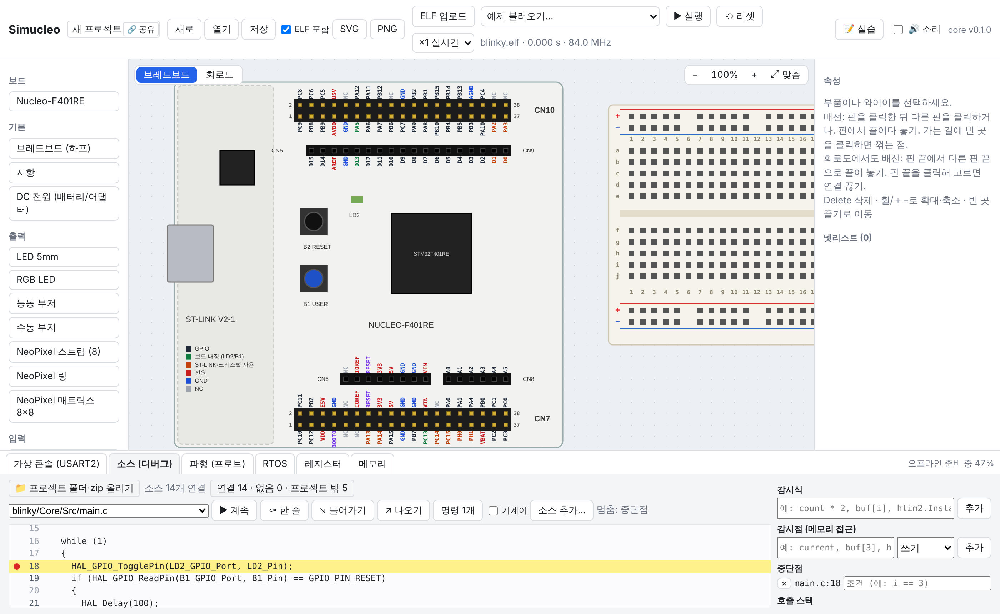

# 프로젝트 폴더·zip으로 소스 디버깅하기

STM32CubeIDE로 만든 프로젝트 폴더를 통째로(또는 zip으로) 올리면 ELF와 소스를 한꺼번에 불러온다(M39).
소스 파일을 하나씩 고를 필요가 없다. 바로 **소스 (디버그)** 탭에서 중단점을 걸고 한 줄씩 실행할 수 있다.
파일은 이 브라우저 안에서만 읽는다. 어디에도 올라가지 않는다(서버가 없다).

## 올리기

먼저 CubeIDE에서 **Debug** 구성으로 한 번 빌드한다(망치 단추). 그러면 프로젝트 폴더에 `Debug/<프로젝트>.elf`가 생긴다.
디버그 정보(`-g`)는 Debug 구성에 기본으로 켜져 있다.

방법은 셋이다.

1. **끌어다 놓기**: 탐색기(Finder)에서 프로젝트 폴더(예: `C:\Users\kim\STM32CubeIDE\workspace_1.16.0\blinky`)를 앱 위
   아무 곳에나 끌어다 놓는다. 파란 테두리가 보이면 놓는다.
2. **폴더 고르기**: **소스 (디버그)** 탭 → **📁 프로젝트 폴더·zip 올리기** → **폴더 고르기…** → 프로젝트 폴더를 고른다.
   브라우저가 "파일 N개를 업로드할까요?"라고 물으면 **업로드**를 누른다(실제로는 아무 데도 보내지 않는다).
3. **zip 고르기**: 같은 메뉴의 **zip·파일 고르기…**로 zip을 고른다. ELF와 소스 파일 여러 개를 함께 골라도 된다.

올리면 소스 탭이 앞으로 나오고 `main.c`가 열린다. 새로 고쳐도 ELF와 소스가 그대로 남는다(브라우저의 IndexedDB).

### zip 만들기

- **Windows**: 탐색기에서 프로젝트 폴더를 오른쪽 클릭 → **압축(zip) 폴더로 보내기**(Windows 11은 **ZIP 파일로 압축**).
- **macOS**: Finder에서 폴더를 오른쪽 클릭 → **압축**.
- **Linux**: `zip -r blinky.zip blinky`.

zip은 64 MB(푼 크기, 소스와 ELF만 셈) 안이어야 한다. `Debug` 폴더의 `.o`·`.d`·`.map` 같은 빌드 부산물은 풀지 않으므로
지우지 않아도 된다. 암호가 걸린 zip, 4 GB 넘는 ZIP64는 열지 못한다.

## 무엇이 연결되나

- **ELF**: `Debug/*.elf`, `Release/*.elf`를 먼저 찾고, 없으면 아무 `.elf`, 그다음 `.axf`·`.out`(파일 앞이 ELF일 때만).
  여러 개면 고르는 칸이 나온다(Debug·Release 먼저, 그 안에서는 최근 것 먼저).
- **소스**: ELF의 디버그 정보(DWARF)에는 학생 PC에서 빌드한 절대 경로가 들어 있다(예:
  `C:/Users/kim/STM32CubeIDE/workspace_1.16.0/blinky/Core/Src/main.c`). 올린 파일 `blinky/Core/Src/main.c`와 **뒤에서부터 같은
  폴더 이름이 가장 많이 겹치는 것**을 짝짓는다. 대소문자와 `\`·`/`는 가리지 않는다. 그래서 `Backup/Core/Src/main.c` 같은 옛 사본이
  있어도 진짜 `Core/Src/main.c`가 뽑힌다. 똑같이 겹치는 후보가 둘 이상이면 앞의 것을 쓰고 목록에 따로 보여 준다.
- 실제 코드가 있는 파일만 센다: `Core/Src/*.c`, 시작 코드 `Core/Startup/*.s`, HAL 드라이버 `Drivers/.../Src/*.c`, 인라인 함수가 든
  헤더(`core_cm4.h` 등). `.ioc`, `README`, 그림 같은 것은 건너뛴다. 한글 주석이 EUC-KR로 저장된 파일도 읽는다.
- 소스 탭 위 줄에 요약이 나온다: "소스 12개 연결 · DWARF에 있지만 없는 파일 3개(HAL 드라이버 등)". **연결 · 없음** 단추를 누르면
  연결된 파일과 빠진 파일 목록이 보인다. 컴파일러 라이브러리(newlib, libgcc)는 "프로젝트 밖"으로 따로 센다 — 소스가 없어도 된다.
- **소스만 올리기**: ELF가 이미 불러와져 있으면 ELF 없는 폴더·zip을 올려도 된다. 지금 펌웨어에 소스를 붙인다.

## 한도와 주의

- 소스는 ELF와 함께 이 브라우저에 저장된다. 연결된 소스가 16 MB를 넘으면 저장하지 않고 이번에만 보여 준다(그렇다고 알림).
  다른 펌웨어를 불러오면 그 펌웨어의 소스만 보인다. 저장되는 것은 마지막으로 올린 프로젝트 하나다.
- 공유 링크(🔗 공유)에는 소스가 들어가지 않는다. 받은 사람에게는 늘 그렇듯 "소스 없음"으로 보인다.
- zip은 믿지 않는 입력으로 다룬다: 폴더 밖을 가리키는 경로(`..`, `/`, `C:`)가 하나라도 있으면 zip 전체를 거절하고, 파일 2만 개·
  푼 크기 64 MB를 넘거나, 적힌 크기보다 크게 풀리거나(압축 폭탄), CRC가 맞지 않으면 오류를 보이고 아무것도 바꾸지 않는다.
- 끌어다 놓을 때 `.git`, `.settings`, `.metadata` 폴더는 들여다보지 않는다.
- ELF를 다시 빌드했으면 프로젝트 폴더를 다시 올린다. 소스만 고치고 ELF를 그대로 두면 줄 번호가 어긋난다.
