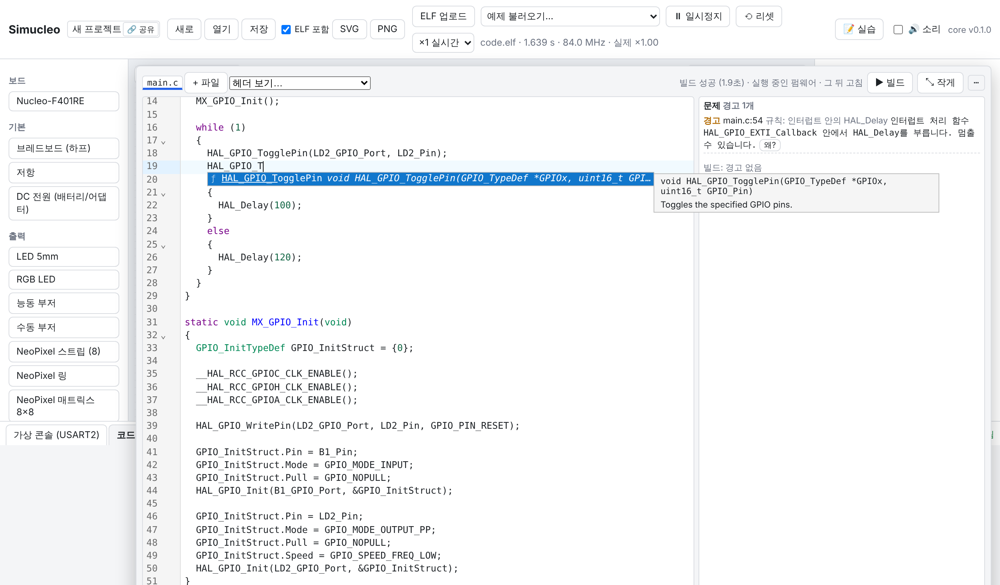
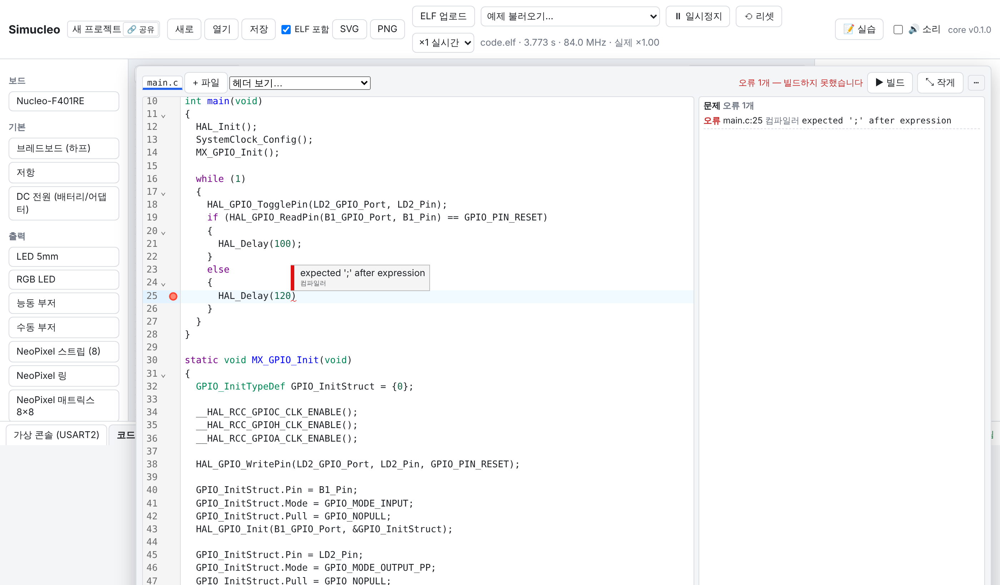
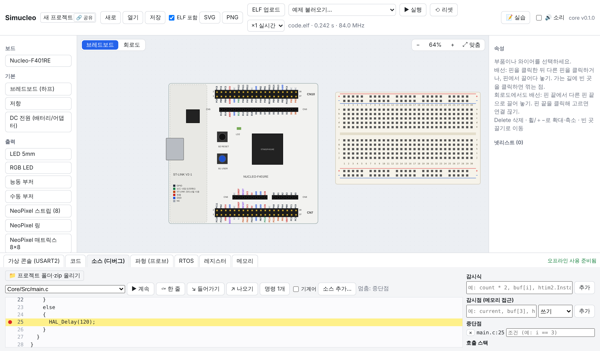

# 브라우저 안에서 C 코드 고치고 빌드하기

예제의 `main.c`를 아래 **코드** 탭에서 고치고 **▶ 빌드**를 누르면, 브라우저 안에서 컴파일·링크해 바로 시뮬레이터에서 실행한다(M33).
STM32CubeIDE를 설치하지 않아도 되고, 서버도 없다 — 컴파일러(clang + ld.lld)가 WebAssembly로 이 브라우저 안에서 돈다.
회로는 그대로 두고 펌웨어만 바뀐다. 빌드한 코드는 소스 탭에서 바로 중단점을 걸고 한 줄씩 실행할 수 있다.

## 시작하기

1. **코드** 탭을 연다. 처음에는 **예제에서 시작** 목록이 보인다. 예제를 고르면 그 예제의 `main.c`가 편집할 사본이 된다
   (지금 불러온 예제가 목록 맨 위에 있다). 회로는 바뀌지 않으니, 배선이 필요한 예제는 먼저 툴바의 **예제 불러오기**로 회로까지 연다.
2. 코드를 고친다. 예: `HAL_Delay(500);` → `HAL_Delay(120);`.
3. **▶ 빌드**(또는 편집기에서 `Ctrl+B`). 처음 한 번은 컴파일러를 받는다(약 20 MB, 진행 막대). 빌드가 되면 펌웨어 이름이
   `code.elf`로 바뀌고 바로 실행된다. LD2가 더 빨리 깜빡인다.

**⤢ 크게**는 편집기를 회로 위에 띄운다(회로와 툴바는 움직이지 않는다). **⋯** 메뉴에는 **편집기 오프라인으로 받기**,
**컴파일러 미리 받기**, **예제 원래 코드로 되돌리기**, **코드 지우기**가 있다.

고칠 수 있는 예제는 HAL 공통 틀(`hal-common`)을 쓰는 것들이다 — `hal-*`, `lesson-*` 예제 43개. FreeRTOS 예제, SD 카드(FatFs)
예제, 레지스터만 쓰는 `bare-blinky`는 아직 고를 수 없다(아래 한계).

## 파일

- 탭은 프로젝트의 파일이다. `Core/Src/main.c`는 항상 있다.
- **+ 파일**로 `.c`·`.h`를 더한다. `led.c`라고 치면 `Core/Src/led.c`, `led.h`는 `Core/Inc/led.h`가 된다. 모든 `.c`가 함께 빌드되고,
  `#include "led.h"`는 프로젝트의 헤더 폴더에서 먼저 찾는다.
- `main.h`를 더하면 틀의 `main.h`를 복사해 시작한다. 그 뒤로는 그 파일이 틀의 것을 대신한다(`LD2_Pin` 같은 핀 이름을 바꿀 때).
- **헤더 보기…**: HAL·CMSIS·newlib 헤더를 읽기 전용으로 연다(🔒). 함수가 어떤 인자를 받는지 확인할 때.
- 코드는 프로젝트와 함께 저장된다: 자동 저장(새로 고쳐도 남음), **저장**한 `.simucleo.json` 파일(빌드한 ELF도 함께), 🔗 공유 링크.

## 빌드가 하는 일

- 학생 파일만 clang으로 컴파일한다(`--target=thumbv7em-none-eabihf -mcpu=cortex-m4 -mfpu=fpv4-sp-d16 -mfloat-abi=hard -O0 -g
  -Wall`, `USE_HAL_DRIVER`, `STM32F401xE`). `-O0`은 CubeIDE의 Debug 구성과 같다 — 모든 줄에 중단점을 걸 수 있고 변수가 다 보인다.
- 나머지는 미리 빌드해 둔 것이다(사이트를 만들 때 arm-none-eabi-gcc로): 시작 코드, `SystemInit`, 인터럽트 처리 함수
  (`stm32f4xx_it.c`), HAL MSP, `SystemClock_Config`(84 MHz), `printf`를 USART2로 보내는 `_write`, HAL 드라이버 전부
  (GPIO, RCC, UART, TIM, ADC, I2C, SPI, DMA, EXTI, PWR, FLASH, Cortex), newlib-nano, libm, libgcc. ld.lld가 이것들과 예제와 같은
  링커 스크립트로 링크한다. 그래서 예제의 `main.c`가 그대로 빌드된다.
- 빌드 시간(이 저장소의 측정): 처음(컴파일러 받기 + 시작 + 빌드) 로컬 서버에서 약 2–4초, 그 뒤로는 0.3–1초. 인터넷으로 받을 때는
  내려받는 시간(약 20 MB)이 더해진다.

## 오류와 경고

- 컴파일러·링커의 메시지는 그 줄에 밑줄과 왼쪽 표시로, 오른쪽 **문제** 목록에 `오류`·`경고`와 파일:줄로 나온다. 메시지는 clang이
  쓴 그대로(영어)다. 목록을 누르면 그 줄로 간다. 빌드에 실패하면 첫 오류로 커서가 간다.
- 오류가 있으면 **빌드하지 않는다**: 실행 중이던 펌웨어는 그대로 돈다.
- 링크 오류(`undefined symbol: …`)는 그 함수를 부른 줄을 가리킨다. 선언만 하고 정의하지 않은 함수, 철자가 틀린 HAL 함수에서 난다.

## 자동완성

- 이름을 치면 HAL·CMSIS·newlib의 함수·매크로·타입과 내 파일의 함수·변수가 나온다. 함수는 시그니처와 설명 첫 문장(HAL 소스의
  `@brief`)을 보여 준다. `Toggle`처럼 중간 글자로도 찾는다.
- `GPIO_InitStruct.` 다음에는 구조체 멤버(`Pin`, `Mode`, `Pull`, `Speed`, `Alternate`), `GPIOA->` 다음에는 레지스터
  (`MODER`, `ODR`, `BSRR` …), `huart2.Init.` 처럼 이어 가도, 콜백 인자 `huart->`도 된다.
- 함수 괄호 안에서는 시그니처가 뜨고 지금 칠 인자가 굵게 보인다.
- 색인은 사이트를 만들 때 헤더에서 뽑는다(`web/public/editor/hal-symbols.json`, 약 9 000개). 컴파일러를 받지 않아도 된다.

## 규칙 기반 제안

컴파일은 되지만 마이크로컨트롤러에서 흔히 틀리는 것을 노란 밑줄(경고)이나 파란 밑줄(제안)로 알려 준다. 목록의 **왜?**(또는 밑줄
풍선의 **왜?**)를 누르면 이유가 나온다. 빌드를 막지는 않는다.

| 규칙 | 예 |
|---|---|
| 인터럽트 안의 `HAL_Delay` | `HAL_GPIO_EXTI_Callback` 안에서 `HAL_Delay(50);` — SysTick이 끼어들지 못해 멈출 수 있다 |
| 인터럽트 안의 무한 루프 | `TIM2_IRQHandler` 안의 `while (1)` |
| GPIO 클럭을 켜지 않음 | `HAL_GPIO_Init(GPIOB, …)` 앞에 `__HAL_RCC_GPIOB_CLK_ENABLE()`이 없음 |
| 입력으로 설정한 핀에 쓰기 | `GPIO_MODE_INPUT`으로 설정한 핀에 `HAL_GPIO_WritePin`·`TogglePin` |
| 조건문 안의 `=` | `if (x = 5)` (비교는 `==`; 일부러면 `if ((x = f()))`) |
| printf가 나갈 UART가 초기화되지 않음 | `printf`를 쓰는데 `HAL_UART_Init(&huart2)`가 없음 |
| 줄바꿈 없는 printf (제안) | `printf("tick %d", n);` — `\n` 전까지 콘솔에 안 나온다 |
| 인터럽트와 함께 쓰는 변수에 `volatile` 없음 | 콜백에서 `pressed = 1;`, main에서 `if (pressed)` |

규칙은 컴파일러가 아니라 글자를 보고 판단하므로, 특이한 코드에서는 틀릴 수 있다. 매크로(`LD2_GPIO_Port` → `GPIOA`)는
헤더와 내 파일의 `#define`을 따라간다.

## 디버깅

빌드한 펌웨어의 디버그 정보에는 편집한 파일이 `/project/Core/Src/main.c`로 들어 있다. **소스 (디버그)** 탭에서 **빌드할 때의**
코드가 보이고(빌드 뒤에 더 고쳐도 줄이 어긋나지 않음), 줄 번호를 눌러 중단점을 걸고, 한 줄씩 실행하고, 변수를 본다.
HAL 공통 파일(`clock_config.c` 등)도 예제처럼 소스가 보인다. HAL 드라이버 안으로는 기계어로만 들어간다.

## 오프라인

컴파일러는 크기 때문에 M29의 기본 오프라인 캐시에 넣지 않는다. 처음 빌드할 때 받고 브라우저가 보통의 HTTP 캐시로 둔다.
인터넷 없이도 빌드하려면 **⋯ → 편집기 오프라인으로 받기**를 누른다(약 20 MB). 서비스 워커가 컴파일러만의 캐시
(`simucleo-editor-<버전>`)에 넣고, **✓ 편집기 오프라인 준비됨**이 보이면 끝이다. 새 버전의 앱이 들어오면 바뀐 파일만 다시 받는다.
편집기와 자동완성 색인, 규칙은 처음부터 오프라인 캐시에 들어 있어 인터넷 없이도 고칠 수 있다(빌드만 컴파일러가 필요).

## 공유와 실습

- 🔗 **공유** 링크에는 코드(소스)가 들어간다. 빌드한 ELF는 넣지 않는다 — 소스는 압축하면 수백 바이트라 링크가 짧고,
  받는 쪽이 **열기**를 누르면 코드 탭이 열리고 그 브라우저에서 다시 빌드해 실행한다(컴파일러를 처음 받는다면 받는 시간이 든다).
  선생님은 학생의 코드를 그대로 보고 고쳐 볼 수 있다.
- 실습은 시작 코드를 가질 수 있다(`"code": {"example": "hal-blinky.elf"}` 또는 `"main": [...]`, [lessons.md](lessons.md)).
  **내 펌웨어 만들기: 2 Hz 깜빡이**는 hal-blinky의 `main.c`로 시작해 코드 탭에서 고치고 빌드하면 평소처럼 채점한다(CubeIDE로 만든
  ELF를 올려도 된다).

## 한계

- 고칠 수 있는 것은 HAL 공통 틀의 예제다. 클럭 설정(`SystemClock_Config`), 인터럽트 처리 함수 파일(`stm32f4xx_it.c`), MSP는
  미리 빌드되어 있어 바꿀 수 없다 — 새 인터럽트 처리 함수(`EXTI15_10_IRQHandler` 등)는 내 파일에 쓰면 된다(시작 코드의 약한 기호를
  대신함). FreeRTOS·FatFs 예제와 C++은 아직 안 된다. 클럭·인터럽트·MSP까지 내 파일로 두려면 설정 도구로 프로젝트를 만든다
  ([config-tool.md](config-tool.md), M36).
- 자동완성 2단계(clangd 같은 의미 분석)는 넣지 않았다. 색인과 내 파일을 훑는 정도라, 매크로로 만든 이름이나 복잡한 타입은 놓칠 수
  있다.
- AI 제안(사용자 API 키)은 넣지 않았다.
- 학생 코드는 clang, 미리 빌드한 부분은 gcc로 빌드한다. EABI가 같아 함께 링크되며(gcc의 작은 enum에 맞춰 `-fshort-enums`),
  모든 고칠 수 있는 예제가 빌드되어 gcc 빌드와 같게 도는 것을 테스트로 확인한다. 그래도 경고 문구와 최적화는 CubeIDE(gcc)와 다르다.
- 컴파일러는 실험 단계 패키지([`microbit-clang-wasm`](https://www.npmjs.com/package/microbit-clang-wasm), LLVM 21)다.
  WebAssembly를 처음 시작할 때 메모리를 수백 MB 쓴다. 아주 오래된 브라우저와 메모리가 적은 기기에서는 시작하지 못할 수 있다.
