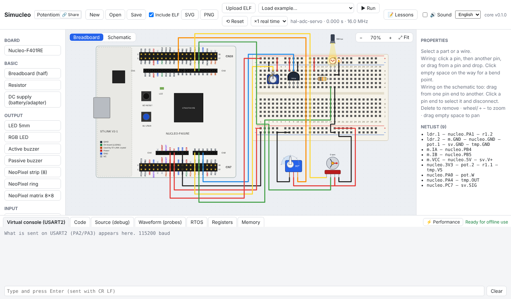

# 영어 UI와 번역 (M34)

Simucleo의 화면은 한국어와 영어로 볼 수 있다. 툴바 오른쪽의 언어 메뉴(**한국어 / English**)에서 고르면 페이지를 다시 열고
(프로젝트는 자동 저장으로 그대로), 고른 언어를 기억한다. 고른 적이 없으면 브라우저 언어가 한국어일 때 한국어, 그 밖에는 영어로 연다.
주소에 `?lang=en`이나 `?lang=ko`를 붙여도 된다(공유 링크·수업 안내에 쓸 때).

영어로 바뀌는 것: 모든 메뉴·버튼·안내·문제 목록·채점 힌트, 부품 이름·설명·핀 이름, 설정 도구, 예제 프로젝트 이름, 레슨 38개 전체.
바뀌지 않는 것: 펌웨어가 콘솔에 쓰는 글, 생성되는 C 코드(주석 포함), 선생님이 직접 쓴 레슨(영어 파일을 따로 두지 않으면).

## 개발자: 문자열 쓰기

- 화면에 보이는 한국어는 `t()`로 감싼다. 한국어 원문이 그대로 키다(gettext 방식).
  ```ts
  import { t } from "../i18n";
  t("와이어 {n}개를 지웠습니다", { n })          // 값 넣기
  t("{pin|이/가} 바뀌지 않았습니다", { pin })      // 한국어 조사: 이/가, 을/를, 은/는, 와/과, 으로/로
  // 영어 사전: "{n} {n#wire/wires} removed"     // 영어 단수·복수
  t("연결", undefined, "category")               // 뜻이 둘인 말: 사전 키는 "category::연결"
  ```
- 영어는 `web/src/i18n/en/<영역>.ts`(app, code, cube, lessons, parts, run, data)에 넣는다.
- 언어는 페이지를 열 때 한 번 정해지므로 모듈 수준 상수에서도 `t()`를 써도 된다. 컴파일러 워커는 페이지가 보낸 언어를 쓴다.
- `npm test`의 `test/i18n.test.ts`(TypeScript 구문 트리로 검사)가 다음을 찾는다.
  - `t()` 밖의 화면 한국어
  - 영어가 없는 키
  - 자리표시자가 원문과 다른 항목
  - 쓰지 않는 항목
  - 같은 키를 두 가지로 옮긴 경우
  - 영어에 남은 한글

  데이터인 한국어는 그 줄 끝에 `// i18n-ok`를 단다(거의 쓸 일이 없다).
- E2E는 `ko-KR` 로캘로 한국어 화면을 검사하고, `e2e/i18n.spec.ts`가 영어 브라우저로 열어 아래 화면에 한글이 남지 않았는지 본다.
  - 첫 화면
  - 예제를 불러온 뒤
  - 아래 탭 전부
  - 실습 하나
  - 설정 도구의 네 탭

## 선생님: 레슨 영어로



레슨 `web/lessons/<파일>.json`의 영어는 `web/lessons/en/<파일>.json`이다. 레슨의 한국어 문자열 하나하나(제목, 목표, 단계 글, 검사 이름,
힌트, 흔한 실수 …)를 그대로 키로 하고 영어를 값으로 둔 표다. 검사·핀·코드 같은 구조는 번역하지 않는다. 레슨을 고치면 테스트가 영어가
빠진 문장과 더 이상 쓰지 않는 문장을 알려 준다. 레슨 편집기로 만든 "내 레슨"은 쓴 언어 그대로 보인다.
