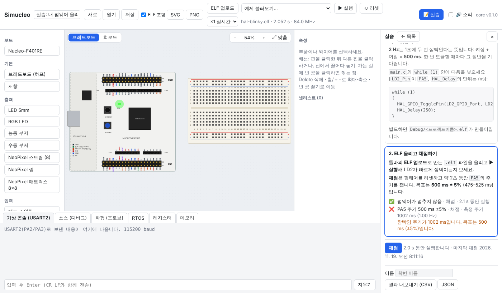
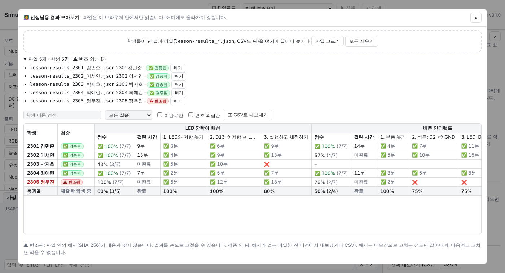

# 실습(레슨) 안내 — 선생님용

Simucleo의 **📝 실습**은 단계별 안내와 자동 채점이 붙은 과제입니다. 학생은 브레드보드에 배선하고,
펌웨어를 실행해 결과를 확인하고, 마지막에 결과 파일을 제출합니다. 서버가 필요 없고 모든 것이
학생 브라우저 안에서 돌아갑니다.


## 1. 수업에서 쓰기

1. 툴바의 **📝 실습**을 누르면 오른쪽에 실습 목록이 열립니다.
2. 실습의 **시작**을 누르면 그 실습의 시작 회로와 예제 펌웨어를 불러옵니다.
   - 이미 배선한 내용이 있으면 먼저 물어봅니다. 그때의 프로젝트는 브라우저에 **백업**해 두며,
     실습 목록 아래 **실습 전 프로젝트 되돌리기**로 다시 열 수 있습니다. 파일로 남기려면 취소하고 먼저
     툴바의 **저장**을 누르세요.
   - 한 번 시작한 실습은 목록에서 **이어서 하기**(지금 회로 그대로)와 **처음부터**(시작 회로를 다시
     불러옴) 중에서 고릅니다.
3. 단계마다 설명과 검사 목록이 나옵니다. 지금 할 단계는 파란 테두리로 표시됩니다.
   - **배선 검사**는 학생이 배선하는 동안 바로바로 ✅/❌로 바뀌고, 틀리면 이유를 알려 줍니다
     (예: "PA5가 GND로 가는 길에 저항이 없습니다.", "저항과 LED가 PA6 (D12)에 연결되어 있습니다. PA5 (D13)에
     연결하세요.", "LED 방향이 반대입니다.").
   - **동작 검사**(검사 이름 옆에 "채점")는 **채점** 버튼으로 확인합니다. 채점은 펌웨어를 리셋하고 정해진
     시뮬레이션 시간(실습마다 1.5–6초, 진행 막대 표시) 동안 실행하면서 핀의 주기, LED 밝기, 콘솔 출력 등을
     잽니다. 필요하면 채점 중에 버튼을 자동으로 누르거나 가변저항을 돌립니다.
   - 채점은 시뮬레이션 시간으로 재므로 결과는 실행 속도와 상관없습니다. 다만 툴바의 실행 속도가 느리면
     (×0.1 등) 채점도 그만큼 오래 걸립니다.
   - 채점했을 때 틀린 **배선 검사**가 있으면 그 검사와 관련된 핀과 넷(부품 핀, 그 핀과 이어진 넷, 검사가 말하는
     보드 신호의 핀)을 **회로도**와 브레드보드에 빨갛게 표시합니다. 회로도 위에는 "🔴 채점: 틀린 배선 검사의 핀·넷"이
     나옵니다. 배선을 고쳐 검사가 통과하면 표시가 바로 사라지고, 다른 실습을 열거나 처음부터 하면 지워집니다.
4. 모든 검사가 ✅가 되면 **🎉 실습 완료!**와 완료 시각이 나오고, 목록의 실습에 ✅가 붙습니다.




### 함께 들어 있는 실습: 교육과정 (M32)


실습 **38개**를 일곱 트랙으로 묶었습니다(예상 시간을 모두 더하면 약 25시간 — 한 학기 주 2시간 수업과 보충 과제 분량).
실습 목록은 트랙마다 접을 수 있는 묶음으로 보이고, 트랙 제목 옆에 완료한 실습 수(예: `3/7 완료`)가 나옵니다.
트랙 안에서는 쉬운 것부터 차례로 놓았고, 각 실습의 **선수 학습**에 먼저 할 실습이 적혀 있습니다.

| 트랙 | 묶음 | 실습 수 |
|---|---|---|
| A | 기초 (GPIO·시간) | 7 |
| B | 타이머·PWM | 5 |
| C | 아날로그 (ADC) | 5 |
| D | 통신 (UART·I2C·SPI·1-Wire) | 7 |
| E | 센서·액추에이터 응용 | 6 |
| F | 고급 (DMA·RTOS·저전력·도구) | 5 |
| G | 프로젝트 (종합) | 3 |

모든 실습에는 학습 목표, 선수 학습, 단계별 설명과 **📘 개념** 상자(PWM, 풀업, 디바운스, I2C 주소, BCD, DMA…), 단계마다 접힌 **💡 힌트**,
**⚠ 흔한 실수**, 빨리 끝낸 학생을 위한 **🚀 도전 과제**가 있습니다. 학생이 하는 일도 여러 가지입니다: 빈 보드에서 배선하기, 부품만
놓인 회로 배선하기, 일부가 빠진 회로 완성하기, **고장 난 회로 고치기**(버튼 폴링, 릴레이), **버그 있는 펌웨어 고치기**(디버거),
콘솔로 **측정·보고**하기(ADC, TMP36), 스코프로 재서 **답을 배선**하기, 값을 계산해 펌웨어 고치기(2 Hz 깜빡이).

| 트랙 | id | 실습 | 다루는 내용 | 부품 | 방식 | 수준 | 시간 | 펌웨어 |
|---|---|---|---|---|---|---|---|---|
| A | `led-on` | LED 켜기: 첫 GPIO 출력 | GPIO 출력, LED 극성, 옴의 법칙 | LED, 저항 | 처음부터 배선 | 입문 | 20분 | `lesson-led-on` |
| A | `led-blink` | LED 깜빡이 배선 | `HAL_Delay`, 주기·주파수 | LED, 저항 | 처음부터 배선 | 입문 | 25분 | `hal-blinky` |
| A | `blink-2hz` | 내 펌웨어 올리기: 2 Hz 깜빡이 | CubeIDE 빌드, ELF 업로드, 지연 계산 | (보드만) | 펌웨어 직접 작성·값 조정 | 중급 | 40분 | 직접 빌드 |
| A | `button-poll` | 버튼 폴링: 고장 난 회로 고치기 | 풀업 입력, 폴링 | 택트 스위치, LED, 저항 | 고장 난 회로 고치기 | 입문 | 30분 | `lesson-button-poll` |
| A | `button-exti` | 버튼 인터럽트(EXTI)와 디바운스 | EXTI, WFI, 디바운스 | 택트 스위치, LED, 저항 | 처음부터 배선 | 초급 | 35분 | `hal-button-exti` |
| A | `knight-rider` | 여러 LED 패턴: 나이트라이더 | GPIO 배열, 패턴 주기 | LED 4, 저항 4 | 부품만 놓인 회로 배선 | 초급 | 35분 | `lesson-knight-rider` |
| A | `seven-segment` | 7세그먼트 다중화와 키패드 | 7세그먼트, 다중화, 키패드 스캔 | 4자리 7세그먼트, 4×4 키패드 | 일부 회로 완성 | 중급 | 45분 | `hal-7seg-keypad` |
| B | `timer-irq` | 타이머 인터럽트로 정확한 주기 | PSC/ARR, 업데이트 인터럽트, 지연 누적 | LED 2, 저항 2 | 배선 + 스코프 측정 | 초급 | 40분 | `lesson-timer-irq` |
| B | `pwm-breathe` | PWM으로 LED 밝기·숨쉬기 | PWM, 듀티비, AF 핀 | LED, 저항 | 처음부터 배선 + 스코프 측정 | 초급 | 35분 | `hal-pwm-led` |
| B | `pwm-rgb` | PWM으로 RGB 색 혼합 | PWM 3채널, 색 혼합 | RGB LED, 저항 3 | 처음부터 배선 | 초급 | 35분 | `hal-pwm-led` |
| B | `buzzer-melody` | 수동 부저로 음계·멜로디 | PWM 주파수, 음계 | 수동 부저 | 처음부터 배선 | 초급 | 30분 | `hal-buzzer-melody` |
| B | `servo-angle` | 서보 각도: 50 Hz 펄스 폭 | 50 Hz 서보 펄스, 펄스 폭→각도 | 서보 3 | 일부 회로 완성 + 스코프 측정 | 초급 | 35분 | `hal-servos-multi` |
| C | `pot-serial` | 가변저항 ADC → 시리얼 출력 | 전압 분배, 12비트 ADC, 전압 환산 | 가변저항 | 측정·보고 | 초급 | 35분 | `hal-adc-servo` |
| C | `adc-servo` | 가변저항(ADC)으로 서보 돌리기 | ADC → 서보 사상 | 가변저항, 서보 | 일부 회로 완성 | 중급 | 40분 | `hal-adc-servo` |
| C | `ldr-nightlight` | 조도센서로 자동 조명 | LDR 분배기, 데드존, PWM 비례 제어 | LDR, 저항 10 kΩ, LED | 부품만 놓인 회로 배선 | 중급 | 40분 | `lesson-ldr-nightlight` |
| C | `tmp36` | 온도센서(TMP36) 단위 변환 | TMP36, mV → °C, VREFINT | TMP36 | 측정·보고 | 중급 | 35분 | `hal-adc-servo` |
| C | `joystick-servos` | 조이스틱으로 서보 2축(팬·틸트) | ADC 2채널, 서보 2축 | 조이스틱, 서보 2 | 부품만 놓인 회로 배선 | 중급 | 45분 | `lesson-joystick-servos` |
| D | `uart-command` | UART printf와 명령 파서 | UART 프레임, 수신 인터럽트, 명령 파서 | (보드만) | 콘솔 명령 입력 | 초급 | 40분 | `lesson-uart-cmd` |
| D | `i2c-oled` | I2C OLED에 글자 표시 | I2C 주소, 오픈 드레인·풀업, 버스 검색 | OLED, RTC, AHT20 | 일부 회로 완성 | 중급 | 35분 | `hal-i2c-oled` |
| D | `i2c-rtc` | I2C RTC 시계(DS3231) | RTC, BCD 레지스터 읽기·쓰기 | DS3231, OLED, AHT20 | 일부 회로 완성 | 중급 | 40분 | `hal-i2c-oled` |
| D | `spi-595` | SPI로 74HC595 시프트 레지스터 | SPI, 시프트·래치 레지스터 | 74HC595, LED 8 | 일부 회로 완성 + SPI 디코더 | 중급 | 40분 | `hal-shift-register` |
| D | `tm1637` | TM1637 4자리 시계 (비트뱅잉) | 비트뱅잉, DWT 지연, ACK | TM1637 | 처음부터 배선 | 중급 | 35분 | `hal-tm1637-clock` |
| D | `onewire-ds18b20` | 1-Wire: DS18B20 여러 개 | 1-Wire 타임 슬롯, SEARCH ROM, CRC | DS18B20 3 | 일부 회로 완성 | 고급 | 45분 | `hal-onewire-multi` |
| D | `bluetooth-hc05` | HC-05 블루투스로 원격 제어 | TX↔RX 교차, USART1, STATE | HC-05 | 처음부터 배선 + 휴대폰 명령 | 중급 | 40분 | `hal-bluetooth-led` |
| E | `sonar-alarm` | 초음파 거리 경보 | 초음파 ToF, 입력 캡처, 5 V 내성 핀 | HC-SR04, LED | 부품만 놓인 회로 배선 | 중급 | 40분 | `lesson-parking` |
| E | `pir-alarm` | PIR 침입 경보 | PIR, 유지·차단 시간, 양쪽 에지 EXTI | PIR, LED | 부품만 놓인 회로 배선 | 초급 | 30분 | `hal-pir-alarm` |
| E | `dht-logger` | DHT22 온습도 로거 | DHT 프로토콜, 입력 캡처, 체크섬 | DHT22 | 처음부터 배선 + 기록 | 중급 | 35분 | `hal-dht-capture` |
| E | `stepper-a4988` | 스테퍼 모터와 A4988 드라이버 | 스텝·마이크로스텝, STEP/DIR/EN, 가속 램프 | NEMA17, A4988, 12 V 전원 | 일부 회로 완성 | 고급 | 45분 | `hal-stepper-a4988` |
| E | `dc-motor` | DC 모터 속도 제어 (PWM) | H 브리지, PWM 속도, 센서→모터 | DC 모터 모듈, LDR | 일부 회로 완성 | 중급 | 35분 | `hal-adc-servo` |
| E | `relay` | 릴레이: 고장 난 회로 고치기 | 릴레이 COM/NO/NC, 액티브 Low | 릴레이, LED, 버튼 | 고장 난 회로 고치기 | 초급 | 30분 | `hal-relay` |
| F | `dma-neopixel` | DMA로 NeoPixel 구동 | DMA, WS2812B 비트 인코딩, 타이머 PWM | NeoPixel 링 | 처음부터 배선 + 스코프 | 고급 | 45분 | `hal-neopixel-dma` |
| F | `rtos-queue` | FreeRTOS 태스크와 큐 | 태스크, 큐, ISR→태스크, 스택 여유 | (보드만) | 관찰 + 콘솔 입력 | 고급 | 45분 | `freertos-queue-uart` |
| F | `sleep-wfi` | 저전력: sleep 모드와 WFI | WFI, sleep 모드, SysTick 정지 | LED | 비교 측정 | 고급 | 35분 | `lesson-sleep-wfi` |
| F | `scope-measure` | 오실로스코프로 PWM 측정·UART 해독 | 스코프 측정, 트리거, UART 디코더 | LED 2 | 측정해서 답을 배선 | 중급 | 45분 | `lesson-scope-mystery` |
| F | `debugger` | 디버거로 버그 찾기 | 중단점, 조사식, 단계 실행, 오버플로 | 가변저항, LED | 버그 있는 펌웨어 고치기 | 고급 | 50분 | `lesson-debug-average` (버그 있음) |
| G | `thermostat` | 프로젝트: 스마트 온도조절기 | 히스테리시스, 페일세이프, 시스템 통합 | AHT20, OLED, 릴레이, LED | 프로젝트(일부 회로 완성) | 고급 | 60분 | `lesson-thermostat` |
| G | `parking-assist` | 프로젝트: 주차 보조 장치 | 거리 구간, 비차단 비프, 통합 시험 | HC-SR04, LED 3, 수동 부저 | 프로젝트(일부 회로 완성) | 고급 | 60분 | `lesson-parking` |
| G | `digital-clock` | 프로젝트: 디지털 시계 | I2C + 비트뱅잉, 에지 검출, RTC 쓰기 | DS3231, TM1637, 버튼 | 프로젝트(일부 회로 완성) | 고급 | 60분 | `lesson-digital-clock` |

- "방식"의 **측정·보고**는 학생이 콘솔과 스코프로 잰 값을 표로 만들어 따로 제출하는 활동입니다. 자동 채점은 그 측정이 가능한 상태인지
  (값이 실제로 바뀌고 기대한 범위를 지나는지)까지만 확인합니다.
- `blink-2hz`(직접 빌드)와 `debugger`(고친 펌웨어를 올림)의 모범 답안 펌웨어 `firmware/lesson-blink-2hz`, `firmware/lesson-debug-average-fixed`는
  사이트에 넣지 않습니다(테스트 전용). `debugger`는 버그 있는 `lesson-debug-average`로 시작하므로, 그대로 채점하면 실패합니다.
- `sonar-alarm`과 `parking-assist`는 같은 펌웨어(`lesson-parking`)를 씁니다 — 앞의 것은 센서와 빨간 LED만, 뒤의 것은 LED 셋과 부저까지.
- 실습을 위해 새로 만든 펌웨어는 `firmware/lesson-*`이고, 각각 같은 이름의 예제 프로젝트(`web/examples/lesson-*.simucleo.json`, 모범 회로)가
  있어 툴바의 예제 목록에서도 열 수 있습니다.

**검증**: `web/e2e/m32.spec.ts`가 모든 실습을 모범 회로와 모범 펌웨어로 불러와 채점하고 모든 검사가 통과하는지 확인합니다. 또 트랙마다
일부러 틀린 회로·펌웨어(LED 방향 반대, 서보 신호 핀이 다름, TX/RX를 교차하지 않음, 버그 있는 펌웨어, 시작할 때의 고장 난 회로 등)로
채점해 해당 검사가 실패하는지도 확인합니다.

## 2. 결과 제출받기

실습 목록과 각 실습 아래에 **이름** 칸과 **결과 내보내기** 버튼이 있습니다.

1. 학생이 이름 칸에 학번과 이름을 적습니다(브라우저에 기억됨).
2. **결과 내보내기 (CSV)** 또는 **JSON**을 누르면 `lesson-results_<이름>.csv`(또는 `.json`) 파일이
   내려받아집니다.
3. 학생이 그 파일을 LMS 과제함이나 메일로 제출합니다.

진행 상황(검사 결과, 시각, 채점 횟수, 완료 시각)은 학생 브라우저의 IndexedDB에 실습별로 저장되어,
새로고침하거나 다음 시간에 다시 열어도 남아 있습니다. 다른 컴퓨터로는 따라가지 않으니 수업이 끝날 때
내보내게 하세요.

### CSV 형식

엑셀에서 한글이 깨지지 않도록 UTF-8 BOM이 붙어 있고, 검사 하나가 한 줄입니다.

| 열 | 뜻 |
|---|---|
| `student` | 이름 칸에 적은 내용 |
| `lesson_id`, `lesson_title` | 실습 id와 제목 |
| `completed_at` | 처음으로 모든 검사를 통과한 시각(ISO 8601, UTC). 아직이면 빈칸 |
| `attempts` | 채점 버튼을 누른 횟수 |
| `step` | 단계 번호(1부터) |
| `check` | 검사 이름 |
| `result` | `pass`, `fail` 또는 `pending`(아직 한 번도 검사하지 않음 — 예: 채점 전에 내보낸 동작 검사) |
| `checked_at` | 이 검사의 결과가 마지막으로 바뀐 시각(`pending`이면 빈칸) |
| `detail` | 측정값(예: `측정 주기 1002 ms (1.00 Hz)`) |
| `hint` | 실패했을 때 학생이 본 안내 |

여러 학생의 CSV는 첫 줄(머리글)만 빼고 이어 붙이면 한 표가 됩니다. 하지만 아래의 **선생님용 결과
모아보기**를 쓰는 편이 쉽고, 그때는 변조 확인이 되는 **JSON**으로 받으세요.

### JSON 형식과 무결성 해시

JSON은 같은 내용을 다음 구조로 담습니다(`step`은 0부터).

```json
{
  "format": "simucleo-lesson-results", "version": 1,
  "student": "2301 김민준", "exportedAt": "2026-03-02T10:00:00.000Z",
  "lessons": [ { "id", "title", "steps": ["단계 제목", …], "startedAt", "completedAt", "attempts",
                 "passed", "total", "checks": [ { "key", "step", "label", "pass", "at", "detail", "hint", "pending" } ] } ],
  "integrity": { "alg": "SHA-256", "hash": "64자리 16진수" }
}
```

`steps`(단계 제목)와 `integrity`는 M24에서 더한 필드입니다. `checks`에는 실습의 **모든** 검사가 들어갑니다:
아직 결과가 없는 검사(채점 전에 내보내면 동작 검사)는 `"pending": true`, `"pass": false`, `"at": ""`로 들어가고
`total`에 셉니다. 실습의 검사가 바뀌어 더는 없는 검사의 옛 결과는 넣지 않습니다. 이전 버전의 파일에는 결과가 있는
검사만 들어 있습니다(아래 모아보기 참고). `integrity.hash`는 `integrity`를 뺀 파일 전체를
**정규화한 JSON**(모든 단계의 객체 키를 정렬하고 공백 없이 쓴 것)의 SHA-256입니다. 브라우저의 WebCrypto로
만들고 확인합니다(`web/src/lessons/integrity.ts`).

> ⚠ **이 해시는 서명이 아닙니다.** 비밀 키가 없으므로 이 문서나 코드를 읽은 사람은 파일을 고친 뒤 해시를 다시
> 계산할 수 있습니다. 학생이 메모장으로 `"pass": false`를 `true`로 바꾸는 정도의 **가벼운 편집만** 드러내는
> 장치(tamper-evident)이고, 위조를 막는 보안 장치가 아닙니다. 중요한 평가라면 수업 중에 화면으로 확인하세요.

선생님용 모아보기에서 파일마다 다음 중 하나로 표시됩니다.

| 표시 | 뜻 |
|---|---|
| ✅ 검증됨 | 해시가 내용과 맞음 |
| ⚠ 변조됨 | 해시가 내용과 맞지 않거나 `integrity` 필드가 깨짐 — 내보낸 뒤 파일을 고쳤을 수 있음 |
| 검증 안 됨 | 해시가 없음: M24 이전 버전에서 내보낸 JSON이나 CSV. 예전 파일도 그대로 읽습니다 |

### 선생님용 결과 모아보기



실습 목록 아래 **👩‍🏫 선생님용 결과 모아보기**를 누르면 열립니다.

1. 학생들이 낸 결과 파일(`.json`, `.csv` 모두 됨)을 여러 개 한꺼번에 **끌어다 놓거나** **파일 고르기**로 고릅니다.
   CSV 하나에 여러 학생이 이어 붙어 있어도 학생마다 나눠 읽습니다. 파일은 브라우저 안에서만 읽으며 어디에도
   올리지 않습니다(창을 새로고침하면 다시 넣어야 합니다).
2. 표의 줄은 학생, 열은 실습마다 **점수**(통과한 검사 비율, 완료하면 ✅), **걸린 시간**(실습 시작부터 완료까지),
   그리고 **단계**입니다. 단계 칸은 ✅ 통과 / ◐ 일부 통과(예: `◐ 1/2`) / ❌ 실패와, 통과했으면 시작부터 그 단계의
   마지막 검사가 통과할 때까지 걸린 시간입니다.
   채점하지 않은 검사(`pending`)는 통과하지 않은 것으로 세고, 점수 옆에 **미채점 검사 있음**이 붙습니다. 예를 들어
   1번 실습에서 배선 검사 4개만 통과하고 채점하지 않고 낸 파일은 `57% (4/7)`입니다. `pending`이 없는 이전 버전의
   파일은, 사이트에 들어 있는 실습이면 그 실습의 검사 수로 빠진 검사를 채우고, 모르는 실습(다른 브라우저의 내 레슨
   등)인데 완료하지 않았고 들어 있는 검사가 모두 통과면 전체 검사 수를 알 수 없으므로 점수 대신 `? (4/4+)`와
   **미채점 검사 있음**을 보여 줍니다(점수 정렬에서는 맨 아래, 표 CSV의 점수 칸은 빈칸).
3. 맨 아래 **통과율** 줄은 그 실습을 낸 학생 중 완료한 비율과 단계별로 통과한 비율입니다.
4. 열 머리(점수, 걸린 시간, 단계)를 누르면 정렬하고, 한 번 더 누르면 반대로 정렬합니다(값이 없는 학생은 늘
   아래). 학생 이름 검색, 실습 고르기, **미완료만**, **변조 의심만** 필터가 있습니다.
5. **표 CSV로 내보내기**는 지금 보이는(검색·필터·정렬이 적용된) 표를 CSV로 저장합니다. 학생마다 한 줄에
   검증 상태, 파일 이름, 실습별 점수·통과 수·완료·시간(초)·채점 횟수·단계 결과가 들어가고 마지막 줄이 통과율입니다.

**중복**: 같은 학생(이름의 앞뒤·중복 공백은 무시)과 같은 실습이 여러 파일에 있으면 `exportedAt`이 가장 늦은
것만 쓰고(같으면 나중에 넣은 파일), 무시한 파일을 파일 목록 아래에 알려 줍니다. 학생이 같은 실습을 다시 해서
새로 낸 경우를 자연스럽게 처리합니다. 한 학생의 파일 중 하나라도 변조됨이면 그 학생 줄이 빨갛게 표시됩니다.

### 링크로 제출받기

파일 대신 링크로 받을 수도 있습니다(M30). 학생이 실습 패널의 **📤 선생님께 보내기**를 누르면 지금 회로·펌웨어와
실습 결과(JSON 내보내기와 같은 내용, 같은 SHA-256 해시)가 든 링크와 QR 코드가 나옵니다. 학생은 링크를 학급
게시판·메신저·메일로 보냅니다. 내용은 주소의 `#` 뒤에 들어 있어 어느 서버에도 가지 않습니다.

- **모아보기에 넣기**: 결과 모아보기의 **공유 링크 붙여넣기** 칸에 링크를 붙여 넣고 **링크 추가**를 누릅니다. 게시판의
  글을 통째로 복사해 붙여도 됩니다 — 링크가 여러 개면 모두 찾아 학생마다 줄이 생기고, 파일과 똑같이 해시를 검사해
  ✅ 검증됨 / ⚠ 변조됨을 보여 줍니다. 결과가 없는 링크(회로만 공유한 링크)나 잘린 링크는 파일 목록에 이유와 함께
  나옵니다.
- **학생의 회로 보기**: 링크를 그냥 열면 무엇이 들었는지 보여 주는 창이 먼저 뜹니다. **열기**는 학생의 회로·펌웨어와
  실습을 열고(작업 중인 회로가 있으면 먼저 묻습니다), **👩‍🏫 결과 모아보기에 추가**는 회로는 그대로 두고 결과만
  표에 넣습니다.
- 학생에게 시작 회로를 나눠 줄 때도 같은 기능을 씁니다: 회로를 만들고 툴바의 **🔗 공유**로 링크나 QR 코드를 띄우면
  학생들이 그대로 엽니다. 자세한 내용은 [share.md](share.md).

메신저에 따라 긴 링크가 잘릴 수 있습니다(대략 4 000자 넘게). 잘린 링크는 "링크가 손상되었습니다"로 나오니, 그럴 때는
파일로 내게 하세요.

## 3. 새 실습 만들기

### 레슨 편집기


JSON 파일을 직접 쓰지 않아도 앱 안에서 실습을 만들 수 있습니다. 실습 목록의 **내 레슨** 아래
**✏️ 레슨 편집기**를 누르세요.

- **기본 정보**: id, 제목, 수준, 순서, 목표, 시작 회로(빈 보드 / 예제 프로젝트 / **레슨에 담은 회로** — 고르는 순간
  또는 **현재 회로를 시작 회로로**를 누를 때의 화면 회로를 담음), 펌웨어(바꾸지 않음 / 학생이 직접 빌드 / 예제 ELF),
  채점 시간, 채점 중 조작(JSON 배열).
- **단계**: 제목, 설명(간단한 Markdown), 검사 목록. 단계와 검사는 ↑ ↓로 순서를 바꾸고 지울 수 있습니다.
- **검사**: 종류(배선 검사 4가지, 동작 검사 8가지)를 고르면 그 종류의 입력 양식이 나옵니다(부품 종류는 목록,
  신호는 `PA5`·`GND` 같은 자동완성). 모든 검사에 표시 이름과 틀렸을 때 안내를 붙일 수 있습니다(비우면 자동).
- **현재 배선에서 검사 만들기**: 지금 화면의 회로를 읽어 그 단계에 배선 검사를 넣습니다. 지금 회로는 이 검사들을
  모두 통과합니다.
  - 보드와 브레드보드를 뺀 부품 종류마다 `part`(같은 종류가 여럿이면 `count`)
  - 보드 신호(MCU 핀, `3V3`, `5V`, `VIN`)에서 저항·LED·버튼·가변저항·RGB LED 한 색을 거쳐 다른 보드 신호(주로
    `GND`)까지 이어진 길마다 `series`. LED는 회로의 방향 그대로(거꾸로 꽂혀 있으면 `from`과 `to`가 바뀜)
  - 그 밖에 보드 신호에 이어진 부품 핀마다 `connected`(OLED의 SDA → `PB9`, 서보의 V+ → `5V` 등)
  
  모범 회로를 그려 놓고 누른 뒤, 필요 없는 검사를 지우고 안내를 다듬으면 됩니다.
- **미리 보기 (현재 프로젝트로)**: 편집 중인 실습을 실습 패널에서 지금 회로와 펌웨어로 실행해 봅니다(시작 회로·
  펌웨어를 불러오지 않음, 결과 내보내기에는 들어가지 않음). **편집기로 돌아가기**로 이어서 고칩니다.
- **오류 표시**: 편집하는 동안 아래 형식 검사를 계속 돌려 오른쪽에 오류 목록을 보여 줍니다. 오류가 있으면 저장·
  내려받기·미리 보기를 할 수 없습니다. 기본 실습과 같은 id도 오류입니다.
- **내 레슨에 저장**: 이 브라우저의 IndexedDB에 저장해 실습 목록의 **내 레슨**에 나타납니다(같은 id면 덮어씀).
  **JSON 파일로 내려받기**는 `<id>.json` 파일을 만들어, `web/lessons/`에 넣고 빌드하거나 다른 선생님께 줄 수
  있습니다. **JSON 불러오기**로 파일을 편집기에 다시 엽니다. 필드가 빠지거나 형식이 틀린 파일도 열리며(빠진 값은
  빈칸, 시작 회로는 빈 보드로 채움) 오류 목록에 무엇이 틀렸는지 나옵니다. 레슨이 아닌 JSON(배열 등)은 열지 않습니다.
  편집 중인 내용은 브라우저에 자동 저장됩니다.
- **검사를 고치면 진행 상황이 초기화됩니다**: 검사 결과는 검사의 위치(단계·순서)로 저장되므로, 내 레슨을 같은 id로
  다시 저장(또는 같은 id의 파일을 다시 불러오기)할 때 검사가 바뀌었으면(값을 고치거나, 더하거나, 지우거나, 순서를
  바꿈) 그 실습의 결과·완료 표시·채점 횟수를 지웁니다(시작 시각은 남음). 제목·설명·검사의 표시 이름과 안내만 고치면
  그대로 남습니다.

**내 레슨**: 목록의 **레슨 파일 불러오기**로 받은 레슨 JSON(여러 개 가능)을 바로 내 레슨에 넣을 수도 있습니다.
형식 오류가 있는 파일은 이유를 보여 주고 넣지 않습니다. 내 레슨마다 **편집**과 **삭제**가 있고, 기본 실습에는
**복사해서 편집**(id에 `-copy`가 붙음)이 있습니다. 내 레슨은 그 브라우저에만 있으므로 학생 컴퓨터에서 쓰려면
JSON 파일을 나눠 주고 학생이 **레슨 파일 불러오기**를 하게 하세요. 결과 파일에는 내 레슨의 결과도 함께 들어갑니다.

### 파일로 실습 만들기

실습은 `web/lessons/<이름>.json` 파일 하나입니다. 폴더에 파일을 넣고 사이트를 다시 빌드하면
(`npm run build`) 목록에 나타납니다. 파일에 오류가 있으면 목록에 시작 버튼 대신 오류 내용이 나오고,
`npm test`도 실패합니다.

### 파일 구조

```json
{
  "id": "led-blink",
  "order": 1,
  "title": "LED 깜빡이 배선",
  "level": "입문",
  "goal": "D13(PA5)에 저항과 LED를 직렬로 연결하고 1초 주기로 깜빡이게 합니다.",
  "start": "empty",
  "firmware": { "example": "hal-blinky.elf" },
  "grade": { "ms": 4000, "stimuli": [] },
  "steps": [
    {
      "title": "D13 → 저항 → LED → GND",
      "text": ["보드의 **D13**은 MCU의 `PA5` 핀입니다.", "", "- 목록도 쓸 수 있습니다"],
      "checks": [
        { "type": "series", "from": "PA5", "to": "GND", "through": ["resistor", "led-5mm"] }
      ]
    }
  ]
}
```

| 필드 | 필수 | 설명 |
|---|---|---|
| `id` | ✔ | 영문 id. 진행 상황과 결과 파일에 쓰이므로 배포한 뒤에는 바꾸지 마세요 |
| `order` | ✔ | 목록 순서(숫자, 겹치지 않게) |
| `title`, `level`, `goal` | ✔ | 제목, 수준(입문·초급·중급 등 자유), 한두 문장의 목표 |
| `start` | ✔ | 시작 회로: `"empty"`(보드 + 빈 브레드보드), `{ "example": "hal-adc-servo.simucleo.json" }`(`web/examples`의 예제 프로젝트), `{ "project": { "parts": [...], "wires": [...] } }`(직접 적은 회로, `.simucleo.json` 파일의 `parts`·`wires`와 같은 형식) |
| `firmware` | | `{ "example": "hal-blinky.elf" }`(사이트에 들어 있는 예제 ELF, `web/scripts/examples.mjs` 목록), 또는 `"upload"`(학생이 직접 빌드해 올림). 없으면 펌웨어를 바꾸지 않음 |
| `grade.ms` | | 채점할 때 실행할 시뮬레이션 시간(ms). 없으면 검사마다 필요한 시간 중 가장 긴 것 |
| `grade.stimuli` | | 채점 중에 할 조작(아래) |
| `steps` | ✔ | 단계 목록. 각 단계는 `title`, `text`, `checks`, 그리고 고를 수 있는 `theory`(📘 개념 상자)와 `hint`(접힌 💡 힌트) — 둘 다 Markdown |
| `track` | | 목록에서 묶을 트랙 이름(`"A. 기초 (GPIO·시간)"`). 같은 이름끼리 한 묶음, 묶음은 그 안의 첫 실습 `order` 순서. 기본 실습 모두에 없으면 예전처럼 한 목록 (M32) |
| `minutes` | | 예상 시간(분). 목록과 실습 머리에 "약 30분" (M32) |
| `objectives` | | 학습 목표, 한 항목에 하나 (M32) |
| `prereq` | | 선수 학습, Markdown (M32) |
| `mistakes` | | ⚠ 흔한 실수, 한 항목에 하나(Markdown) (M32) |
| `challenges` | | 🚀 도전 과제, 한 항목에 하나(Markdown). 실습을 완료하면 펼쳐져 보입니다 (M32) |

`start`의 `project`를 쉽게 만들려면 편집기에서 원하는 시작 회로를 그린 뒤 **저장**한 파일에서
`parts`와 `wires`를 복사하세요. 시작 회로에 부품만 놓고 배선을 비워 두면 학생이 배선할 몫이 됩니다.

**단계 설명(`text`)** 은 문자열이나 줄의 배열(이어 붙임)이고, 간단한 Markdown을 씁니다:
`**굵게**`, `` `코드` ``, `- 목록`, `1. 번호 목록`, `### 소제목`, 빈 줄로 문단 나누기, ```` ``` ```` 로
감싼 코드 블록. HTML은 쓸 수 없습니다(글자 그대로 보임). 검사가 없는 단계(`"checks": []`)는 읽기만
하는 단계입니다.

**부품은 id가 아니라 종류(`kind`)로 찾습니다.** 학생이 부품 이름을 `led1`이든 `myLed`든 마음대로 지어도
됩니다. 같은 종류가 여럿이면 그중 하나라도 맞으면 통과입니다. 부품 종류 이름은 저장한 프로젝트 파일의 `kind`나
`web/src/parts/*.tsx`를 보세요(예: `led-5mm`, `resistor`, `rgb-led`, `tact-switch`, `potentiometer`,
`servo`, `dc-motor`, `oled-ssd1306`, `lcd-i2c`, `buzzer-passive`, `tm1637`, `neopixel-ring`, `hc05`, `relay`).

M32의 필드(`track`, `minutes`, `objectives`, `prereq`, `mistakes`, `challenges`, 단계의 `theory`, `hint`)는 모두 고를 수 있는
것이라 예전 레슨 파일도 그대로 열립니다. 이 필드들은 검사가 아니므로 바꿔도 진행 상황이 초기화되지 않습니다.

**신호 이름**: `PA5`처럼 MCU 핀 이름을 씁니다(Arduino 이름 `D13`이 아님 — 같은 신호인 Morpho 핀에
연결해도 맞게 하려고). 전원은 `GND`, `3V3`, `5V`, `VIN`. 안내 문구에는 `PA5 (D13)`처럼 둘 다 나옵니다.

### 검사 종류

모든 검사에 공통으로 `label`(검사 목록에 보일 이름, 없으면 자동으로 만듦)과 `hint`(실패했을 때 자동
안내 대신 보일 문장)를 붙일 수 있습니다.

#### 배선 검사 — 배선하는 동안 바로 채점

| `type` | 필드 | 통과 조건 | 실패 안내 예 |
|---|---|---|---|
| `part` | `kind`, `count`(기본 1) | 그 종류의 부품이 `count`개 이상 있음 | "LED가 없습니다. 왼쪽 부품 목록에서 …", "저항 3개가 필요합니다 (지금 1개)." |
| `connected` | `kind`, `pin`, `to` | 그 종류의 어떤 부품의 핀 `pin`이 신호 `to`와 같은 넷(직접 또는 브레드보드·다른 부품 핀을 거쳐 전선으로) | "OLED의 SDA 핀이 PB9 (D14)에 연결되어 있지 않습니다. 지금은 PB8 (D15)에 연결되어 있습니다." |
| `series` | `from`, `to`, `through` | `from`에서 `to`까지 `through`의 부품들이 **정확히 그만큼** 직렬로(순서는 상관없음) 이어짐. LED는 애노드가 `from` 쪽이어야 함 | "PA5가 GND로 가는 길에 저항이 없습니다.", "LED 방향이 반대입니다.", "저항과 LED가 PA6 (D12)에 연결되어 있습니다. PA5 (D13)에 연결하세요.", "PA5가 GND에 바로 연결되어 있습니다 (단락)." |
| `noWarnings` | — | 지금 화면에 전기 규칙 경고(저항 없는 LED의 과전류, 단락, 5 V 초과 등)가 없음. 경고는 전류가 흐를 때(실행 중) 생기므로 채점 단계에 두세요 | "전기 규칙 경고가 있습니다: …" |

`series`의 `through`에 쓸 수 있는 것: `resistor`(1–2), `led-5mm`(A → K), `tact-switch`(누르면 이어지는
1쪽 ↔ 2쪽), `potentiometer`(양 끝 1–2), RGB LED의 한 색 `rgb-led:R`·`rgb-led:G`·`rgb-led:B`(공통 캐소드면
색 → COM, 공통 애노드면 COM → 색). 예: 버튼이 D2와 GND 사이에 있는지는
`{ "type": "series", "from": "PA10", "to": "GND", "through": ["tact-switch"] }`, 가변저항 양 끝이 3V3과
GND에 있는지는 `{ "type": "series", "from": "3V3", "to": "GND", "through": ["potentiometer"] }`.

#### 동작 검사 — "채점" 버튼으로

| `type` | 필드 | 통과 조건 | 기본 채점 시간 |
|---|---|---|---|
| `running` | — | 채점하는 동안 펌웨어가 멈추지 않음(`Error_Handler`, HardFault 등이 없음) | 1 s |
| `period` | `pin`, `ms`, `tolerance`(기본 0.05) | 핀의 주기(상승 에지 사이, 처음 한 주기는 빼고 평균)가 `ms` ± `tolerance`×`ms`. 레벨 변화를 프로브로 정확히 잼 | 3.5 × `ms` + 0.3 s |
| `brightness` | `kind`, `channel`(RGB LED: 0 R, 1 G, 2 B), `above`, `below` | 그 종류의 LED가 어느 순간 `above`보다 밝았고, 어느 순간 `below`보다 어두웠음(둘 중 하나만 써도 됨, 0–1). 4자리 7세그먼트는 `channel` = 자리 × 8 + 세그먼트(a = 0 … g = 6, dp = 7). NeoPixel(`neopixel-ring` 등)은 가장 밝은 LED의 색 값(`channel`이 없으면 R·G·B 중 큰 것, M32) | 2.5 s |
| `duty` | `pin`, `min`, `max`, `mode`(`"some"` 기본 / `"always"`) | 핀의 PWM 듀티비(화면 한 프레임 평균, 0–1)가 어느 순간(`some`) 또는 내내(`always`) `min`–`max` 안 | 2.5 s |
| `console` | `pattern`, `flags`, `count`(기본 1) | 가상 콘솔(USART2) 출력에 정규식 `pattern`이 `count`번 이상 나옴. JSON에서는 `\`를 `\\`로 | 2 s |
| `consoleValues` | `pattern`, `minSpread` | `pattern`의 첫 번째 괄호가 잡은 숫자들의 최댓값 − 최솟값이 `minSpread` 이상(예: `"pot\\s+(\\d+)"`) | 2 s |
| `motion` | `kind`, `field`(`"angle"` 서보 / `"rpm"` 모터), `minSpread` | 각도(°) 또는 회전수가 `minSpread` 이상 바뀜 | 2.5 s |
| `display` | `kind`, `minPixels`(기본 20), `text` | OLED: 켜진 픽셀이 `minPixels`개 이상. 문자 LCD(`lcd-i2c`)와 TM1637(`tm1637`, M32): 글자가 나옴(`text`가 있으면 그 정규식에 맞는 글자). TM1637은 세그먼트를 숫자·글자로 읽고 콜론은 `:`(예: `"12:34"`, 콜론이 꺼지면 `"1234"` — `"\\d\\d:?\\d\\d"`처럼 쓰세요) | 2 s |

채점은 펌웨어를 리셋하고 `grade.ms`(없으면 위 시간 중 가장 긴 것, 조작이 있으면 마지막 조작 + 0.6 s
이상) 동안 실행합니다. 펌웨어가 중간에 멈추면 그때까지 본 것으로 채점합니다.

### 채점 중 조작 (`grade.stimuli`)

학생이 직접 해야 하는 조작(버튼 누르기, 손잡이 돌리기)을 채점 때는 자동으로 합니다. `at`은 채점 시작부터의
시뮬레이션 시간(ms)입니다.

```json
"grade": {
  "ms": 3000,
  "stimuli": [
    { "at": 500, "press": "tact-switch", "ms": 150 },
    { "at": 1300, "press": "B1" },
    { "at": 300, "set": { "kind": "potentiometer", "prop": "position", "value": 0.1 } }
  ]
}
```

- `press`: 그 종류의 첫 부품(또는 보드의 파란 버튼 `B1`)을 `ms`(기본 100) 동안 누름. 키패드는 `"keypad-4x4:5"`처럼
  종류와 키를 함께 씁니다(M32)
- `set`: 그 종류의 첫 부품의 속성을 바꿈(가변저항 `position` 0–1, LDR `lux`, 온도센서 `temp`, 초음파 `distance`, PIR
  `motion`·`person`, 조이스틱 `x`·`y` 등 속성 창에 있는 값). 채점이 끝나도 바뀐 값은 그대로입니다
- `send`(M32): 한 줄을 입력합니다(끝에 CR LF가 붙음). `to`가 없거나 `"console"`이면 가상 콘솔(USART2)에,
  `"hc05"`면 그 블루투스 모듈의 휴대폰에서 보냅니다. 예: `{ "at": 600, "send": "led on" }`
- `connect`(M32): 그 종류의 첫 블루투스 모듈에 휴대폰을 연결합니다(`{ "at": 300, "connect": "hc05" }`). `send`로
  휴대폰에서 보내기 전에 필요합니다

같은 부품 종류가 여럿이면 `press`와 `set`은 첫 부품에만 합니다. 버튼 두 개가 필요하면 하나는 보드의 `B1`을 쓰세요
(디지털 시계 실습처럼).

### 형식 검사 (스키마)

레슨 편집기, **레슨 파일 불러오기**, 기본 실습 목록, `npm test`가 모두 같은 검사(`web/src/lessons/validate.ts`의
`validateLesson`)를 씁니다. 다음을 확인하고, 틀리면 "단계 2 검사 1 (series): 'through'에 쓸 수 없는 것 'led'"처럼
위치와 이유를 알려 줍니다.

| 대상 | 규칙 |
|---|---|
| `id` | 비어 있지 않음, 영문·숫자·`-`·`_`만(첫 글자는 영문·숫자) |
| `title`, `level`, `goal` | 비어 있지 않은 문자열 |
| `order` | 숫자 |
| `start` | `"empty"`, `{ "example": 문자열 }`, `{ "project": { "parts": [...], "wires": [...] } }` 중 하나 |
| `firmware` | 없음, `"upload"`, `{ "example": 문자열 }` 중 하나 |
| `grade` | `ms`는 0보다 큰 숫자, `stimuli`는 배열이고 각 항목은 숫자 `at`과 `press`(문자열, `ms`는 숫자), `set`(`kind`·`prop`·`value`, 알려진 부품 종류), `send`(문자열, `to`는 `"console"`이나 알려진 부품 종류) 또는 `connect`(알려진 부품 종류) |
| 과정 필드 (M32) | `track`은 비어 있지 않은 문자열, `minutes`는 0보다 큰 숫자, `objectives`·`mistakes`·`challenges`는 문자열 배열, `prereq`와 단계의 `theory`·`hint`는 문자열 또는 문자열 배열 |
| `steps` | 비어 있지 않은 배열. 각 단계는 `title`, `text`(문자열 또는 문자열 배열), `checks`(배열) |
| 검사 | 알려진 `type`, 종류마다 필수 필드(위 표의 "필드"에서 기본값이 없는 것), 숫자 필드(`count`, `ms`, `tolerance`, `channel`, `above`, `below`, `min`, `max`, `minSpread`, `minPixels`)는 숫자, 문자열 필드는 문자열, `kind`는 알려진 부품 종류, `series.through`는 비어 있지 않고 `resistor`·`led-5mm`·`tact-switch`·`potentiometer`·`rgb-led:R/G/B`만, `motion.field`는 `angle`/`rpm`, `duty.mode`는 `some`/`always`, `pattern`은 (`flags`와 함께) 올바른 정규식 |

신호 이름(`PA5`, `GND` 등)이 실제로 있는 핀인지는 검사하지 않습니다. 잘못 쓰면 배선 검사가 늘 실패하므로
미리 보기로 확인하세요.

### 확인하기

```bash
cd web
npm test          # 모든 레슨 파일의 형식, 예제·펌웨어 이름, 부품 종류를 검사
npm run build && npm run preview
```

함께 들어 있는 실습들은 `web/e2e/m32.spec.ts`에서 모범 회로와 모범 펌웨어로 모두 통과하는지(그리고 틀린 회로로는
실패하는지) 확인합니다. 새 실습을 `web/lessons/`에 넣으면 그 파일의 `SOLUTIONS` 표에 모범 회로(예제 프로젝트나
`web/e2e/solutions/`의 파일)를 적어야 테스트가 통과합니다 — 펌웨어나 부품이 바뀌어도 채점이 맞는지 알 수 있습니다.
`npm test`(`web/test/m32.test.ts`)는 모든 실습에 트랙·예상 시간·학습 목표·흔한 실수·도전 과제·개념 상자가 있는지, 펌웨어가
예제 목록과 `firmware/` 폴더, CI 빌드 목록에 있는지도 봅니다.
