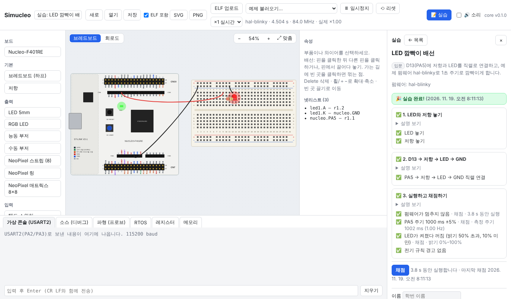

# 실습(레슨) 안내 — 선생님용

Simucleo의 **📝 실습**은 단계별 안내와 자동 채점이 붙은 과제입니다. 학생은 브레드보드에 배선하고,
펌웨어를 실행해 결과를 확인하고, 마지막에 결과 파일을 제출합니다. 서버가 필요 없고 모든 것이
학생 브라우저 안에서 돌아갑니다.



## 1. 수업에서 쓰기

1. 툴바의 **📝 실습**을 누르면 오른쪽에 실습 목록이 열립니다.
2. 실습의 **시작**을 누르면 그 실습의 시작 회로와 예제 펌웨어를 불러옵니다.
   - 이미 배선한 내용이 있으면 먼저 물어봅니다. 그때의 프로젝트는 브라우저에 **백업**해 두며,
     실습 목록 아래 **실습 전 프로젝트 되돌리기**로 다시 열 수 있습니다. 파일로 남기려면 취소하고 먼저
     툴바의 **저장**을 누르세요.
   - 한 번 시작한 실습은 목록에서 **이어서 하기**(지금 회로 그대로)와 **처음부터**(시작 회로를 다시
     불러옴) 중에서 고릅니다.
3. 단계마다 설명과 검사 목록이 나옵니다. 지금 할 단계는 파란 테두리로 표시됩니다.
   - **배선 검사**는 학생이 배선하는 동안 바로바로 ✅/❌로 바뀌고, 틀리면 이유를 알려 줍니다
     (예: "PA5가 GND로 가는 길에 저항이 없습니다.", "저항과 LED가 PA6 (D12)에 연결되어 있습니다. PA5 (D13)에
     연결하세요.", "LED 방향이 반대입니다.").
   - **동작 검사**(검사 이름 옆에 "채점")는 **채점** 버튼으로 확인합니다. 채점은 펌웨어를 리셋하고 정해진
     시뮬레이션 시간(실습마다 2–4초, 진행 막대 표시) 동안 실행하면서 핀의 주기, LED 밝기, 콘솔 출력 등을
     잽니다. 필요하면 채점 중에 버튼을 자동으로 누르거나 가변저항을 돌립니다.
   - 채점은 시뮬레이션 시간으로 재므로 결과는 실행 속도와 상관없습니다. 다만 툴바의 실행 속도가 느리면
     (×0.1 등) 채점도 그만큼 오래 걸립니다.
4. 모든 검사가 ✅가 되면 **🎉 실습 완료!**와 완료 시각이 나오고, 목록의 실습에 ✅가 붙습니다.


### 함께 들어 있는 실습

| 순서 | id | 제목 | 수준 | 펌웨어 | 학생이 하는 일 · 채점 내용 |
|---|---|---|---|---|---|
| 1 | `led-blink` | LED 깜빡이 배선 | 입문 | `hal-blinky` | 빈 보드에 LED·저항을 놓고 D13(PA5) → 저항 → LED → GND. PA5 주기 1000 ms ± 5 %, LED 켜짐·꺼짐, 전기 규칙 경고 없음 |
| 2 | `button-exti` | 버튼 인터럽트 | 초급 | `hal-button-exti` | 버튼을 D2(PA10)–GND, LED를 D7(PA8)에. 채점이 버튼을 두 번 눌러 콘솔의 `D2 pressed` 두 번과 LED 토글을 확인 |
| 3 | `pwm-rgb` | PWM으로 RGB LED 밝기 조절 | 초급 | `hal-pwm-led` | RGB LED와 저항 3개를 D3/D5/D6(PB3/PB4/PB10)에. 듀티비 90 % 이상·10 % 이하인 순간, LD2 숨쉬기, 세 색이 각각 켜졌다 꺼짐 |
| 4 | `adc-servo` | 가변저항(ADC)으로 서보 돌리기 | 중급 | `hal-adc-servo` | 가변저항을 3V3–GND, 와이퍼를 A0(PA0)에, 서보를 5V·GND·D9(PC7)에. 채점이 손잡이를 10 % → 90 %로 돌려 콘솔 `pot` 값 변화(2000 이상)와 서보 회전(90° 이상)을 확인 |
| 5 | `i2c-oled` | I2C OLED 시계 | 중급 | `hal-i2c-oled` | RTC·AHT20이 이미 연결된 I2C 버스에 OLED의 VCC·GND·SCL(D15)·SDA(D14)를 연결. 펌웨어가 멈추지 않음, 버스 검색에 `0x3C`, OLED에 글자 |
| 6 | `blink-2hz` | 내 펌웨어 올리기: 2 Hz 깜빡이 | 중급 | 학생이 직접 빌드 | STM32CubeIDE에서 `HAL_Delay(250)`로 PA5 토글(코드 힌트가 단계에 있음), **ELF 업로드** 후 채점. PA5 주기 500 ms ± 5 % |

6번의 모범 답안 펌웨어는 `firmware/lesson-blink-2hz`에 있지만 사이트에는 포함하지 않습니다(테스트 전용).

## 2. 결과 제출받기

실습 목록과 각 실습 아래에 **이름** 칸과 **결과 내보내기** 버튼이 있습니다.

1. 학생이 이름 칸에 학번과 이름을 적습니다(브라우저에 기억됨).
2. **결과 내보내기 (CSV)** 또는 **JSON**을 누르면 `lesson-results_<이름>.csv`(또는 `.json`) 파일이
   내려받아집니다.
3. 학생이 그 파일을 LMS 과제함이나 메일로 제출합니다.

진행 상황(검사 결과, 시각, 채점 횟수, 완료 시각)은 학생 브라우저의 IndexedDB에 실습별로 저장되어,
새로고침하거나 다음 시간에 다시 열어도 남아 있습니다. 다른 컴퓨터로는 따라가지 않으니 수업이 끝날 때
내보내게 하세요.

### CSV 형식

엑셀에서 한글이 깨지지 않도록 UTF-8 BOM이 붙어 있고, 검사 하나가 한 줄입니다.

| 열 | 뜻 |
|---|---|
| `student` | 이름 칸에 적은 내용 |
| `lesson_id`, `lesson_title` | 실습 id와 제목 |
| `completed_at` | 처음으로 모든 검사를 통과한 시각(ISO 8601, UTC). 아직이면 빈칸 |
| `attempts` | 채점 버튼을 누른 횟수 |
| `step` | 단계 번호(1부터) |
| `check` | 검사 이름 |
| `result` | `pass` 또는 `fail` |
| `checked_at` | 이 검사의 결과가 마지막으로 바뀐 시각 |
| `detail` | 측정값(예: `측정 주기 1002 ms (1.00 Hz)`) |
| `hint` | 실패했을 때 학생이 본 안내 |

여러 학생의 CSV는 첫 줄(머리글)만 빼고 이어 붙이면 한 표가 됩니다. JSON은 같은 내용을
`{ "format": "simucleo-lesson-results", "version": 1, "student", "exportedAt", "lessons": [ { "id", "title",
"startedAt", "completedAt", "attempts", "passed", "total", "checks": [ { "key", "step", "label", "pass", "at",
"detail", "hint" } ] } ] }` 구조로 담습니다(`step`은 0부터).

## 3. 새 실습 만들기

실습은 `web/lessons/<이름>.json` 파일 하나입니다. 폴더에 파일을 넣고 사이트를 다시 빌드하면
(`npm run build`) 목록에 나타납니다. 파일에 오류가 있으면 목록에 시작 버튼 대신 오류 내용이 나오고,
`npm test`도 실패합니다.

### 파일 구조

```json
{
  "id": "led-blink",
  "order": 1,
  "title": "LED 깜빡이 배선",
  "level": "입문",
  "goal": "D13(PA5)에 저항과 LED를 직렬로 연결하고 1초 주기로 깜빡이게 합니다.",
  "start": "empty",
  "firmware": { "example": "hal-blinky.elf" },
  "grade": { "ms": 4000, "stimuli": [] },
  "steps": [
    {
      "title": "D13 → 저항 → LED → GND",
      "text": ["보드의 **D13**은 MCU의 `PA5` 핀입니다.", "", "- 목록도 쓸 수 있습니다"],
      "checks": [
        { "type": "series", "from": "PA5", "to": "GND", "through": ["resistor", "led-5mm"] }
      ]
    }
  ]
}
```

| 필드 | 필수 | 설명 |
|---|---|---|
| `id` | ✔ | 영문 id. 진행 상황과 결과 파일에 쓰이므로 배포한 뒤에는 바꾸지 마세요 |
| `order` | ✔ | 목록 순서(숫자, 겹치지 않게) |
| `title`, `level`, `goal` | ✔ | 제목, 수준(입문·초급·중급 등 자유), 한두 문장의 목표 |
| `start` | ✔ | 시작 회로: `"empty"`(보드 + 빈 브레드보드), `{ "example": "hal-adc-servo.simucleo.json" }`(`web/examples`의 예제 프로젝트), `{ "project": { "parts": [...], "wires": [...] } }`(직접 적은 회로, `.simucleo.json` 파일의 `parts`·`wires`와 같은 형식) |
| `firmware` | | `{ "example": "hal-blinky.elf" }`(사이트에 들어 있는 예제 ELF, `web/scripts/examples.mjs` 목록), 또는 `"upload"`(학생이 직접 빌드해 올림). 없으면 펌웨어를 바꾸지 않음 |
| `grade.ms` | | 채점할 때 실행할 시뮬레이션 시간(ms). 없으면 검사마다 필요한 시간 중 가장 긴 것 |
| `grade.stimuli` | | 채점 중에 할 조작(아래) |
| `steps` | ✔ | 단계 목록. 각 단계는 `title`, `text`, `checks` |

`start`의 `project`를 쉽게 만들려면 편집기에서 원하는 시작 회로를 그린 뒤 **저장**한 파일에서
`parts`와 `wires`를 복사하세요. 시작 회로에 부품만 놓고 배선을 비워 두면 학생이 배선할 몫이 됩니다.

**단계 설명(`text`)** 은 문자열이나 줄의 배열(이어 붙임)이고, 간단한 Markdown을 씁니다:
`**굵게**`, `` `코드` ``, `- 목록`, `1. 번호 목록`, `### 소제목`, 빈 줄로 문단 나누기, ```` ``` ```` 로
감싼 코드 블록. HTML은 쓸 수 없습니다(글자 그대로 보임). 검사가 없는 단계(`"checks": []`)는 읽기만
하는 단계입니다.

**부품은 id가 아니라 종류(`kind`)로 찾습니다.** 학생이 부품 이름을 `led1`이든 `myLed`든 마음대로 지어도
됩니다. 같은 종류가 여럿이면 그중 하나라도 맞으면 통과입니다. 부품 종류 이름은 저장한 프로젝트 파일의 `kind`나
`web/src/parts/*.tsx`를 보세요(예: `led-5mm`, `resistor`, `rgb-led`, `tact-switch`, `potentiometer`,
`servo`, `dc-motor`, `oled-ssd1306`, `lcd-i2c`, `buzzer-passive`).

**신호 이름**: `PA5`처럼 MCU 핀 이름을 씁니다(Arduino 이름 `D13`이 아님 — 같은 신호인 Morpho 핀에
연결해도 맞게 하려고). 전원은 `GND`, `3V3`, `5V`, `VIN`. 안내 문구에는 `PA5 (D13)`처럼 둘 다 나옵니다.

### 검사 종류

모든 검사에 공통으로 `label`(검사 목록에 보일 이름, 없으면 자동으로 만듦)과 `hint`(실패했을 때 자동
안내 대신 보일 문장)를 붙일 수 있습니다.

#### 배선 검사 — 배선하는 동안 바로 채점

| `type` | 필드 | 통과 조건 | 실패 안내 예 |
|---|---|---|---|
| `part` | `kind`, `count`(기본 1) | 그 종류의 부품이 `count`개 이상 있음 | "LED가 없습니다. 왼쪽 부품 목록에서 …", "저항 3개가 필요합니다 (지금 1개)." |
| `connected` | `kind`, `pin`, `to` | 그 종류의 어떤 부품의 핀 `pin`이 신호 `to`와 같은 넷(직접 또는 브레드보드·다른 부품 핀을 거쳐 전선으로) | "OLED의 SDA 핀이 PB9 (D14)에 연결되어 있지 않습니다. 지금은 PB8 (D15)에 연결되어 있습니다." |
| `series` | `from`, `to`, `through` | `from`에서 `to`까지 `through`의 부품들이 **정확히 그만큼** 직렬로(순서는 상관없음) 이어짐. LED는 애노드가 `from` 쪽이어야 함 | "PA5가 GND로 가는 길에 저항이 없습니다.", "LED 방향이 반대입니다.", "저항과 LED가 PA6 (D12)에 연결되어 있습니다. PA5 (D13)에 연결하세요.", "PA5가 GND에 바로 연결되어 있습니다 (단락)." |
| `noWarnings` | — | 지금 화면에 전기 규칙 경고(저항 없는 LED의 과전류, 단락, 5 V 초과 등)가 없음. 경고는 전류가 흐를 때(실행 중) 생기므로 채점 단계에 두세요 | "전기 규칙 경고가 있습니다: …" |

`series`의 `through`에 쓸 수 있는 것: `resistor`(1–2), `led-5mm`(A → K), `tact-switch`(누르면 이어지는
1쪽 ↔ 2쪽), `potentiometer`(양 끝 1–2), RGB LED의 한 색 `rgb-led:R`·`rgb-led:G`·`rgb-led:B`(공통 캐소드면
색 → COM, 공통 애노드면 COM → 색). 예: 버튼이 D2와 GND 사이에 있는지는
`{ "type": "series", "from": "PA10", "to": "GND", "through": ["tact-switch"] }`, 가변저항 양 끝이 3V3과
GND에 있는지는 `{ "type": "series", "from": "3V3", "to": "GND", "through": ["potentiometer"] }`.

#### 동작 검사 — "채점" 버튼으로

| `type` | 필드 | 통과 조건 | 기본 채점 시간 |
|---|---|---|---|
| `running` | — | 채점하는 동안 펌웨어가 멈추지 않음(`Error_Handler`, HardFault 등이 없음) | 1 s |
| `period` | `pin`, `ms`, `tolerance`(기본 0.05) | 핀의 주기(상승 에지 사이, 처음 한 주기는 빼고 평균)가 `ms` ± `tolerance`×`ms`. 레벨 변화를 프로브로 정확히 잼 | 3.5 × `ms` + 0.3 s |
| `brightness` | `kind`, `channel`(RGB LED: 0 R, 1 G, 2 B), `above`, `below` | 그 종류의 LED가 어느 순간 `above`보다 밝았고, 어느 순간 `below`보다 어두웠음(둘 중 하나만 써도 됨, 0–1) | 2.5 s |
| `duty` | `pin`, `min`, `max`, `mode`(`"some"` 기본 / `"always"`) | 핀의 PWM 듀티비(화면 한 프레임 평균, 0–1)가 어느 순간(`some`) 또는 내내(`always`) `min`–`max` 안 | 2.5 s |
| `console` | `pattern`, `flags`, `count`(기본 1) | 가상 콘솔(USART2) 출력에 정규식 `pattern`이 `count`번 이상 나옴. JSON에서는 `\`를 `\\`로 | 2 s |
| `consoleValues` | `pattern`, `minSpread` | `pattern`의 첫 번째 괄호가 잡은 숫자들의 최댓값 − 최솟값이 `minSpread` 이상(예: `"pot\\s+(\\d+)"`) | 2 s |
| `motion` | `kind`, `field`(`"angle"` 서보 / `"rpm"` 모터), `minSpread` | 각도(°) 또는 회전수가 `minSpread` 이상 바뀜 | 2.5 s |
| `display` | `kind`, `minPixels`(기본 20), `text` | OLED: 켜진 픽셀이 `minPixels`개 이상. 문자 LCD(`lcd-i2c`): 글자가 나옴(`text`가 있으면 그 정규식에 맞는 글자) | 2 s |

채점은 펌웨어를 리셋하고 `grade.ms`(없으면 위 시간 중 가장 긴 것, 조작이 있으면 마지막 조작 + 0.6 s
이상) 동안 실행합니다. 펌웨어가 중간에 멈추면 그때까지 본 것으로 채점합니다.

### 채점 중 조작 (`grade.stimuli`)

학생이 직접 해야 하는 조작(버튼 누르기, 손잡이 돌리기)을 채점 때는 자동으로 합니다. `at`은 채점 시작부터의
시뮬레이션 시간(ms)입니다.

```json
"grade": {
  "ms": 3000,
  "stimuli": [
    { "at": 500, "press": "tact-switch", "ms": 150 },
    { "at": 1300, "press": "B1" },
    { "at": 300, "set": { "kind": "potentiometer", "prop": "position", "value": 0.1 } }
  ]
}
```

- `press`: 그 종류의 첫 부품(또는 보드의 파란 버튼 `B1`)을 `ms`(기본 100) 동안 누름
- `set`: 그 종류의 첫 부품의 속성을 바꿈(가변저항 `position` 0–1, LDR `lux`, 온도센서 `temp` 등 속성 창에
  있는 값). 채점이 끝나도 바뀐 값은 그대로입니다

### 확인하기

```bash
cd web
npm test          # 모든 레슨 파일의 형식, 예제·펌웨어 이름, 부품 종류를 검사
npm run build && npm run preview
```

함께 들어 있는 실습들은 `web/e2e/lessons.spec.ts`에서 예제의 배선으로 모두 통과하는지 확인합니다. 새
실습도 같은 방식으로 테스트를 추가해 두면 펌웨어나 부품이 바뀌어도 채점이 맞는지 알 수 있습니다.
