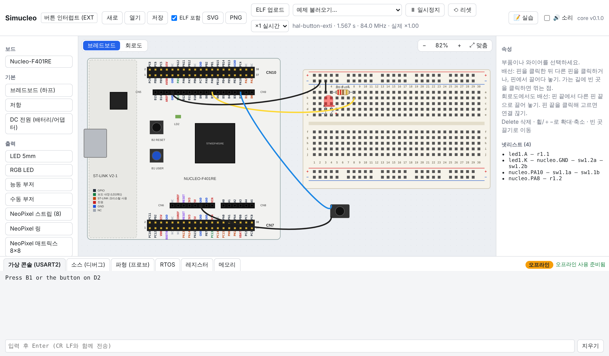

# 오프라인에서 쓰기 (설치형 앱)

Simucleo는 한 번 열어 두면 인터넷 없이도 쓸 수 있다(M29). 인터넷이 자주 끊기는 교실에서도 앱을
열고, 예제 펌웨어를 실행하고, 실습을 하고, 자기 ELF와 프로젝트를 불러올 수 있다. 서버는 없다 —
모든 것이 브라우저 안에서 돈다.

## 1. 처음 한 번은 인터넷에서 열기

1. 인터넷이 될 때 https://elecage.github.io/Simucleo/ 를 연다.
2. 아래 탭 줄 오른쪽에 **오프라인 준비 중 n%**가 보이며 앱의 모든 파일을 내려받는다. 시뮬레이터(WASM),
   화면, 예제 펌웨어 35개와 그 배선, 예제 소스, 실습이 모두 들어 있고 약 40 MB다. 그동안에도 앱은 그대로
   쓸 수 있다.
3. **오프라인 사용 준비됨**(초록)이 나오면 끝이다. 이제 이 브라우저에서는 인터넷 없이도 같은 주소로 열린다.

수업 전에 교실의 컴퓨터마다 한 번씩 열어 두면 된다. 크롬·엣지·파이어폭스·사파리의 최신 판에서 된다.
시크릿(프라이빗) 창은 창을 닫으면 저장한 것이 지워지므로 쓰지 않는다.

## 2. 설치하기

브라우저가 앱 설치를 허락하면 아래 탭 줄 오른쪽에 **⬇ 설치**가 나온다. 누르면 브라우저의 설치 창이 뜨고, 설치한
뒤에는 바탕화면·시작 메뉴·앱 목록의 Simucleo 아이콘으로 주소창 없는 창에서 열린다.

- 크롬·엣지(Windows, macOS, 크롬북, 안드로이드): **⬇ 설치** 버튼, 또는 주소창 오른쪽의 설치 아이콘
- 아이폰·아이패드(사파리): 공유 버튼 → **홈 화면에 추가**
- 버튼이 안 보이면 이미 설치했거나 그 브라우저가 설치를 지원하지 않는 것이다. 설치하지 않아도
  오프라인 사용은 된다(1번만 하면 된다)

## 3. 오프라인에서 쓰기

- 인터넷이 끊기면 아래 탭 줄 오른쪽에 주황색 **오프라인** 배지가 보인다. 다시 연결되면 사라진다.
- 오프라인에서도 앱 열기, 새로 고침, 예제 펌웨어와 예제 배선, 예제 소스 보기, 실습(채점, 결과 내보내기),
  ELF 업로드, 프로젝트 저장·열기, 자동 저장, SD 카드 이미지가 모두 된다.
- 직접 올린 ELF와 프로젝트, 자동 저장, 실습 진행, SD 카드 내용은 원래부터 이 브라우저 안(IndexedDB,
  localStorage)에 저장된다. 오프라인 캐시와는 따로 있어서 업데이트해도 지워지지 않는다.
- 페이지는 인터넷이 있어도 저장된 버전으로 열린다. 화면과 예제·실습 파일이 늘 같은 버전이어야 하기 때문이다.
  새 버전은 **새로 고침** 배너로 받으면 화면과 파일이 함께 바뀐다.

## 4. 업데이트

새 버전이 배포된 뒤 인터넷이 될 때 앱을 열면, 바뀐 파일만 뒤에서 내려받는다. 다 받으면 아래에
**새 버전이 있습니다 — 새로 고침**이 나온다.

- **새로 고침**을 누르면 새 버전으로 다시 연다. 배선과 펌웨어는 자동 저장되어 있어서 그대로 돌아온다.
- 시뮬레이션이 실행 중이면 먼저 묻는다. **취소**하면 실행은 그대로 이어진다. 앱은 묻지 않고 스스로
  새로 고치지 않는다.
- **✕**로 배너를 닫으면 지금 버전을 계속 쓴다. 다음에 앱을 열 때 다시 알려 준다.
- 탭을 여러 개 열어 두었으면 한 탭에서 새로 고친 뒤 다른 탭에도 배너가 나온다. 그 탭도 새로 고친다.

## 5. 문제가 있을 때

- **오프라인 준비 실패**: 내려받는 중에 인터넷이 끊겼다. 인터넷이 될 때 다시 열면 이어서 받는다.
- 저장 공간이 모자라면 브라우저가 캐시를 지울 수 있다. 그러면 인터넷에서 한 번 다시 열면 된다.
- 캐시를 완전히 지우려면 브라우저 설정의 사이트 데이터에서 이 사이트를 지운다. 이때 자동 저장과
  실습 진행도 함께 지워지므로 필요한 프로젝트와 결과는 먼저 파일로 저장한다.

## 만드는 쪽

- `web/public/manifest.webmanifest`: 앱 이름, 시작 주소(`./`, GitHub Pages의 `/Simucleo/` 아래),
  standalone 창, 색, 아이콘. 아이콘은 `web/public/icons/*.svg`에서 `node web/scripts/icons.mjs`로 만든 PNG다
- `web/sw/service-worker.js`: 서비스 워커. `vite build`의 마지막 단계(`web/scripts/precache.mjs`의 Vite
  플러그인)가 `dist/`의 모든 파일을 SHA-256과 함께 목록으로 넣어 `dist/sw.js`를 만든다. 캐시 이름은
  `simucleo-<파일 내용 해시 12자리>`라 파일이 하나라도 바뀌면 바뀐다. 예제(`examples/index.json`)나
  실습이 목록에 빠지면 빌드가 실패한다
- `web/src/pwa.ts`, `web/src/PwaUi.tsx`: 등록(프로덕션 빌드에서만, `vite dev`에서는 안 함), 준비 상태,
  업데이트 배너, 설치 버튼, 오프라인 배지
