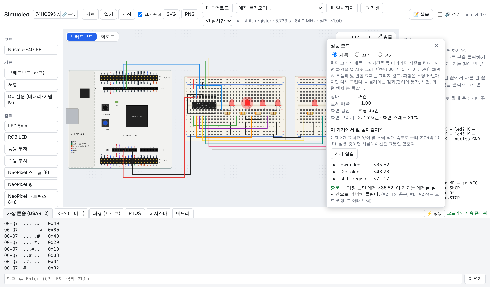

# 저사양 기기에서 쓰기 (성능 모드·기기 점검)

학교 크롬북이나 오래된 노트북에서도 Simucleo가 실시간으로 돌게 했다(M31). 시뮬레이션은 웹 워커에서 돌고, 화면은
페이지 스레드가 그린다. 느린 기기에서는 화면 그리기가 페이지 스레드를 다 써 버려 클릭과 끌기가 굼떠지고, 코어가 적은
기기에서는 시뮬레이션까지 느려진다. **성능 모드**는 화면만 덜 그리고, 시뮬레이션 결과는 하나도 바꾸지 않는다.
**기기 점검**은 이 기기가 얼마나 빠른지 10초 만에 알려 준다. 서버는 그대로 없다.



## 1. 이 기기에서 잘 돌아갈까? (기기 점검)

1. 아래 탭 줄 오른쪽(오프라인 상태 옆)의 **⚡ 성능**을 누른다.
2. 창 아래의 **기기 점검**을 누른다. 예제 3개(`hal-pwm-led` 타이머 PWM, `hal-i2c-oled` I2C와 OLED,
   `hal-shift-register` 부품 20개와 SPI)를 화면 없이 최대 속도로 2초씩 돌린다. 약 10초 걸린다. 실행 중이던
   시뮬레이션은 그동안 멈췄다가 다시 돈다.
3. 예제마다 **실시간의 몇 배**로 돌았는지와 판정이 나온다. 판정은 가장 느린 예제로 정한다.

| 판정 | 가장 느린 예제 | 뜻 | 할 일 |
|---|---|---|---|
| **충분** | ×2 이상 | 예제를 실시간으로 넉넉히 돌린다 | 그대로 쓴다(성능 모드는 자동) |
| **성능 모드 권장** | ×1.1–×2 | 실시간은 되지만 화면까지 그리면 여유가 적다 | 성능 모드를 **켜기**로 두거나 자동에 맡긴다 |
| **느림** | ×1.1 미만 | 화면 없이도 실시간을 못 따라간다 | 성능 모드를 켠다. 시간이 느리게 갈 뿐 결과는 같다 |

수업 전에 교실 기기 하나에서 해 보면 된다. 다른 탭과 프로그램을 닫고, 노트북은 전원을 꽂고 한다(배터리 절약 모드는
CPU를 늦춘다). 점검은 시뮬레이션만 재고, 화면 그리기는 재지 않는다 — 화면이 무거운지는 아래 **실제 배속**과
성능 모드 창의 **화면 그리기**로 본다.

## 2. 실제 배속 읽기

툴바 상태 줄의 **실제 ×1.00**은 최근 1.5–2초 동안 흐른 시뮬레이션 시간을 실제 시간으로 나눈 값이다. 시뮬레이터가
계산한 시간과 화면에 보인 시간 중 느린 쪽을 쓴다. 속도를 **×1 실시간**으로 두었는데 ×0.9보다 작으면 이 기기가 못 따라가는
것이다. 그래도 결과는 같다 — 펌웨어 안의 1초는 언제나 1초이고, 바깥에서 보기에 천천히 흐를 뿐이다. 백그라운드 탭에
있다가 돌아오면 처음부터 다시 잰다.

## 3. 성능 모드

**⚡ 성능**을 누르면 나오는 창에서 고른다. 고른 것은 이 브라우저에 저장된다.

- **자동**(처음 값): 화면 그리기가 페이지 스레드의 절반 넘게 쓰면서 실시간을 못 따라가거나, 프레임을 건너뛰거나,
  스레드가 꽉 찬 상태가 3초 넘게 이어지면 켠다. 그러면 버튼이 **⚡ 성능 모드 켜짐**으로 바뀐다(누르면 사라진다).
  모든 프레임을 다 그려도 여유가 넉넉한 상태가 10초 넘게 이어지면 다시 끈다. 켜고 끄는 조건이 멀리 떨어져 있어
  왔다 갔다 하지 않는다.
- **켜기**: 늘 가볍게 그린다. 판정이 "성능 모드 권장"이나 "느림"인 기기에.
- **끄기**: 늘 모든 프레임을 그린다.

켜면 달라지는 것(화면만):

- 화면을 덜 자주 그린다. 시뮬레이터는 프레임을 초당 60개 그대로 만들고, 화면에는 몇 개씩 묶어 초당 30번 보낸다.
  그래도 바쁘면 15 → 10 → 5번으로 줄이고, 한가해지면 다시 늘린다. 페이지가 앞의 묶음을 다 그린 뒤에만 다음 묶음을 보내서
  메시지가 쌓이지 않는다.
- 파형은 실행 중 초당 10번까지만 다시 그린다.
- 캔버스에서 화면 밖에 있는 부품은 마지막 모습 그대로 둔다(다시 보이면 따라온다).
- 켜진 LED의 빛 번짐(그림자 필터)을 그리지 않는다.

그대로인 것: 펌웨어 동작, 콘솔, 실습 채점, 파형 캡처, 시뮬레이션 시간. 프레임은 모두 만들어지고, 채점과 파형에는
묶음 안의 프레임이 하나도 빠짐없이 차례로 간다. E2E 테스트가 성능 모드를 끄고 켠 두 번의 실행을 시뮬레이션 시간으로
비교한다(LD2·USART2 TX 에지, 콘솔 출력, 나이트라이더 실습 채점 결과가 같음).

모드와 상관없이 늘 하는 것(M31): 숨은 탭(소스, 파형)은 프레임마다 다시 그리지 않고, 캔버스의 부품은 자기 상태가 바뀔
때만 다시 그린다(브레드보드 구멍 400개를 LED 하나가 깜빡일 때마다 다시 그리지 않음).

## 4. 교실에서

- 느린 기기는 성능 모드를 **켜기**로 두고 시작한다. 판정이 "충분"이면 자동에 맡긴다.
- 파형 탭은 필요할 때만 연다. 프로브가 많고 빠른 신호(SPI, PWM)일수록 프레임이 커진다.
- 아래 표에서 배율이 낮은 예제(`hal-bldc-*`, `hal-spi-sd-logger`)는 느린 기기에서 실시간보다 느리게 돈다. 결과는 같으니
  관찰에는 문제가 없지만, 실습은 가벼운 예제로 한다.
- 펌웨어의 대기 루프가 매번 레지스터에 쓰면(예: 루프마다 `__HAL_TIM_SET_COMPARE`) 시뮬레이터가 대기를 건너뛰지 못해
  84 MHz의 명령을 하나하나 실행한다. 값이 바뀔 때만 쓰면 훨씬 빠르다(`lesson-parking`이 이것으로 네이티브 ×0.4 → ×100).

## 5. 예제별 속도

`web/scripts/bench.mjs`가 함께 들어 있는 예제를 모두 배선과 함께 화면 없이 3초씩 돌려, 워커와 같은 방식(10 ms씩,
1/60초마다 프레임)으로 잰다. 네이티브(`crates/wasm/examples/bench.rs`, 같은 진입점)와 Node의 WebAssembly(브라우저와
같은 V8)를 따로 잰다. 브라우저의 워커는 16 ms마다 12 ms까지 계산하므로 실제 배속은 WASM 배율의 약 0.75배까지 나온다.
크롬북급 CPU는 아래 기계보다 3–5배 느리다고 보면 된다.

```sh
cd web
node scripts/bench.mjs                 # 표 출력 (네이티브 + WASM)
node scripts/bench.mjs --native --check 1.5   # CI: 네이티브로 ×1.5보다 느린 예제가 있으면 실패
node scripts/bench.mjs --write ../docs/performance.md   # 이 표를 고침
```

CI는 `--check 1.5`로 네이티브 릴리스 빌드에서 ×1.5보다 느린 예제가 없는지 본다. 느리게 나온 예제는 두 번 더 재어
가장 좋은 값을 쓰므로, 바쁜 기계에서 우연히 실패하지 않는다. `hal-blinky-hse-crystal`은 일부러 `Error_Handler`에서
멈추는 예제라 "멈춤"이다.

<!-- bench:start -->
3 s 시뮬레이션, Intel(R) Xeon(R) Processor @ 2.10GHz (4코어), Node v22.23.5. 배율 = 시뮬레이션 시간 / 실제 시간(클수록 빠름).

| 예제 | 부품 | 네이티브 | WASM (Node) |
|---|---:|---:|---:|
| `hal-uart-printf` | — | ×441 | ×127 |
| `hal-blinky` | — | ×514 | ×169 |
| `hal-blinky-hse-bypass` | — | ×441 | ×275 |
| `hal-blinky-hse-crystal` | — | 멈춤 | 멈춤 |
| `hal-button-exti` | 5 | ×429 | ×321 |
| `hal-pwm-led` | 6 | ×106 | ×51.7 |
| `hal-buzzer-melody` | 3 | ×314 | ×198 |
| `hal-adc-servo` | 8 | ×37.0 | ×30.8 |
| `hal-i2c-oled` | 5 | ×78.3 | ×53.8 |
| `hal-spi-sd-logger` | 6 | ×2.5 | ×1.9 |
| `hal-neopixel-dma` | 2 | ×16.6 | ×10.1 |
| `hal-dht-capture` | 3 | ×393 | ×217 |
| `hal-7seg-keypad` | 13 | ×56.2 | ×34.6 |
| `hal-encoder-stepper-lcd` | 7 | ×71.6 | ×46.2 |
| `hal-sonar-onewire` | 4 | ×64.8 | ×48.0 |
| `hal-imu-matrix` | 5 | ×82.1 | ×54.2 |
| `hal-ir-remote` | 2 | ×381 | ×229 |
| `hal-onewire-multi` | 5 | ×19.5 | ×13.8 |
| `hal-bluetooth-led` | 2 | ×425 | ×236 |
| `hal-relay` | 6 | ×605 | ×413 |
| `hal-servos-multi` | 4 | ×263 | ×101 |
| `hal-shift-register` | 20 | ×213 | ×123 |
| `hal-tm1637-clock` | 2 | ×210 | ×115 |
| `hal-joystick-oled` | 3 | ×9.1 | ×6.4 |
| `hal-pir-alarm` | 5 | ×632 | ×438 |
| `hal-bmp280` | 3 | ×357 | ×235 |
| `hal-neopixel-chain` | 3 | ×11.8 | ×7.3 |
| `hal-stepper-a4988` | 4 | ×21.6 | ×13.2 |
| `hal-stepper-l298n` | 4 | ×41.6 | ×23.0 |
| `hal-esc-bldc` | 5 | ×281 | ×192 |
| `hal-bldc-hall` | 4 | ×20.9 | ×16.7 |
| `hal-bldc-pwm` | 6 | ×3.1 | ×2.0 |
| `hal-bldc-sensorless` | 15 | ×2.5 | ×1.7 |
| `freertos-two-tasks` | — | ×76.3 | ×47.9 |
| `freertos-queue-uart` | — | ×78.8 | ×48.9 |
| `lesson-led-on` | 4 | ×700 | ×454 |
| `lesson-button-poll` | 5 | ×455 | ×306 |
| `lesson-knight-rider` | 10 | ×359 | ×259 |
| `lesson-timer-irq` | 6 | ×80.8 | ×52.0 |
| `lesson-ldr-nightlight` | 6 | ×157 | ×110 |
| `lesson-joystick-servos` | 4 | ×81.7 | ×79.2 |
| `lesson-uart-cmd` | 1 | ×546 | ×370 |
| `lesson-sleep-wfi` | 4 | ×950 | ×693 |
| `lesson-scope-mystery` | 6 | ×55.1 | ×36.4 |
| `lesson-debug-average` | 5 | ×201 | ×148 |
| `lesson-thermostat` | 7 | ×90.8 | ×66.4 |
| `lesson-parking` | 10 | ×104 | ×76.6 |
| `lesson-digital-clock` | 5 | ×219 | ×148 |
| `bare-blinky` | — | ×3.9 | ×2.8 |
<!-- bench:end -->

## 6. 한계

- 크롬 개발자 도구의 CPU 제한(E2E가 쓰는 것)은 페이지 스레드만 느리게 한다. 이때 시뮬레이션은 워커에서 제 속도로 돌아,
  성능 모드를 꺼도 실제 배속이 떨어지지 않는다 — 떨어지는 것은 클릭·끌기의 반응과 프레임 수다. 코어를 나눠 쓰는 실제
  저사양 기기에서는 페이지 스레드가 바쁜 만큼 시뮬레이션도 느려지는데, 이것은 테스트로 흉내 내지 못했다. 그래서 E2E는
  CPU 제한에서 성능 모드가 페이지 스레드의 일을 줄이고(브라우저가 잰 작업 시간 절반 이하) 실제 배속을 낮추지 않는 것을 본다.
- 화면 그리기 시간은 메시지 처리 + React 렌더·커밋 + 다음 애니메이션 프레임부터 그다음 작업까지(스타일·레이아웃·페인트)로
  어림한다. GPU에서 하는 합성은 들어가지 않는다.
- 묶음으로 그릴 때 LED 밝기·버저 소리는 묶음의 마지막 프레임 것이다(짧게 깜빡인 것은 화면에서 놓칠 수 있다. 채점은 모든
  프레임을 본다).
- 화면 밖 부품은 부품 상자에 4칸 여유를 두고 정한다. 상자 밖으로 크게 그리는 부품(사람이 지나가는 PIR 등)은 가장자리에서
  늦게 따라올 수 있다.
- 기기 점검은 시뮬레이션 속도만 잰다. 화면이 큰 기기(고해상도 모니터)는 그리기도 무거운데, 그것은 성능 모드 창의
  **화면 그리기**와 자동 모드가 맡는다.
