# 로드맵

| 단계 | 내용 | 완료 기준 |
|---|---|---|
| **M0 · CPU 코어** ✅ | Thumb/Thumb-2 전체, FPv4-SP, 공용 예외/NVIC 모델(SVC, PendSV, SysTick, BASEPRI, PSP, FP 프레임), Unicorn 차분 테스트 백엔드 | `bare-blinky`가 무한 루프까지 실행, 차분 테스트 통과 |
| **M1 · 기본 Peripheral** ✅ | SVD 기반 레지스터 맵, RCC/PWR/FLASH, GPIO, SysTick, USART2(VCP), 미구현 접근 리포트, `Error_Handler` 감지 | CubeMX `hal-blinky`, `hal-uart-printf`가 CLI에서 동작 |
| **M2 · 웹 실행** ✅ | Web Worker 실행 루프, 실시간 동기/배속, LD2·B1, **가상 콘솔**, 레지스터/메모리 뷰 | 브라우저에서 ELF 업로드 → LD2 깜빡임, `printf` 출력 |
| **M3 · 디지털 부품** ✅ | EXTI, TIM 기본/PWM, Tier 1 부품(LED, RGB LED, 버튼, 부저), 전기 규칙 검사, 프로브/파형 뷰, 프로젝트 저장 | 버튼 인터럽트, PWM 밝기, 부저 멜로디 예제 |
| **M4 · FreeRTOS** ✅ | CubeMX FreeRTOS 실행, TIM 타임베이스, WFI 시간 건너뛰기, **RTOS 뷰**(태스크, 스택, 전환 타임라인) | `freertos-two-tasks`, `freertos-queue-uart` |
| **M5 · 아날로그/구동** ✅ | ADC, MNA DC 솔버, Tier 2 부품(가변저항, LDR, 아날로그 온도센서, 서보, DC 모터) | 가변저항 → ADC → 서보/모터 제어 예제 |
| **M6 · 버스 장치** ✅ | I2C, SPI Peripheral, Tier 3 부품(SSD1306 I2C/SPI, I2C RTC, SPI SD 카드 + FatFs, I2C 온습도센서) | OLED 그래픽, RTC 시계, SD 카드 로깅 예제 |
| **M7 · 타이밍 민감 장치** ✅ | DMA, 입력 캡처, Tier 4 부품(NeoPixel, DHT11/22) | NeoPixel 무지개, DHT 측정 예제 |
| **M8 · 추가 부품** ✅ | 7세그먼트(1·4자리), 4×4 키패드, 로터리 엔코더(+TIM 엔코더 모드), NTC 서미스터, 초음파 거리센서, DS18B20(1-Wire), I2C 문자 LCD, 스테퍼 | 키패드 → 7세그먼트, 엔코더 → 스테퍼 + LCD, 초음파·1-Wire 예제 |
| **M9 · 소스 디버깅** ✅ | DWARF 줄 표·호출 스택·변수, 중단점, 줄 단위 스텝(넘어가기/들어가기/나오기), 웹 소스 탭 | 예제 C 소스에서 중단점 → 스텝 → 변수 확인 |
| **M10 · 디버그 확장** ✅ | GDB 원격 서버(`simucleo gdb`), 디스어셈블리 보기, 감시식(C 식), 조건부 중단점 | `gdb-multiarch`·Cortex-Debug로 접속, 웹에서 조건이 참일 때만 멈추고 감시식 확인 |
| **M11 · 디버거 마무리** ✅ | 변수 값 바꾸기, 데이터 감시점(GDB Z2–Z4 포함), FreeRTOS 태스크별 호출 스택·지역 변수 | 웹에서 값을 바꾸면 펌웨어 동작이 달라지고, 감시점이 쓰는 줄에서 멈추고, 대기 중인 태스크의 스택을 본다 |
| **M12 · 회로도 뷰** ✅ | 배선에서 자동으로 만든 회로도(MCU는 쓰는 신호만, 부품 기호, 넷 이름·전원 기호), 실시간 넷 레벨, 넷 강조, 스위치 누르기, 그림 내보내기 | 예제 회로가 회로도로 보이고 실행 중 레벨·LED가 따라 바뀐다 |
| **M13 · 추가 부품 2** ✅ | MPU-6050(I2C 가속도·자이로, 마우스로 끌어 기울이기), MAX7219 8×8 LED 매트릭스(1–4개 체인, SPI·비트뱅잉), IR 수신기 + NEC 리모컨 | 기울이면 매트릭스의 점이 굴러가고, 리모컨 버튼이 NEC 코드(반복 포함)로 해독된다 |
| **M14 · 부품 직접 조작** ✅ | 브레드보드에서 센서를 실제 물건처럼 마우스·손가락으로 조작: 가변저항 노브 돌리기(휠 포함), LDR 위 손전등 옮기기·손으로 가리기, 온도센서 손가락으로 데우기(DHT·AHT20은 입김으로 습도도), 초음파 센서 앞 장애물 옮기기. 서보 각도·모터 회전 표시 개선 | 노브를 돌리면 ADC 값이, 손전등을 옮기면 밝기가, 손가락을 대면 온도가 몇 초에 걸쳐 오르내리고, 장애물을 옮기면 측정 거리가 바뀐다 |
| **M15 · 마무리** ✅ | 따로 놓은 MAX7219 부품끼리 DOUT → DIN 체인(하드웨어 SPI·비트뱅잉), MPU-6050 흔들기(감쇠하는 가속 충격), M13 부품의 회로도 상자(핀 배치·부제), SD 카드 내용 자동 저장(IndexedDB)과 카드 비우기 | 흔들면 \|a\|가 커지고 DOUT에 이은 두 번째 매트릭스의 막대가 올라가며, 새로고침해도 SD 카드의 LOG.CSV가 그대로 남는다 |
| **M16 · 수업용 실습** ✅ | 단계별 실습(레슨 파일 `web/lessons/*.json`)과 자동 채점: 넷리스트로 배선 검사(부품, 핀 연결, 저항–LED 직렬 경로, 전기 규칙), 실행 프레임으로 동작 검사(주기, 밝기, 듀티비, 콘솔, 서보, 디스플레이, 멈춤), 진행 상황 저장과 결과 내보내기(CSV/JSON), 실습 6개 | 배선하면 검사가 바로 초록으로 바뀌고 틀리면 이유를 알려 주며, 채점이 주기를 재어 실습을 완료하고, 학생이 결과 파일을 낸다 |
| **M17 · 부품 추가** ✅ | DS18B20 여러 개를 한 1-Wire 선에(SEARCH·MATCH·ALARM SEARCH, 부품별 ROM 코드), HC-05 블루투스 모듈(USART1/6 연결, 휴대폰 대화 탭, 보레이트 불일치, AT 모드), 5 V 릴레이 모듈(회로 해석 속 접점, 동작 지연·튐), 여러 서보 | 세 센서를 찾아 각각의 온도를 읽고 하나만 데워지며, 휴대폰에서 보낸 명령으로 LD2가 켜지고 답이 오고, 버튼이 릴레이를 켜 5 V LED가 켜지고, 서보 셋이 각자 채널대로 움직인다 |
| **M18 · 회로도에서 배선** ✅ | 회로도의 핀 끝에서 핀 끝으로 끌어 배선(브레드보드에 직각으로 꺾인 진짜 와이어), 같은 넷이면 알림, **모든 MCU 핀**(쓰지 않는 핀·전원 핀을 양쪽에), 핀을 골라 **연결 끊기**(브레드보드로 이어져 있으면 알림), 와이어 하나로 기호가 뒤섞이지 않는 배치 | 회로도에서만 LED와 저항을 보드에 이으면 브레드보드에도 와이어가 생기고 blinky로 LED가 깜빡이며, 연결을 끊으면 두 보기에서 모두 사라진다 |
| **M19 · 부품 추가** ✅ | 74HC595 시프트 레지스터(비트뱅잉·하드웨어 SPI, Q7' 체인, 출력이 회로 해석의 진짜 출력), TM1637 4자리 7세그먼트(시작·끝·LSB·ACK), KY-023 조이스틱(끌기·스프링 복귀·누르기), HC-SR501 PIR(워밍업·H/L·차단 시간, 사람 끌기), BMP280 기압계(I2C, 보정식 역산), NeoPixel 부품끼리 DOUT → DIN 체인 | SPI로 LED 8개 나이트라이더가 돌고, TM1637에 분:초가 ACK와 함께 뜨며, 조이스틱을 끌면 OLED 점이 움직이고, 사람이 센서 앞을 지나가면 LED가 켜지고, BMP280 보정 코드가 설정한 기압·온도를 돌려주고, 링 뒤 스트립에 혜성이 달린다 |
| **M20 · 오실로스코프 트리거** ✅ | 파형 뷰에 오실로스코프식 트리거(소스 핀, 상승·하강·양쪽 에지, 펄스 폭 조건, 자동·일반·단일 모드, 트리거 시 일시정지), 트리거 앞뒤 구간을 시뮬레이터 안에서 에지 하나 빠짐없이 캡처, 1 µs–200 ms/div 시간축(눈금, 단위, T 표시, 휠 확대·끌어 이동), 펄스 측정과 두 커서 | 서보 펄스가 단일 캡처로 잡혀 펌웨어가 정한 폭(µs)이 그대로 재지고, NeoPixel의 0.4 µs·0.8 µs 비트가 1 µs/div에서 보이며, 트리거 시 일시정지가 실행을 멈춘다 |
| **M21 · 모터 추가** ✅ | NEMA17 바이폴라 스테퍼(관성·홀딩 토크·디텐트를 적분하는 회전자, 풀인을 넘으면 탈조), A4988/DRV8825 스텝 드라이버(마이크로스텝, EN·SLP·RST, 펄스 폭·VMOT 경고), L298N H-브리지(풀·반스텝, EN PWM, 틀린 순서는 떨림), ESC + BLDC(아밍·페일세이프·KV), 홀 센서 BLDC + 3상 브리지(6스텝 정류), DC 전원 부품 | A4988이 가속 램프로 한 바퀴씩 오가고 B1로 끈 축을 손으로 돌리며, 브레이크를 걸면 스텝을 잃고, L298N 반스텝이 60 rpm으로 돌고, ESC가 1초 뒤 아밍되어 가변저항을 따르고 신호가 끊기면 멈추며, BLDC가 홀 인터럽트로 3300 rpm까지 돌다가 홀을 바꾸면 멈춘다 |
| 이후 | 추가 부품, 넷 이름 붙이기, 아날로그 채널·버스 해독 등 | |

상세 부품 계획은 [parts.md](parts.md)를 참고한다.

## 현재 상태

### M21 완료 (모터 추가)

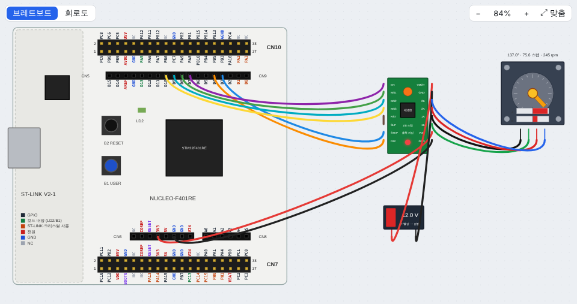

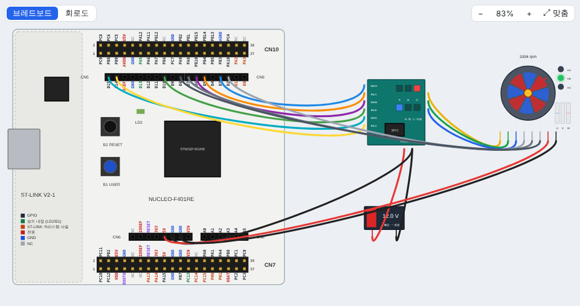

"스텝모터도 바이폴라 스텝모터도 필요해. BLDC모터도 추가되면 좋겠고."에서 시작했다. 단극 28BYJ-48(M8)과 DC 모터(M5)는 드라이버가 붙은 한 부품이었지만, 이번 모터들은 드라이버 모듈과 모터가 따로이고 **넷으로 이어진다**: 코일의 두 끝이 드라이버의 한 출력 쌍 위에 있으면 그 출력의 전류가 흐른다.

- [x] **NEMA17 바이폴라 스테퍼**(`crates/circuit/src/tier9.rs`): 회전자를 10 µs 간격으로 적분(관성, 홀딩 토크 40 N·cm, 디텐트, 마찰·감쇠, 부하 슬라이더, 축에 단 관성). 평형점은 전기각 atan2(I_B, I_A)(4스텝 = 한 주기). 초퍼 전류는 (VMOT − 역기전력)/L로, 전압 구동은 L/R로 따라가서 빠를수록 토크가 준다. 자기장에서 한 주기 넘게 벗어나면 4스텝을 잃는다(묶음으로 세어 `lost`, 경고, "탈조!"). 풀인 약 1100 풀스텝/s, 램프로 약 2000. 축을 끌어 손으로 돌리기, 멈춰 있으면 계산을 건너뛴다
- [x] **A4988 / DRV8825**: STEP 상승 에지마다 마이크로스텝(풀–1/16, DRV8825 1/32), DIR, EN·SLP·RST로 출력 끄기(모터 헐거움), RST가 떠 있으면 리셋 유지 + 경고, 최소 STEP 펄스(1 µs / 1.9 µs), VMOT 없음, VDD 5 V에 3.3 V 입력. 전류 제한(Vref) 속성. 회로도 상자
- [x] **L298N**: IN1–IN4, ENA/ENB(점퍼 또는 PWM), 전압 구동. 자기장이 180° 뒤집히는 순서는 떨림 + 경고. 코일이 두 출력 쌍에 걸치면 배선 경고
- [x] **ESC + BLDC**: 서보 펄스 폭 → 스로틀, 1 s 최저 스로틀로 아밍(삐), 스로틀이 올라간 채면 거부, 0.5 s 신호 없음 → 페일세이프, KV × 전압, 1차 지연, 프로펠러 그림
- [x] **홀 센서 BLDC + 3상 브리지**: 6스텝 별결선 전류와 역기전력, 홀 A/B/C(히스테리시스, 오픈 컬렉터 장치 출력), 다음 홀 에지 예측으로 깨우기(제때 EXTI), 관통 전류·풀업 없는 홀·정지(틀린 정류) 경고. TIM1 상보 출력(CHxN)은 periph-stm32f4에 아직 없어 GPIO 6개로
- [x] **DC 전원** 부품(3–24 V, 떠 있는 전압원)
- [x] **예제 4개**: `hal-stepper-a4988`, `hal-stepper-l298n`, `hal-esc-bldc`, `hal-bldc-hall`(배선된 예제 프로젝트 포함, CI 펌웨어 빌드 목록에 추가)
- [x] 테스트: Rust 단위 25개 추가(워크스페이스 201개: `tier9.rs` 14개 — 회전자 평형, 한 바퀴 정확히, 마이크로스텝, 풀인을 넘으면 탈조·램프면 정상, 부하로 정지, 손으로 돌리기, 코일 반대·틀린 순서, 펄스 폭, L298N 출력, ESC 아밍·거부·페일세이프, 홀 코드와 정류표, 6스텝 회전·홀이 바뀌면 정지, 오픈 컬렉터 / `sim.rs` 11개 — 넷을 통한 A4988–모터, 코일 반대, VMOT 없음·EN High·손으로 돌리기, 마이크로스텝·짧은 펄스·RST, 두 쌍에 걸친 코일·DRV8825 1/32, 너무 빠른 스텝, L298N 반스텝·PWM 평균·떨림, 점퍼, ESC, BLDC 정류·정지·풀업·관통 전류), 펌웨어 통합 5개(40개, `a4988_ramps…`, `a4988_with_a_brake…`, `l298n_half_steps…`, `esc_arms…`, `bldc_is_commutated…`), E2E 5개(`web/e2e/m21.spec.ts`, 전체 84개: A4988 왕복·B1·축 손으로 돌리기·회로도 / 브레이크로 탈조 경고 / L298N 반스텝 / ESC 아밍·가변저항·페일세이프 / BLDC 회전·홀 바꾸면 정지). 탈조 세기, 코일 부호, 아밍 시간, 페일세이프, 손으로 돌리기, 마이크로스텝 표, 상 모양, L298N 방향, 펄스 폭 검사를 하나씩 깨면 해당 단위·펌웨어 테스트가 실패하고, 탈조·손으로 돌리기·페일세이프 / L298N 방향·상 모양을 깨면 해당 E2E가 실패하는 것을 확인했다
- 한계: 코일 전류는 넷 전압이 아니라 드라이버와 모터 사이의 연결로 전달된다(전류가 회로 해석에 들어가지 않아 OUT 핀을 프로브해도 전압이 보이지 않음, 직렬 저항이나 다른 부품을 끼우면 연결이 끊긴 것으로 봄). L298N의 EN Low는 느린 감쇠로 계산한다(실제로는 빠른 감쇠라 PWM 평균 전류가 듀티보다 낮다). 스테퍼의 공진·미드밴드 불안정은 감쇠로 눌러 두었고, 마이크로스텝 표는 이상적인 사인이다. DRV8825도 VDD 핀을 그대로 두고 로직 전원 검사만 건너뛴다. ESC는 BEC·스로틀 캘리브레이션·소리·역회전이 없다. 홀 BLDC는 PWM 속도 조절과 TIM1 상보 출력·데드타임이 없고(풀 전압 6스텝), 상 인덕턴스를 무시한다
- 남은 항목: TIM1 상보 출력과 PWM 속도 조절 BLDC, 센서리스 BLDC, 엔코더 DC 모터 PID, 코일 전류를 넷 해석에 넣어 OUT 핀 전압 보기

### M20 완료 (오실로스코프 트리거)

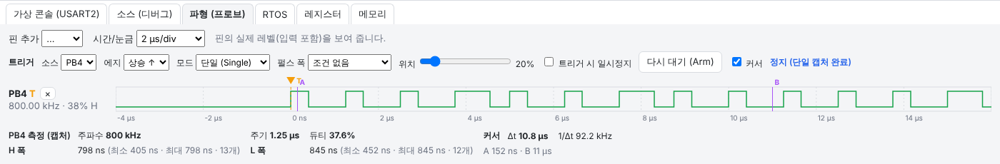

"짧은 파형을 보기 힘들다"는 요청에서 시작했다. 지금까지의 파형 뷰는 최근 N ms를 흘려 보여 주는 로직 프로브라, 프레임(약 16 ms)마다 핀당 4000개까지만 에지를 보내고(넘으면 `dense`, "너무 빠름"으로 나머지를 버림) 화면 1000칸에 2–2000 ms를 그려서 µs 펄스는 한 칸도 안 되거나 지나가 버렸다.

- [x] **에지 기록은 원래 정확했다**: 버스가 프로브한 핀의 레벨 변화를 CPU 사이클 시각으로 남기고(`level_events`, IDR이 보는 레벨이라 **입력 포함** — 버튼, 센서 출력, DHT·IR 응답처럼 회로가 미는 핀도), `Nucleo::ns_at`이 클럭 변경을 반영해 ns로 바꾼다. 84 MHz에서 11.9 ns 해상도. 잃는 곳은 프레임 상한과 화면 쪽이었다
- [x] **트리거·캡처 엔진(Rust, `crates/wasm/src/scope.rs`)**: 프로브한 핀마다 링 버퍼(에지 65,536개)를 두고, 트리거는 **소스 핀의 에지에서만** 검사한다(프로브하지 않은 핀은 비용 0). 트리거가 걸리면 앞부분(프리 트리거)은 링에서 복사하고 뒷부분은 에지가 올 때마다 캡처에 쌓아, 시뮬레이션이 창의 끝을 지나면 완성된 캡처 하나를 프레임 JSON(`scope.capture`)으로 보낸다. 시각은 트리거 기준 ns. 실행 루프가 `runForMs` 조각마다 버스의 에지를 곧바로 엔진과 프레임 목록에 옮기므로(`feed_scope`) 프레임 단위 상한과 무관하다. 기존 프레임별 `probes`(라이브 보기, 채점)는 그대로
- [x] **트리거 조건**: 소스 핀, 상승·하강·양쪽 에지. **펄스 폭 조건**: 상승이면 High 펄스, 하강이면 Low 펄스가 X µs보다 좁거나(<) 넓을 때 — 펄스가 끝나는 에지에서 판단하고 t = 0은 펄스의 시작 에지. 펄스가 창보다 길어 판단 시점에 이미 창이 끝났어도 링에서 바로 캡처를 완성한다
- [x] **모드**: **자동(Auto)** 트리거가 오면 캡처를 보이고, 트리거가 끊기면(창 두 배 또는 100 ms) 예전처럼 흘러가는 실시간 보기. **일반(Normal)** 마지막 캡처를 붙잡아 두고 새 트리거에만 바뀐다(창이 끝난 뒤 다시 대기). **단일(Single)** 한 번 잡고 멈춤, **다시 대기 (Arm)** 버튼. 설정을 바꾸면 이전 캡처를 지우고 새 설정의 캡처를 기다린다(오는 중이던 이전 설정의 캡처는 창이 맞지 않아 버린다)
- [x] **트리거 시 일시정지**: 체크하면 캡처가 완성되는 순간 실행이 멈춘다(`triggerPaused`, 워커가 `paused`/`trigger`로 알림 — 소스 탭에 "멈춤: 오실로스코프 트리거"). 그동안 `runForMs`는 짧은 조각(대기 중엔 창 길이를 20 µs–1 ms로, 수집 중엔 창의 끝까지)으로 돌아 창 끝 바로 뒤에서 멈춘다. 수업에서 "이 펄스가 나온 순간"의 레지스터·변수·소스를 볼 수 있다
- [x] **시간축**: 1 µs/div–200 ms/div(1-2-5 단계), 10칸. 격자, 칸마다 단위가 붙은 시각(t = 0이 트리거), 위쪽 주황 **T** 표시를 끌어 트리거 위치(10–90%, 슬라이더도). 캡처 위에서 **휠로 확대**(포인터 아래 시각 고정)·**끌어서 이동**, **전체 보기**로 복귀. 그림은 실제 픽셀 폭으로 그려 글자가 찌그러지지 않고, 반 픽셀 안에 몰린 에지는 세로 막대 하나로 합쳐 6만 개 에지도 가볍다
- [x] **측정**: 트리거 채널의 주파수, 주기(상승 에지 사이 평균), 듀티, H·L 펄스 폭(최소·최대·마지막·개수, 양쪽 에지가 모두 창 안에 있는 펄스만). 줄마다 보이는 구간의 주파수·듀티(예전과 같은 형식). **커서** 두 개(A, B)를 끌어 Δt와 1/Δt
- [x] **경계 상황**: 에지가 없으면 "트리거 대기 중…"(일반·단일은 그림 가운데에도), 자동은 그동안 실시간 보기. 소스 핀을 프로브에서 빼면 "트리거 소스 핀이 프로브되지 않았습니다". 링이 넘쳐 창 앞부분이 없거나 캡처가 핀당 65,536개를 넘으면 그 구간을 빗금으로 칠하고 "버퍼를 넘었습니다 — 시간/눈금을 줄이세요". 리셋·새 펌웨어면 링과 캡처를 비우고 다시 대기(설정과 프로브는 유지). 일시정지 중엔 창이 끝나지 않으므로 "트리거됨 — 수집 중…". 파형 탭은 한 번 열면 다른 탭으로 가도 남아 트리거와 캡처를 지킨다(보이지 않을 땐 그리지 않음)
- [x] 테스트: Rust 단위 16개(`scope.rs`: 상승·하강·양쪽 에지, 프리 트리거 에지와 창 경계, 다른 채널도 캡처, 단일은 한 번 뒤 정지·Arm으로 재개, 일반은 매번 다시 대기·창이 끝난 뒤에만, 20 ms 주기의 2 µs 펄스(84 MHz 사이클 시각)가 사이클 해상도로 정확히, 좁은 펄스 폭 트리거, 창보다 긴 펄스, 링 넘침(잃은 구간과 그 앞 레벨), 캡처 넘침, 프로브되지 않은 소스, 일시정지 요청, 리셋), 펌웨어 통합 3개(`crates/wasm/tests/scope_firmware.rs`, 워커와 같은 진입점: 서보 펄스 폭이 펌웨어가 찍은 µs와 한 사이클 안, NeoPixel 비트가 T0H·T1H(34·67틱) 그대로·단일 뒤 정지, 트리거 시 일시정지가 창 끝 50 µs 안에서 멈춤), 웹 단위 8개(`web/test/scope.test.ts`: 시간축 단계, 단위, 펄스 측정, 그리기와 에지 합치기, 확대·이동), E2E 73개(새 4개, `web/e2e/scope.spec.ts`: 가변저항 가운데의 서보 펄스를 500 µs/div 단일로 잡아 콘솔의 `servo NNNN us`와 비교·단일이 실행 중에도 그대로·Arm으로 새 캡처·휠 확대·커서 Δt / 트리거 시 일시정지와 다시 실행하면 다음 캡처에서 또 멈춤 / NeoPixel 프레임 끝(40 µs보다 넓은 Low 펄스 트리거, 90% 위치)의 7비트가 1 µs/div에서 1.25 µs 주기·0.40/0.80 µs 폭으로, 0.6 µs보다 넓은 펄스 트리거 / 트리거 대기·자동 실시간·일반 캡처·소스가 프로브되지 않음). 새 테스트는 엔진(에지 판정, 프리 트리거 복사, 단일·일반 재대기, 캡처 시각 양자화, 링·캡처 넘침 표시), 워커(일시정지 무시), UI(단일을 일반으로 보냄), 에지 시각을 1 µs로 반올림하는 변경을 하나씩 넣으면 실패하는 것을 확인했다
- 한계: 트리거는 디지털 레벨(IDR이 보는 0/1)뿐이라 아날로그 전압·레벨 트리거는 없다. UART는 여전히 바이트 단위 모델이라 TX 핀에 프레임 비트가 보이지 않는다. 트리거 시 일시정지는 창 끝을 지난 첫 명령 경계에서 멈추며(대기 중 조각 길이만큼 늦게 알아챌 수 있음), 일반 모드에서 한 프레임에 여러 캡처가 끝나면 마지막 것만 보인다. 캡처 하나는 핀당 65,536 에지까지라 MHz SPI를 200 ms/div로 잡으면 뒷부분이 잘린다(표시됨). 커서는 측정만 하고 트리거 레벨·시간 오프셋 같은 다른 노브는 없다
- 남은 항목: 아날로그 채널(넷 전압) 표시와 레벨 트리거, 버스 해독(I2C·SPI·UART 프로토콜 표시), 캡처 내보내기(CSV·VCD)

### M19 완료 (부품 추가)

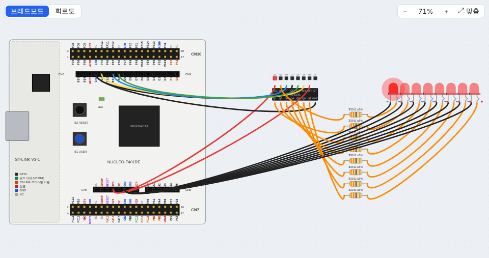

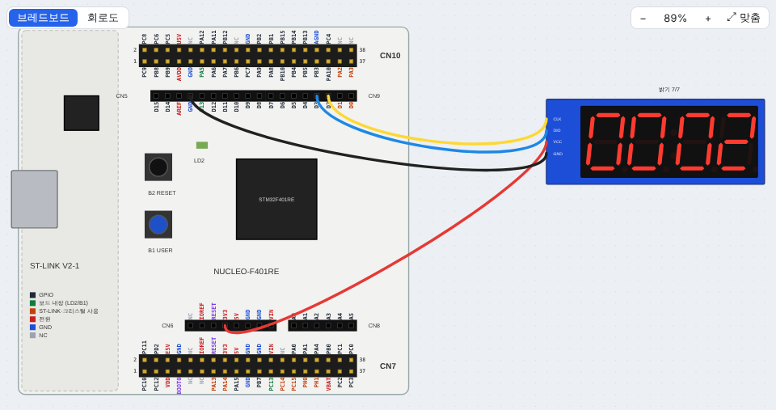

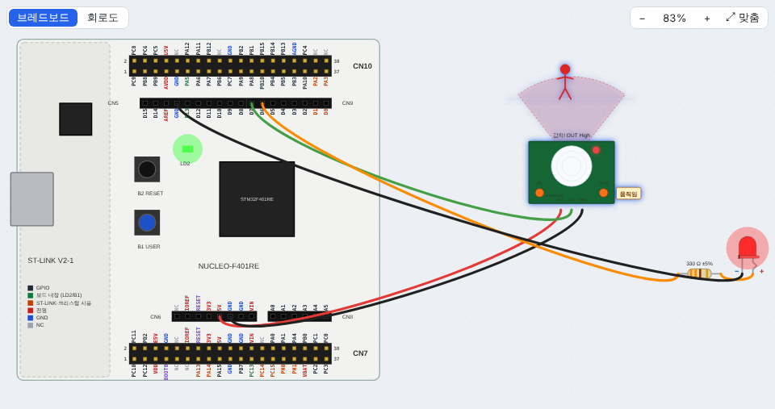

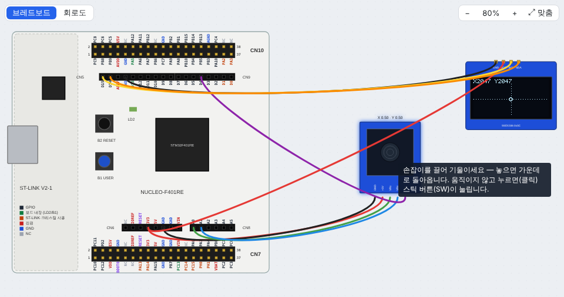

- [x] **74HC595**: SHCP 상승 에지에 시프트, STCP 상승 에지에 래치(둘이 함께 오르면 한 클럭 늦은 저장 레지스터), OE High면 Q0–Q7 하이 임피던스, MR Low면 지움. Q0–Q7과 Q7'은 장치 출력이라 저항을 거쳐 LED를 회로 해석으로 켠다. 하드웨어 SPI는 칩 선택 없이 SCK·MOSI 넷이 SHCP·DS인 칩에 바이트로 들어가고, Q7'에 DS가 있는 다음 칩으로 밀려난 바이트가 간다(MAX7219 DOUT과 같은 방식). 비트뱅잉 체인은 넷 에지로 동작(모든 칩이 에지 전의 DS를 샘플). OE·MR이 떠 있으면 경고
- [x] **장치 출력 즉시 반영**: 장치가 방금 본 것으로 출력을 바꾸면(래치, ACK, 전원 켜짐) 그 자리에서 다시 해를 구한다. 그래서 래치 뒤 MCU가 아무 핀도 바꾸지 않아도 LED가 바로 켜지고, TM1637의 ACK를 MCU가 바로 읽는다
- [x] **TM1637**: 시작·끝 조건, LSB 먼저, 8번째 하강 에지부터 9번째 하강 에지까지 DIO Low(ACK), 데이터·주소·표시 명령, 콜론, 밝기. 경고: MSB 먼저(뒤집은 값을 알려 줌), 알 수 없는 명령, 주소 없는 데이터, 바이트 중간의 시작·끝, 너무 빠른 클럭(반주기 1 µs 미만)
- [x] **조이스틱(KY-023)**: 가변저항 둘과 SW 스위치. 손잡이를 정사각형 안에서 끌고, 놓으면 가운데로, 움직이지 않고 누르거나 클릭하면 SW
- [x] **PIR(HC-SR501)**: 워밍업, H(재트리거)/L(단발) 유지 시간, 2.5 s 차단 시간, 4.5 V 미만이면 경고·동작 안 함. 사람 그림을 시야 안에서 움직이는 동안만 움직임, '움직임' 버튼
- [x] **BMP280**: I2C 0x76/0x77, 칩 ID·리셋·ctrl_meas·config·status, 데이터시트 예제 보정값, 강제·연속 모드와 변환 시간, 보정식(정수판)을 이분 탐색으로 거꾸로 풀어 만든 원시값(해상도는 오버샘플링대로, 건너뛰면 0x80000), 측정 전 읽기 경고, 손가락 데우기
- [x] **NeoPixel 체인**: 링·스트립·매트릭스에 DOUT 핀. 자기 LED 수를 넘은 비트를 DOUT 넷의 다음 부품으로
- [x] **예제 6개**: `hal-shift-register`, `hal-tm1637-clock`, `hal-joystick-oled`, `hal-pir-alarm`, `hal-bmp280`, `hal-neopixel-chain`(배선된 예제 프로젝트 포함)
- [x] 회로도: 새 부품의 상자(전원은 왼쪽, 신호는 오른쪽, 부제), 595의 Q7', NeoPixel의 DIN/DOUT. M18 회로도 배선 테스트도 그대로 통과
- [x] 테스트: Rust 단위 157개(새 19개 — tier8 11개: 595 시프트·래치·MR·묶인 클럭·SPI 바이트와 체인, TM1637 명령·ACK·고정 주소·MSB 경고·빠른 클럭·잘린 바이트, PIR H/L·워밍업·차단, BMP280 데이터시트 예제·강제/연속 모드·건너뜀·리셋; sim 8개: 비트뱅잉 595 체인이 LED를 켬, SPI 체인과 OE, OE 떠 있음 경고, TM1637 ACK와 표시, PIR 출력과 3V3 경고, 조이스틱 분압과 SW, BMP280 주소와 경고, NeoPixel 체인), 펌웨어 통합 테스트 35개(새 6개), `npm test` 22개, E2E 75개(새 6개, `web/e2e/m19.spec.ts`). 해당 코드를 하나씩 망가뜨리면(래치 끔, SPI 경로 끔, 즉시 재해석 끔, TM1637 MSB 먼저·ACK 없음, 조이스틱 저항 뒤바꿈, PIR 워밍업·차단 없음, BMP280 보정값·건너뜀, NeoPixel 전달 끔, 조이스틱 복귀·PIR 시야 판정) 해당 테스트가 실패하는 것을 확인했다. 기존 E2E 하나는 부품 이름 "시프트 레지스터"와 겹치지 않게 '레지스터' 탭 버튼을 정확히 찾도록 고쳤다
- 한계: 595 출력 High는 VCC와 상관없이 3.3 V로 계산한다. TM1637 키 스캔(0x42 읽기)은 미구현. BMP280의 IIR 필터·대기 시간·SPI 모드는 미구현(연속 모드는 읽을 때의 값). PIR은 거리·감도(Sx)를 모델링하지 않고 움직임이 있다/없다만 본다. 조이스틱 예제는 ADC를 채널마다 폴링한다(스캔+DMA 아님)
- 남은 항목: TM1637 키 입력, BME280(습도), 74HC165 입력 시프트 레지스터

### M18 완료 (회로도에서 배선)

- [x] **끌어서 배선**: 회로도 기호의 핀 끝(스텁 끝, 넷 깃발, 접지·전원 기호, 연결 안 됨 ×)에서 다른 핀 끝으로 끌면 고무줄 선이 따라오고 놓을 핀 끝이 초록으로 표시된다. 놓으면 두 부품 핀 사이에 진짜 `WireModel`이 생겨 브레드보드에도 바로 나타나고, 회로도는 프로젝트에서 다시 만들어진다(원본은 프로젝트 하나). Esc나 빈 곳에 놓으면 취소. 포인터 캡처를 쓴 포인터 이벤트라 마우스와 터치 모두 되고, 끄는 동안 넷 강조·고정이나 스위치 누르기가 일어나지 않는다. 회로도 위쪽 막대는 높이가 고정되어 끄는 동안 그림이 움직이지 않는다
- [x] **어느 핀에, 어떤 길로**: 회로도 단자는 버스로 묶인 여러 핀(보드의 GND 핀 전부, 스위치 1a/1b)일 수 있어 `choosePin`이 와이어가 아직 없는 핀, Arduino 헤더(D13, GND_P1…)를 Morpho(CN7/CN10)보다 먼저, 그다음 상대 끝에 가까운 핀을 고른다. `routePoints`가 직각으로 꺾는 점을 넣는다: 부품끼리는 L자 하나, 보드 핀에서는 보드 밖(위 헤더는 위로, 아래 헤더는 아래로)으로 곧게 나간 뒤 꺾고, 보드 와이어마다 한 칸씩 다른 줄(4줄 순환)을 써서 겹치지 않는다
- [x] **같은 넷이면 와이어 없음**: 두 핀이 이미 같은 넷(와이어, 브레드보드 줄, 같은 점)이면 와이어를 더하지 않고 "이미 같은 넷(N1)에 연결되어 있어…" 알림
- [x] **모든 MCU 핀**: 회로도 막대의 체크박스. 켜면 MCU 상자가 쓰지 않는 신호와 전원 핀(3V3, 5V, GND, VIN, E5V, IOREF, VBAT, RESET, BOOT0)까지 양쪽에 보여 준다 — 왼쪽은 포트 A·B, 오른쪽은 C·D·H와 전원. 순서가 고정이라 배선해도 핀 자리가 그대로다. 기본은 꺼짐(쓰는 신호만)
- [x] **연결 끊기**: 핀 끝을 클릭하면 그 넷이 고정 강조되고 핀이 선택된다(막대에 "선택: led1.K (GND) [연결 끊기]"). **연결 끊기** 버튼이나 Delete/Backspace로 그 핀(버스면 묶인 핀 전부)에 직접 붙은 와이어를 지운다. 부품이 아니라 핀이 지워지고, 같은 핀 끝을 다시 클릭하거나 빈 곳을 클릭하거나 Esc면 선택이 풀린다. 와이어를 지워도(또는 지울 와이어가 없어도) 브레드보드 줄이나 같은 점으로 아직 이어져 있으면 "아직 브레드보드(같은 줄이나 같은 구멍)를 통해 GND에 연결되어 있습니다. 브레드보드 보기에서 부품을 옮겨…" 알림. 알림은 회로도 보기에서 막대 아래에 떠서 버튼을 가리지 않는다
- [x] **상호작용 규칙**: 넷 이름에 마우스 올리기 = 강조, 핀 끝 클릭 = 넷 고정 + 핀 선택, 핀 끝에서 끌기 = 배선, 기호 몸체 클릭 = 부품 선택(브레드보드와 공유), 스위치 레버 = 누르기. 부품을 고르면 핀 선택이 풀려 Delete가 무엇을 지울지 헷갈리지 않는다. 막대의 안내 문구와 속성 창 안내에 적어 두었다
- [x] **배치 안정**: `buildSchematic`이 이전 그림의 부품 순서를 받아(`stableOrder`) 이미 있던 부품은 그 순서를 지키고 새 부품만 MCU 핀 순위에 맞는 자리에 끼운다. 다른 프로젝트를 열거나 새로 만들면 잊는다
- [x] **양방향 동기**: 회로도에서 만든 와이어는 브레드보드에서 옮기고 꺾고 지울 수 있고, 브레드보드에서 바꾼 배선은 회로도에 바로 반영된다. 배선이 바뀔 때마다 실행 중인 시뮬레이터에 회로를 다시 보내므로 펌웨어를 멈추지 않고 배선한다
- [x] 테스트: 단위 7개(`npm test`, `web/test/schematic.test.ts`: 쓰는 신호만/모든 핀의 양쪽 나누기, 버스로 묶인 보드 핀과 스위치 다리 고르기, L자와 보드 밖으로 나가는 경로가 모두 직각, 줄 바꾸기, `stableOrder`), E2E 69개(새 4개, `web/e2e/m18.spec.ts`: 빈 프로젝트에 저항·LED를 넣고 회로도에서만 배선 → 브레드보드 와이어 3개가 직각·Arduino 핀 → hal-blinky로 LED 깜빡임 → 같은 넷 알림, 빈 곳·Esc 취소, 끌기가 넷을 고정하지 않음 → 모든 MCU 핀으로 PA5·GND에 배선 → Delete로 음극 연결 끊기, 두 보기에서 사라지고 LED 꺼짐 / 브레드보드로 이어진 핀의 알림과 스위치 1a/1b 버스 끊기, 부품 선택 동기 / 와이어를 더해도 기호 위치 그대로 / 터치 포인터로 끌기와 탭). 새 테스트는 해당 코드(배선, 경로, 같은 넷 검사, 모든 핀, 핀 고르기, 연결 끊기, 브레드보드 알림, 배치 안정, 끌기 중 넷 고정)를 하나씩 망가뜨리면 실패하는 것을 확인했다
- 한계: 회로도는 여전히 넷 이름표로 연결을 보여 주며 선으로 잇지 않는다. 배치 엔진은 그대로라 "모든 MCU 핀"을 끈 상태에서 새 MCU 신호를 쓰면 그 아래 MCU 핀 줄이 두 칸씩 내려가고(부품 위치는 그대로), MCU 상자가 길어져 열이 넘치면 부품 열이 나뉠 수 있다. 부품을 지우고 다시 넣으면 새 부품으로 취급한다. 브레드보드 경로는 다른 부품을 피해 가지 않는다(직각일 뿐). 보드 GND처럼 묶인 단자를 끊으면 그 신호의 모든 핀에 붙은 와이어가 지워진다
- 남은 항목: 넷 이름 붙이기, 같은 넷을 선으로 잇는 배치, 회로도에서 부품 옮기기

### M17 완료 (부품 추가)

- [x] **DS18B20 멀티드롭**: 부품마다 고유 ROM 코드(0x28 + 부품 id나 `serial` 속성에서 정한 48비트 + Dallas/Maxim CRC8), 부품 위에 표시. 여러 센서가 한 데이터 넷에 있으면 각자 장치 출력으로 선을 Low로 끌고 회로 해석이 wired-AND를 낸다(누구든 Low면 Low). 지금까지는 읽기 슬롯의 상승 에지(다른 센서가 놓는 순간)를 쓰기 슬롯으로 잘못 읽을 수 있어서, 슬롯마다 읽기 슬롯인지 기억해 그 상승 에지는 비트로 치지 않는다. **SEARCH ROM**(비트 → 보수 → 호스트가 쓴 방향, 방향과 다른 센서는 다음 리셋까지 빠짐, 64비트 뒤 선택됨), **ALARM SEARCH**(마지막 측정이 TH 이상 또는 TL 이하인 센서만), MATCH ROM, SKIP ROM(모두 CONVERT T), READ ROM(뒤에 기능 명령 가능, 여럿이면 겹침)
- [x] **`hal-onewire-multi`**: 세 센서를 D2 한 선에(모듈마다 4.7 kΩ 풀업). 시작할 때 SEARCH ROM으로 모두 찾아 ROM을 찍고, 1초마다 SKIP ROM + CONVERT T 뒤 센서마다 MATCH ROM + READ SCRATCHPAD로 `#2 28-… 24.00 C`. 센서 하나를 손가락으로 누르면 그 줄만 오른다
- [x] **USART1·USART6**: 주변장치는 이미 USART2와 같은 모델(APB2 클럭, IRQ 37·71)이었다. 핀 라우팅 표(`USART_PINS`: USART1 PA9/PA10·PB6/PB7 AF7, USART6 PA11/PA12·PC6/PC7 AF8)와 `usart_pins()`를 더했다
- [x] **HC-05**: UART는 가상 콘솔처럼 바이트 단위로 모델링한다(회로 해석이 UART 프레임의 비트 에지를 보지 않으므로). 대신 배선이 중요하다: 보드가 프레임마다 모듈의 RXD 넷에 있는 MCU 핀 중 **AF로 TX에 라우팅된 핀**의 USART 바이트를 모듈로, 모듈의 출력(휴대폰 글, AT 응답)을 TXD 넷의 **RX로 라우팅된 핀**의 USART로 보낸다. 그 USART의 상대 보레이트를 모듈 보레이트로 두므로 펌웨어가 115200인데 모듈이 9600이면 기존 USART 모델이 바이트를 다시 샘플링해 깨진다(깨진 바이트 표시). TX끼리 이으면 경고. STATE는 휴대폰이 연결되면 High(장치 출력), TXD는 평소 High, EN은 풀다운 — 전원을 넣을 때 EN이 High면 38400 baud AT 모드
- [x] **블루투스 탭**: HC-05 부품마다 아래 패널에 **블루투스 (HC-05)** 탭(여럿이면 부품 이름 포함). 연결/연결 끊기, 상태, 어느 USART에 연결됐는지와 양쪽 보레이트, 말풍선(MCU가 보낸 줄, 휴대폰이 보낸 글), 보레이트 불일치·TX↔TX 경고. 연결 안 됐을 때 보내면 이유를 알려 준다
- [x] **`hal-bluetooth-led`**: USART1 9600 baud 수신 인터럽트로 줄을 모아 `on`·`off`·`blink`(2 Hz)·`status` 명령으로 LD2를 다루고 휴대폰에 답한다. STATE(D7)가 오르면 인사, 명령은 가상 콘솔에도 기록
- [x] **릴레이 모듈**: 회로 해석에 접점 원소(`Contact`)를 더했다 — 닫히면 0.1 Ω, 열리면 없음. 접점 상태는 장치 출력처럼 구동 키 뒤에 붙어 해가 캐시되고, 코일은 해에서 IN과 VCC 전압으로 정한다(active low 모듈은 IN을 10 kΩ로 VCC에, high 모듈은 GND에). 코일이 바뀌면 10 ms(놓을 때 5 ms) 뒤 접점이 움직이고 0.3 ms 간격으로 두 번 튄 뒤 자리 잡는다. VCC가 3.75 V보다 낮으면 붙지 않고 경고. 그림은 모듈 LED와 움직이는 접점, 회로도는 코일과 전환 접점(점선 연결)을 상자 안에 그린다. 소리를 켜면 접점이 움직일 때 딸깍
- [x] **`hal-relay`**: D4 버튼(EXTI)이나 B1이 D7의 active-low 릴레이를 토글, 5V → COM, NO → 330 Ω → LED. LD2가 따라 하고 콘솔에 기록
- [x] **여러 서보**: 서보마다 자기 SIG 펄스를 재는 구조라 고칠 것이 없었다. **`hal-servos-multi`**: TIM3 CH1(D5)·CH2(D9)와 TIM1 CH1(D7, MOE) 50 Hz로 세 서보가 4초 삼각파를 1/3 주기씩 어긋나게 움직인다
- [x] 테스트: Rust 단위(세 센서 SEARCH ROM이 ROM 셋을 모두 찾음·한 센서만 있으면 한 번에, MATCH ROM이 하나만 고르고 없는 코드엔 아무도 답하지 않음, READ ROM 겹침, ALARM SEARCH, ROM 코드와 CRC(응용 노트 27의 예), 릴레이 접점이 따로 전원을 받는 LED를 켜고 지연·튐·low/high 트리거, 3V3 릴레이 경고, HC-05 STATE·TXD·UART 핀 찾기와 AT 모드, USART1/6 라우팅과 APB2 보레이트, 보드 브리지가 같은 보레이트에서 양방향으로 전달하고 다르면 깨짐), 펌웨어 통합 테스트 29개(새 5개: 세 DS18B20, 휴대폰 명령으로 LD2와 답장, 보레이트 불일치, 릴레이 버튼, 서보 셋이 각자 CCR을 따름), E2E 64개(새 4개: ROM 셋과 한 센서만 데워짐, 블루투스 대화로 LD2 켜고 끄기와 보레이트 경고, 릴레이로 LED와 회로도 접점, 서보 셋이 서로 다른 각도로 움직임). 새 테스트는 해당 코드를 망가뜨리면 실패하는 것을 확인했다
- 남은 항목: UART 핀 수준 파형(프로브로 프레임이 보이지 않음), HC-05끼리 연결(마스터 모드), 여러 채널 릴레이, 블루투스 실습(레슨)

### M16 완료 (수업용 실습)

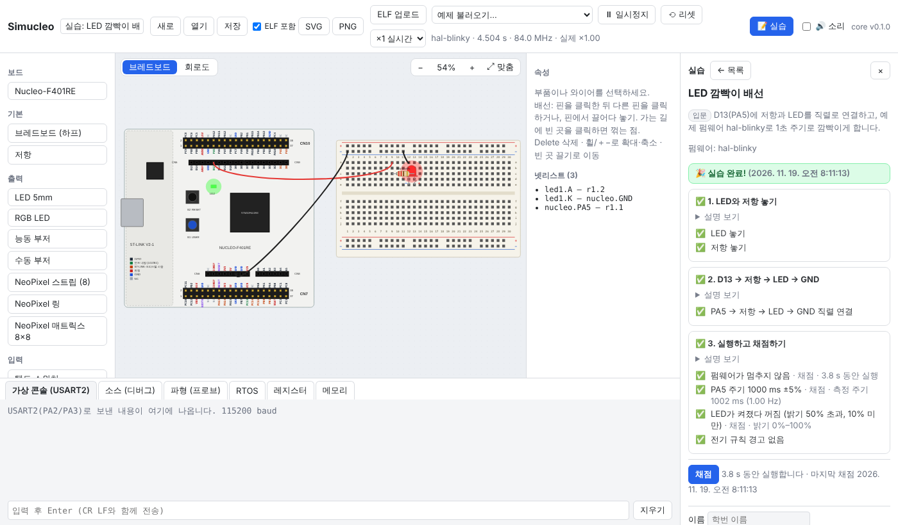

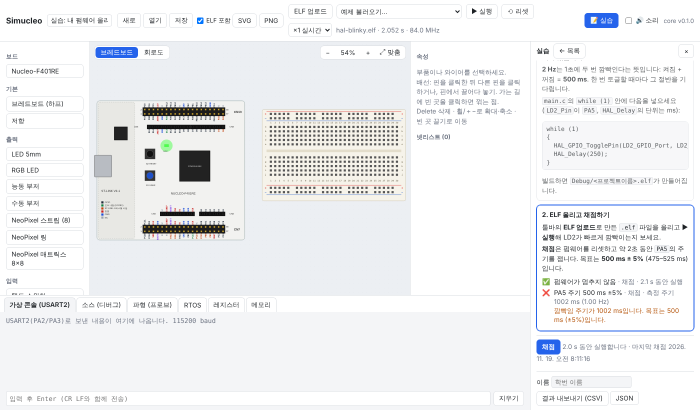

- [x] **레슨 형식**: `web/lessons/<id>.json` 하나가 실습 하나(빌드할 때 `import.meta.glob`으로 묶임). id·순서·제목·수준·목표, 시작 회로(`"empty"`, 예제 프로젝트, 직접 적은 회로), 예제 ELF 또는 `"upload"`, 채점 시간과 채점 중 조작(버튼 누르기, 속성 바꾸기), 단계(간단한 Markdown 설명 + 검사 목록). 형식 검사(`validate.ts`)가 오류를 목록에 보여 준다. 선생님용 설명은 [lessons.md](lessons.md)
- [x] **배선 검사**(`web/src/lessons/wiring.ts`, 배선할 때마다 바로): `part`, `connected`(부품 핀 → MCU 신호·GND·3V3·5V, Nucleo 핀은 `nucleoSignal`로 신호가 같으면 Arduino·Morpho 어느 핀이든), `series`(넷을 노드, 저항·LED·버튼·가변저항·RGB LED 한 색을 변으로 한 그래프에서 `from`부터 `to`까지 정확히 그 부품들로 된 단순 경로를 찾음, LED 방향 확인), `noWarnings`. 부품은 id가 아니라 종류로 찾는다. 실패하면 원인을 진단해 한국어로 안내: 빠진 부품("PA5가 GND로 가는 길에 저항이 없습니다."), 뒤집힌 LED, 다른 핀에 꽂힌 같은 사슬("…PA6 (D12)에 연결되어 있습니다. PA5 (D13)에 연결하세요."), 단락, 다른 신호에 연결된 핀. 조사(이/가, 으로/로, 와/과)는 `PA5가`·`3V3으로`처럼 영문·숫자를 읽는 소리에 맞춘다
- [x] **동작 검사**(`behaviour.ts`, **채점** 버튼): 펌웨어를 리셋(에포크를 붙여 이전 프레임과 구분)하고 시뮬레이션 시간으로 정해진 만큼 실행하며 모든 프레임을 기록한다(`runner.onFrame`, React가 건너뛰는 프레임 없이). `period`(채점 동안 그 핀을 프로브해 에지 시각으로 평균 주기, 처음 주기는 뺌), `brightness`, `duty`, `console`, `consoleValues`(콘솔에서 잡은 숫자의 변화 폭), `motion`(서보 각도·모터 rpm), `display`(OLED 켜진 픽셀, LCD 글자), `running`. 실패 안내 예: "깜빡임 주기가 1002 ms입니다. 목표는 500 ms (±5%)입니다." 진행 막대와 중지 버튼, 펌웨어가 멈추면 그때까지로 채점
- [x] **프로브 공유**: `setProbes(pins, owner)` — 파형 탭과 채점이 각자 고른 핀의 합집합을 프로브해 서로 지우지 않는다
- [x] **실습 패널**: 툴바 **📝 실습**으로 여는 오른쪽 열. 실습 목록(완료 ✅, 이어서 하기 / 처음부터), 단계와 체크리스트(✅ ❌ ⬜, 측정값, 안내), 지금 단계 강조, 끝난 단계 설명 접기, 채점 뒤 첫 실패 검사로 스크롤, 완료 표시. 저장하지 않은 작업 위에 실습을 시작하면 묻고, 그때 프로젝트를 IndexedDB에 백업해 **실습 전 프로젝트 되돌리기**로 다시 연다
- [x] **진행 상황과 제출**: 실습별 검사 결과·결과가 바뀐 시각·채점 횟수·시작·완료 시각을 IndexedDB(`idbGet`/`idbSet`)에 저장하고, 열려 있던 실습은 새로고침 뒤에도 다시 열린다. 이름 칸과 **결과 내보내기** — CSV(엑셀용 BOM, 검사 하나가 한 줄)와 JSON
- [x] **실습 6개**: LED 깜빡이 배선(`hal-blinky`, 주기 1000 ms ± 5 %), 버튼 인터럽트(`hal-button-exti`, 채점이 버튼을 두 번 누름), PWM RGB LED(`hal-pwm-led`, 듀티비와 색별 밝기), 가변저항 → 서보(`hal-adc-servo`, 채점이 노브를 돌림), I2C OLED 시계(`hal-i2c-oled`), 내 펌웨어 올리기 2 Hz(직접 빌드, 주기 500 ms ± 5 %, C 코드 힌트). 모범 답안 `firmware/lesson-blink-2hz`는 CI에서 빌드하고 테스트에만 쓴다
- [x] 테스트: Node 내장 테스트 러너로 단위 테스트 15개(`npm test`, 추가 의존성 없음 — 직렬 경로와 각 안내, 버튼 경로, 조사, 주기·밝기·콘솔·듀티비·디스플레이 판정, 모든 레슨 파일의 형식·예제·부품 종류, CSV), 펌웨어 통합 테스트 24개(답안 펌웨어가 251 ms마다 토글), E2E 58개(새 8개: 실습 1을 캔버스에서 배선하면 검사가 초록으로 바뀌고 채점·완료·CSV/JSON 내보내기·새로고침 뒤 복원, 저항 빠짐과 잘못된 핀의 안내, 직접 올리기 실습이 hal-blinky는 주기 안내로 떨어지고 답안 ELF는 통과, 실습 2–5가 예제 배선으로 모두 통과, 작업 위에 시작할 때 확인과 백업 되돌리기). 새 테스트는 해당 코드를 하나씩 망가뜨리면 실패하는 것을 확인했다
- 남은 항목: 여러 학생 결과를 모아 보는 선생님용 화면(지금은 파일을 모아 표로 합침), 회로도 뷰에서의 검사 강조, 채점 중 실행 속도 자동 조절(지금은 툴바 속도를 따름), 레슨 편집기

### M15 완료 (마무리)

- [x] **MAX7219 DOUT → DIN 체인**: DOUT은 이제 실제 출력이다. 모듈(`count`개 칩)의 시프트 레지스터 MSB, 즉 16×`count` 클럭 전에 들어간 비트를 내보내고 CLK 하강 에지에서 바뀐다(데이터시트대로). 회로 시뮬레이터에서는 장치 출력(push-pull)이라 프로브로도 보인다
  - **비트뱅잉**: 다음 부품의 DIN은 그냥 넷으로 DOUT 레벨을 읽는다. 상승 에지의 해(解)는 직전 하강 에지에 정해진 DOUT으로 풀리므로, 다음 칩은 앞 칩에서 밀려나는 바로 그 비트를 받는다
  - **하드웨어 SPI**: SPI 주변장치는 바이트 단위로 장치에 전달될 뿐 넷에 클럭 에지가 생기지 않는다(비트마다 회로를 다시 풀면 너무 느림). 그래서 `CircuitSim::spi()`가 매트릭스의 `byte()`가 돌려주는 "그동안 DOUT으로 나간 8비트"를, DIN이 그 DOUT 넷이고 CLK이 같은 SCK인(전원이 있고 CS가 Low인) 부품에 바이트로 넘기고, 그 부품의 넘친 바이트를 다시 다음으로 넘긴다(한 바이트에 부품마다 한 번, 배선이 고리여도 끝남). 비트 단위 재현과 결과가 같고, 두 부품 모두 공유 CS 상승 에지에 각자 래치한다
  - `count`는 그대로 동작하고, `count` 2인 부품 뒤에 또 이어도 된다. 회로도에서도 체인의 앞 부품이 먼저 그려진다
- [x] **MPU-6050 흔들기**: 부품 오른쪽 위의 **흔들기** 버튼, 또는 기울이며 끄는 도중 빠르게 왔다 갔다 하면(포인터 속도 방향이 1.2 px/ms 넘게 뒤집힐 때) 약 0.45 s 동안 5 Hz로 흔들리며 시간 상수 0.18 s로 잦아드는 가속도가 중력에 더해진다. 값은 새 속성 `ax`·`ay`·`az`(g, 속성 창에 슬라이더)로 Rust `Mpu6050.extra`에 들어가 가속도 레지스터에 나오고 ±범위에서 잘린다. 흔드는 동안 기판 그림이 다이얼 안에서 흔들린다. 펌웨어가 100 ms마다 읽어도 놓치지 않게 흔들림은 둥근 사인파 대신 앞뒤로 번갈아 치는 모양
- [x] **`hal-imu-matrix` 확장**: 두 번째 MAX7219 부품(`bar`)을 첫 부품의 DOUT에 잇고(CLK·CS 공유) CS 한 번에 프레임 두 개(먼 칩 것 먼저)를 보낸다. 두 번째 매트릭스는 \|a\|를 막대로(1 g에 3줄), 콘솔 줄 끝에 `|a| 1.00 g`. 모듈이 하나뿐이면 먼 칩 프레임은 DOUT으로 빠져나가 그대로 동작
- [x] **회로도**: MPU-6050, MAX7219, IR 수신기 상자를 손으로 배치 — VCC·GND는 왼쪽, 신호는 오른쪽에 쓰는 순서대로(DIN·CLK·CS·DOUT, SCL·SDA, OUT), 부제는 `IMU (MPU-6050) · I2C 0x68`, `LED 매트릭스 ×N (MAX7219)`, `IR 수신기 (VS1838B, NEC)`. 리모컨 버튼은 핀이 아니므로 상자에 없다. 부품 순서는 MCU 핀 순위를 하나씩 비교해, 같은 SCK를 쓰는 두 매트릭스 중 MCU에 더 많이 연결된 체인의 앞 부품이 위에 온다
- [x] **SD 카드 자동 저장**: 카드 내용이 바뀔 때마다 움직이는 `generation`을 프레임에 실어 보내고, Rust가 0이 아닌 블록만 담은 스냅숏(`sdSnapshot`, "SDS1" + 블록 수 + (번호, 512바이트)…)을 만든다 — 포맷하고 로그를 쓴 32 MB 카드가 수십 KB. 웹은 프로젝트 이름 + 부품 id(`sd:<프로젝트>:<부품>`)로 IndexedDB에 저장한다: 펌웨어가 쓰기 시작하고 3 s 뒤(계속 쓰는 동안은 3 s마다 한 번), 그리고 일시정지할 때. 프로젝트를 다시 열면(새로고침 후 자동 복원 포함) 실행 전에 `sdRestore`로 되돌린다. 복원 전에는 저장하지 않아 빈 카드로 덮어쓰지 않는다. 속성 창에 **카드 비우기**(모두 0, 파일 시스템도 지움, 바로 저장)
- [x] 테스트: Rust 단위(DOUT 비트가 16클럭 뒤 나옴·바이트 넘침, 두 부품 체인이 SPI·비트뱅잉 모두 동작하고 `count` 2와 섞여도 됨 — 바꾸기 전으로 되돌리면 실패, 흔들기 가속도가 레지스터에 더해지고 포화, 회로 속성 `ay`가 레지스터까지, SD 스냅숏 왕복·generation·지우기·잘못된 스냅숏 거부), 펌웨어 통합 테스트 23개(두 번째 매트릭스가 DOUT으로만 받아 \|a\| 막대를 그리고 흔들면 5줄), E2E 48개(흔들기 버튼·빠르게 끌기로 \|a\| ≥ 1.25 g와 기판 흔들림 그리고 두 번째 매트릭스의 막대, 회로도 상자의 핀 쪽·부제·체인 순서·IR 핀 3개, SD 로거 실행 → 새로고침 → 실행 전에 이미지에 로그 줄이 있고 펌웨어가 포맷 없이 이어 씀 → 카드 비우기 → 새로고침 → 다시 빈 카드)
- 남은 항목: NeoPixel 부품끼리 DOUT → DIN 체인, 같은 이름의 다른 프로젝트는 카드 저장을 공유함(프로젝트 id가 없음), 흔들기 방향 고르기(버튼은 늘 같은 방향)

### M14 완료 (부품 직접 조작)

- [x] **공통 구조**: 부품 그림에서 조작하는 부분에 `data-drag="이름"`을 달고, 부품 정의(`PartDef.controls`)에 그 이름의 조작을 등록한다(`web/src/parts/controls.ts`의 노브·슬라이드 손잡이·누르는 동안 값·손가락 터치·기울이기). 편집기는 조작 부분을 끌면 그 조작으로, 나머지 몸체를 끌면 부품 이동으로 나눈다. 값은 속성 창 슬라이더와 같은 속성에 쓰므로 둘이 늘 같은 값을 보이고, 슬라이더는 정밀 조절용으로 그대로 둔다
- [x] **시뮬레이터 부담**: 속성이 바뀔 때마다 회로 전체를 다시 보내므로, 끄는 동안 그림은 바로 따라가고 시뮬레이터로는 최대 20번/초(50 ms)만 보낸다. 시간에 따라 변하는 조작(데워지고 식기)은 10번/초. 펌웨어가 실행 중이어도 동작한다. Rust 쪽 변경 없음
- [x] **안내**: 조작 부분에 마우스를 올리면 할 일을 알려 주는 말풍선과 커서(잡기·위아래·손가락)가 나오고, 조작 중인 부분은 강조된다. 마우스와 터치(포인터 이벤트) 모두
- [x] **가변저항**: 노브를 잡고 중심 둘레로 돌리면 돌린 각도만큼 움직인다(270°가 전체, 누를 때 튀지 않음). 노브 위에서 휠 한 칸이 2 %. 노브의 표시선·홈이 현재 각도로 돌고, 둘레의 호가 위치만큼 채워짐
- [x] **LDR**: 위쪽 손전등을 끌어 가까이 대면 밝아진다(거리의 제곱에 반비례, 약 100–10000 lux). 빛줄기와 손전등 옆의 lux가 거리를 보여 줌. ✋를 누르고 있는 동안 손으로 가려 약 5 lux, 떼면 원래 밝기
- [x] **온도센서**(TMP36/LM35, 서미스터, DS18B20, DHT11/22, AHT20): 누르고 있으면 손가락 체온(33 °C)을 향해 시간 상수 3 s로 데워지고, 떼면 누르기 전 온도로 3.5 s 시간 상수로 식는다. DHT·AHT20은 입김으로 습도도 85 %를 향해 오름. 누르는 동안 손가락 자국과 열기가 보이고, 짧게 클릭(선택)은 데우지 않으며, 누른 채 끌면 부품이 옮겨진다. 식는 도중 슬라이더를 움직이면 슬라이더 값이 이긴다
- [x] **초음파 센서**: 모듈 앞의 장애물(✋)을 위아래로 끌어 2–450 cm(가까운 쪽이 더 세밀한 제곱 눈금), 장애물 옆에 cm 표시와 음파 그림. 모듈을 끌면 옮겨짐
- [x] **MPU-6050**: M13의 끌어서 기울이기를 같은 구조로 옮김(자이로 값이 멈추면 0이 되는 것도 조작의 타이머로)
- [x] **서보·모터 표시**: 서보에 0–180° 눈금과 돌아간 만큼 칠한 부채꼴, DC 모터에 빨간 표시 살 하나와 회전 방향 화살표(빠를수록 진하게)
- [x] 맞춤(⤢)은 부품 상자 밖에 그린 손전등·장애물까지 보이게 맞춘다
- [x] 테스트: E2E 5개 — 노브를 돌리면 `hal-adc-servo`의 `pot` 값과 서보가 따라가고 휠로 10 %, TMP36을 누르면 몇 초에 걸쳐 데워졌다가 떼면 25 °C로 돌아옴(누른 채 끌면 이동), 손전등과 손으로 `light`가 바뀜, 장애물을 끌면 `hal-sonar-onewire`의 거리가 바뀌고 DS18B20이 데워짐, DHT22에 입김. 조작할 때 부품이 움직이지 않는지도 확인
- 남은 항목: 회로도 뷰에서의 직접 조작, 손전등 방향(지금은 위에서만), 실내 조명 아래의 어두운 쪽 범위(100 lux 미만은 손으로 가리기나 슬라이더로)

### M13 완료 (MPU-6050, MAX7219, IR 리모컨)

- [x] **MPU-6050**(I2C 0x68, AD0으로 0x69): 레지스터 포인터 쓰기 → 자동 증가 연속 읽기(`HAL_I2C_Mem_Read`), WHO_AM_I 0x68, 전원을 켜면 잠자기(PWR_MGMT_1 = 0x40, 측정값 0), DEVICE_RESET, GYRO_CONFIG(131/65.5/32.8/16.4 LSB per °/s)·ACCEL_CONFIG(16384/8192/4096/2048 LSB per g), 온도 = 값/340 + 36.53, int16로 잘림. 가속도는 roll·pitch만큼 돌린 중력
- [x] **끌어서 기울이기**: 부품 가운데 기판을 마우스로 끌면 좌우가 roll, 위아래가 pitch(1 px ≈ 1°, ±90°), 그림이 그만큼 기울고 공이 굴러감. 끄는 동안 각도 변화 속도가 자이로 X/Y가 되고, 멈추면 150 ms 뒤 0. 모듈 가장자리를 끌면 옮겨지고, 속성 창 슬라이더도 같은 값을 보여 줌
- [x] **MAX7219** 8×8 LED 매트릭스(FC-16, `count` 1–4): CS Low 동안 CLK 상승 에지마다 DIN 한 비트(비트뱅잉), 하드웨어 SPI 바이트도 같은 시프트 레지스터로, CS 상승 에지에 반영. 체인은 마지막 16×N비트, 먼저 보낸 프레임이 가장 먼 모듈로. 셧다운이면 꺼지고, 디스플레이 테스트면 모두 켜지고, 스캔 한도 밖 줄은 꺼지고, Code-B 디코드, 밝기만큼 흐리게
- [x] **IR 수신기 + 리모컨**(VS1838B, NEC): 버튼을 누르면 OUT에 9 ms Low, 4.5 ms High, 32비트(LSB부터, 562.5 µs 마크 + 562.5/1687.5 µs 스페이스), 마지막 마크. 누르고 있으면 108 ms마다 반복 코드. 17키(숫자, *, #, 화살표, OK), 주소 0x00
- [x] 예제(배선 포함): `hal-imu-matrix`(I2C1 MPU-6050 → roll·pitch, SPI1 + GPIO CS로 MAX7219에 점), `hal-ir-remote`(TIM2 입력 캡처로 하강 에지 간격을 재서 NEC 해독, 반복 코드, LD2로 숫자 깜빡임)
- [x] 테스트: MPU-6050 레지스터·잠자기·범위·리셋, MAX7219 체인·레지스터·비트뱅잉, NEC 펄스열과 반복, 회로 시뮬레이션(I2C 주소, SPI와 비트뱅잉, 수신기 출력), 펌웨어 통합 테스트 22개, E2E(끌어서 기울이면 점이 따라감, 리모컨 버튼 → 해독된 코드와 반복)
- 남은 항목: MPU-6050 FIFO·인터럽트·DMP (흔들기와 따로 놓은 MAX7219 체인은 M15에서 완료)

### M12 완료 (회로도 뷰)

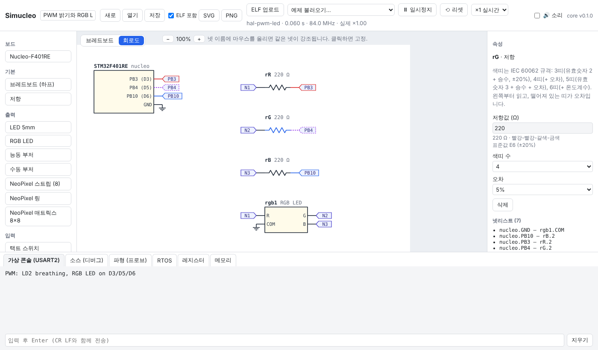

- [x] **자동 회로도**: 브레드보드 배선의 넷리스트에서 회로도를 만든다. 브레드보드는 기계적인 연결이라 빼고, 보드는 STM32F401RE 상자로 쓰는 신호만(`PB3 (D3)`처럼 Arduino 이름과 함께), 저항·LED·택트 스위치·부저·LDR·서미스터는 기호로, 나머지 부품은 핀 이름이 있는 상자로(내부에서 이어진 핀은 하나로)
- [x] **넷 이름**: MCU 신호가 있는 넷은 그 신호 이름(`PA5`), 없으면 `N1`, `N2`…. GND는 접지 기호, 3V3·5V 등은 전원 깃발. 연결 안 된 핀은 ×
- [x] **넷 강조**: 넷 이름에 마우스를 올리면 같은 넷이 모두 강조되고 연결된 핀 목록이 보임(클릭하면 고정)
- [x] **실시간 표시**: 실행 중 MCU 핀의 넷은 High(빨강)·Low(파랑)·PWM(보라 점선), LED는 밝기만큼 빛남, 회로도의 스위치를 눌러 펌웨어를 움직일 수 있음
- [x] 부품을 누르면 속성 창에서 고칠 수 있고, 브레드보드/회로도를 오가도 편집 상태 유지. SVG/PNG 내보내기는 보고 있는 화면(회로도)을 저장
- [x] 테스트: E2E(기호와 신호 이름, 넷 강조와 핀 목록, 속성 창, 실행 중 PWM, 내보내기, 전원 기호, 스위치를 눌러 LED 켜기)
- 남은 항목: 회로도에서 직접 배선하기(M18에서 완료), 넷 이름 붙이기, 같은 넷을 선으로 잇는 배치

### M11 완료 (디버거 마무리)

- [x] **변수 값 바꾸기**: 소스 탭의 지역·전역 변수와 감시식에서 값을 두 번 클릭해 고침. 정수·enum·포인터·실수, 구조체 멤버·배열 원소·`*포인터`, 비트 필드(주변 비트는 그대로). 값은 C 식(`FONT[8]`, `0x3F`, `'A'`). 타입 범위를 넘으면 거절. 레지스터에 사는 변수는 가장 안쪽 프레임에서만(바깥 프레임·대기 중인 태스크의 레지스터는 스택에 저장된 사본이라). 컴파일러가 상수로 바꿔 저장소가 없는 변수는 이유를 보여 줌. 주변장치 레지스터(`htim2.Instance->ARR`)는 워드 단위로 써서 칩과 같게 동작
- [x] **데이터 감시점**: 식이 가리키는 메모리(변수, 원소, 멤버, 하위 배열)에 쓰기·읽기·둘 다. 그 접근을 한 명령이 끝난 뒤 멈춤(칩의 DWT처럼 다음 명령 위치). 줄 스텝 중에도 멈춤. 시작 코드가 `.bss`를 지우는 것도 쓰기로 잡힘. GDB `watch`/`rwatch`/`awatch`(Z2/Z3/Z4) 지원
- [x] **RTOS 태스크별 호출 스택**: 멈춘 동안 태스크를 고르면 그 태스크가 전환될 때 포트가 스택에 저장한 문맥(r4–r11, EXC_RETURN, FPU를 썼다면 s16–s31, 예외 프레임)에서 되감아 호출 스택을 보여 줌(`osDelay` ← `CountTask`). 그 프레임의 지역 변수·감시식·감시점 주소도 그 태스크 기준. 스택은 태스크 함수에서 끝남
- [x] 테스트: 펌웨어 통합 테스트(멤버·주변장치 레지스터·배열 원소·레지스터 매개변수 값 바꾸기와 화면 변화, 쓰기·읽기 감시점과 스텝, 대기 중인 네 태스크의 스택과 지역 변수), GDB 프로토콜(Z2), E2E(값 바꾸기, 감시점, 태스크 선택)

### M10 완료 (디버그 확장)

- [x] **GDB 원격 서버**(`simucleo gdb <elf> [--port 3333]`): GDB 원격 직렬 프로토콜(RSP). `target.xml`로 r0–r15·xPSR·MSP/PSP·FPU(d0–d15, FPSCR)·PRIMASK/BASEPRI/FAULTMASK/CONTROL을 알려 줌. 레지스터·메모리 읽기/쓰기(플래시 쓰기 포함), 소프트웨어 중단점, 한 명령 스텝, 계속 실행과 Ctrl-C, `QStartNoAckMode`, `monitor reset`·`monitor time`. 가상 COM 포트 출력은 서버 터미널에. `gdb-multiarch`로 break/continue/bt/next/step/finish/print/x/set var 확인, VS Code Cortex-Debug는 외부 GDB 서버로 연결
- [x] **디스어셈블리**(`simucleo_elf::disasm`, yaxpeax-arm): Thumb/Thumb-2 명령을 함수 시작부터 디코드해 경계를 맞추고, 분기 대상은 절대 주소와 `<심볼>`, 리터럴 풀 읽기는 값으로 주석. 웹 소스 탭의 ‘기계어’ 상자로 현재 위치 주변 명령을 소스 줄과 섞어 보여 줌
- [x] **감시식**: C 식 평가기(`simucleo_elf` 내부) — 지역·전역 변수, enum 상수, 정수·실수·문자 리터럴(접미사, 16진), `. -> [] * & !  ~ -`, 산술·비트·시프트·비교·논리(단락 평가) 연산. 구조체·배열 값은 변수 트리와 같은 모양으로. 오류는 이유와 함께(없는 변수, 범위 밖 인덱스, 읽을 수 없는 메모리)
- [x] **조건부 중단점**: 중단점 목록에서 조건을 적으면 그 줄에 도착할 때마다 조건을 평가해 참일 때만 멈춤(평가할 수 없으면 멈춰서 보여 줌). 실행, 줄 스텝, 나오기 모두 같은 규칙. 같은 주소에 조건 없는 중단점이 있으면 항상 멈춤. 거터에서 주황색 점
- [x] 테스트: CLI GDB 프로토콜 테스트(접속 → 중단점 → 계속 → 레지스터·메모리 → 스텝 → Ctrl-C), 펌웨어 통합 테스트(감시식 값·오류, 조건이 참일 때만 1 ms 타이머 콜백에서 멈춤, 거짓이면 끝까지 실행), 식 어휘 분석 단위 테스트, E2E(기계어 보기, 감시식과 조건부 중단점)
- 남은 항목: 변수 값 바꾸기(웹), 감시점(데이터 중단점), RTOS 태스크별 호출 스택

### M9 완료 (소스 수준 디버깅)

- [x] **DWARF 읽기**(`simucleo_elf::debug`, gimli): 줄 표(주소 ↔ 파일:줄, DWARF 4/5), 함수 범위, 파일 범위 변수, `.debug_frame`
- [x] **호출 스택**: CFI로 한 단계씩 되감기, Cortex-M 예외 프레임(MSP/PSP, FP 확장 프레임, 정렬 비트)을 넘어 인터럽트가 끼어든 코드까지
- [x] **변수 값**: 위치식 평가(위치 목록, 레지스터, 프레임 베이스, 상수) → C 타입대로 표시: 정수·실수·char·enum·포인터(문자열, 함수 이름)·다차원 배열·구조체·비트 필드. 최적화로 없어진 값은 `<optimized out>`
- [x] **실행 제어**: 파일:줄 중단점(코드가 없는 줄이면 다음 줄로), 명령 1개, 한 줄 넘어가기(호출과 인터럽트는 반환 주소까지 전속력으로), 들어가기(줄 정보 없는 라이브러리는 건너뜀), 나오기
- [x] **웹 소스 탭**: 예제 소스 포함(빌드 시 `public/examples/src`), 직접 올린 ELF는 ‘소스 추가…’로 C 파일을 넣으면 파일 이름으로 맞춤, 거터 클릭으로 중단점, 현재 줄 표시, 호출 스택(프레임을 고르면 그 프레임의 지역 변수), 지역·전역 변수 트리
- [x] DWARF는 처음 쓸 때 읽음(펌웨어 로드는 그대로 빠름)
- [x] 테스트: 펌웨어 통합 테스트(중단점, 넘어가기 후 클럭 설정 확인, 들어가기·나오기, 명령 스텝, 지역·전역 변수 값, 타이머 인터럽트 안의 중단점에서 예외 프레임 너머 `main`까지), E2E(거터 중단점 → 스텝 → 호출 스택·전역 변수)
- 남은 항목: 조건부 중단점·감시식, 디스어셈블리 보기, GDB 원격 프로토콜은 M10에서 완료

### M8 완료 (추가 부품)

- [x] **7세그먼트** 1자리(공통 캐소드/애노드, COM 핀 2개)와 4자리(D1–D4 자리 공통): 세그먼트마다 LED 모델이라 멀티플렉싱하면 각 자리가 켜진 비율만큼 밝기로 보임. 저항 없으면 과전류 경고, 한 자리에 전류가 몰리면 핀 25 mA 경고
- [x] **4×4 키패드**: 키를 누르면 줄과 칸이 이어짐(오픈드레인 줄 스캔 + 풀업 칸 입력으로 확인)
- [x] **로터리 엔코더**(KY-040): 한 칸마다 CLK/DT 한 주기, 시계 방향이면 CLK가 먼저. 돌리는 동작은 시간에 맞춰 예약된 접점 변화. 누르면 SW → GND
- [x] **TIM 엔코더 모드**(SMS 001/010/011): 다른 입력의 레벨로 업/다운, DIR 비트, 넘침·모자람에서 업데이트 이벤트
- [x] **NTC 서미스터**(R25, B 상수), **HC-SR04P**(TRIG 10 µs 미만이면 경고, 1 cm당 58 µs ECHO, 범위 밖이면 38 ms), **DS18B20**(리셋/존재 펄스, 쓰기·읽기 슬롯, READ ROM·MATCH ROM·SKIP ROM, CONVERT T와 해상도별 변환 시간, 스크래치패드와 CRC, 전원 켤 때 85 °C)
- [x] **문자 LCD 16×2 (PCF8574 + HD44780)**: 4비트 초기화, DDRAM/CGRAM(사용자 문자), 주소 증감, 화면 이동, 커서, 백라이트
- [x] **스테퍼 28BYJ-48 + ULN2003**: 반스텝 순서를 따라 4096 반스텝에 한 바퀴, 너무 빠르면 탈조 경고, 핀을 하나씩 쓰는 동안 생기는 µs 단위 중간 패턴은 한 스텝으로 봄
- [x] 5 V 내성(FT) 핀 구분: 5 V 풀업이 달린 I2C 모듈(LCD)을 FT 핀에 연결해도 경고 없음, 아날로그 핀에 5 V가 걸리면 경고
- [x] 예제(배선 포함): `hal-7seg-keypad`(타이머 인터럽트 멀티플렉싱 + 키패드 스캔), `hal-encoder-stepper-lcd`(TIM3 엔코더 모드 → 스테퍼, LCD에 각도와 NTC 온도), `hal-sonar-onewire`(입력 캡처로 거리, DWT 지연으로 1-Wire 비트뱅잉)
- [x] 테스트: 엔코더 모드, 엔코더 접점 순서, DS18B20 프로토콜(호스트 시뮬레이션), 초음파 펄스 폭, LCD 4비트 디코드, 펌웨어 통합 테스트 19개, E2E(키패드 → 7세그먼트, 엔코더 → 스테퍼·LCD, 슬라이더 → 거리·온도)
- 남은 항목: 여러 DS18B20의 SEARCH ROM, LCD 바쁨 플래그 읽기와 명령 실행 시간, 키 바운스, 스테퍼 토크·관성

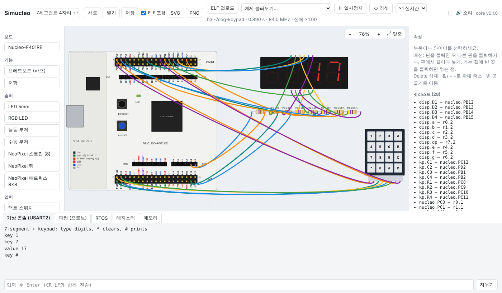

### M7 완료 (DMA, 입력 캡처, 타이밍 민감 장치)

- [x] **DMA1/DMA2**: 스트림 8개씩, 채널 선택으로 요청 연결(RM0368 표 28·29: USART TX/RX, SPI TX/RX, ADC1, TIM 업데이트·비교), 주변장치↔메모리·메모리↔메모리, 증가, 데이터 크기, 순환·이중 버퍼, HT/TC/TE 플래그와 인터럽트, 실행 중 끄기. 데이터는 CPU와 같은 레지스터 경로로 옮기므로 DR 읽기 같은 부수 효과가 그대로 일어남. HAL DMA 드라이버를 그대로 사용
- [x] **TIM DMA 요청**: 업데이트(UDE), 비교(CCxDE), CCDS. 업데이트에서 다시 읽힌 비교값이 그 주기의 첫 카운터 값부터 적용
- [x] **TIM 입력 캡처**: 직접·간접(TI1 ↔ IC2) 연결, 상승/하강/양쪽 엣지, 프리스케일러, 과캡처(CCxOF), CCR 읽기로 CCxIF 해제, DMA 요청. 리셋 슬레이브 모드(TI1FP1/TI2FP2)로 PWM 입력 측정 가능
- [x] **회로가 스스로 바꾸는 신호**: 회로가 다음 변화 시각을 알려 주면 버스가 그 시각에 이벤트를 예약해 핀 레벨을 갱신(EXTI·입력 캡처까지 같은 시각에 반영)
- [x] **DHT11/DHT22**: 시작 신호 길이 검사(DHT22 1 ms, DHT11 18 ms 미만이면 응답 없음 + 경고), 80/80 µs 응답, 40비트 펄스 폭, 체크섬, 음수 온도. 모듈의 10 kΩ 풀업
- [x] **NeoPixel(WS2812B)**: 핀 엣지 시각으로 High 폭을 재서 비트 판정(0.4/0.8 µs ±150 ns), GRB 순서, 50 µs Low로 표시 갱신, 어느 쪽에도 맞지 않는 펄스는 경고. 스트립(8), 링(12/16/24), 8×8 매트릭스. 5V 전원 필요(3.5 V 미만이면 전원 부족)
- [x] 예제(배선 포함): `hal-neopixel-dma`(TIM3 PWM 800 kHz + DMA로 12 LED 링에 무지개, B1 밝기), `hal-dht-capture`(TIM2 양쪽 엣지 입력 캡처 인터럽트로 DHT22 읽기, B1로 펄스 폭 출력)
- [x] 테스트: DMA(메모리→USART, 표 → PWM 듀티, 순환·이중 버퍼), 입력 캡처·PWM 입력 모드, DHT 프레임, NeoPixel 디코드, 펌웨어 통합 테스트(링 색, DHT22 값, DHT11을 DHT22로 잘못 해석하는 경우), E2E(무지개가 돎, 슬라이더 → 측정값)
- 남은 항목: NeoPixel 체인 연결(DOUT → 다음 부품 DIN), I2C DMA·ADC DMA 연속 요청(DDS)·DMA FIFO 패킹, 중앙 정렬 카운팅·반복 카운터·상보 출력, 입력 필터(ICxF)

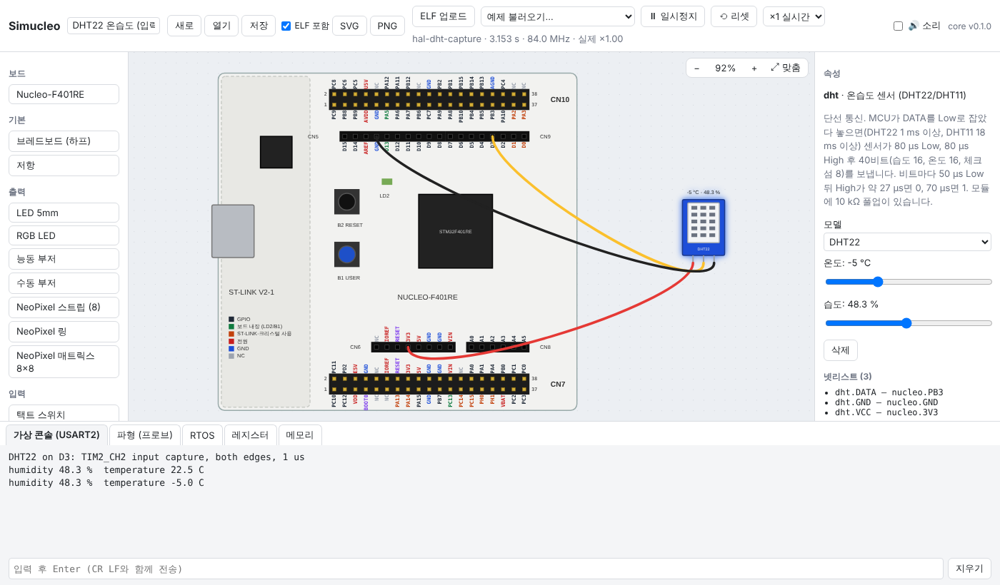

### M6 완료 (I2C/SPI 버스 장치)

- [x] **I2C1–3 마스터**: SB/ADDR/BTF/TXE/RXNE/AF 플래그 순서, ACK/POS로 정하는 NACK 위치, DR이 차면 클럭 스트레칭, 진행 중 바이트가 끝난 뒤의 STOP/재시작, CCR·PCLK1로 정한 바이트 시간(9 SCL), 이벤트·에러 인터럽트. HAL I2C 드라이버(폴링, `Mem_Read/Write`, `IsDeviceReady`)를 그대로 사용
- [x] **SPI1–4 마스터**: 송신 버퍼와 시프트 레지스터(TXE/BSY), 분주비에 따른 프레임 시간, RXNE/OVR(DR → SR 읽기로 해제), 8/16비트, LSB 먼저, 인터럽트. 소프트웨어 NSS인데 SSI가 0이면 실제처럼 MODF로 마스터 모드가 풀림
- [x] **버스와 회로 연결**: 장치는 SCL/SDA(또는 SCK/MOSI/MISO)가 MCU 핀과 같은 넷에 있고 VCC가 들어와 있을 때만 응답. I2C 모듈은 자체 4.7 kΩ 풀업을 가지므로 모듈 전원이 없으면 버스가 Low에 머무름(경고). SCL/SDA, SCK/MOSI가 바뀐 배선과 MISO를 동시에 구동하는 두 장치도 경고. SPI 장치는 CS 넷이 Low일 때만 선택
- [x] **장치**: SSD1306(I2C·SPI 공용 코어, 주소 모드 3종, 컬럼/페이지 창, 리맵·COM 방향, 시작 줄, 반전, 차지펌프, RES 핀), DS3231(BCD 시간·날짜, 12/24시간, 세기 비트, 일부 레지스터만 써도 나머지는 계속 흐름, 온도 레지스터, 시뮬레이션 시작 시각 = PC 현지 시각, 보드 리셋·펌웨어 교체에도 배터리로 계속 감), AHT20(보정, 80 ms 측정, 바쁨 비트, CRC-8), SD 카드(SPI 모드 SDHC: CMD0/8/55/ACMD41/58/9/10/12/13/16/17/18/24/25, CMD0·CMD8 CRC 검사, 데이터 응답·바쁨, 희소 저장소)
- [x] **웹**: OLED 화면 실시간 표시, RTC 날짜·시간 표시, AHT20 온도·습도 슬라이더, SD 카드 접근 LED와 용량 선택, **디스크 이미지 내려받기/넣기**
- [x] 예제(배선 포함): `hal-i2c-oled`(버스 스캔, OLED 시계 + 온습도, B1로 RTC 쓰기), `hal-spi-sd-logger`(빈 카드를 FatFs로 포맷, RTC 시각이 찍힌 CSV 기록, SPI OLED, B1로 파일 읽기). FatFs R0.16(ST 패키지)을 vendor에 추가
- [x] 테스트: I2C·SPI 컨트롤러, 장치(OLED 주소 모드, RTC 설정·진행, AHT20 측정·CRC, SD 초기화·읽기·쓰기·이미지), 회로 연결(전원·풀업·주소), 펌웨어 통합 테스트(실제 HAL·FatFs로 포맷·기록·재부팅 후 이어 쓰기), E2E(OLED 화면, 슬라이더 → 측정값, SD 이미지 안의 LOG.CSV)
- 남은 항목: 비트뱅잉 I2C/SPI용 핀 레벨 디코더, DS3231 알람·SQW 출력, SSD1306 스크롤, I2C·SPI DMA와 슬레이브 모드(M7 이후)

### M5 완료 (아날로그·구동)

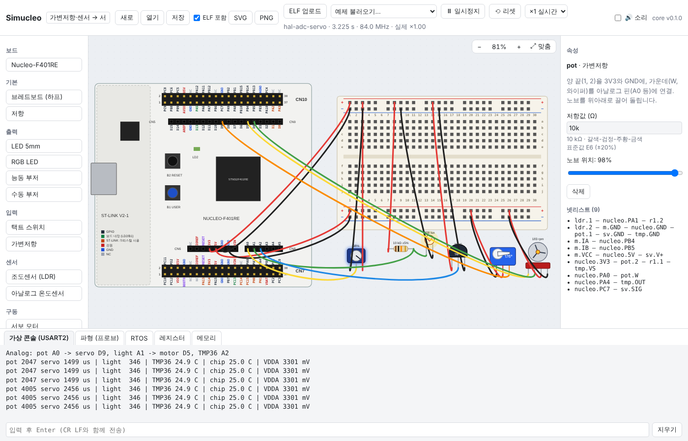

- [x] **ADC1**: 정규 그룹(단일/스캔/연속), 소프트웨어 시작, 채널별 샘플링 시간과 분해능을 반영한 변환 시간(ADCPRE), 정렬, EOC/OVR/아날로그 워치독과 인터럽트, 내부 온도센서·VREFINT·VBAT/4. 채널 0–15는 회로 해석이 계산한 핀 전압을 읽음. HAL ADC 드라이버를 그대로 사용
- [x] **회로 해석 확장**(이미 DC 노드 해석이라 MNA 솔버 추가 없이): 가변저항(노브 위치), LDR(조도 → 저항, γ = 0.7), 아날로그 온도센서 TMP36/LM35(공급 전압이 모자라면 출력 없음 + 경고), 서보(펄스 폭 0.5–2.5 ms → 0–180°, 600°/s), H-브리지 드라이버 달린 DC 모터(IA/IB 듀티 → rpm, 1차 응답)
- [x] **웹**: 노브를 위아래로 끌어 돌리기, 속성 창 슬라이더(위치·조도(로그 눈금)·온도), 서보 혼 회전과 각도, 모터 회전과 rpm, 전원 부족 표시
- [x] 예제 `hal-adc-servo`(배선 포함): 가변저항 → 서보, 빛 → 모터 속도, TMP36·칩 온도·VDDA 출력
- [x] 테스트: ADC 단위 테스트, 부품 단위 테스트(분압, LDR, 센서 전원, 서보 각도, 모터 속도), 전체 경로 통합 테스트, E2E(노브 → 서보, 어둡게 → 모터 느려짐)
- 남은 항목: ADC 주입 그룹·타이머 트리거·DMA(M7), 연속 시간 과도 해석(RC 필터 등)

### M4 완료 (FreeRTOS)

- [x] **CubeMX FreeRTOS 그대로 실행**: ST가 CubeMX용으로 배포하는 FreeRTOS V11.3.1(CMSIS-RTOS v2 래퍼, ARM_CM4F 포트, heap_4)을 수정 없이 사용. SVC로 첫 태스크 시작, PendSV 문맥 교환(FP 문맥 포함), BASEPRI 임계 구역, `configASSERT`의 인터럽트 우선순위 검사까지 통과
- [x] **TIM 타임베이스**: CubeMX처럼 HAL tick은 TIM11, SysTick은 FreeRTOS 차지
- [x] **Idle 시간 건너뛰기**: 기존 바쁜 대기 건너뛰기로 idle 태스크 루프가 다음 tick까지 건너뛰어짐. 30초 시뮬레이션이 약 0.5초(실시간의 약 60배)
- [x] **RTOS 뷰**(커널 인식, 펌웨어 수정 불필요): ELF 심볼로 FreeRTOS 리스트와 TCB를 읽어 태스크 이름, 상태(실행/준비/대기/일시중단/삭제), 우선순위(CMSIS 이름 포함), 스택 크기와 최대 사용량(high-water), CPU 사용률, 실행 타임라인(`pxCurrentTCB` 쓰기로 모든 문맥 교환 기록)
- [x] 예제: `freertos-two-tasks`(Blink/Count/Button, 뮤텍스, B1 인터럽트 → 세마포어), `freertos-queue-uart`(UART 수신 ISR → 큐 → 에코 태스크, 센서 → 큐 → 로거, 힙·스택 통계)
- [x] 테스트: 펌웨어 통합 테스트(tick 타이밍, ISR → 태스크, 큐, 태스크 상태·스택), E2E(RTOS 탭, 버튼 → 세마포어)
- 남은 항목: tickless idle(`configUSE_TICKLESS_IDLE`), 큐·세마포어 객체 뷰, 런타임 통계(`configGENERATE_RUN_TIME_STATS`) 연동

### M3 완료 (디지털 부품)
- [x] **EXTI/SYSCFG**: 핀 레벨이 바뀔 때마다(펌웨어 출력, 외부 회로, 버튼) 선택한 엣지를 감지해 EXTI0–4, 9_5, 15_10 인터럽트. 소프트웨어 트리거, 이벤트 마스크(WFE 깨우기)
- [x] **TIM1–5, TIM9–11**: 업/다운 카운팅, PSC/ARR 프리로드, UG, 원펄스, 업데이트·비교 인터럽트, 출력 비교(토글 등)와 PWM 1/2, 극성, TIM1 MOE. 카운터는 매 사이클 세지 않고 필요한 시점만 계산하고, 관찰되는 일(인터럽트, 출력 엣지)만 이벤트로 예약. AF 핀으로 출력(데이터시트 AF 표)
- [x] **회로 해석**: 배선을 넷으로 묶고 저항·LED(구간 선형 다이오드)·부저 부하·전원·핀 드라이버(푸시풀 출력, 풀업/풀다운)를 DC 노드 해석. 핀 구동 조합별로 결과를 캐시해 PWM도 빠름. 입력 핀은 회로가 만든 레벨을 즉시 읽음(EXTI 포함). 보드 내장 LD2(510 Ω)와 B1(4.7 kΩ 풀업)도 같은 모델
- [x] **부품**: LED(색별 Vf), RGB LED(공통 캐소드/애노드), 저항, 택트 스위치(실행 중 클릭), 능동/수동 부저(Web Audio로 소리, 음높이 = 신호 주파수)
- [x] **전기 규칙 검사**: LED 과전류(저항 없음), 핀 출력 25 mA 초과(단락, 출력끼리 충돌), 전원 단락. 부품에 빨간 점멸 표시와 경고
- [x] **파형 뷰**: 임의 MCU 핀의 실제 레벨(입력 포함)을 로직 분석기처럼 표시, 주파수와 듀티 측정 (M20에서 오실로스코프 트리거·캡처 추가)
- [x] **프로젝트 파일** `.simucleo.json`(버전·검증, ELF 포함 선택), IndexedDB 자동 저장과 복원, SVG/PNG 배선도 내보내기, 모두 보이게 맞춤
- [x] 예제(배선 포함): `hal-button-exti`(외부 버튼 → EXTI → LED), `hal-pwm-led`(LD2 숨쉬기, RGB 색 순환), `hal-buzzer-melody`(TIM1 PWM 멜로디)
- [x] 테스트: 타이머·EXTI·회로 단위 테스트, 펌웨어 통합 테스트(PWM 주기·듀티 정확히 84000 사이클, 음 높이, 배선된 스위치/LED, hot-plug), Playwright E2E 12개
- 남은 항목: 스위치 바운스, 풀업 없는 입력(플로팅) 경고, 중앙 정렬 카운팅·반복 카운터·입력 캡처(M7), USB-UART 모듈 부품

### M2 완료 (웹에서 실행)
- [x] **바쁜 대기 루프 건너뛰기**: 같은 상태로 반복되는 루프(`HAL_Delay`, 플래그 폴링)를 감지해 다음 변화(인터럽트, Peripheral 이벤트, SysTick 0 도달)까지 반복 단위로 시간을 건너뜀. HAL 예제 10초 시뮬레이션이 약 9초에서 0.02초로 단축되고 타이밍은 같음. 1사이클씩 실행한 결과와 정확히 같은지 검사하는 회귀 테스트 포함
- [x] Web Worker 실행 루프: 실제 시간에 맞춰 진행(×0.01~×10, 최대), 실제 배속 표시, 백그라운드 탭에서 따라잡기 방지
- [x] 프레임 스냅샷(약 60 Hz): 시간, 클럭, 핀 상태와 프레임 동안 켜진 비율(LED 밝기), 레지스터, 진단, 경고
- [x] UI: ELF 업로드와 내장 예제, 실행·일시정지·리셋, 배속, LD2 밝기, B1·B2 버튼 클릭, 가상 콘솔(입력 포함), 레지스터·메모리 뷰, 정지 원인 배너, 경고 배너
- [x] 내장 예제는 CI·Pages에서 arm-none-eabi-gcc로 빌드해 사이트에 포함(`npm run examples`)
- [x] Playwright E2E: printf와 에코, LD2 실시간 깜빡임과 B1, 클럭 설정 오류 진단, ELF 업로드와 레지스터·메모리 뷰
- 남은 항목: 외부 부품(브레드보드의 LED 등)을 실행 중인 펌웨어와 연결하는 일은 M3

### M1 완료 (기본 Peripheral)
- [x] ST SVD에서 레지스터 맵 생성(`tools/svdgen.py`). 동작 모델이 없는 Peripheral도 리셋 값과 쓴 값을 유지하고, 어떤 레지스터를 썼는지 보고
- [x] RCC: HSI/HSE/PLL/LSE/LSI 레디 플래그, SW→SWS, 분주기, 클럭 트리(SYSCLK/HCLK/PCLK1/PCLK2/타이머 클럭), 리셋 원인 플래그, 백업 도메인 유지. Nucleo 보드 조건 반영: HSE는 ST-LINK MCO 8 MHz **바이패스로만** 동작(크리스털 없음), LSE 크리스털 있음
- [x] PWR(VOS, DBP), FLASH 인터페이스(ACR 지연, 잠금 해제). 클럭에 비해 지연이 부족하면 경고
- [x] Peripheral 클럭 게이팅: 클럭을 켜지 않은 GPIO/USART/PWR 접근은 실제처럼 무시되고 경고("RCC.AHB1ENR.GPIOAEN을 먼저 켜세요")
- [x] USART1/2/6: 보레이트 기반 송수신 타이밍, TXE/TC/RXNE/ORE/IDLE, 인터럽트, 가상 콘솔(USART2 = ST-LINK VCP). 터미널 보레이트와 다르면 실제 수신기처럼 비트를 다시 샘플링해 깨진 문자 재현
- [x] Peripheral 이벤트 스케줄러, IRQ 라인 → NVIC 즉시 반영, 이벤트까지 수면 건너뛰기, 클럭 변경을 반영한 시간(ns) 타임라인
- [x] 진단: `Error_Handler()` 진입(호출 함수 표시), 폴트 핸들러 정지(폴트 명령어 위치와 CFSR 해석), 처리기 없는 인터럽트(SVD 이름), 인터럽트가 막힌 무한 루프. 인터럽트를 기다리는 `while(1);`은 수면처럼 시간 건너뛰기
- [x] B1 버튼(PC13, 외부 풀업), SYSRESETREQ/리셋 버튼(리셋 원인별 처리)
- [x] CubeMX 스타일 HAL 예제: `hal-blinky`(HSI/HSE 바이패스/HSE 크리스털 오류 변형), `hal-uart-printf`(printf + 인터럽트 에코)
- 남은 항목: 성능(HAL `HAL_Delay` 루프 기준 84 MHz 실시간의 약 1.1배) 최적화는 M2에서. EXTI/TIM/DMA는 M3 이후

### M0 완료 (CPU 코어)
- [x] Thumb/Thumb-2 전체: 데이터 처리, 로드/스토어(단일·다중·듀얼·배타), 분기(TBB/TBH, CBZ), IT 블록, 시스템 레지스터(MRS/MSR/CPS)
- [x] DSP 확장: SIMD 덧셈/뺄셈(GE 플래그, SEL), 포화 연산(Q 플래그), SMLAxy/SMLAD/SMMLA/USAD8, 64비트 곱셈 누적, PKH, 확장+덧셈
- [x] FPv4-SP: 사칙연산, 융합 곱셈-덧셈, √, 비교, 정수/고정소수점/반정밀도 변환, VLDM/VSTM/VPUSH/VPOP, VMOV, VMRS/VMSR. ARM 규칙의 NaN 전파, 기본 NaN, flush-to-zero, 반올림 모드, 누적 예외 플래그
- [x] 공용 Cortex-M 시스템 모듈(`simucleo_core::cortexm`): NVIC(4비트 우선순위, 그룹), SCB, SysTick, DWT CYCCNT, CPACR/FPCCR, 예외 진입·복귀(기본/FP 프레임, 스택 재정렬), BASEPRI/PRIMASK/FAULTMASK, SVC, PendSV, 폴트 에스컬레이션(UsageFault/BusFault → HardFault → Lockup)
- [x] WFI/WFE 시 다음 이벤트까지 시간 건너뛰기, SLEEPONEXIT
- [x] `simucleo-nucleo` 보드 크레이트, GPIO 레지스터와 핀 변화 기록, 비트밴딩
- [x] 검증
  - Unicorn과 lock-step 비교: 5가지 최적화 수준의 테스트 프로그램, 명령어 약 28만 개, 매 명령어마다 레지스터·플래그·FP 레지스터·FPSCR 비교 후 SRAM 비교
  - 예외 모델 자가 테스트 17항목: SysTick, WFI, SVC, BASEPRI, 중첩, tail-chaining, PSP, FP 프레임, 폴트, FreeRTOS 방식 문맥 교환
  - `bare-blinky`에서 LD2 토글 확인. 성능은 약 96 MIPS로 84 MHz 실시간보다 빠름
- 남은 항목: 사이클 수는 근사치(명령어당 1 + 메모리 접근·분기 가산), VMOV 스칼라와 BKPT(디버거)는 미구현

### v0 골격
- [x] Cargo workspace, ELF 로더, CLI(`info`, `run`)
- [x] 넷리스트 추출(내부 버스 + 같은 점 연결), PWM 듀티 적분기
- [x] 웹 배선 편집기 v0: Nucleo(Arduino + Morpho, 실크스크린 핀 이름)/브레드보드/LED/저항/스위치, Rust 넷리스트 연동
- [x] CI: fmt, clippy, 테스트, wasm/웹 빌드, 펌웨어 실행, Unicorn 차분 테스트
