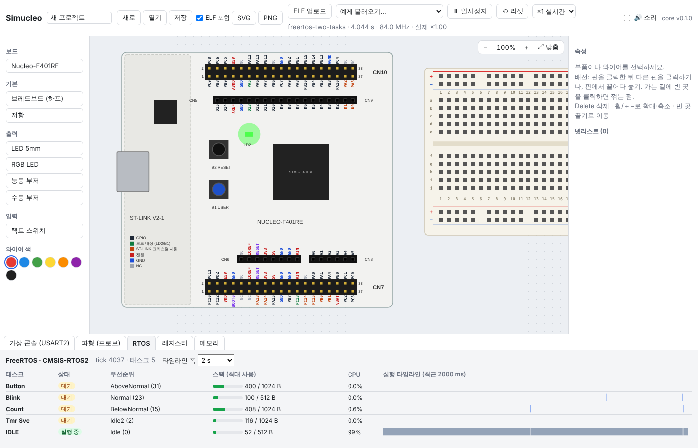

# 로드맵

| 단계 | 내용 | 완료 기준 |
|---|---|---|
| **M0 · CPU 코어** ✅ | Thumb/Thumb-2 전체, FPv4-SP, 공용 예외/NVIC 모델(SVC, PendSV, SysTick, BASEPRI, PSP, FP 프레임), Unicorn 차분 테스트 백엔드 | `bare-blinky`가 무한 루프까지 실행, 차분 테스트 통과 |
| **M1 · 기본 Peripheral** ✅ | SVD 기반 레지스터 맵, RCC/PWR/FLASH, GPIO, SysTick, USART2(VCP), 미구현 접근 리포트, `Error_Handler` 감지 | CubeMX `hal-blinky`, `hal-uart-printf`가 CLI에서 동작 |
| **M2 · 웹 실행** ✅ | Web Worker 실행 루프, 실시간 동기/배속, LD2·B1, **가상 콘솔**, 레지스터/메모리 뷰 | 브라우저에서 ELF 업로드 → LD2 깜빡임, `printf` 출력 |
| **M3 · 디지털 부품** ✅ | EXTI, TIM 기본/PWM, Tier 1 부품(LED, RGB LED, 버튼, 부저), 전기 규칙 검사, 프로브/파형 뷰, 프로젝트 저장 | 버튼 인터럽트, PWM 밝기, 부저 멜로디 예제 |
| **M4 · FreeRTOS** ✅ | CubeMX FreeRTOS 실행, TIM 타임베이스, WFI 시간 건너뛰기, **RTOS 뷰**(태스크, 스택, 전환 타임라인) | `freertos-two-tasks`, `freertos-queue-uart` |
| **M5 · 아날로그/구동** ✅ | ADC, MNA DC 솔버, Tier 2 부품(가변저항, LDR, 아날로그 온도센서, 서보, DC 모터) | 가변저항 → ADC → 서보/모터 제어 예제 |
| **M6 · 버스 장치** | I2C, SPI Peripheral, Tier 3 부품(SSD1306 I2C/SPI, I2C RTC, SPI SD 카드 + FatFs, I2C 온습도센서) | OLED 그래픽, RTC 시계, SD 카드 로깅 예제 |
| **M7 · 타이밍 민감 장치** | DMA, 입력 캡처, Tier 4 부품(NeoPixel, DHT11/22) | NeoPixel 무지개, DHT 측정 예제 |
| 이후 | 회로도 뷰, GDB 원격 서버(데스크톱/Tauri), DWARF 소스 레벨 디버깅, 7세그먼트·LCD·스테퍼 등 | |

상세 부품 계획은 [parts.md](parts.md)를 참고한다.

## 현재 상태

### M5 완료 (아날로그·구동)

- [x] **ADC1**: 정규 그룹(단일/스캔/연속), 소프트웨어 시작, 채널별 샘플링 시간과 분해능을 반영한 변환 시간(ADCPRE), 정렬, EOC/OVR/아날로그 워치독과 인터럽트, 내부 온도센서·VREFINT·VBAT/4. 채널 0–15는 회로 해석이 계산한 핀 전압을 읽음. HAL ADC 드라이버를 그대로 사용
- [x] **회로 해석 확장**(이미 DC 노드 해석이라 MNA 솔버 추가 없이): 가변저항(노브 위치), LDR(조도 → 저항, γ = 0.7), 아날로그 온도센서 TMP36/LM35(공급 전압이 모자라면 출력 없음 + 경고), 서보(펄스 폭 0.5–2.5 ms → 0–180°, 600°/s), H-브리지 드라이버 달린 DC 모터(IA/IB 듀티 → rpm, 1차 응답)
- [x] **웹**: 노브를 위아래로 끌어 돌리기, 속성 창 슬라이더(위치·조도(로그 눈금)·온도), 서보 혼 회전과 각도, 모터 회전과 rpm, 전원 부족 표시
- [x] 예제 `hal-adc-servo`(배선 포함): 가변저항 → 서보, 빛 → 모터 속도, TMP36·칩 온도·VDDA 출력
- [x] 테스트: ADC 단위 테스트, 부품 단위 테스트(분압, LDR, 센서 전원, 서보 각도, 모터 속도), 전체 경로 통합 테스트, E2E(노브 → 서보, 어둡게 → 모터 느려짐)
- 남은 항목: ADC 주입 그룹·타이머 트리거·DMA(M7), 연속 시간 과도 해석(RC 필터 등)

### M4 완료 (FreeRTOS)

- [x] **CubeMX FreeRTOS 그대로 실행**: ST가 CubeMX용으로 배포하는 FreeRTOS V11.3.1(CMSIS-RTOS v2 래퍼, ARM_CM4F 포트, heap_4)을 수정 없이 사용. SVC로 첫 태스크 시작, PendSV 문맥 교환(FP 문맥 포함), BASEPRI 임계 구역, `configASSERT`의 인터럽트 우선순위 검사까지 통과
- [x] **TIM 타임베이스**: CubeMX처럼 HAL tick은 TIM11, SysTick은 FreeRTOS 차지
- [x] **Idle 시간 건너뛰기**: 기존 바쁜 대기 건너뛰기로 idle 태스크 루프가 다음 tick까지 건너뛰어짐. 30초 시뮬레이션이 약 0.5초(실시간의 약 60배)
- [x] **RTOS 뷰**(커널 인식, 펌웨어 수정 불필요): ELF 심볼로 FreeRTOS 리스트와 TCB를 읽어 태스크 이름, 상태(실행/준비/대기/일시중단/삭제), 우선순위(CMSIS 이름 포함), 스택 크기와 최대 사용량(high-water), CPU 사용률, 실행 타임라인(`pxCurrentTCB` 쓰기로 모든 문맥 교환 기록)
- [x] 예제: `freertos-two-tasks`(Blink/Count/Button, 뮤텍스, B1 인터럽트 → 세마포어), `freertos-queue-uart`(UART 수신 ISR → 큐 → 에코 태스크, 센서 → 큐 → 로거, 힙·스택 통계)
- [x] 테스트: 펌웨어 통합 테스트(tick 타이밍, ISR → 태스크, 큐, 태스크 상태·스택), E2E(RTOS 탭, 버튼 → 세마포어)
- 남은 항목: tickless idle(`configUSE_TICKLESS_IDLE`), 큐·세마포어 객체 뷰, 런타임 통계(`configGENERATE_RUN_TIME_STATS`) 연동

### M3 완료 (디지털 부품)
- [x] **EXTI/SYSCFG**: 핀 레벨이 바뀔 때마다(펌웨어 출력, 외부 회로, 버튼) 선택한 엣지를 감지해 EXTI0–4, 9_5, 15_10 인터럽트. 소프트웨어 트리거, 이벤트 마스크(WFE 깨우기)
- [x] **TIM1–5, TIM9–11**: 업/다운 카운팅, PSC/ARR 프리로드, UG, 원펄스, 업데이트·비교 인터럽트, 출력 비교(토글 등)와 PWM 1/2, 극성, TIM1 MOE. 카운터는 매 사이클 세지 않고 필요한 시점만 계산하고, 관찰되는 일(인터럽트, 출력 엣지)만 이벤트로 예약. AF 핀으로 출력(데이터시트 AF 표)
- [x] **회로 해석**: 배선을 넷으로 묶고 저항·LED(구간 선형 다이오드)·부저 부하·전원·핀 드라이버(푸시풀 출력, 풀업/풀다운)를 DC 노드 해석. 핀 구동 조합별로 결과를 캐시해 PWM도 빠름. 입력 핀은 회로가 만든 레벨을 즉시 읽음(EXTI 포함). 보드 내장 LD2(510 Ω)와 B1(4.7 kΩ 풀업)도 같은 모델
- [x] **부품**: LED(색별 Vf), RGB LED(공통 캐소드/애노드), 저항, 택트 스위치(실행 중 클릭), 능동/수동 부저(Web Audio로 소리, 음높이 = 신호 주파수)
- [x] **전기 규칙 검사**: LED 과전류(저항 없음), 핀 출력 25 mA 초과(단락, 출력끼리 충돌), 전원 단락. 부품에 빨간 점멸 표시와 경고
- [x] **파형 뷰**: 임의 MCU 핀의 실제 레벨(입력 포함)을 로직 분석기처럼 표시, 주파수와 듀티 측정
- [x] **프로젝트 파일** `.simucleo.json`(버전·검증, ELF 포함 선택), IndexedDB 자동 저장과 복원, SVG/PNG 배선도 내보내기, 모두 보이게 맞춤
- [x] 예제(배선 포함): `hal-button-exti`(외부 버튼 → EXTI → LED), `hal-pwm-led`(LD2 숨쉬기, RGB 색 순환), `hal-buzzer-melody`(TIM1 PWM 멜로디)
- [x] 테스트: 타이머·EXTI·회로 단위 테스트, 펌웨어 통합 테스트(PWM 주기·듀티 정확히 84000 사이클, 음 높이, 배선된 스위치/LED, hot-plug), Playwright E2E 12개
- 남은 항목: 스위치 바운스, 풀업 없는 입력(플로팅) 경고, 중앙 정렬 카운팅·반복 카운터·입력 캡처(M7), USB-UART 모듈 부품

### M2 완료 (웹에서 실행)
- [x] **바쁜 대기 루프 건너뛰기**: 같은 상태로 반복되는 루프(`HAL_Delay`, 플래그 폴링)를 감지해 다음 변화(인터럽트, Peripheral 이벤트, SysTick 0 도달)까지 반복 단위로 시간을 건너뜀. HAL 예제 10초 시뮬레이션이 약 9초에서 0.02초로 단축되고 타이밍은 같음. 1사이클씩 실행한 결과와 정확히 같은지 검사하는 회귀 테스트 포함
- [x] Web Worker 실행 루프: 실제 시간에 맞춰 진행(×0.01~×10, 최대), 실제 배속 표시, 백그라운드 탭에서 따라잡기 방지
- [x] 프레임 스냅샷(약 60 Hz): 시간, 클럭, 핀 상태와 프레임 동안 켜진 비율(LED 밝기), 레지스터, 진단, 경고
- [x] UI: ELF 업로드와 내장 예제, 실행·일시정지·리셋, 배속, LD2 밝기, B1·B2 버튼 클릭, 가상 콘솔(입력 포함), 레지스터·메모리 뷰, 정지 원인 배너, 경고 배너
- [x] 내장 예제는 CI·Pages에서 arm-none-eabi-gcc로 빌드해 사이트에 포함(`npm run examples`)
- [x] Playwright E2E: printf와 에코, LD2 실시간 깜빡임과 B1, 클럭 설정 오류 진단, ELF 업로드와 레지스터·메모리 뷰
- 남은 항목: 외부 부품(브레드보드의 LED 등)을 실행 중인 펌웨어와 연결하는 일은 M3

### M1 완료 (기본 Peripheral)
- [x] ST SVD에서 레지스터 맵 생성(`tools/svdgen.py`). 동작 모델이 없는 Peripheral도 리셋 값과 쓴 값을 유지하고, 어떤 레지스터를 썼는지 보고
- [x] RCC: HSI/HSE/PLL/LSE/LSI 레디 플래그, SW→SWS, 분주기, 클럭 트리(SYSCLK/HCLK/PCLK1/PCLK2/타이머 클럭), 리셋 원인 플래그, 백업 도메인 유지. Nucleo 보드 조건 반영: HSE는 ST-LINK MCO 8 MHz **바이패스로만** 동작(크리스털 없음), LSE 크리스털 있음
- [x] PWR(VOS, DBP), FLASH 인터페이스(ACR 지연, 잠금 해제). 클럭에 비해 지연이 부족하면 경고
- [x] Peripheral 클럭 게이팅: 클럭을 켜지 않은 GPIO/USART/PWR 접근은 실제처럼 무시되고 경고("RCC.AHB1ENR.GPIOAEN을 먼저 켜세요")
- [x] USART1/2/6: 보레이트 기반 송수신 타이밍, TXE/TC/RXNE/ORE/IDLE, 인터럽트, 가상 콘솔(USART2 = ST-LINK VCP). 터미널 보레이트와 다르면 실제 수신기처럼 비트를 다시 샘플링해 깨진 문자 재현
- [x] Peripheral 이벤트 스케줄러, IRQ 라인 → NVIC 즉시 반영, 이벤트까지 수면 건너뛰기, 클럭 변경을 반영한 시간(ns) 타임라인
- [x] 진단: `Error_Handler()` 진입(호출 함수 표시), 폴트 핸들러 정지(폴트 명령어 위치와 CFSR 해석), 처리기 없는 인터럽트(SVD 이름), 인터럽트가 막힌 무한 루프. 인터럽트를 기다리는 `while(1);`은 수면처럼 시간 건너뛰기
- [x] B1 버튼(PC13, 외부 풀업), SYSRESETREQ/리셋 버튼(리셋 원인별 처리)
- [x] CubeMX 스타일 HAL 예제: `hal-blinky`(HSI/HSE 바이패스/HSE 크리스털 오류 변형), `hal-uart-printf`(printf + 인터럽트 에코)
- 남은 항목: 성능(HAL `HAL_Delay` 루프 기준 84 MHz 실시간의 약 1.1배) 최적화는 M2에서. EXTI/TIM/DMA는 M3 이후

### M0 완료 (CPU 코어)
- [x] Thumb/Thumb-2 전체: 데이터 처리, 로드/스토어(단일·다중·듀얼·배타), 분기(TBB/TBH, CBZ), IT 블록, 시스템 레지스터(MRS/MSR/CPS)
- [x] DSP 확장: SIMD 덧셈/뺄셈(GE 플래그, SEL), 포화 연산(Q 플래그), SMLAxy/SMLAD/SMMLA/USAD8, 64비트 곱셈 누적, PKH, 확장+덧셈
- [x] FPv4-SP: 사칙연산, 융합 곱셈-덧셈, √, 비교, 정수/고정소수점/반정밀도 변환, VLDM/VSTM/VPUSH/VPOP, VMOV, VMRS/VMSR. ARM 규칙의 NaN 전파, 기본 NaN, flush-to-zero, 반올림 모드, 누적 예외 플래그
- [x] 공용 Cortex-M 시스템 모듈(`simucleo_core::cortexm`): NVIC(4비트 우선순위, 그룹), SCB, SysTick, DWT CYCCNT, CPACR/FPCCR, 예외 진입·복귀(기본/FP 프레임, 스택 재정렬), BASEPRI/PRIMASK/FAULTMASK, SVC, PendSV, 폴트 에스컬레이션(UsageFault/BusFault → HardFault → Lockup)
- [x] WFI/WFE 시 다음 이벤트까지 시간 건너뛰기, SLEEPONEXIT
- [x] `simucleo-nucleo` 보드 크레이트, GPIO 레지스터와 핀 변화 기록, 비트밴딩
- [x] 검증
  - Unicorn과 lock-step 비교: 5가지 최적화 수준의 테스트 프로그램, 명령어 약 28만 개, 매 명령어마다 레지스터·플래그·FP 레지스터·FPSCR 비교 후 SRAM 비교
  - 예외 모델 자가 테스트 17항목: SysTick, WFI, SVC, BASEPRI, 중첩, tail-chaining, PSP, FP 프레임, 폴트, FreeRTOS 방식 문맥 교환
  - `bare-blinky`에서 LD2 토글 확인. 성능은 약 96 MIPS로 84 MHz 실시간보다 빠름
- 남은 항목: 사이클 수는 근사치(명령어당 1 + 메모리 접근·분기 가산), VMOV 스칼라와 BKPT(디버거)는 미구현

### v0 골격
- [x] Cargo workspace, ELF 로더, CLI(`info`, `run`)
- [x] 넷리스트 추출(내부 버스 + 같은 점 연결), PWM 듀티 적분기
- [x] 웹 배선 편집기 v0: Nucleo(Arduino + Morpho, 실크스크린 핀 이름)/브레드보드/LED/저항/스위치, Rust 넷리스트 연동
- [x] CI: fmt, clippy, 테스트, wasm/웹 빌드, 펌웨어 실행, Unicorn 차분 테스트
