# 로드맵

| 단계 | 내용 | 완료 기준 |
|---|---|---|
| **M0 · CPU 코어** ✅ | Thumb/Thumb-2 전체, FPv4-SP, 공용 예외/NVIC 모델(SVC, PendSV, SysTick, BASEPRI, PSP, FP 프레임), Unicorn 차분 테스트 백엔드 | `bare-blinky`가 무한 루프까지 실행, 차분 테스트 통과 |
| **M1 · 기본 Peripheral** ✅ | SVD 기반 레지스터 맵, RCC/PWR/FLASH, GPIO, SysTick, USART2(VCP), 미구현 접근 리포트, `Error_Handler` 감지 | CubeMX `hal-blinky`, `hal-uart-printf`가 CLI에서 동작 |
| **M2 · 웹 실행** ✅ | Web Worker 실행 루프, 실시간 동기/배속, LD2·B1, **가상 콘솔**, 레지스터/메모리 뷰 | 브라우저에서 ELF 업로드 → LD2 깜빡임, `printf` 출력 |
| **M3 · 디지털 부품** ✅ | EXTI, TIM 기본/PWM, Tier 1 부품(LED, RGB LED, 버튼, 부저), 전기 규칙 검사, 프로브/파형 뷰, 프로젝트 저장 | 버튼 인터럽트, PWM 밝기, 부저 멜로디 예제 |
| **M4 · FreeRTOS** ✅ | CubeMX FreeRTOS 실행, TIM 타임베이스, WFI 시간 건너뛰기, **RTOS 뷰**(태스크, 스택, 전환 타임라인) | `freertos-two-tasks`, `freertos-queue-uart` |
| **M5 · 아날로그/구동** ✅ | ADC, MNA DC 솔버, Tier 2 부품(가변저항, LDR, 아날로그 온도센서, 서보, DC 모터) | 가변저항 → ADC → 서보/모터 제어 예제 |
| **M6 · 버스 장치** ✅ | I2C, SPI Peripheral, Tier 3 부품(SSD1306 I2C/SPI, I2C RTC, SPI SD 카드 + FatFs, I2C 온습도센서) | OLED 그래픽, RTC 시계, SD 카드 로깅 예제 |
| **M7 · 타이밍 민감 장치** ✅ | DMA, 입력 캡처, Tier 4 부품(NeoPixel, DHT11/22) | NeoPixel 무지개, DHT 측정 예제 |
| **M8 · 추가 부품** ✅ | 7세그먼트(1·4자리), 4×4 키패드, 로터리 엔코더(+TIM 엔코더 모드), NTC 서미스터, 초음파 거리센서, DS18B20(1-Wire), I2C 문자 LCD, 스테퍼 | 키패드 → 7세그먼트, 엔코더 → 스테퍼 + LCD, 초음파·1-Wire 예제 |
| **M9 · 소스 디버깅** ✅ | DWARF 줄 표·호출 스택·변수, 중단점, 줄 단위 스텝(넘어가기/들어가기/나오기), 웹 소스 탭 | 예제 C 소스에서 중단점 → 스텝 → 변수 확인 |
| **M10 · 디버그 확장** ✅ | GDB 원격 서버(`simucleo gdb`), 디스어셈블리 보기, 감시식(C 식), 조건부 중단점 | `gdb-multiarch`·Cortex-Debug로 접속, 웹에서 조건이 참일 때만 멈추고 감시식 확인 |
| **M11 · 디버거 마무리** ✅ | 변수 값 바꾸기, 데이터 감시점(GDB Z2–Z4 포함), FreeRTOS 태스크별 호출 스택·지역 변수 | 웹에서 값을 바꾸면 펌웨어 동작이 달라지고, 감시점이 쓰는 줄에서 멈추고, 대기 중인 태스크의 스택을 본다 |
| **M12 · 회로도 뷰** ✅ | 배선에서 자동으로 만든 회로도(MCU는 쓰는 신호만, 부품 기호, 넷 이름·전원 기호), 실시간 넷 레벨, 넷 강조, 스위치 누르기, 그림 내보내기 | 예제 회로가 회로도로 보이고 실행 중 레벨·LED가 따라 바뀐다 |
| **M13 · 추가 부품 2** ✅ | MPU-6050(I2C 가속도·자이로, 마우스로 끌어 기울이기), MAX7219 8×8 LED 매트릭스(1–4개 체인, SPI·비트뱅잉), IR 수신기 + NEC 리모컨 | 기울이면 매트릭스의 점이 굴러가고, 리모컨 버튼이 NEC 코드(반복 포함)로 해독된다 |
| **M14 · 부품 직접 조작** ✅ | 브레드보드에서 센서를 실제 물건처럼 마우스·손가락으로 조작: 가변저항 노브 돌리기(휠 포함), LDR 위 손전등 옮기기·손으로 가리기, 온도센서 손가락으로 데우기(DHT·AHT20은 입김으로 습도도), 초음파 센서 앞 장애물 옮기기. 서보 각도·모터 회전 표시 개선 | 노브를 돌리면 ADC 값이, 손전등을 옮기면 밝기가, 손가락을 대면 온도가 몇 초에 걸쳐 오르내리고, 장애물을 옮기면 측정 거리가 바뀐다 |
| **M15 · 마무리** ✅ | 따로 놓은 MAX7219 부품끼리 DOUT → DIN 체인(하드웨어 SPI·비트뱅잉), MPU-6050 흔들기(감쇠하는 가속 충격), M13 부품의 회로도 상자(핀 배치·부제), SD 카드 내용 자동 저장(IndexedDB)과 카드 비우기 | 흔들면 \|a\|가 커지고 DOUT에 이은 두 번째 매트릭스의 막대가 올라가며, 새로고침해도 SD 카드의 LOG.CSV가 그대로 남는다 |
| **M16 · 수업용 실습** ✅ | 단계별 실습(레슨 파일 `web/lessons/*.json`)과 자동 채점: 넷리스트로 배선 검사(부품, 핀 연결, 저항–LED 직렬 경로, 전기 규칙), 실행 프레임으로 동작 검사(주기, 밝기, 듀티비, 콘솔, 서보, 디스플레이, 멈춤), 진행 상황 저장과 결과 내보내기(CSV/JSON), 실습 6개 | 배선하면 검사가 바로 초록으로 바뀌고 틀리면 이유를 알려 주며, 채점이 주기를 재어 실습을 완료하고, 학생이 결과 파일을 낸다 |
| **M17 · 부품 추가** ✅ | DS18B20 여러 개를 한 1-Wire 선에(SEARCH·MATCH·ALARM SEARCH, 부품별 ROM 코드), HC-05 블루투스 모듈(USART1/6 연결, 휴대폰 대화 탭, 보레이트 불일치, AT 모드), 5 V 릴레이 모듈(회로 해석 속 접점, 동작 지연·튐), 여러 서보 | 세 센서를 찾아 각각의 온도를 읽고 하나만 데워지며, 휴대폰에서 보낸 명령으로 LD2가 켜지고 답이 오고, 버튼이 릴레이를 켜 5 V LED가 켜지고, 서보 셋이 각자 채널대로 움직인다 |
| **M18 · 회로도에서 배선** ✅ | 회로도의 핀 끝에서 핀 끝으로 끌어 배선(브레드보드에 직각으로 꺾인 진짜 와이어), 같은 넷이면 알림, **모든 MCU 핀**(쓰지 않는 핀·전원 핀을 양쪽에), 핀을 골라 **연결 끊기**(브레드보드로 이어져 있으면 알림), 와이어 하나로 기호가 뒤섞이지 않는 배치 | 회로도에서만 LED와 저항을 보드에 이으면 브레드보드에도 와이어가 생기고 blinky로 LED가 깜빡이며, 연결을 끊으면 두 보기에서 모두 사라진다 |
| **M19 · 부품 추가** ✅ | 74HC595 시프트 레지스터(비트뱅잉·하드웨어 SPI, Q7' 체인, 출력이 회로 해석의 진짜 출력), TM1637 4자리 7세그먼트(시작·끝·LSB·ACK), KY-023 조이스틱(끌기·스프링 복귀·누르기), HC-SR501 PIR(워밍업·H/L·차단 시간, 사람 끌기), BMP280 기압계(I2C, 보정식 역산), NeoPixel 부품끼리 DOUT → DIN 체인 | SPI로 LED 8개 나이트라이더가 돌고, TM1637에 분:초가 ACK와 함께 뜨며, 조이스틱을 끌면 OLED 점이 움직이고, 사람이 센서 앞을 지나가면 LED가 켜지고, BMP280 보정 코드가 설정한 기압·온도를 돌려주고, 링 뒤 스트립에 혜성이 달린다 |
| **M20 · 오실로스코프 트리거** ✅ | 파형 뷰에 오실로스코프식 트리거(소스 핀, 상승·하강·양쪽 에지, 펄스 폭 조건, 자동·일반·단일 모드, 트리거 시 일시정지), 트리거 앞뒤 구간을 시뮬레이터 안에서 에지 하나 빠짐없이 캡처, 1 µs–200 ms/div 시간축(눈금, 단위, T 표시, 휠 확대·끌어 이동), 펄스 측정과 두 커서 | 서보 펄스가 단일 캡처로 잡혀 펌웨어가 정한 폭(µs)이 그대로 재지고, NeoPixel의 0.4 µs·0.8 µs 비트가 1 µs/div에서 보이며, 트리거 시 일시정지가 실행을 멈춘다 |
| **M21 · 모터 추가** ✅ | NEMA17 바이폴라 스테퍼(관성·홀딩 토크·디텐트를 적분하는 회전자, 풀인을 넘으면 탈조), A4988/DRV8825 스텝 드라이버(마이크로스텝, EN·SLP·RST, 펄스 폭·VMOT 경고), L298N H-브리지(풀·반스텝, EN PWM, 틀린 순서는 떨림), ESC + BLDC(아밍·페일세이프·KV), 홀 센서 BLDC + 3상 브리지(6스텝 정류), DC 전원 부품 | A4988이 가속 램프로 한 바퀴씩 오가고 B1로 끈 축을 손으로 돌리며, 브레이크를 걸면 스텝을 잃고, L298N 반스텝이 60 rpm으로 돌고, ESC가 1초 뒤 아밍되어 가변저항을 따르고 신호가 끊기면 멈추며, BLDC가 홀 인터럽트로 3300 rpm까지 돌다가 홀을 바꾸면 멈춘다 |
| **M22 · 오실로스코프 확장** ✅ | 아날로그 채널(부품 핀·MCU 핀의 넷 전압, V/div·오프셋, 최소·최대·평균·Vpp·RMS), 레벨 트리거(상승·하강, 히스테리시스), USART·I2C·SPI 핀의 비트 단위 파형 합성, UART·I2C·SPI 디코더(파형 위 상자, 16진수/ASCII, 오류는 빨강, 해독 표), 캡처 CSV·VCD 내보내기 | `printf`가 PA2에 115 200 baud 프레임으로 보여 그 글자가 해독되고, BMP280 읽기가 START·0x76 W ACK·재START·0x76 R로, 74HC595에 보낸 바이트가 SCK 버스트의 MOSI로 보이며, 가변저항 와이퍼 전압이 노브를 따라가고 2.5 V 레벨 트리거가 그 순간을 잡고, 캡처가 GTKWave용 VCD로 저장된다 |
| **M23 · TIM1 상보 출력·데드타임** ✅ | TIM1 CH1N–CH3N(CCxNE/CCxNP), BDTR.DTG 데드타임(네 구간, CKD), MOE/AOE/OSSR/OSSI와 유휴 레벨(OISx/OISxN), 브레이크(BKIN 핀·EGR.BG → BIF, IRQ 24), CCPC 프리로드와 COM 이벤트, 3상 브리지의 PWM 듀티 평균과 관통 전류 검출, `hal-bldc-pwm` 예제 | BLDC가 TIM1 상보 PWM 6스텝으로 돌며 가변저항이 듀티로 속도를 정하고, B1 브레이크로 출력이 꺼져 관성으로 멈췄다 다시 돌며, 오실로스코프에서 PA8 하강과 PA7 상승 사이에 정확히 500 ns(42사이클)가 보이고, 데드타임이 없으면 관통 전류 경고가 뜬다 |
| **M24 · 수업용 확장** ✅ | 선생님용 결과 모아보기(여러 결과 파일을 끌어다 놓기, 학생 × 실습·단계 표, 점수·걸린 시간, 단계별 통과율, 정렬·필터, 중복은 최신만, 표 CSV), 결과 JSON의 SHA-256 무결성 해시(변조됨·검증 안 됨 표시), 레슨 편집기(검사 종류별 입력 양식, 현재 배선에서 검사 만들기, 현재 프로젝트로 미리 보기, 형식 검사, JSON 내려받기·불러오기, 내 레슨), 채점에서 틀린 배선 검사의 핀·넷을 회로도·브레드보드에 표시 | 두 학생이 낸 결과가 한 표에 통과율과 함께 보이고 손으로 고친 파일은 "변조됨"으로 표시되며, 편집기에서 회로로 만든 실습을 내 레슨에서 다시 열어 채점하면 통과하고, 틀린 배선은 회로도에 빨갛게 보인다 |
| **M25 · 해독기 추가·해독 트리거** ✅ | 1-Wire(DS18B20: 리셋·프레즌스, 슬롯, ROM·기능 명령, SEARCH 3비트, 타이밍 오류)·TM1637(START·STOP, LSB, ACK, 명령, 세그먼트 → 숫자·콜론, NACK)·WS2812(0.4/0.8 µs ±150 ns, GRB 픽셀 색 견본, 리셋·픽셀 번호, 허용 오차 밖) 디코더, 해독 내용 트리거(UART 바이트·글자열, I2C 주소+R/W, SPI·1-Wire·TM1637 바이트, WS2812 N번 픽셀 색; 단일·일반·자동, 트리거 시 일시정지), 파형 설정(프로브, 아날로그, 디코더, 트리거, 시간축)을 프로젝트 파일과 자동 저장에 | DS18B20의 리셋·프레즌스·SKIP ROM·CONVERT T·READ SCRATCHPAD가 풀리고 스크래치패드의 온도가 콘솔과 같으며, TM1637의 0x40·0xC0과 숫자가 표시기와 같고, NeoPixel 체인의 해독한 프레임 색이 링·스트립과 같으며, UART 글자열 "tick 1"에서 그 글자 앞뒤가 잡히고, 저장한 프로젝트를 다시 열면 파형 설정이 돌아온다 |
| **M26 · 시뮬레이터 안의 해독 트리거·IR 해독** ✅ | 해독 트리거를 트리거 엔진 안으로: UART·I2C·SPI·1-Wire·TM1637·WS2812·NEC 스트리밍 디코더(Rust)가 프로브한 모든 에지를 받아 일치한 항목의 시작 사이클에 트리거, 창·일시정지는 M20 방식(창 끝 바로 뒤에 멈춤), 기록을 다시 흘려 중간에 설정해도 동기, UI에 "정확(시뮬레이터)"/"화면 해독" 표시, TS–Rust 디코더 일치 검사(공유 고정 데이터). IR(NEC) 디코더(리더, 공백 폭 32비트, 주소·명령과 반전 검사, 반복 코드, 타이밍 오류)와 NEC 명령 트리거 | hal-uart-printf의 "tick 1" 트리거가 그 't'의 시작 비트에 사이클 단위로 맞고 실행이 창 끝(0.05 ms 안)에서 멈추며, BMP280의 0x76 R 주소 트리거가 재START 뒤 주소 바이트에, 리모컨 OK를 누르면 NEC 명령 0x1C 트리거가 리더 마크에 맞고 해독한 주소·명령이 콘솔과 같다 |
| **M27 · 아날로그 채널 수학·FFT** ✅ | 수학 채널 2개(A+B, A−B, A×B, −A, k·A + c, 이동 평균 — 소스는 아날로그 채널, 0/3.3 V 디지털 채널, M1; 두 소스의 변화 시각의 합집합에서 정확히, 이동 평균은 정확한 구간별 직선), 자기 V/div·중앙과 최소·최대·평균·Vpp·RMS, 스펙트럼(FFT) 보기(아무 채널, 보이는 구간 또는 커서 A–B, 구간 평균으로 균일 재표본화, N 1024–16384, 사각·Hann·Hamming·Blackman, dBV·선형, 선형·로그 주파수축, 피크 표시, 기본파·DC·THD(2–10차)·SNR 추정, 포인터·키보드 읽기 선), 시간·스펙트럼·분할 보기, 설정 저장 | 가변저항 와이퍼 − 고정 분압의 차가 노브를 따라 바뀌고, LD2 PWM을 한 주기로 평균하면 듀티 × 3.3 V, 부저 C4의 스펙트럼이 262 Hz에 기본파·짝수 고조파 없음, L298N 80 % PWM의 5·10차가 사라진다 |
| **M28 · 모터 모델 보강** ✅ | TIM1–TIM5 중앙 정렬 PWM(CR1.CMS 1–3: 0 → ARR → 0, 오버플로·언더플로 업데이트, 읽기 전용 DIR, 방향별 CCxIF, 대칭 펄스)과 TIM1 반복 카운터(RCR: RCR + 1번째 오버/언더플로마다 업데이트), 모터 권선을 넷 해석에(스테퍼 코일·BLDC 상 = 저항 + 역기전력, 드라이버 출력 = 전원·GND 스위치, 해마다 역기전력 감도를 함께 캐시해 v = v0 + S·x, 모터 전류 a + B·emf), 센서리스 BLDC 부품(`bldc`)과 `hal-bldc-sensorless`(중앙 정렬 + RCR 1, ADC로 떠 있는 상 − 가상 중성점, 정렬 → 램프 → 영점 + 30°) | 아날로그 채널에 L298N OUT·A4988 1A–2B·3상 브리지 OUTA–C의 실제 전압(PWM 그대로, 떠 있는 상은 중성점 + 역기전력)이 보이고 직렬 저항이 전류를 줄이며, 중앙 정렬 PWM은 듀티가 바뀌어도 펄스 중심이 언더플로에 그대로 있고(업데이트가 걸린 한 펄스만 반반), 센서리스 BLDC가 정렬·램프 뒤 영점을 따라 돌고 가변저항이 속도를 정한다 |
| **M29 · 오프라인 설치형 앱** ✅ | 웹 앱 매니페스트(이름, standalone, 색, 192·512·maskable 아이콘), 손으로 쓴 서비스 워커(빌드가 만든 모든 파일 — 화면, 해시된 JS/CSS, WASM, 예제 ELF·배선, 예제 소스, 실습이 든 번들 — 을 빌드 때 SHA-256 목록으로 미리 캐시, 내용 해시로 정한 캐시 이름, 바뀐 파일만 다시 받기), 페이지는 네트워크 먼저·끊기면 캐시, 해시된 파일은 캐시 먼저, 업데이트 배너(실행 중이면 먼저 물음), 설치 버튼, 오프라인 배지, "오프라인 사용 준비됨" | 한 번 연 뒤 네트워크를 끊고 새로 고쳐도 앱이 열리고 hal-blinky의 LD2가 깜빡이며 실습이 열리고, 새 버전은 배너로 알려 시뮬레이션 중이면 묻고 나서 바꾼다 |
| **M32 · 실습 레슨 확충** ✅ | 실습 6개 → 38개, 트랙 A–G(기초, 타이머·PWM, 아날로그, 통신, 센서·액추에이터, 고급, 프로젝트)로 묶은 한 학기 이상의 교육과정. 레슨마다 학습 목표·선수 학습·개념 상자·힌트·흔한 실수·도전 과제·수준·예상 시간, 실습 목록의 트랙 묶음, 채점 조작 `send`(콘솔·블루투스 입력)·`connect`·키패드 키, TM1637·NeoPixel 읽기, 실습용 펌웨어 13개(`firmware/lesson-*`) | 모든 실습이 모범 회로·모범 펌웨어로 자동 채점을 통과하고, 트랙마다 틀린 회로·펌웨어는 해당 검사에서 실패한다 |
| **M38 · 예제 배선 정리** ✅ | 예제·실습 회로 68개(예제 41, E2E 모범 회로 2, 실습 시작 회로 25)를 실제 브레드보드 작업처럼 다시 배치: 스루홀 부품은 브레드보드 구멍에 꽂고(DIP·택트 스위치는 가운데 홈을 걸침), 보드에서 레일로 전원·GND 점퍼 하나씩, 큰 모듈은 옆에 두고 점퍼로, 모든 점퍼는 직각으로 꺾여 부품을 가리지 않음. 택트 스위치를 실물처럼 3 × 3(다리 0.3″ 간격)으로, 배치 도구(`scripts/route.mjs`: 넷을 지키며 점퍼를 다시 고르고 격자 위 최단 경로로 꺾기, `scripts/m38-layouts.mjs`: 회로별 배치)와 `npm test` 배치 검사(넷 스냅숏과 같음, 부품 위를 지나는 점퍼 없음, 부품 겹침 없음, 꽂을 부품은 구멍에, 한 줄에 두 다리 없음) | 모든 회로의 넷이 배치 전과 같아 펌웨어·실습 채점·E2E가 그대로 통과하고, 일부러 망가뜨린 회로는 검사마다 실패한다 |
| **M30 · 링크·QR 공유("선생님께 보내기")** ✅ | 프로젝트(회로, 부품 속성, 파형 설정, 펌웨어)·열어 둔 실습·해시가 붙은 실습 결과를 주소의 `#s1=` 뒤에 담은 링크(버전 붙은 형식, `deflate-raw` 압축 + base64url, 서버로 가지 않음), 예제 펌웨어는 이름만·올린 ELF는 바이트로(디버그 정보를 빼고 로드 세그먼트 + 기호표만 남기기), 직접 쓴 바이트 모드 QR 인코더(버전 1–40, 2 953바이트까지), 받을 때 확인 창(덮어쓰기 전에 묻고 열면 `#` 지움), 링크는 믿지 않는 입력(길이·압축 폭탄 한도, 프로젝트·결과 검사기), 실습 패널의 **선생님께 보내기**, 선생님용 모아보기의 링크 붙여넣기 | 예제 펌웨어 회로의 링크를 새 브라우저에서 열면 묻고 나서 같은 부품·와이어·펌웨어로 실행되고, 올린 ELF도 링크로 오가며, 선생님께 보낸 링크가 모아보기에서 "검증됨"으로 나온다 |
| 이후 | 추가 부품, 넷 이름 붙이기, CAN(F401에는 CAN 주변장치가 없어 MCP2515 SPI CAN 컨트롤러 + TJA1050 부품과 비트 스트림이 먼저 필요)·1-Wire 오버드라이브·RC5 등 다른 IR 디코더, NEC 반복 코드·확장 NEC 조건, 수학 채널로 트리거(시뮬레이터 안의 수학), 스펙트럼 평균·스펙트로그램, 상 인덕턴스(전류 리플)·데드타임 동안의 실제 다이오드 전압, A4988 초퍼 PWM과 A4988 뒤 직렬 저항, FOC·전류 감지(ADC 주입 변환을 TIM1 트리거로), 엔코더 DC 모터 PID 등 | |

상세 부품 계획은 [parts.md](parts.md)를 참고한다.

## 다음 계획 (순서대로)

별도 서버 없이 정적 사이트(GitHub Pages)로 운영하는 것을 전제로 한다. 시뮬레이션은 학생 브라우저에서 돈다.

1. **소스 폴더·zip 업로드**: ELF와 소스를 한꺼번에 올리면 DWARF 경로로 소스를 짝지음, CubeIDE 프로젝트 폴더 끌어다 놓기
2. **M31 · 저사양 기기 성능 모드**: 예제별 실시간 배율 측정, 화면 갱신 빈도 자동 조절
3. **M33 · 브라우저 안 C 편집·빌드**: CodeMirror 하이라이트, 자동완성 1단계(HAL 심볼 색인)·2단계(선택: clangd-wasm), 규칙 기반 제안,
   AI 제안은 사용자가 넣은 API 키가 있을 때만(선택)
4. **M36 · CubeMX식 설정 도구**: 핀 배치·클럭 트리·주변장치 페이지 → `MX_*_Init` 코드 생성, `.ioc` 불러오기 → CubeIDE식 프로젝트
   트리(Core/Inc·Src·Startup, Drivers/STM32F4xx_HAL_Driver·CMSIS는 고를 수 있는 STM32CubeF4 버전에서 복사), 다시 생성해도 USER CODE
   영역 유지, CubeIDE로 열리는 zip 내보내기와 CubeIDE 프로젝트 가져오기
5. **M34 · 영어 UI**(다국어)
6. **SWO/SWV**: ITM 자극 포트 콘솔(printf), DWT 데이터 트레이스(변수 값 그래프), PC 샘플링 프로파일, 예외 트레이스 타임라인
7. **M35 · 부품 추가**: 컬러 TFT(ST7735/ILI9341), RFID(RC522), MCP2515 CAN 모듈 + CAN 해독, 열전대(MAX6675/MAX31855: K형 온도·냉접점·
   단선/단락 오류, 가열 조작)
8. **M37 · 보드 펌웨어 교체 실습**: 부트로더·IAP(UART 수신 → 플래시 지우기/쓰기 → 검증 → 점프), FLASH 컨트롤러 지우기/쓰기 모델,
   VTOR, 이중 이미지·롤백

나중에: **수업 세션 실시간 모니터링**(선생님이 학생 화면·진행 상황을 실시간으로 봄). 서버가 필요하므로 학교 서버의 WebSocket 중계 방식을 권장.

## 현재 상태

### M30 완료 (링크·QR 공유)

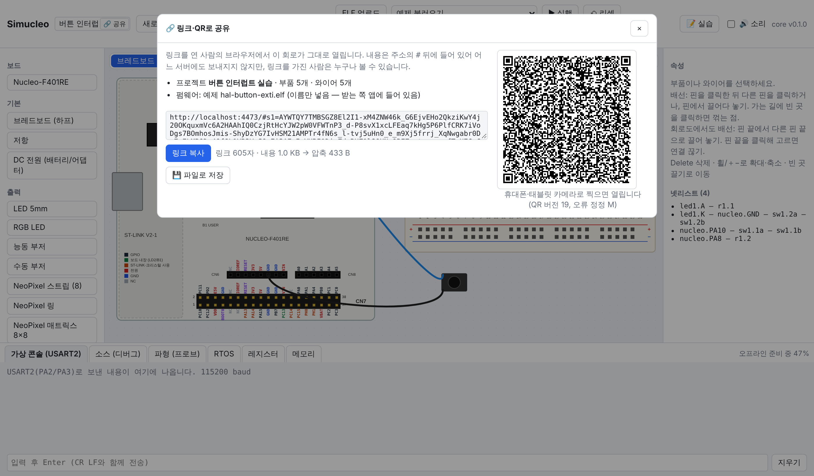

회로·펌웨어·설정을 링크나 QR 코드로 주고받게 했다. 서버는 그대로 없다 — 내용은 주소의 `#` 뒤에 있어 브라우저가
서버로 보내지 않는다. 사용법은 [share.md](share.md), 선생님용은 [lessons.md](lessons.md#링크로-제출받기). 모두 웹
쪽(`web/src/share/`)이고 Rust 코어는 바뀌지 않았다. 새 의존성도 없다.

- [x] **형식**(`link.ts`): `#s1=<base64url>`. `s1`이 형식 버전이고, 다른 버전은 읽지 않고 알린다. 첫 바이트가 방식(0 그대로,
  1 `deflate-raw` — 브라우저의 `CompressionStream`, 없으면 압축 없이), 그 뒤가 JSON 길이(u32 LE)·JSON·올린 ELF 바이트다.
  ELF를 JSON 안의 base64로 넣지 않아 글자로 바꾸는 것이 한 번뿐이다. JSON에는 프로젝트 파일(부품, 속성, 와이어, 꺾는
  점, 파형 설정, 이름, 펌웨어 이름), ELF 정보(크기·원래 크기·뺀 것), 열어 둔 실습 id, 해시가 붙은 실습 결과가 든다
- [x] **펌웨어**: 예제는 파일 이름만(예제 회로 링크는 수백 자). 올린 ELF는 기본으로 **디버그 정보를 뺀다**(`elf.ts`: ELF
  헤더, `PT_LOAD` 헤더와 바이트, 함수·변수 기호만 남긴 기호표 — `Error_Handler` 감지와 RTOS 보기용). hal-blinky.elf는
  829 KB → 10 KB, 링크 약 8 000자. 기호표도 뺄 수 있고, 다 넣으면 원래 ELF가 바이트까지 그대로 간다
- [x] **한도**: QR 코드는 링크가 2 953바이트(버전 40-L) 이하일 때만 그리고, 아니면 이유와 **파일로 저장**을 보여 준다.
  4 000자가 넘으면 메신저가 자를 수 있다고 경고하고, 2 000 000자(브라우저 주소 한도)가 넘으면 링크를 만들지 않는다
- [x] **QR 인코더**(`qr.ts`, 약 350줄): 바이트 모드, 버전 1–40, L/M/Q/H, GF(256) 리드–솔로몬, 블록 나누기·섞기, 마스크
  8개 중 벌점이 가장 낮은 것. M으로 안 들어가면 L. SVG 경로 하나로 그린다
- [x] **받기**: `#s…`로 열리면(새로 열거나 같은 페이지에서 `hashchange`) 자동 저장을 되살린 뒤 **공유 링크 열기** 창을
  띄운다. 링크에 든 것(이름, 부품·와이어 수, 펌웨어, 실습, 결과와 검증 상태, 건너뛴 것)을 보여 주고, 작업 중인
  회로가 있으면 바뀐다고 경고하며 그 자리에서 파일로 저장하게 한다. **열기**는 평소의 "저장하지 않은 내용은
  사라집니다" 확인을 거쳐 연다. **취소**는 아무것도 바꾸지 않는다. 어느 쪽이든 `history.replaceState`로 `#`을 지워
  새로 고침이 다시 묻지 않는다. 링크의 실습이 이 브라우저에 있으면 그 실습을 연다
- [x] **믿지 않는 입력**: 링크 길이 한도, 풀면서 8 MB를 넘는 순간 멈춤(압축 폭탄), 길이·남는 바이트 확인, 프로젝트는
  프로젝트 파일 검사기, 결과는 모아보기의 검사기와 SHA-256 검증, ELF는 헤더·세그먼트 범위 확인, 예제 이름에 경로가
  있으면 버림, 실습 id 형식 확인. 화면에는 글자로만 나온다(HTML로 넣지 않음)
- [x] **선생님께 보내기**: 실습 패널 이름 칸 옆 **📤 선생님께 보내기**가 결과(열어 둔 실습만, 목록에서는 전부)를 JSON
  내보내기와 같은 해시로 봉인해 공유 창에 넣는다. 선생님용 모아보기에 **공유 링크 붙여넣기** 칸이 생겼다(여러 링크,
  둘레의 글은 무시, 결과 없는 링크와 잘린 링크는 이유와 함께). 링크를 그냥 열면 **결과 모아보기에 추가**도 된다
- [x] **툴바**: **🔗 공유**는 프로젝트 이름 칸 안 오른쪽에 겹쳐 놓았다(`position: absolute`, 이름 칸 폭 130 px 그대로).
  처음에는 프로젝트 메뉴에 넣었는데, 그만큼 실행 컨트롤이 좁아져 1400 px에서 툴바가 85 → 111 px로 높아지고 캔버스가
  내려갔다(M29와 같은 문제). 이제 단추를 숨겨도 툴바의 모든 항목 위치·크기가 같다
- [x] 오프라인: 서비스 워커의 페이지 이동 대체(캐시한 `index.html`)는 요청에 없는 `#`을 건드리지 않으므로 그대로 된다
- [x] 테스트: 웹 단위 12개(`web/test/m30.test.ts`, 전체 146개: 예제 펌웨어·올린 ELF(그대로·디버그 정보 뺌·기호표도
  뺌)·실습과 결과(검증됨·변조됨·결과 아님)를 넣은 링크의 왕복, 압축 없는 링크, 다른 버전·손상·잘림·바이트 바꿈·모르는
  방식·형식·크기 불일치·남는 바이트·ELF 아님은 알아볼 수 있는 오류, 경로가 든 예제 이름·모르는 부품·이상한 실습 id는
  버림, 2 000 000자 넘는 링크와 64 MB 압축 폭탄(링크 약 87 000자)은 풀기 전에·푸는 중에 거부, 붙여 넣은 글에서 링크
  찾기, 합성 ELF와 실제 hal-blinky.elf 줄이기(세그먼트·기호 같음), QR의 형식·버전 정보가 표준의 값과 같고 용량 표와
  같으며, 따로 쓴 디코더(형식 정보 BCH, 언마스크, 리드–솔로몬 신드롬, 바이트 모드)가 여러 버전(1–40)·모든 마스크·수준의
  QR을 원래 바이트로 읽고, 긴 링크는 L로, 2 954바이트는 거절), E2E 7개(`web/e2e/m30.spec.ts`, 전체 177개: 회로 +
  예제 펌웨어의 링크와 QR·복사 → 새 브라우저 컨텍스트에서 확인 창 → 열기 → 부품·와이어·펌웨어가 자동 저장까지 같고
  LD2가 깜빡이며 `#`이 지워져 새로 고쳐도 묻지 않음 / 받는 사람의 작업은 취소하면 그대로(새로 고침 뒤에도), 열기에서
  "아니요"도 그대로, "예"면 바뀜 / 손상·새 버전 링크는 오류만 / 올린 ELF: 디버그 정보 빼기가 기본, QR 대신 설명, 받은
  쪽에서 실행, 다 넣은 링크는 ELF가 바이트까지 같음 / 실습 채점 → 선생님께 보내기 → 선생님 모아보기에 붙여 넣은
  링크가 "검증됨" 줄, 링크를 열면 결과 검증·회로와 실습이 열리고, 모아보기에 바로 추가 / 캐시된 뒤 오프라인 새 탭에서
  링크가 열려 실행 / 세 폭에서 공유 단추가 툴바 항목과 캔버스를 움직이지 않음). 하나씩 망가뜨려 해당 테스트가 실패하는
  것을 확인했다 — 단위: 압축 폭탄 한도, 버전 검사, 기호표 남기기, 형식 정보 마스크, 리드–솔로몬 생성 다항식, 블록 섞기,
  결과 검증 / E2E: 묻지 않고 바로 열기, `#` 지우기, 열기 전 확인, 모아보기의 링크 결과, 서비스 워커의 오프라인 페이지,
  공유 단추를 프로젝트 메뉴에 두기
- 한계: 링크를 가진 사람은 누구나 내용을 본다(암호화하지 않음 — 선생님께 보낼 때는 학급 게시판처럼 닫힌 곳에). 결과의
  해시는 M24와 같이 메모장으로 고치는 정도만 잡는다(비밀 키가 없어 서명이 아님). 디버그 정보를 뺀 ELF는 받는 쪽에서
  소스 보기·변수 보기가 안 된다. 올린 ELF는 줄여도 대개 QR에 들어가지 않는다. 메신저마다 링크 길이 한도가 달라 4 000자
  경고는 어림이다. SD 카드 내용과 콘솔 기록은 넣지 않는다. 이 브라우저에 없는 "내 레슨"은 링크로 따라가지 않는다
  (id만 들어 있음)

### M38 완료 (예제 배선 정리)

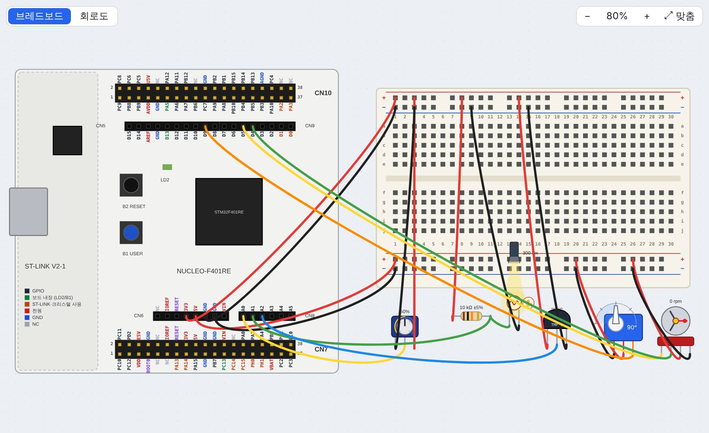

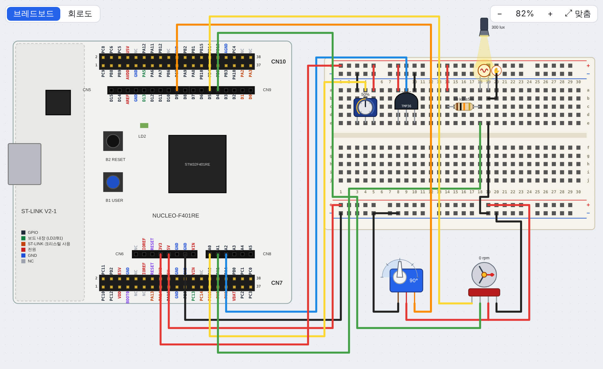

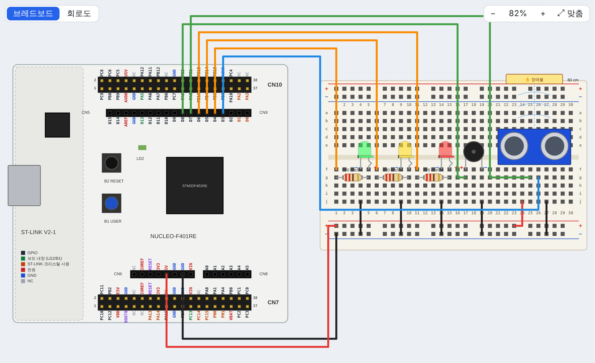

"예제 배선이 브레드보드를 전혀 활용하지 않고, 배선이 부품을 가린다"는 의견에 따라 함께 들어 있는 회로를 모두 다시 배치했다.
**전기적으로는 하나도 바뀌지 않았다**: 브레드보드 구멍이 아닌 모든 핀의 넷이 배치 전과 같다(`web/test/data/m38-nets.json`에 배치
전의 넷을 저장해 두고 비교). 규칙은 [parts.md](parts.md#예제-배선-규칙-m38).

- [x] **대상**: `web/examples/*.simucleo.json` 41개(실습 모범 회로 포함), E2E 모범 회로 `web/e2e/solutions/*` 2개, 실습 시작 회로
  (`web/lessons/*.json`의 `start.project`) 25개. 시작 회로는 일부러 틀린 배선(버튼 폴링, 릴레이)과 빠진 배선을 그대로 두고, 아직
  연결하지 않은 LED·저항도 서로 이어지지 않게 꽂아 두었다(LED는 위쪽 반, 저항은 아래쪽 반). 실습 글이 말하는 레일("위쪽 레일은
  3V3, 아래쪽 레일은 5V")도 그대로다
- [x] **브레드보드 사용**: LED·RGB LED·저항·가변저항·LDR·TMP36·서미스터·DS18B20·부저·DHT·74HC595·7세그먼트·택트 스위치와 핀
  헤더가 달린 작은 센서 보드(AHT20, DS3231, BMP280, MPU-6050, HC-SR04, 로터리 엔코더, SD 카드)는 구멍에 꽂혔다. 74HC595와 택트
  스위치는 가운데 홈을 걸치고, 4자리 7세그먼트는 b열·h열에 걸친다. 74HC595(LED 8개)와 7세그먼트·키패드는 브레드보드 두 개를 쓴다.
  OLED·LCD·릴레이·L298N·A4988(핀 줄이 세로라 꽂으면 한 줄에 여러 핀이 이어짐)·모터·서보·NeoPixel·키패드·HC-05·PIR·IR 수신기·배터리·
  ESC·3상 브리지는 옆에 두고 점퍼로
- [x] **배선**: 보드 3V3/5V와 GND에서 레일로 점퍼 하나씩, 부품은 레일에서 전원을 받는다. 모든 점퍼에 꺾는 점이 있어 직각으로
  달리고(곡선 없음), 부품 몸체를 지나지 않으며, 다른 점퍼와 겹쳐 달리지 않는다. 빨강 = 전원, 검정 = GND, 신호는 그 밖의 색(예전 색을
  넷마다 유지). Arduino 헤더 핀을 쓰고, Morpho 핀은 그 신호가 Morpho에만 있을 때만, AREF·IOREF는 전원으로 쓰지 않는다
- [x] **택트 스위치 3 × 3**: 다리 간격을 실물(6 × 6 mm, 0.3″)처럼 가로·세로 3칸으로 바꿨다(`2a`·`2b`가 한 칸 아래로). 그래서
  가운데 홈을 걸쳐 꽂으면 1a·1b는 e열, 2a·2b는 f열에 들어간다. 예전 2칸 높이에서는 어디에 꽂아도 두 쪽이 한 줄에 이어졌다
- [x] **도구**(앱 UI가 아니라 예제를 만드는 사람용): `web/scripts/route.mjs` — 부품 배치를 받아 넷을 지키는 최소 점퍼(브레드보드가
  이미 이은 것은 빼고, 전원은 레일로, 한 줄의 빈 구멍 수 안에서)를 고르고, 격자 위에서 꺾임·교차·구멍 위 지나기에 비용을 매긴
  최단 경로로 꺾는다. `web/scripts/m38-layouts.mjs` — 회로별 배치(LED 칸, 홈 걸치기, 레일 지정)를 적어 두고 다시 돌리면 점퍼를 새로
  그린다. `web/scripts/appmodel.mjs`는 앱의 부품 정의와 `toCircuit`을 esbuild로 묶어 Node에서 쓴다
- [x] **테스트**: `npm test` — `web/test/m38.test.ts`가 모든 회로(69개)에 대해 넷·부품이 스냅숏과 같음, 시작 회로 레일이 실습 글과
  같음, 점퍼가 자기 핀을 떠나는 짧은 구간 말고는 부품 몸체를 지나지 않음, 모든 꺾임이 직각·격자 위, 부품 몸체 겹침 없음,
  브레드보드가 있으면 꽂을 부품은 모든 다리가 구멍에 있고 다리에 점퍼가 없음, 한 부품의 두 다리가 한 줄(5구멍 줄·레일)에 없음을
  검사한다. 검사마다 일부러 망가뜨린 회로(핀을 옮긴 점퍼, 한 칸 옮긴 LED, 보드를 가로지르는 직선·사선 점퍼, 겹친 부품, 들어
  올린 LED, 레일에 두 다리를 꽂은 LED)가 실패하는지도 확인한다. E2E `m32.spec.ts`의 틀린 설정(LED 반대, TMP36 입력)은 꽂힌
  부품을 들어 올려 다리에 점퍼를 단 뒤 바꾸고, `m18.spec.ts`는 꽂힌 스위치에 대한 안내와 보드 단자(PA10 = D2/CN10_33)의 연결 끊기를
  확인한다. 예제 회로를 직접 읽는 Rust 테스트(센서리스·BLDC PWM)는 `crates/nucleo/tests/support/web_project.rs`로 앱과 같이 꽂힌
  핀을 구멍에 잇고 브레드보드 버스를 넘긴다

### M29 완료 (오프라인 설치형 앱)

인터넷이 자주 끊기는 교실에서 한 번 연 뒤에는 오프라인으로 쓰게 했다. 서버는 그대로 없다. 사용법은
[offline.md](offline.md). 모두 웹 쪽이고 Rust 코어는 바뀌지 않았다. 새 의존성도 없다(vite-plugin-pwa·workbox 대신
작은 빌드 스크립트와 손으로 쓴 서비스 워커).

- [x] **매니페스트**(`web/public/manifest.webmanifest`): 이름 Simucleo, 한국어 설명, `start_url`·`scope`·`id`가 `./`(Pages의
  `/Simucleo/` 아래), standalone, `theme_color` #2563eb(`--accent`)·`background_color` #f4f5f7(`--bg`), 아이콘 192·512와
  maskable 192·512(안전 영역 안에 보드를 줄임), SVG, apple-touch-icon. PNG는 SVG에서 Playwright의 Chromium으로 그려
  커밋했다(`web/scripts/icons.mjs`)
- [x] **미리 캐시할 목록**(`web/scripts/precache.mjs`): `vite build`의 마지막 단계(Vite 플러그인 `closeBundle`)가 `dist/`의
  **모든 파일**(public에서 복사된 예제 포함, `sw.js` 제외)을 SHA-256과 함께 `dist/sw.js`에 넣는다. 손으로 고치는 목록이 없어
  어긋날 수 없다. 캐시 이름은 `simucleo-` + 모든 경로·내용 해시의 12자리라 파일 하나만 바뀌어도 바뀐다. `index.html`,
  매니페스트, WASM, `examples/index.json`의 모든 ELF와 배선 파일, 그리고 `web/lessons/*.json`의 모든 실습 id가 미리 캐시한
  스크립트에 들어 있는지(실습은 JS 번들에 들어감) 검사해 빠지면 **빌드가 실패한다**. 지금 126개, 39.5 MB(대부분 디버그
  정보가 든 예제 ELF 35개)
- [x] **서비스 워커**(`web/sw/service-worker.js`): 설치 때 목록을 6개씩 병렬로 `cache: "reload"`(HTTP 캐시 건너뜀)와
  `integrity`(빌드 때의 바이트만)로 받아 넣고, 하나라도 실패하면 설치가 실패해 다음 방문에 이어 받는다. 이전 버전 캐시에 같은
  해시의 파일이 있으면 복사하므로(응답에 `x-simucleo-integrity`를 붙여 저장) **업데이트는 바뀐 파일만** 받는다. activate에서
  다른 `simucleo-` 캐시를 지우고 `clients.claim()`. 목록에 있는 파일도 페이지 이동(navigate)도 캐시 먼저다. 페이지는 이
  버전 캐시의 `index.html`이라, 새 배포의 페이지가 이전 캐시의 예제·실습 파일과 섞여 돌지 않는다(새 페이지는 업데이트를 받을
  때 그 파일들과 함께 온다). 그 밖의 요청(POST, 다른 사이트, 목록에 없는 파일)은 건드리지
  않는다 — 직접 올린 ELF·프로젝트·자동 저장·SD 카드는 원래 IndexedDB/localStorage에 있어 서비스 워커를 지나지 않는다
- [x] **업데이트**: 새 버전은 `waiting`에서 기다리고 페이지에 **"새 버전이 있습니다 — 새로 고침"** 배너가 나온다. 누르면
  `SKIP_WAITING`을 보내고 새 버전이 페이지를 맡은 뒤(`controllerchange`) 그 탭만 새로 고친다. 시뮬레이션이 실행 중이면 먼저
  묻고, 아니라고 하면 아무것도 하지 않는다. 다른 탭에서 바뀐 경우에는 배너만 보이고 스스로 새로 고치지 않는다. 다시
  연결되면(`online`) 새 버전을 찾아본다. 등록은 프로덕션 빌드에서만(`import.meta.env.PROD`), `updateViaCache: "none"`
- [x] **UI**(`web/src/pwa.ts`, `PwaUi.tsx`): 아래 패널 탭 줄 오른쪽(툴바 높이가 바뀌어 캔버스가 움직이지 않도록)에 `beforeinstallprompt`가 오면 **⬇ 설치**, `navigator.onLine`과
  online/offline 이벤트로 주황 **오프라인** 배지, 코어 버전 옆에 **오프라인 준비 중 n%** → 서비스 워커가 목록이 모두
  캐시에 있다고 답하면(`GET_STATUS` → `STATUS`) 초록 **오프라인 사용 준비됨**(툴팁에 캐시 버전)
- [x] 테스트: 웹 단위 15개(`web/test/m29.test.ts`, 전체 129개: 목록에 index.html·WASM·모든 예제 ELF와 배선·예제 소스가 있고
  sw.js는 없음, integrity가 바이트의 SHA-256, 번들에 없는 실습·빠진 ELF·배선·WASM은 보고하고 빌드 실패, 캐시 버전이 내용과
  파일 추가에 따라 바뀌고 순서·이전 sw.js와는 무관, sw.js에 목록과 버전, 실제 `dist/`가 있으면 그 sw.js에 모든 예제·실습,
  샌드박스에서 돌린 서비스 워커의 설치(reload·integrity·Content-Type 유지, 404면 실패)·바뀐 파일만 다시 받기·activate가 다른
  simucleo 캐시만 지움·요청할 때만 SKIP_WAITING·GET_STATUS·캐시 먼저·네트워크 먼저와 오프라인 index.html·건드리지 않는
  요청, 페이지 쪽의 대기 버전 배너·controllerchange 뒤에만 새로 고침·실행 중이면 묻고 아니면 그대로·첫 설치에는 배너 없음·
  준비 상태·배지·설치 프롬프트), E2E 2개(`web/e2e/m29.spec.ts`, 전체 113개: 한 번 열고 준비됨을 기다린 뒤
  `context.setOffline(true)` → 배지, 새로 고쳐도 앱과 코어가 열리고 캐시에 없는 파일은 실패, hal-blinky의 LD2가 깜빡이고
  LED 깜빡이 실습이 열리며 다시 연결되면 배지가 사라짐 / 테스트가 띄운 서버에서 sw.js만 다른 버전으로 바꿔 업데이트 → 배너,
  `waiting`, 실행 중에 새로 고침을 누르면 물음 → 취소하면 그대로 깜빡임 → 확인하면 새로 고쳐져 새 캐시 버전이 준비됨이고
  이전 캐시는 지워짐). 하나씩 망가뜨려 해당 테스트가 실패하는 것을 확인했다 — 단위: 목록에서 examples/ 빼기, 캐시 버전에서
  내용 빼기, 실습 검사, activate의 이전 캐시 삭제, SKIP_WAITING 처리, 페이지 이동의 캐시 대체, 이전 캐시에서 복사하지 않기,
  캐시 먼저 대신 네트워크, 실행 중 묻기, `controllerchange` 전에 새로 고치기, 준비된 뒤의 진행률, 첫 설치에 배너, offline
  이벤트 / E2E: 서비스 워커 등록, 페이지 이동의 캐시 대체, 오프라인 배지, 실행 중 묻기, activate의 이전 캐시 삭제, 대기 워커
  배너. 목록에서 ELF를 빼면 빌드가 실패한다(35개 누락)
- [x] **툴바가 흔들리지 않게**: 처음 전체 E2E에서 손잡이·끌기 테스트 3개가 실패했다 — 준비 상태 글자("준비 중 10/126" →
  "…126/126" → "준비됨")의 폭이 바뀔 때마다 `flex: 1`인 실행 컨트롤이 다시 줄바꿈해 툴바 높이(73 → 85 px)와 그 아래
  캔버스가 마우스 아래에서 움직였다. 상태 칸을 고정 폭(11.5em, 줄바꿈 없음, 숫자 같은 폭)으로 하고 진행률을 %로 보여
  첫 그림부터 폭이 바뀌지 않는다(오프라인 배지와 설치 버튼은 생길 때만 자리를 차지한다)
- 한계: 처음 방문에 약 40 MB를 받는다(예제 ELF가 디버그 정보를 담고 있어서 — 소스 디버깅에 필요). 처음 방문의 페이지는
  캐시를 채우는 동안에도 네트워크로 돈다. 업데이트를 찾는 것은 앱을 열 때와 다시 연결될 때뿐이라 오래 열어 둔 탭은 새 버전을
  늦게 안다. `beforeinstallprompt`는 크롬·엣지에만 있어 사파리·파이어폭스에서는 설치 버튼이 없다(브라우저 메뉴로 설치).
  저장 공간이 모자라면 브라우저가 캐시를 지울 수 있다(`navigator.storage.persist()`는 요청하지 않음). 서비스 워커 파일만
  바뀐 배포는 캐시 이름이 그대로라 파일을 다시 받지 않는다(의도)

### M32 완료 (실습 레슨 확충)

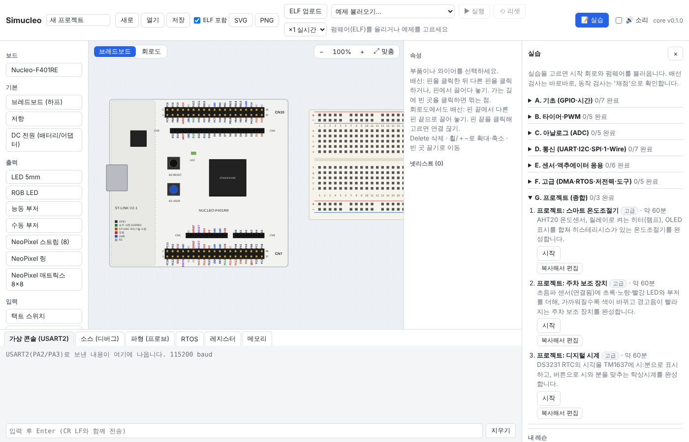

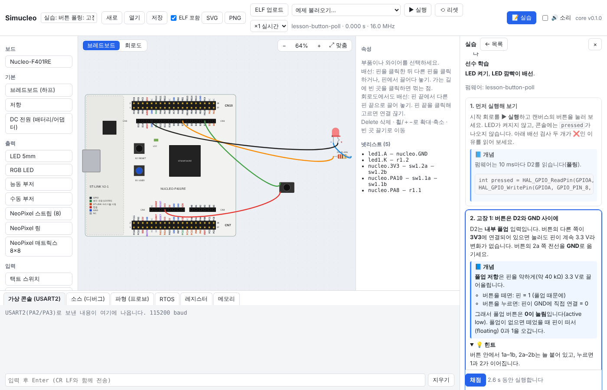

M16·M24의 실습 6개를 **38개의 교육과정**으로 늘렸다. 검사 종류(12가지)는 그대로이고, 레슨 형식에는 고를 수 있는 필드만 더했다
(예전 레슨 파일과 결과 파일은 그대로 읽힌다). 표와 쓰는 법은 [lessons.md](lessons.md#함께-들어-있는-실습-교육과정-m32).

- [x] **트랙과 수준**: A 기초(GPIO·시간) 7, B 타이머·PWM 5, C 아날로그 5, D 통신 7, E 센서·액추에이터 6, F 고급 5, G 프로젝트 3.
  예상 시간 합계 약 25시간. 기존 6개는 id·검사를 그대로 두고(진행 상황 유지) 트랙과 설명만 더했다
- [x] **레슨 형식**(`types.ts`, `validate.ts`): `track`, `minutes`, `objectives`, `prereq`, `mistakes`, `challenges`, 단계의 `theory`(📘 개념
  상자)·`hint`(접힌 💡 힌트). 모두 검사가 아니라 바꿔도 진행 상황이 초기화되지 않는다(`lessonFingerprint`는 검사만 본다)
- [x] **실습 목록**(`LessonPanel.tsx`): 트랙마다 접을 수 있는 묶음과 `n/m 완료`, 실습마다 "약 30분". 실습 머리에 트랙·수준·시간
  배지, 학습 목표·선수 학습(채점 전에는 펼침), 단계의 개념 상자와 힌트, 끝에 흔한 실수와 도전 과제(완료하면 펼침). 트랙이 없는
  레슨만 있으면 예전처럼 한 목록
- [x] **채점 조작**: `send`(가상 콘솔 또는 `to: "hc05"`이면 휴대폰에서 한 줄 입력), `connect`(휴대폰 연결), `press`의 `"keypad-4x4:5"`
  (키패드 키). 명령 파서·블루투스·RTOS 큐·키패드 실습을 자동 채점할 수 있다
- [x] **동작 검사 확장**: `display`가 TM1637을 글자로 읽고(`"12:34"`, 콜론 포함), `brightness`가 NeoPixel의 가장 밝은 색 값을 읽는다.
  4자리 7세그먼트는 `channel` = 자리 × 8 + 세그먼트
- [x] **실습용 펌웨어 13개**(CubeMX HAL 형식, CI 두 빌드 목록·`examples.mjs`·예제 프로젝트 `web/examples/lesson-*.simucleo.json`):
  `lesson-led-on`, `lesson-button-poll`, `lesson-knight-rider`, `lesson-timer-irq`(1 ms TIM2 인터럽트 vs HAL_Delay 루프),
  `lesson-ldr-nightlight`, `lesson-joystick-servos`, `lesson-uart-cmd`(명령 파서), `lesson-sleep-wfi`(WFI vs busy-wait, TIM5로 잰
  잠든 비율), `lesson-scope-mystery`(주파수·듀티가 다른 PWM 넷과 9600 baud 비밀 메시지), `lesson-debug-average`(uint8_t 합 오버플로
  버그; 고친 것 `lesson-debug-average-fixed`는 테스트 전용), `lesson-thermostat`(AHT20·OLED·릴레이, 히스테리시스·페일세이프),
  `lesson-parking`(HC-SR04·LED 3·부저), `lesson-digital-clock`(DS3231·TM1637·버튼). Rust 코어는 바꾸지 않았다
- [x] **다양한 활동**: 빈 보드에서 배선, 부품만 놓인 회로, 일부 빠진 회로 완성, 고장 난 회로 고치기(버튼 폴링, 릴레이), 버그 있는
  펌웨어 고치기(디버거), 측정·보고(ADC, TMP36), 스코프로 재서 답을 배선(답을 알려 주지 않는 안내), 값 계산해 펌웨어 고치기
- [x] **테스트**: `npm test` — 모든 레슨이 형식 검사를 통과, id 중복 없음, 펌웨어가 예제 목록·`firmware/`·CI 목록에 있음, 모든 레슨에
  트랙·시간·목표·실수·도전·개념 상자, 새 필드·조작의 형식 검사, TM1637·NeoPixel 읽기(`web/test/m32.test.ts`).
  E2E `web/e2e/m32.spec.ts` — 38개 실습 모두 모범 회로·펌웨어로 채점해 전부 통과, 트랙마다 틀린 설정(LED 반대, 시작의 고장 난
  회로, 타이머 대신 HAL_Delay 펌웨어, 서보 신호 핀, TMP36 입력 핀, TX/RX 교차 안 함, 버그 있는 펌웨어, 스코프 답 틀림, 릴레이 입력
  핀, LED 핀)이 해당 검사에서 실패, 스코프 실습의 안내가 답을 말하지 않음, 목록의 트랙 묶음. 펌웨어 테스트
  `crates/nucleo/tests/lessons.rs`(회로 없이 9개)

### M28 완료 (모터 모델 보강)

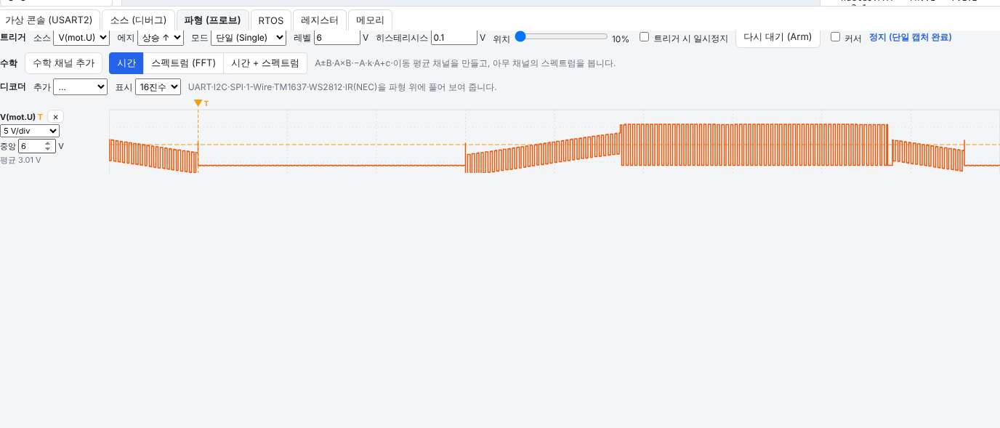

"이후"에 있던 모터 모델 세 가지(코일 전류를 넷 해석에 넣기, 중앙 정렬 PWM·반복 카운터, 센서리스 BLDC)를 했다.

- [x] **중앙 정렬 PWM**(`crates/periph-stm32f4/src/timer.rs`, RM0368 §12.3.2): CR1.CMS 1–3(TIM1–TIM5; TIM9–11에는 없음). 카운터가
  0 → ARR → 0으로 오르내리고(주기 2·ARR틱) ARR에서 오버플로, 0에서 언더플로가 각각 업데이트 이벤트. CR1.DIR은 읽기 전용으로
  지금 방향을 보이고 쓰기는 무시. PWM 1은 올라갈 때 CNT < CCR, 내려갈 때 CNT ≤ CCR이 활성이라 펄스가 언더플로를 중심으로
  대칭(폭 2·CCR틱, CCR 0이면 0 %, ≥ ARR이면 100 %), PWM 2는 그 반대로 오버플로 중심. 출력 채널의 CCxIF(와 DMA 요청)는 CMS 1이면
  내려갈 때만, 2면 올라갈 때만, 3이면 둘 다(ARR 값은 내려가는 쪽, 0은 올라가는 쪽으로 친다). 여전히 에지 이벤트만 스케줄한다:
  위치(0 … 2·ARR − 1)로 CCR까지 남은 틱을 계산하고, 미리 읽어 둘 것이 없으면 주기 여러 개를 한꺼번에 건너뛴다(주기마다 오버·
  언더플로 두 번, 비교 일치는 위·아래로 각각). 상보 출력·데드타임도 그대로: OCxREF가 바뀐 시각을 위치로 거꾸로 계산하고,
  업데이트 이벤트에서 새 CCR이 들어와 바뀐 경우(0 %에서 펄스로 등)는 그 업데이트보다 앞으로 잡지 않는다(이 경우를 놓쳐 데드타임
  없이 켜지던 것을 센서리스 예제가 관통 전류 경고로 찾아냈다)
- [x] **반복 카운터**(TIM1 RCR, §12.3.3): 오버플로·언더플로마다 REP_CNT를 하나씩 줄이다 0에서 만나면 업데이트 이벤트(UIF, 미리
  읽기 레지스터 적재, DMA, AOE)를 내고 RCR을 다시 싣는다. UG가 RCR을 싣는다. 에지 정렬이면 RCR + 1주기마다, 중앙 정렬이면
  RCR + 1반주기마다(RCR 1이면 UG 뒤로 언더플로에서만). 원펄스 모드는 그 업데이트에서 멈춘다. 업데이트 인터럽트만 켜져 있으면
  다음 *업데이트*까지 한 번에 스케줄한다(오버플로마다 깨우지 않음)
- [x] **권선이 넷 해석 안에**(`crates/circuit/src/sim.rs`, `tier9.rs`): 스테퍼 코일(A+–A−, B+–B−, 25 Ω)과 BLDC 상(U·V·W → 모터
  안의 중성점, 1 Ω)은 저항에 역기전력 전압원을 직렬로 단 소자, 드라이버 출력은 전원·GND로 가는 스위치(L298N 2.5 Ω, A4988 0.4 Ω,
  3상 브리지 0.02 Ω)이고 그 상태(High/Low/Float)가 MCU 핀처럼 캐시 키에 들어간다 — 해는 여전히 캐시. 역기전력은 연속으로
  바뀌므로 해마다 *역기전력이 0인 동작점* v0와 각 권선 입력 x_j(역기전력, 또는 전류원 전류)에 대한 모든 넷의 **감도** S_j를 같은
  분해(여러 우변)로 함께 구한다. 회로가 그 키에서 선형이라 지금 전압은 v = v0 + S·x(프로브, MCU 입력 레벨, ADC가 이 값을 읽는다)이고
  권선 전류는 a + B·emf다. 모터는 이 계수를 받아 다시 풀지 않고 적분한다: 스테퍼 코일은 정상 전류를 L/R(2 ms)로 따라가고(열린
  코일은 다이오드로 0.2 ms, L298N EN Low는 예전처럼 느린 감쇠), BLDC는 준정적(R + 역기전력). 3상 브리지가 초핑하는 상은 그 상을
  켠 해와 끈 해를 듀티로 섞어 평균(M23의 평균과 같은 뜻, 이제 회로를 거친다). A4988이 켜져 있으면 코일은 초퍼가 정한 전류의
  **전류원**이고 출력은 전류 방향대로 한쪽 VMOT, 다른 쪽 GND(초퍼의 PWM은 없음). 3상 브리지의 두 스위치가 다 꺼진 순간이 PWM 주기
  안이면(데드타임, 한쪽만 초핑할 때의 오프 시간) 전류가 이어지는 다이오드 쪽 레일에 붙고, 정적으로 둘 다 꺼지면 떠서 중성점 +
  역기전력. 그래서:
  - L298N OUT1–4, A4988 1A/1B/2A/2B, 3상 브리지 OUTA–C를 아날로그 채널로 보면 실제 전압이 PWM 그대로 보이고(평균이 아님), 그
    넷에 분압기로 이은 MCU 핀이 그 레벨을 읽는다
  - 코일과 출력 사이에 저항(전류 감지 등)을 끼우면 전류가 준다(12 V L298N에서 25 Ω이면 정격의 0.55), 한쪽 끝만 출력에 있는 코일
    경고는 없어졌다(두 출력쌍에 걸치면 여전히 경고)
  - 떠 있는 상·열린 코일에 역기전력이 보이고, 프로브한 넷이 돌고 있는 모터의 역기전력으로 움직이면 20 µs마다 다시 표본을 남긴다
  - ADC는 변환이 끝나는 순간의 역기전력을 읽는다(`ExternalCircuit::refresh`), 디지털 입력 레벨은 회로가 갱신될 때(PWM 에지 등)
  - 정지 전류가 수 A인 모터 때문에 배터리 단락 경고는 단자 전압이 절반 아래로 처질 때만
- [x] **성능**: 3상 브리지 출력은 MCU 핀 구동에서 미리 계산해(입력이 MCU 핀이면) PWM 에지마다 두 번 풀지 않고, 모터 계수는
  권선에 닿는 것이 바뀔 때만 다시 계산한다(상호성: 역기전력이 움직이지 않는 MCU 핀의 구동은 권선 전류도 못 바꾼다 — PWM 입력
  핀이 그렇다). 코어: 처리 중인 인터럽트 뒤에 다른 인터럽트가 걸려 있으면(업데이트 인터럽트가 자기 핸들러 안에서 다시 걸리는 것
  처럼) 명령마다 걸린·활성 예외를 찾는데, 96개 IRQ를 다 훑던 것을 켜진 비트만 보게 했다 — 20 kHz 제어 인터럽트 예제가 두 배 빨라졌다.
  네이티브 1 s 시뮬레이션(회로 포함, 같은 기계에서 연달아, 세 번 중 최소): `hal-stepper-a4988` 0.091 → 0.040 s, `hal-stepper-l298n`
  0.023 → 0.025 s, `hal-bldc-hall` 0.073 → 0.048 s, `hal-bldc-pwm` 0.270 → 0.274 s, 새 `hal-bldc-sensorless` 0.333 s. 코어 변경만
  넣은 기준과 비교한 회로 쪽 비용은 a4988 0.038 → 0.040, l298n 0.019 → 0.025, hall 0.063 → 0.048(BLDC가 바뀌지 않은 계수에서 일찍
  돌아온다), pwm 0.249 → 0.274 s
- [x] **센서리스 BLDC**: 부품 `bldc`(홀 센서 BLDC와 같은 모터, 핀은 U·V·W). 떠 있는 상의 핀 = 중성점 + 그 상의 역기전력이라 각
  60° 구간 가운데에서 중성점을 지난다. 정렬하는 동안은 일부러 멈춰 있으므로 정지 경고는 1.5 s를 본다
- [x] **예제 `hal-bldc-sensorless`**: TIM1 중앙 정렬 모드 1, ARR 2100(20 kHz), 상보 출력 + 500 ns 데드타임, **RCR 1** → 주기마다 한 번,
  언더플로(켜짐 시간 한가운데)에서 업데이트 인터럽트. 거기서 ADC1을 레지스터로 시작해 떠 있는 상(10 kΩ/2.2 kΩ 분압기, A1·A2·A4)과
  **가상 중성점**(세 분압점을 10 kΩ 세 개로 모은 A5)을 번갈아 읽고(가끔 가변저항 A0), 떠 있는 상 − 중성점의 부호가 그 스텝의 방향
  (올라감/내려감)으로 바뀌면 영점 — 정류 뒤부터 영점까지 걸린 만큼(30°) 뒤에 TIM2 원펄스(1 µs 틱)가 정류한다. TIM5는 µs 시계.
  정류 직후 스텝의 1/4은 가린다. 멈춰 있으면 역기전력이 없으니 한 스텝으로 500 ms **정렬**, TIM2로 점점 빨라지는 열린 루프 **램프**
  (20 ms → 4 ms, 스텝마다 31/32), 그다음 **닫힌 루프**(가변저항 → 듀티 15–95 %). 두 스텝 넘게 영점이 없으면 강제 정류, 열두 번이면
  "lost the rotor"로 다시 정렬. 인터럽트 사이에는 WFI로 잔다. 500 ms마다 상태(align/ramp/closed)·듀티·rpm·영점 수. 배선된 예제
  프로젝트, CI 펌웨어 빌드 목록 두 곳, `examples.mjs`
- [x] 테스트: Rust 단위 11개 추가(워크스페이스 265개: `timer.rs` 5개 — 중앙 정렬 카운터 값·DIR 표(RM0368 그림대로 0…ARR…1)와
  읽기 전용 DIR·업데이트 두 번, 대칭 PWM 1/2와 0 %·100 %, CMS별 CCxIF와 건너뛴 주기, RCR 에지/중앙 정렬·미리 읽기 ARR·원펄스·
  건너뛴 주기, 중앙 정렬 상보 출력 데드타임과 늦게 본 경우·업데이트에서 바뀐 CCR / `sim.rs` 6개 — 출력 전압(L298N OUT1/OUT2, 분압기로
  MCU 입력 레벨, 아날로그 로그, 3상 브리지의 정지 전류와 떠 있는 상), 직렬 저항이 전류를 줄이고 그 전압 강하가 보이고 경고 없이
  스텝이 돌며 열린 코일에 역기전력, 떠 있는 상 = 중성점 + 역기전력(200번 확인, 영점을 지남)과 가상 중성점·20 µs 표본, A4988 출력의
  방향과 전류원, 데드타임 동안 로사이드 다이오드, 센서리스 영점 정류(Rust로 짠 같은 알고리즘, 영점에서 떠 있는 상의 역기전력이
  진폭의 10 % 안)), 펌웨어 통합 1개(42개, `sensorless_bldc_aligns_ramps_and_closes_the_loop_on_zero_crossings`: 정렬 중
  멈춤, 닫힌 루프 1400–2000 rpm·콘솔 rpm 일치·영점 수·경고 없음, 가변저항으로 1.3배 넘게 빨라지고 0.7배 아래로 느려짐),
  `scope_firmware` 2개(14개: 듀티를 54 → 87 %로 바꾸는 순간을 펄스 폭 트리거로 잡아 PA8 펄스 중심이 모두 50 µs 격자 위에 있고 상승
  에지는 움직이며, 업데이트가 걸린 한 펄스만 옛 폭으로 올라가 새 폭으로 내려감, CH1N은 반 주기 어긋난 중심과 500 ns / `hal-bldc-pwm`의
  V(br.OUTA)가 하이사이드가 켜지면 PVDD, 로사이드면 0 V, 떠 있으면 그 사이), E2E 3개(`web/e2e/m28.spec.ts`, 전체 114개: 브리지 출력
  아날로그 채널의 CSV가 PA8 High면 > 11 V, PA7 High면 < 1 V·평균 4.5–7.5 V / 같은 중앙 정렬 검사를 파형 탭에서 / 센서리스가 정렬·
  램프·닫힌 루프를 거쳐 돌고 mot.U·분압점·가상 중성점 채널과 가변저항으로 빨라지고 느려짐, 경고 없음). 하나씩 깨서 해당 테스트가
  실패하는 것을 확인했다 — 타이머: CMS별 플래그 무시, RCR 무시, 중앙 정렬 방향 무시, DIR 읽기, 중앙 정렬 에지 시각 없음, 업데이트
  시각 하한 없음, 업데이트 대신 오버플로마다 스케줄, OPM이 업데이트 아닌 랩에서 멈춤, 건너뛴 주기의 반주기 수(처음엔 놓쳐서 테스트를
  더함) / 회로: 출력 스위치 없음, 역기전력 감도 부호, 전류원 모드 무시, 권선 저항, 스테퍼 역기전력 입력(놓쳐서 열린 코일 검사를 더함),
  BLDC 역기전력 부호, 한쪽 끝 코일 경고 되살림, 배터리 단락 조건, 데드타임 다이오드 규칙(놓쳐서 테스트를 더함), 20 µs 표본(놓쳐서
  검사를 강화) / 펌웨어·scope_firmware·E2E: 펌웨어 통합은 BLDC 역기전력 부호를, `scope_firmware`는 중앙 정렬 없음·출력 스위치 없음을, E2E는 출력 스위치 없음·중앙 정렬 없음·BLDC 역기전력 부호를 깨면 실패한다(중앙 정렬 없음은 펌웨어 통합 테스트로는 안 잡히고 — 에지 정렬로도 돈다 — scope_firmware·단위 테스트가 잡는다. 업데이트 시각 하한을 빼면 단위 테스트와, 관통 전류 경고로 펌웨어 통합 테스트가 잡는다. ADC 변환 직전의 `refresh`를 빼는 것은 어느 테스트도 잡지 못한다: PWM 에지마다 회로가 갱신되어 25 µs 넘게 낡지 않기 때문). 처음 쓴 중앙 정렬 검사는 정류가 펄스를 자르면 가끔 틀려서(5–6번에 한 번) 스텝 안의 온전한 펄스만 보게 고쳤고 E2E를 여섯 번 되풀이해 확인했다
- 한계: 상 인덕턴스는 스테퍼의 1차 지연(L/R)뿐이고 BLDC는 준정적이라 PWM 전류 리플·전류 방향에 따른 데드타임 전압(다이오드 0.7 V)이
  없다(데드타임 동안은 PWM 평균 규칙대로 한 레일에 붙임). A4988은 초퍼 PWM이 없고 출력이 전류 방향대로 VMOT/GND라 출력 사이의 평균
  전압(I·R + 역기전력)은 보이지 않으며, A4988과 코일 사이에 직렬 저항을 끼우면 링크가 끊겨 코일이 전압 구동(R + 역기전력)으로 보인다.
  서로 다른 모터의 역기전력이 서로의 전류에 주는 영향(교차 항)은 무시. 디지털 입력 레벨은 회로가 갱신될 때(PWM 에지, 20 µs 표본은
  프로브할 때만) 역기전력을 반영하므로 분압기 + EXTI 비교기는 그 해상도. 3상 브리지에서 동시에 초핑하는 출력이 넷보다 많으면 넷째부터는
  반올림(2ⁿ개 해). 중앙 정렬에서 RCR 1 + 미리 읽기면 업데이트가 펄스 한가운데라 한 펄스는 반반(실제 칩과 같음). 센서리스 예제는 무부하·
  관성만 있는 모터에 맞춘 램프라 부하 슬라이더를 크게 올리면 놓칠 수 있다
- 남은 항목: 상 인덕턴스(전류 리플), A4988 초퍼 PWM, ADC 주입 변환·타이머 트리거(TIM1 TRGO로 표본), FOC 예제

### M27 완료 (아날로그 채널 수학·FFT)

"이후"에 있던 아날로그 채널 수학(A−B, FFT)을 했다. 모두 웹 쪽(`web/src/run/`)이고 Rust 코어는 바뀌지 않았다.

- [x] **수학 채널**(`math.ts`, 최대 2개, 이름 M1·M2): A + B, A − B, A × B, −A, k·A + c, **이동 평균**(창 µs). 소스는 아날로그
  채널 `V(…)`, 프로브한 디지털 핀(Low 0 V·High 3.3 V), M2에서는 M1(M1이 이동 평균이면 −A와 k·A + c만 받고, 연산을 바꿔 받을 수 없게 되면 그 소스는 첫 채널로 바뀐다). 모든 채널이 바뀐 시각 사이에서 값을
  그대로 유지하므로 두 소스의 **변화 시각의 합집합**에서 한 번씩(같은 시각이면 한 번) 계산하면 정확하다(`combine`). 이동 평균
  y(t) = (1/W)·∫[t−W, t] x는 계단 입력에서 **정확히 구간별 직선**이고 꺾이는 곳은 x가 바뀐 시각과 그 W 뒤뿐이라, 누적 적분의
  차로 꺾이는 점만 계산해 직선으로 그린다(`movingAverage`, 기울기가 같은 점은 합침). 캡처에서는 창이 차기 전(처음 W)을 빗금으로
  표시하고 측정에서 뺀다. 실시간 보기에서는 W만큼 앞의 기록을 더 쓰되, 채널이 실제로 기록된 곳(프로브를 더한 때, 남겨 두는 4 s)보다 앞은 모르는 구간이라 빗금·측정 제외이고, 창이 기록 안에 들어올 때까지 측정·스펙트럼이 없다
- [x] **그리기·측정**: 아날로그 채널처럼 자기 V/눈금·중앙과 0 V 선, 최소·최대·평균·Vpp·RMS(아날로그 측정 표의 `M1 = …` 줄).
  직선 구간은 평균(사다리꼴)과 RMS(∫(a + bt)² = d·(v₁² + v₁v₂ + v₂²)/3)를 정확히 적분한다. 반 픽셀보다 촘촘한 점은 그 범위의
  세로 막대로 합친다(`wavePoints`)
- [x] **스펙트럼(FFT)**(`spectrum.ts`, `Spectrum.tsx`): 아무 채널(디지털·아날로그·수학)을 **보이는 구간**(확대한 부분, 실시간이면
  마지막 10눈금) 또는 **커서 A–B** 사이에서. 계단·직선 신호이므로 균일 재표본화는 각 표본 구간의 **정확한 평균**(상자 필터 —
  점 표본보다 앨리어싱이 적다)이고, 그 sinc 감쇠는 빈마다 보정한다. N = 1024–16 384(2의 거듭제곱), fs = N / 구간, Δf = 1 / 구간.
  창 함수 사각·Hann·Hamming·Blackman(주기형, 결맞음 이득 보정 — 빈에 맞는 1 V 피크 사인이 어느 창에서나 0.707 V RMS). 크기는
  dBV(1 V RMS 기준) 또는 선형 V RMS, 주파수축 선형(기본은 기본파 ×12.5까지, 끄면 fs/2까지)·로그, 화면 픽셀마다 가장 큰 빈
- [x] **피크와 측정**: 큰 순서로 N개의 극대(창의 주엽만큼 떨어진 것, 주파수는 dB 포물선 보간, 크기는 주엽 전력의 합 — 빈 사이의
  톤도 제 크기), **기본파**(DC 주엽 밖의 가장 큰 빈; 평균은 창을 곱하기 전에 빼므로 DC 주엽 바로 위의 톤도 오프셋 전력이 섞이지 않는다), **DC**(구간 평균, 정확), 2–10차 **고조파**(각 h·f₀ 근처의 주엽 전력,
  기본파 대비 dB), **THD** = √(Σ 2–10차 전력)/기본파, **SNR(추정)** = 기본파 ÷ (기본파와 2–10차를 뺀 나머지 AC 전력), AC RMS.
  이상적인 50 % 사각파의 THD는 2–10차로 42.9 %(√(1/9 + 1/25 + 1/49 + 1/81)), 모든 고조파로 48.3 %(√(π²/8 − 1))다
- [x] **읽기 선**: 포인터를 따라가고, 그림에 초점을 두면(Tab) ←/→ 한 빈, Shift는 10빈, Home/End, P는 다음 피크, Esc는 끄기.
  주파수와 크기를 그 자리에 보인다
- [x] **보기**: 수학 줄의 "시간 / 스펙트럼 (FFT) / 시간 + 스펙트럼" 버튼(`aria-pressed`). 스펙트럼만 보면 시간 그림을 숨기고
  측정 표는 남긴다
- [x] **설정 저장**: 프로젝트 파일의 `scope`에 `math`(id, op, a, b, gain, bias, windowUs, vdiv, offset)와 `spectrum`(view, source,
  window, n, db, logFreq, fit, peaks, range). 값마다 검사해 틀리면 기본값, M27 전의 파일(`math`·`spectrum` 없음)은 수학 채널
  없이 시간 보기로 열린다
- [x] 테스트: 웹 단위 20개(`web/test/m27.test.ts`, 전체 114개: 변화 시각의 합집합(같은 시각 한 번, 상쇄되면 점 없음), 연산과
  0/3.3 V 디지털 소스·직선 소스 거부, 이동 평균의 정확한 경사와 사다리꼴, PWM을 한 주기로 평균하면 듀티 × 3.3 V로 평평·반
  주기면 삼각파, 직선 구간의 평균·RMS, 그리기, FFT와 직접 DFT, 창마다 사인 크기·DC, 창 값·결맞음 이득·누설 순서, 재표본화
  (구간 평균·직선·평균 보존), 50 % 사각파 THD 42.9 %·48.3 %와 짝수 고조파 없음·홀수 1/k, 듀티의 sinc 영점(25 % → 4·8차,
  20 %·80 % → 5·10차, 49 %에는 2차가 있음), 피크, 빈에 맞지 않는 262.05 Hz PWM, 설정 저장·M27 전 파일·틀린 값), E2E
  (`web/e2e/m27.spec.ts` 7개, 전체 111개: hal-adc-servo에서 M1 = V(pot.W) − V(PA1)이 와이퍼 − 분압과 같고 노브를 끝까지 돌리면
  1.65 V 커지며 분압은 그대로, M2 = −M1 / hal-pwm-led에서 "400 µs보다 넓은 펄스"로 잡은 LD2(듀티 40–45 %)를 1 ms(한 주기)로
  평균하면 듀티 × High 레벨과 0.035 V 안·Vpp 0.035 V 미만(창 안에서 듀티가 1 % 한 번 바뀔 수 있음), 0.5 ms면 2·듀티·V만큼 출렁임,
  창이 차는 구간 빗금 / hal-buzzer-melody 첫 음 C4(1 MHz/3816 = 262.05 Hz, 50 %)를 커서 A–B(30–130 ms, Δf 10 Hz)에서 기본파가 한
  빈 안, DC 1.65 V, 2·4·6·8·10차가 −60 dB 아래, 3·5·7차가 1/k와 0.5 dB 안, THD 42.9 %, 피크가 1·3·5·7·9차, 키보드 읽기 선(P, →),
  사각 창, 스펙트럼만 보기 / hal-stepper-l298n ENA(PB4) 2 kHz 80 %에서 기본파 2 kHz, DC 2.64 V, 2·3·4·6·7·8·9차가 sinc 포락선
  |sin(πk·0.8)|/(k·sin(π·0.8))과 0.5 dB 안, 5·10차는 −60 dB 아래 / 수학·스펙트럼 설정을 저장하고 바꾼 뒤 다시 열면 그대로).
  하나씩 망가뜨려 해당 테스트가 실패하는 것을 확인했다 — 합집합 대신 A의 변화 시각만, 이동 평균의 W 뒤 꺾임 생략, 직선 구간을
  계단으로 적분, 재표본화를 점 표본으로, 결맞음 이득 보정 생략, FFT 회전 인자 부호, THD를 9차까지만, 피크 크기를 한 빈으로,
  창마다 주엽 폭을 1빈으로, 설정의 `math`·`logFreq`를 읽지 않기(단위), 그리고 E2E에서 A − B를 A + B로, 이동 평균 창의 단위를
  틀리게(µs × 100), 재표본화를 점 표본으로(L298N의 sinc 포락선이 어긋남), THD에서 제곱근 빼기, 고조파를 3빈 옆에서 찾기, 키보드
  →가 두 빈, 열 때 `spectrum.view`를 읽지 않기, 스펙트럼만 보기에서 시간 그림을 숨기지 않기
- [x] **Codex 리뷰 반영**: (1) 스펙트럼이 평균을 뺀 신호에 창을 곱한다 — 전에는 창을 곱한 오프셋이 DC 주엽(Hann이면 1–2빈)에
  퍼져, 그 바로 위의 톤(예: 8192점에서 1.65 V + 0.1 V 사인의 3번 빈)이 0.0707 V 대신 0.955 V RMS로 읽혔다. DC 읽기는 따로
  정확히. (2) M1이 이동 평균이어도 M2의 −A·k·A + c는 M1을 소스로 받고, 연산을 A ± B·A × B·이동 평균으로 바꾸거나 M1이 이동
  평균이 되거나 M1을 지우면 받을 수 없는 소스는 첫 채널로 바뀐다(`mathSources`·`fixMathSources`). (3) 실시간 아날로그 채널도
  디지털처럼 실제로 기록된 곳(`since`: 프로브를 더한 때, 4 s 기록을 넘어 버린 때)부터만 안다 — 전에는 막 더한 프로브의 첫
  값을 요청한 구간 전체로 늘려 이동 평균·스펙트럼을 지어낸 기록으로 계산했다(`liveAnalog`·`liveDigital`·`mathChannel`).
  테스트: 웹 단위 4개(DC 바로 위 톤의 RMS·피크와 따로 읽는 DC, 이동 평균을 받는 연산, 연산·M1이 바뀔 때 소스 바꾸기, 실시간
  구간의 시작과 창이 찬 뒤에만 아는 이동 평균), E2E 2개(−avg·2·avg − 1이 맞고 A − B로 바꾸면 소스가 V(pot.W)로·M1이 목록에
  없음 / 막 더한 프로브의 1.5 s 이동 평균은 측정·스펙트럼 없이 빗금이었다가 1.5 s 뒤 1.65 V, 5 s 창은 4 s 기록보다 길어 계속
  없음). 각 수정을 되돌리면 해당 단위 테스트가, (2)·(3)은 해당 E2E도 실패하는 것을 확인했다
- 성능: 16 384점 스펙트럼(재표본화·창·FFT·분석)이 약 10 ms, 64 k 에지 PWM의 이동 평균이 약 15–20 ms. 실시간 보기에서는 프레임마다
  다시 계산한다(보이는 구간의 에지만)
- 한계: **수학 채널로는 트리거하지 않는다** — 수학은 UI에서 캡처·실시간 기록으로 계산하므로 트리거 엔진(Rust)이 모른다. 소스
  채널(아날로그 레벨 트리거 포함)로 트리거하고 수학 채널은 그 캡처에서 본다. 수학 채널은 CSV·VCD 내보내기에 들어가지 않는다.
  이동 평균(직선)은 다른 이항 연산의 소스가 되지 않는다(−A·k·A + c는 됨, 그 결과도 직선). 디지털 채널은 언제나 0/3.3 V(실제 넷
  전압이 필요하면 그 핀의 아날로그 채널을 쓴다). 스펙트럼은 구간 하나의 FFT로 평균·스펙트로그램·영점 채우기가 없고, 구간이
  주기의 정수배가 아니면 창 함수의 누설이 그대로 보인다(사각 창은 특히). SNR(추정)은 2–10차를 뺀 나머지를 모두 잡음으로 보므로
  사각파에서는 11차 이상의 고조파가 잡음이 된다
- 남은 항목: 수학 채널 트리거(시뮬레이터 안의 수학), 스펙트럼 평균·스펙트로그램, 수학 채널 내보내기

### M26 완료 (시뮬레이터 안의 해독 트리거·IR 해독)

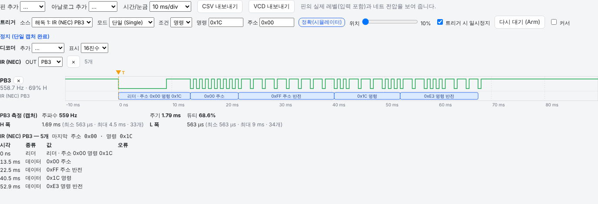

M25에서 남긴 둘(시뮬레이터 안의 해독 트리거, IR(NEC) 디코더)을 했다. CAN은 하지 않았다(아래 남은 항목).

- [x] **스트리밍 디코더**(`crates/wasm/src/decode.rs`): UART(8비트, 패리티 없음·짝수·홀수, 정지 비트 1)·I2C·SPI(모드 0–3,
  MSB/LSB, MISO·CS는 있으면)·1-Wire·TM1637·WS2812·NEC를 Rust로 다시 썼다. 규칙은 화면용 TS 디코더(`decode.ts`)와 같고, 에지를
  하나씩 받아 실행 조각 사이에 상태를 이어 간다. 샘플은 TS `levelAt`처럼 그 시각 바로 전의 레벨이고, 같은 시각의 에지는 TS가 보는
  순서대로(I2C·TM1637은 클럭 먼저, SPI는 CS 먼저) 시간이 넘어갈 때 처리한다. UART 프레임은 에지가 없어도 마지막 샘플(정지 비트
  가운데)까지 시간이 지나면 끝난다(`advance`). 1-Wire 리셋은 다음 Low 펄스를 보고 프레즌스를 정한다
- [x] **엔진 안의 해독 트리거**(`scope.rs`): `setTrigger` JSON에 `content: { decoder, match }`(파형 뷰의 `DecoderCfg`와
  `ContentMatch` 그대로). 디코더 핀이 모두 프로브되어 있으면(SPI의 MISO·CS는 없어도 됨, 아니면 "소스 핀이 프로브되지 않았습니다")
  `feed_scope`가 엔진에 넣는 **모든 에지**가 디코더로도 가고, 끝난 항목이 조건(`Matcher`: 바이트·텍스트·I2C 주소+R/W·WS2812
  픽셀·NEC 명령+주소)에 맞으면 **그 항목의 시작**(텍스트는 첫 글자의 시작 비트, NEC는 리더 마크)이 트리거 시각이다. 항목은 끝나야
  알 수 있으므로 창의 앞부분은 링(M20)에서 자르고 나머지는 이어서 모은다. 일치는 대기한 시각(또는 지난 창의 끝) 뒤에 시작한 것만
  센다(TS `findMatches`와 같음). 트리거를 바꾸면 링에 남은 기록을 디코더에 다시 흘려 동기를 맞추고(프레임 중간에 설정해도 다음
  바이트를 잘못 읽지 않음), 리셋하면 디코더도 처음부터. 단일·일반·자동 모드와 **트리거 시 일시정지**는 에지 트리거와 똑같이
  돈다 — 대기·수집 중에는 `runForMs`가 짧은 조각으로 돌아 창이 끝난 바로 뒤에 멈춘다
- [x] **UI**: 고른 조건을 시뮬레이터가 알면(`exactContent`, 지금은 모든 디코더의 모든 조건) 엔진에 맡기고 조건 옆에
  **"정확(시뮬레이터)"**을, 아니면 M25의 화면 해독(`contentStep`)으로 돌아가 **"화면 해독"**을 보인다. 엔진 쪽이면 상태·캡처·
  다시 대기는 에지 트리거와 같은 길이다. 설정은 M25처럼 프로젝트 파일에(새 필드 `trigger.content.addr`, 없으면 아무 주소)
- [x] **IR(NEC) 디코더**(`decodeNec`, Rust `Nec`): VS1838B 출력(평소 High, 38 kHz 버스트 동안 Low)에서 9 ms 마크(7–11 ms)와
  4.5 ms 공백(3.5–5.5 ms)이 리더, 그다음 32비트를 LSB 먼저 공백 폭으로 읽고(0.3–0.9 ms → 0, 1.2–2.2 ms → 1, 마크는 0.3–0.9 ms)
  주소·주소 반전·명령·명령 반전 바이트로 보인다. 리더 상자에 "리더 · 주소 0x00 명령 0x1C", 반전이 맞지 않으면 "주소/명령 검사
  실패". 9 ms 마크 + 2.25 ms 공백 + 마크는 **반복**(키를 누르고 있음). 공백·마크 폭이 틀리거나 리더 뒤 공백이 둘 다 아니면 오류,
  32번째 비트 전에 새 리더가 오면 "프레임이 끝나지 않음". 프레임은 **마지막 마크가 0.3–0.9 ms로 끝나야** 성립하고(그래서 해독 트리거도 그때 일치하며 트리거 시각은 여전히 리더의 시작), 마지막 마크가 너무 길면 "마지막 마크 폭" 오류, 리더만큼 길거나 구간 끝까지 끝나지 않으면 "프레임이 끝나지 않음"(Codex 리뷰 반영). 표 머리에 마지막 주소·명령. 해독 트리거 조건 "명령"과 "주소"(비우면
  아무 주소), 검사에 실패한 프레임은 맞지 않는다
- [x] **TS–Rust 일치 검사**: `web/test/parity.ts`가 합성 스트림 23개(UART 8N1 115 200·9600 baud와 8E1·8O1 — 프레이밍·패리티
  오류, 글리치, 오류 프레임이 낀 "ticXk 1" / I2C — NACK, 재START, 첫 START 전 비트, 클럭이 떨어지는 그 시각의 SDA 변화 / SPI 네
  모드 × CS·MISO·LSB — 샘플 에지와 같은 시각의 MOSI 변화, 워드 도중 CS 상승 / 1-Wire — SEARCH 3비트, 짧은 리셋, 프레즌스 없음,
  끊긴 바이트, 너무 긴 슬롯 / TM1637 / WS2812 — 허용 오차 밖, 끊긴 픽셀 / NEC — 반복, 검사 실패, 끊긴 프레임, 틀린 공백, 마지막 마크 4 ms·0.2 ms·9 ms)를 TS
  디코더로 풀어 항목 2362개와 조건 79개의 일치 시각을 `crates/wasm/tests/fixtures/decode-parity.json`에 쓴다(`node
  scripts/decode-parity.ts`). `npm test`는 그 파일이 지금 TS 디코더의 결과와 같은지, `cargo test`(`tests/decode_parity.rs`)는
  같은 에지를 Rust 디코더에 하나씩 — 임의 길이 실행 조각으로 두 번, 같은 시각의 에지를 거꾸로 한 번 — 넣어 항목(종류·시작·끝·값·
  MISO·주소·R/W·번호·오류 종류)과 일치 시각이 모두 같은지 본다
- [x] 테스트: Rust 단위 19개(`decode.rs` 12 — UART 텍스트와 오류 프레임(M25의 Codex 수정: 오류 프레임을 건너뛰면 "tick 1"이
  되는 "ticXk 1"은 맞지 않음), 패리티·글리치·에지 없이 끝나는 프레임, I2C 주소 R/W·NACK·재START, 같은 시각의 클럭·데이터, SPI
  네 모드·LSB, CS 중간 상승, 1-Wire 리셋·프레즌스·끊긴 바이트, TM1637 LSB, WS2812 GRB·번호·시작 조건, NEC 프레임·반복·검사
  실패·끊긴 프레임, 마지막 마크(4 ms·리더 길이·끝나지 않음)와 그 마크가 끝나야 일치 / `scope.rs` 7 — 정확한 트리거 시각과 프리 트리거 창 내용, 항목이 끝나는 순간에 트리거되고 창 끝에서
  일시정지, 실행 조각과 상관없이 같은 일치, 일반 모드의 재대기(창이 짧으면 모두, 길면 하나 건너)·단일의 다시 대기, 중간에
  설정해도 기록으로 동기, 핀이 프로브되지 않으면 소스 없음, 리셋), 일치 검사 2개, `scope_firmware` 4개(전체 12개: hal-uart-printf
  "tick 1" 트리거가 긴 에지 캡처에서 찾은 그 글자의 시작과 0.01 ns 안에서 같음, "tick 2" + 일시정지가 창 끝 0.05 ms 안에서
  멈춤, hal-bmp280 0x76 R이 재START 뒤 주소 바이트의 SCL 하강에, hal-ir-remote에서 5는 트리거하지 않고 OK가 누른 시각의 리더
  마크에 트리거·창 끝에서 멈춤·캡처의 32비트가 0x00 0xFF 0x1C 0xE3·콘솔과 같음), 웹 단위 8개(`web/test/m26.test.ts`, 전체
  94개: NEC 리더·바이트·LSB 먼저·길이, 반복과 다음 프레임, 마지막 마크 폭·끝나지 않은 마지막 마크, 검사 실패·틀린 공백·끊긴 프레임·틀린 리더 공백·마크 폭, 명령·주소
  조건, 모든 조건이 엔진 쪽, 프로젝트 파일, 일치 고정 데이터가 최신), E2E 2개(`web/e2e/m26.spec.ts`, 전체 104개: 리모컨 RIGHT는
  대기 그대로·OK는 캡처되고 창 끝에서 멈추며 리더가 t = 0, 네 바이트와 표 머리가 콘솔의 주소·명령과 같음 / UART "tick 1" 정확
  모드 + 일시정지로 실행이 창 끝 0.05 ms 안에서 멈추고 't'가 정확히 t = 0, "정확(시뮬레이터)" 표시). 하나씩 망가뜨려 해당 테스트가
  실패하는 것을 확인했다 — 오류 프레임에서 텍스트를 끊지 않기, 항목 시작 대신 알아챈 시각에 트리거, 대기 전·창 안의 일치 허용,
  시간으로 디코더를 진행하지 않기, 기록 다시 흘리기 생략, NEC 반전 검사·1 기준·주소 조건, SPI 같은 시각 샘플, 같은 시각 처리
  순서, 1-Wire 프레즌스, WS2812 번호, TS NEC 비트 순서·오류 무시·반복 공백, 대기 중 짧은 조각, 엔진 대신 화면 해독(창 끝보다
  10–14 ms 늦게 멈춤), NEC 표시·표 머리
- 성능: 해독 트리거가 없으면 비용은 에지마다 `Option` 검사 하나 — hal-neopixel-dma 10 s(프로브 PB4, 초당 약 27 000 에지)가
  M25 0.57–0.58 s, M26 0.58–0.59 s(측정 오차 안). 일치하지 않는 WS2812 픽셀 조건을 걸어도 0.58 s, hal-uart-printf 10 s는
  0.024 s 그대로. 엔진만 따로 재면 WS2812 디코더가 에지당 약 7 ns(6.3 → 13.1 ns). 일치해 캡처가 생기면(1 ms 창 476개)
  0.75 s로 에지 트리거와 같다 — 비용은 캡처를 자르고 JSON으로 보내는 쪽이다
- 한계: 디코더의 설정은 UI에 있는 것만(UART 8비트·정지 비트 1·반전 없음, SPI 8비트). 일치는 항목이 끝나야 알 수 있으므로
  텍스트가 창 뒷부분보다 길면(예: 1 ms 창의 50 % 위치에 10글자 "…") 알아챈 때 이미 창이 끝나 있어 그때 바로 캡처·일시정지한다.
  일반·자동은 창 하나가 끝날 때까지 다음 일치를 보지 않는다(에지 트리거와 같음). 합성 에지(USART·I2C·SPI)는 `holdback_ns`만큼
  늦게 엔진에 들어가므로 일시정지도 그만큼(바이트 하나 정도) 늦을 수 있다. 화면 해독(M25)은 이제 시뮬레이터가 모르는 조건에만
  쓰이는데 지금은 그런 조건이 없다. NEC는 표준 NEC만(확장 NEC의 16비트 주소는 검사 실패, 반복 코드는 트리거 조건 없음), 다른 IR
  프로토콜(RC5, Sony)은 없다
- 남은 항목: **CAN** — STM32F401에는 bxCAN이 없어 CAN 파형에는 MCP2515(SPI CAN 컨트롤러) + TJA1050 부품과 그 TXCAN·CANH/L의
  비트 스트림(SOF, 11비트 ID, RTR, DLC, 데이터, CRC-15, 비트 스터핑, ACK 슬롯, EOF, CNF1–3의 비트 속도), 받는 쪽(두 번째
  MCP2515나 "CAN 버스 모니터")과 CAN 디코더(스터핑 제거, CRC, ACK)가 필요하다. 이번에는 반쯤 만들지 않고 남겼다. 1-Wire 오버드라이브,
  다른 IR 프로토콜, 아날로그 채널 수학(A−B, FFT)

### M25 완료 (해독기 추가·해독 트리거)

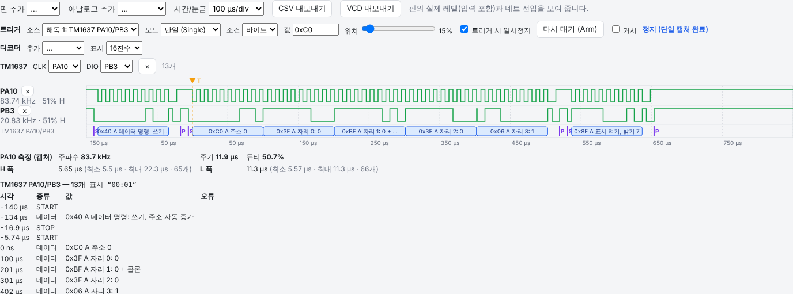

M22에서 남긴 셋(1-Wire·TM1637·WS2812 디코더, 디코더 결과로 트리거, 파형 설정 저장)을 했다. 모두 웹 쪽(`web/src/run/`)이고 Rust 코어는 바뀌지 않았다.

- [x] **1-Wire 디코더**(`decodeOneWire`, DS18B20 표준 속도): DQ의 Low 펄스마다 판단한다 — 300 µs보다 길면 리셋(480 µs 미만은 "리셋 펄스가 짧음"), 그 뒤 80 µs 안에 시작하는 60–240 µs Low가 장치의 **프레즌스**(없으면 "프레즌스 없음"), 나머지는 시간 슬롯으로 15 µs 넘게 Low면 0(쓰기 0, 또는 읽기 0을 잡고 있는 장치), 아니면 1. 비트는 LSB 먼저 바이트가 되고, 리셋 다음 바이트는 **ROM 명령**(0x33 READ ROM·0x55 MATCH ROM·0xCC SKIP ROM·0xF0 SEARCH ROM·0xEC ALARM SEARCH), READ·MATCH 뒤 8바이트는 ROM 계열·일련번호·CRC, SEARCH·ALARM SEARCH 뒤는 **64개의 3비트**(ROM 비트, 보수, 컨트롤러가 쓴 방향 — "0: 00→0", 1·1은 "응답하는 장치 없음"), 그다음 **기능 명령**(0x44 CONVERT T·0xBE READ SCRATCHPAD·0x4E WRITE SCRATCHPAD·0x48 COPY·0xB8 RECALL E²·0xB4 READ POWER SUPPLY)과 데이터(스크래치패드 0–8). **타이밍 오류**: 120 µs보다 길고 리셋보다 짧은 Low, 60 µs보다 가까운 슬롯, 리셋으로 끊긴 바이트
- [x] **TM1637 디코더**(`decodeTm1637`): CLK가 High일 때 DIO 하강 = START, 상승 = STOP, CLK 상승마다 LSB 먼저 8비트와 9번째 클럭의 ACK(DIO Low). START 뒤 첫 바이트가 명령 — 0x40/0x44(쓰기, 자동 증가/고정 주소, 0x42는 키 읽기), 0x80–0x8F(표시 켜기·끄기, 밝기 0–7), 0xC0+(주소) — 이고 주소 뒤 바이트는 **세그먼트**: 자리마다 보이는 글자(0–9, A–F, -, _ 등)와 bit 7(자리 1이면 콜론, 아니면 점). NACK·알 수 없는 명령은 오류. 표 머리에 마지막으로 다 쓴 네 자리를 "12:34"처럼
- [x] **WS2812 디코더**(`decodeWs2812`): High 폭으로 비트(0.4 µs → 0, 0.8 µs → 1, 0.6 µs 기준), ±150 ns를 벗어나면 "비트 High … ns" 오류. 24비트를 G·R·B(MSB 먼저)로 모아 0xRRGGBB, 레인의 상자를 그 색으로 칠하고 "#번호 #RRGGBB". 50 µs 이상 Low가 **리셋**이고 픽셀 번호는 리셋부터 센다(구간이 프레임 도중에 시작하면 첫 리셋 전 번호는 모름). 리셋으로 끊긴 픽셀은 오류. 표 머리에 마지막으로 래치된 프레임의 색 견본
- [x] **해독 내용 트리거**: 트리거 소스 목록에 "해독 N: …"이 생기고, 고르면 조건(UART 바이트·**텍스트**, I2C **주소** + R/W·바이트, SPI(MOSI 또는 MISO)·1-Wire·TM1637 바이트, WS2812 **픽셀** 번호와 색(비우면 아무 색)), 값은 `0x41`·`'A'`·`65`·`41h`, 텍스트는 `\r`·`\n`. 시뮬레이터의 트리거 엔진은 끄고 **UI가 실시간 스트림을 해독**한다(`scanStep`, `contentStep`): 프레임마다 마지막 동기점(UART 프레임, SPI 워드, I2C·TM1637 START, 1-Wire·WS2812 리셋 — 텍스트면 글자 수만큼 앞)부터 지금까지 해독해 새로 끝난 항목에서 조건을 찾고, 일치하면 그 항목의 시작을 t = 0으로 창이 다 찰 때까지 기다렸다 실시간 기록(4 s)에서 프리 트리거 위치대로 모든 프로브·아날로그 채널을 잘라 캡처로 보인다. 단일은 한 번 잡고 다시 대기까지, 일반·자동은 창이 끝난 뒤부터 다시 찾는다. **트리거 시 일시정지**도 된다(워커의 `pause`에 이유 `trigger`, 소스 탭에 "멈춤: 오실로스코프 트리거"). 측정 줄은 디코더의 첫 핀
- [x] **파형 설정 저장**(`scopeSettings.ts`, `editor/projectFormat.ts`): 프로젝트 파일에 `scope`(프로브 핀, 아날로그 채널과 V/눈금·중앙, 디코더와 핀·보드레이트·패리티·SPI 모드·비트 순서, 표시 형식, 시간/눈금, 트리거의 소스·에지·모드·위치·펄스 폭·일시정지·레벨·히스테리시스·해독 조건). 열 때 값마다 검사해 틀리거나 모르는 값은 기본값, 모르는 디코더·핀은 버린다. `scope`가 없는 예전 파일(또는 예제 프로젝트)은 그대로 열리고 파형 뷰는 지금 설정을 유지한다(M24까지처럼). 설정은 바뀔 때마다 프로젝트에 들어가 자동 저장(IndexedDB)으로도 돌아온다. 파일 형식 함수는 부품 목록을 받아 단위 테스트할 수 있도록 `projectFormat.ts`로 옮겼다
- [x] 테스트: 웹 단위 21개(`web/test/m25.test.ts`, 전체 82개: 1-Wire 리셋·프레즌스·SKIP ROM·CONVERT T, READ SCRATCHPAD 9바이트, MATCH ROM 8바이트, SEARCH 64개 3비트와 1·1 오류, 프레즌스 없음·짧은 리셋·200 µs Low·40 µs 간격·끊긴 바이트, `to` 뒤 펄스 / TM1637 명령·주소·숫자·콜론·표시 "12:34", 고정 주소·표시 끄기·모르는 명령·NACK, LSB 먼저 / WS2812 GRB 색·번호·리셋, 첫 리셋 전 번호 없음, 허용 오차 밖·끊긴 픽셀·짧은 Low, 마지막 프레임 / 해독 조건 일치(UART 바이트·텍스트, I2C 주소·R/W, 픽셀 번호·색, 1-Wire·TM1637 바이트), 입력값 해석, 실시간 스캔이 단계 길이와 상관없이 일치를 한 번씩(단계에 걸친 텍스트, START가 앞 단계에 있는 I2C 바이트) / 저장·열기 왕복, `scope` 없는 예전 파일, 깨진 값의 기본값), E2E 5개(`web/e2e/m25.spec.ts`, 전체 99개: DS18B20 0x44 해독 트리거로 리셋·프레즌스·SKIP ROM·CONVERT T, 0xBE로 READ SCRATCHPAD 9바이트의 온도가 콘솔과 같음 / TM1637 0xC0 해독 트리거 + 일시정지로 0x40·0xC0·네 자리·0x8F와 표시기의 세그먼트·콜론이 같음 / NeoPixel 체인의 프레임 끝 트리거로 60픽셀(3프레임) 번호와 마지막 프레임 색이 링 12개 + 스트립 8개와 같음 / UART 텍스트 "tick 1" 해독 트리거가 그 글자를 t = 0에, 다른 텍스트는 대기 / 설정을 저장한 파일의 `scope`, 바꾼 뒤 다시 열면 그대로, 새로 고침(자동 저장) 뒤에도, `scope` 없는 파일은 지금 설정 유지). 디코더의 비트 순서(1-Wire·TM1637)·샘플 기준·슬롯 간격 검사·ACK 극성·주소 자동 증가·GRB 순서·허용 오차, 조건의 R/W, 스캔의 동기점(텍스트 길이만큼, I2C START), `scope` 직렬화·검사, 예전 파일 처리를 하나씩 깨면 해당 단위 테스트가, 프레즌스 판단·1-Wire와 TM1637 비트 순서·주소 증가·GRB 순서·캡처 t = 0·해독 트리거 일시정지·설정 적용·설정 보고·예전 파일 처리를 깨면 해당 E2E가 실패하는 것을 확인했다(그대로 두면 모두 통과)
- 한계(M26에서 해결 — 해독 트리거가 시뮬레이터 안에서 모든 에지를 보므로 프레임별 에지 제한·4 s 기록·한 프레임 늦은 캡처·늦은 일시정지·200 ms 앞까지만 해독하는 문제는 없어졌다): ~~해독 트리거는 시뮬레이터가 아니라 UI에서 돌아 프레임별 에지(핀당 프레임마다 4000개, 넘으면 "너무 빠름"으로 버림)와 실시간 기록(4 s)에 기대므로, 그보다 빠른 스트림은 놓칠 수 있고 캡처는 창이 끝난 뒤 다음 프레임(합성 에지 지연을 위해 1 ms 더)에 보인다. 에지 시각 자체는 사이클 정확도 그대로다. 트리거 시 일시정지는 창 끝이 아니라 그걸 알아챈 프레임 뒤에 멈추므로(1× 속도에서 최대 십수 ms 시뮬레이션 시간, 배속이면 더) 그사이 펌웨어가 더 진행할 수 있다. 해독은 동기점부터 최대 200 ms 앞까지만 보므로 그보다 긴 I2C·TM1637·1-Wire 트랜잭션 도중의 내용은 잡지 못하고, 일반·자동은 창 하나가 끝날 때까지 다음 일치를 보지 않는다.~~ 1-Wire는 표준 속도만(오버드라이브·기생 전원 강한 풀업 없음), TM1637은 키 읽기(0x42) 응답을 숫자로 풀지 않는다
- 남은 항목: ~~시뮬레이터 안(트리거 엔진)의 해독 트리거~~(M26), CAN·~~IR(NEC)~~(M26) 디코더, 아날로그 채널 수학(A−B, FFT)

### M24 완료 (수업용 확장)

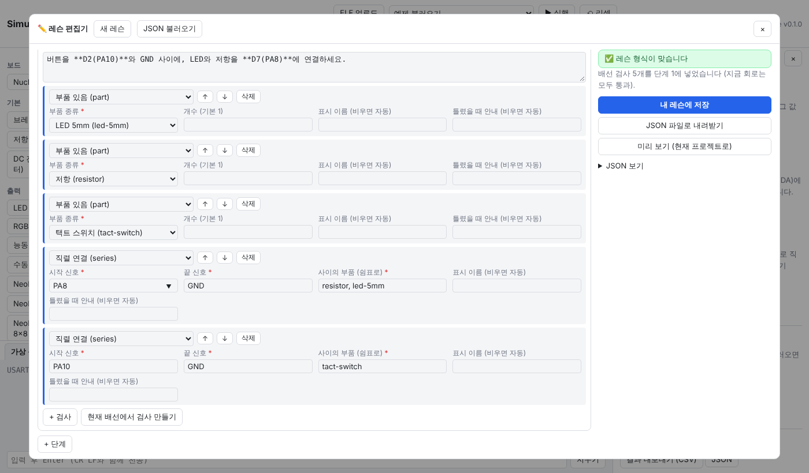

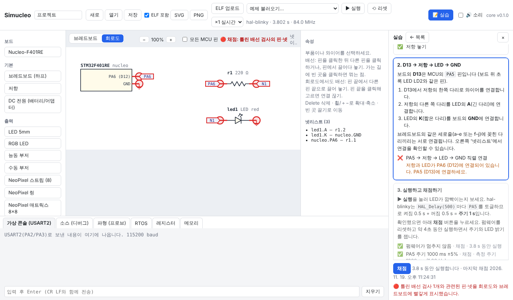

M16의 남은 항목 셋(선생님용 결과 화면, 회로도 검사 강조, 레슨 편집기)을 했다. 모두 브라우저 안에서만 동작하고
서버나 업로드가 없다. 선생님용 설명은 [lessons.md](lessons.md).

- [x] **결과 파일 무결성**(`web/src/lessons/integrity.ts`): M16의 결과 JSON에는 서명도 해시도 없었다. 이제 **JSON**
  내보내기에 `integrity: { alg: "SHA-256", hash }`를 붙인다 — `integrity`를 뺀 파일을 정규화한 JSON(모든 단계에서
  키 정렬, 공백 없음)의 WebCrypto SHA-256. 비밀 키가 없으므로 **가벼운 편집만 드러내는(tamper-evident) 장치이고
  보안이 아니다**(문서에 명시). 확인 결과는 검증됨 / 변조됨(해시 불일치, `integrity` 필드가 깨짐) / 검증 안 됨(해시
  없음: 이전 파일, CSV). 예전 결과 파일은 그대로 읽는다. 결과에 단계 제목(`lessons[].steps`)도 더해 표 머리에 쓴다
- [x] **선생님용 결과 모아보기**(`teacher.ts` 순수 함수, `TeacherView.tsx`): 실습 목록의 버튼으로 여는 대화상자.
  여러 파일을 끌어다 놓기·다중 선택, JSON과 CSV(이어 붙인 CSV는 학생마다 나눔) 모두 읽고 형식 오류는 파일별로
  보여 줌. 학생(공백 정규화) × 실습의 **중복은 `exportedAt`이 가장 늦은 것만**(같으면 나중 파일) 쓰고 무시한 파일을
  알림. 표: 학생 줄, 실습마다 점수(통과 검사 비율)·걸린 시간(시작 → 완료)·단계 칸(통과/일부/실패, 단계 통과까지
  걸린 시간), 학생별 검증 상태(파일 중 가장 나쁜 것). 아래 줄은 제출한 학생 중 완료율과 **단계별 통과율**. 열 머리
  눌러 정렬(값 없는 학생은 늘 아래), 이름 검색, 실습 고르기, 미완료만, 변조 의심만. **표 CSV 내보내기**(BOM, 보이는
  표 그대로 + 통과율 줄)
- [x] **레슨 편집기**(`LessonEditor.tsx`): 기본 정보, 시작 회로(빈 보드 / 예제 / 지금 회로를 담은 `project`),
  펌웨어, 채점 시간·조작, 단계(제목·Markdown 설명·순서 바꾸기), 검사 12종 각각의 입력 양식(부품 종류 목록, 신호
  자동완성, 숫자·선택 필드), 표시 이름·안내. 편집하면서 형식 검사 결과를 보여 주고 오류가 있으면 저장·내려받기·
  미리 보기를 막는다. **미리 보기**는 실습 패널에서 지금 회로·펌웨어로 실행(`__preview`, 결과 내보내기에서 뺌).
  JSON 내려받기·불러오기, 초안 자동 저장
- [x] **현재 배선에서 검사 만들기**(`fromWiring.ts` `checksFromWiring`): 넷리스트에서 부품 종류별 `part`, 보드 신호에서
  2단자 부품(저항, LED, 버튼, 가변저항, RGB LED 한 색)을 거쳐 다른 보드 신호까지의 사슬마다 `series`(LED 방향을
  따라 `from`·`to`를 정함, 방향이 섞인 사슬은 건너뜀), 사슬에 들지 않은 부품 핀이 보드 신호에 이어져 있으면
  `connected`(같은 넷의 버스 핀은 하나로). 만든 검사는 지금 회로에서 모두 통과한다(단위 테스트로 확인)
- [x] **내 레슨**(`mine.ts`): 편집기에서 저장하거나 **레슨 파일 불러오기**(여러 개, 형식 검사)로 넣은 레슨을
  IndexedDB에 두고 실습 목록의 "내 레슨"에 보여 준다. 편집·삭제, 기본 실습은 복사해서 편집. 기본 실습과 같은 id는 오류
- [x] **형식 검사 강화**(`validate.ts`): id 문자, 숫자·문자열 필드 타입, `through` 항목, `field`·`mode` 값, 정규식
  플래그, `start.project` 구조, `grade.ms`, 채점 중 조작(`press`/`set`, 부품 종류). 기본 실습 6개는 그대로 통과
- [x] **채점 표시**: 채점이 끝나면 실패한 배선 검사마다 관련 핀(`involved`: `connected`는 그 종류 부품의 핀과 신호,
  `series`는 `through` 부품의 단자와 `from`·`to` 신호)을 넷 전체로 넓히고 신호의 보드 핀을 더해, 회로도의 핀 끝에
  빨간 원·굵은 스텁·넷 깃발(`data-mark="fail"`)과 브레드보드 핀(`.pin.marked`)으로 표시한다. 배선을 고쳐 검사가
  통과하면 바로 사라진다
- [x] 테스트: `npm test` 61개(새 18개, `web/test/classroom.test.ts` — 정규화 JSON과 SHA-256, 봉인 → 검증·필드 하나
  바꾸면 변조·해시 없는 옛 파일은 검증 안 됨, JSON·CSV 읽기와 오류, 이어 붙인 CSV, 중복은 불러온 순서와 상관없이
  최신만, 단계 상태·점수·걸린 시간, 단계별 통과율, 정렬·필터·검증 상태, 시간 없는 학생 정렬, 표 CSV, 형식 검사의
  각 규칙, 내 레슨 목록, 배선에서 만든 검사(LED·저항, 거꾸로 꽂은 LED, 버튼·가변저항·OLED·서보·RGB LED, 부품
  없음)가 모두 통과하고 틀린 배선은 실패, `involved`), E2E 94개(새 3개, `web/e2e/m24.spec.ts` — 두 브라우저
  컨텍스트의 학생이 실제 내보내기로 낸 결과를 모아 표·통과율·정렬·검색·변조됨·검증 안 됨·중복·표 CSV 확인,
  편집기에서 현재 배선으로 검사를 만들고 양식으로 period 검사를 더해 오류 표시·JSON 내려받기·미리 보기·내 레슨
  저장 → 새로고침 → 내 레슨에서 시작해 채점 통과 → 삭제, 잘못된 핀으로 채점하면 브레드보드와 회로도에 표시되고
  고치면 사라짐). 해당 코드를 하나씩 망가뜨리면(해시 비교 생략, 해시 없음을 검증됨으로, 키 정렬 생략, 중복에서
  첫 파일 유지·같은 시각에 나중 파일 무시, 통과율 분모, 표 CSV 통과율 줄, 단계 시간, 정렬의 빈 값 위치, CSV 따옴표,
  through·숫자 형식 검사, LED 방향 뒤집기, 사슬 핀 제외, 사슬 생성, 브레드보드 제외, `involved` 핀, 내 레슨 저장,
  채점 뒤 표시 켜기, 회로도 MCU 핀 표시) 해당 테스트가 실패하는 것을 확인했다
- 한계: 해시는 보안이 아니다(누구나 다시 계산 가능). CSV 결과에는 해시가 없어 늘 "검증 안 됨". 모아보기에 넣은
  파일은 저장하지 않는다(새로고침하면 다시 넣음). 편집기의 채점 중 조작은 JSON으로 적는다(양식 없음). 배선에서 만든
  검사는 보드 신호에 닿는 연결만 다룬다(부품끼리만 이어진 I2C 버스 같은 연결이나 3단자 이상 부품의 내부 경로는
  `connected`로만 표현), 신호 이름이 실제 핀인지는 형식 검사가 보지 않는다. 회로도 표시는 쓰지 않는 MCU 핀(예:
  가야 할 PA5)을 그리지 않으면 보이지 않는다("모든 MCU 핀"을 켜면 보임). 내 레슨은 브라우저마다 따로다
- 남은 항목: 채점 중 조작 입력 양식, 결과 파일 서명(선생님 키), 여러 반·과제 단위로 모아보기 저장, 회로도 표시에서
  틀린 연결과 있어야 할 연결 구별

### M23 완료 (TIM1 상보 출력·데드타임)

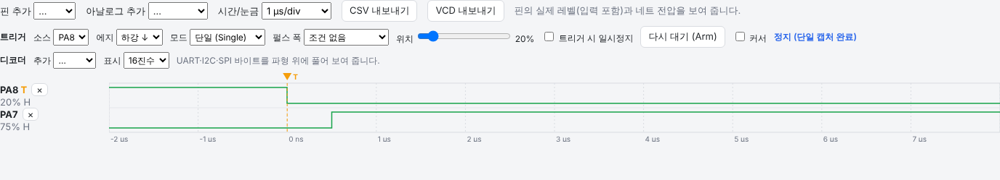

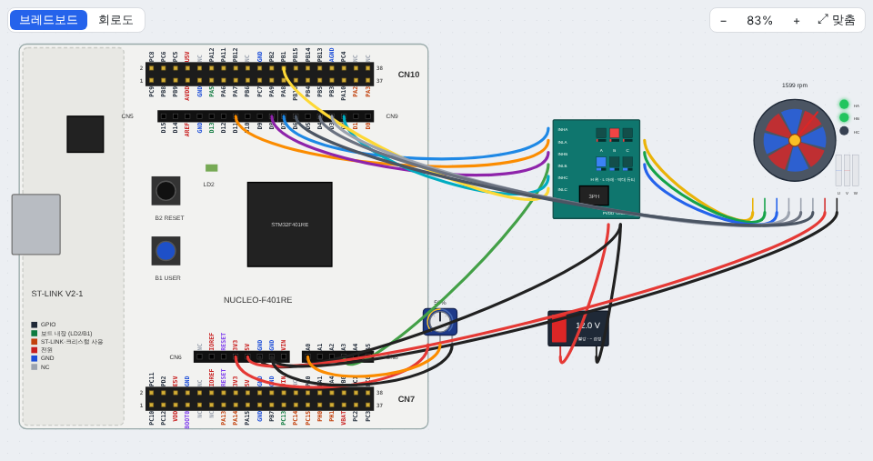

M21의 한계("TIM1 상보 출력(CHxN)이 없어 BLDC 예제는 GPIO 6개로 풀 전압, PWM 속도 조절 없음")를 풀었다. 데드타임이 왜 필요한지(관통 전류)를 오실로스코프와 경고로 보여 주는 것이 목표다.

- [x] **TIM1 고급 제어**(`crates/periph-stm32f4/src/timer.rs`, RM0368 §12.3.11–12.3.13): 상보 출력 CH1N–CH3N(CCxNE·CCxNP, 표 75대로: CCxE만이면 OCx = OCxREF, CCxNE만이면 OCxN = OCxREF, 둘 다면 상보 + 데드타임, OSSR이면 꺼진 쪽을 비활성 레벨로 구동). **데드타임** BDTR.DTG의 네 구간(0xx: DTG × tDTS, 10x: (64+DTG[5:0]) × 2tDTS, 110: (32+DTG[4:0]) × 8tDTS, 111: × 16tDTS), tDTS는 CR1.CKD로 tCK_INT의 1·2·4배. OCxREF가 바뀐 시각을 기억해(PWM은 카운터로 거꾸로 계산해 틱 경계 그대로) 켜지는 쪽 출력이 그만큼 늦게 켜지고, 데드타임이 펄스보다 길면 펄스가 사라진다. 그 에지는 카운터 틱 사이에 있어도 사이클 단위로 스케줄된다(PWM은 여전히 에지 이벤트, 사이클마다 돌지 않음). **MOE/AOE/OSSI**: MOE가 꺼지면 OSSI면 유휴 레벨 CR2.OISx/OISxN, 아니면 구동하지 않음. AOE면 브레이크가 풀린 뒤 다음 업데이트에서 MOE가 다시 켜진다(그 업데이트를 스케줄). **브레이크**: BKIN(PA6·PB12, AF1)이 BKP 레벨이고 BKE면, 또는 EGR.BG면 MOE를 지우고 SR.BIF를 세운다(DIER.BIE → TIM1_BRK_TIM9, IRQ 24). 입력이 살아 있는 동안 MOE는 켜지지 않고 BIF도 지워지지 않는다. **COM 이벤트**: CR2.CCPC면 CCxE·CCxNE·OCxM이 프리로드되어 EGR.COMG에서 한꺼번에 적용, SR.COMIF(TIM1_TRG_COM_TIM11, IRQ 26). 강제 활성/비활성(OCxM 101/100)에도 데드타임이 들어간다
- [x] **핀**: `PIN_MAP_N` — CH1N PA7/PB13, CH2N PB0/PB14, CH3N PB1/PB15, `BKIN_PINS` — PA6/PB12(모두 AF1, 데이터시트 표 9). 기존 표의 CH1–CH3 PA8/PA9/PA10(AF1)은 그대로
- [x] **3상 브리지의 PWM**(`crates/circuit/src/tier9.rs` `PwmMeter`·`PhaseBridge`): 스위치 입력마다 주기별 듀티를 잰다(다시 켜지는 간격이 0.5 ms 이하면 PWM, 더 느리면 정류로 보고 레벨 그대로). 하이사이드가 초핑하면 상 전압은 하이사이드 듀티 × PVDD(그 사이 전류는 상보 로사이드나 데드타임 동안 다이오드로 돈다), 로사이드만 초핑하면 (1 − 듀티) × PVDD — L298N의 ENA PWM처럼 평균으로 모터에 준다(`PhaseDrive::Duty`). 그래서 토크·속도가 듀티를 따른다. 한 주기 넘게 에지가 없으면 정적 레벨로 보고, 그 시각에 회로를 깨운다(브레이크면 전류가 끊기고 관성으로 돈다). GPIO로 켜는 `hal-bldc-hall`은 예전 그대로
- [x] **관통 전류 검출**: 실제 핀 에지로 — 한 상의 INH와 INL이 잠깐이라도(0보다 길게) 같이 켜져 있거나, 한쪽이 꺼진 뒤 스위치가 꺼지는 시간(150 ns)보다 빨리 다른 쪽이 켜지면 "데드타임 없이 상·하단이 동시에 켜짐(관통 전류)" 경고. 데드타임 0이면 TIM1 출력은 같은 사이클에 바뀌지만 실제 MOSFET은 그렇게 빨리 꺼지지 않으므로 경고가 뜨고, 500 ns면 뜨지 않는다. 극성(CCxNP)을 틀려 같이 켜져도 뜬다
- [x] **브리지 표시**: 상마다 하이사이드(빨강)·로사이드(파랑) 듀티 막대(프레임 평균), 관통 전류가 있었던 프레임에는 **관통!** 표시(`MotorView.duty`, `shoot_through`)
- [x] **예제 `hal-bldc-pwm`**: TIM1 CH1–CH3(D7/D8/D2 → INHA/B/C), CH1N–CH3N(D11/A3/PB1 → INLA/B/C), 84 MHz에서 20 kHz(ARR 4199), DTG 42 = 500 ns(`HAL_TIMEx_ConfigBreakDeadTime`, OSSR·OSSI, OIS 0), `HAL_TIMEx_ConfigCommutEvent`(CCPC, 소프트웨어 COM). 홀(D3/D4/D6) EXTI에서 다음 단계를 쓰고(PWM 상: PWM1 + 상보, 아래 상: 강제 비활성 → CHxN 켜짐, 남은 상: 둘 다 끔) EGR.COMG로 한꺼번에 전환. A0 가변저항 → 듀티(CCR, 프리로드). B1: `HAL_TIM_GenerateEvent(BREAK)`로 소프트웨어 브레이크 → BIF·브레이크 인터럽트 → "break: BIF set, MOE off", 다시 누르면 MOE를 켜 재개. 500 ms마다 듀티와 rpm 출력. 배선된 예제 프로젝트(`web/examples/hal-bldc-pwm.simucleo.json`), CI 펌웨어 빌드 목록 두 곳에 추가. `hal-bldc-hall`은 그대로 둔다
- [x] **성능**: BLDC는 아무것도 바꾸지 않는 PWM 에지에서 적분·홀 예측을 건너뛰고(다음 홀 에지 전에는 출력이 바뀔 수 없으므로), 드라이브가 연달아 바뀌면 예측을 50 µs에 한 번으로, PWM이 도는 동안은 0.25 ms만 내다본다. 버스는 회로가 바꾸지 않은 핀의 새로 고침을 건너뛰고, 출력 채널의 입력 캡처 검사를 먼저 거른다
- [x] 테스트: Rust 단위 14개 추가(워크스페이스 233개: `timer.rs` 8개 — DTG 네 구간과 CKD·타이머 클록, 상보 에지 사이 데드타임을 사이클 단위로(데드타임 0이면 같은 사이클, 펄스보다 길면 사라짐), CCxNP·CCxP 극성과 CCxNE만 켠 경우·OSSR, MOE 끔 + OSSI·OISx/OISxN 유휴 레벨, BKIN 핀(BKP 양쪽)·EGR.BG로 BIF·MOE 끔·입력이 살아 있으면 MOE 못 켬, AOE가 다음 업데이트에 MOE를 켬, 강제 활성/비활성의 데드타임(카운터가 멈춰도 스케줄), CCPC·COM 이벤트와 COMIF / `lib.rs` 1개 — PA8·PA7 핀 에지에 8사이클 데드타임, PA6 BKIN으로 두 핀이 동시에 유휴 레벨, IRQ 24 / `tier9.rs` 1개 — 주기별 듀티, 정적 레벨로의 복귀와 깨우기 시각, 2 kHz 미만은 PWM 아님, 조금 일찍 깨워도 다시 깨우지 않음 / `sim.rs` 4개 — 듀티 25·50·90 %에 비례하는 BLDC 속도와 듀티 막대, 데드타임 0·100 ns·극성 반대면 관통 전류 경고·500 ns면 없음, PWM이 멈추면 모터가 관성으로 돌고, 모터 없는 브리지도 한 주기 뒤에 깨워 놓아 줌; 기존 관통 전류 테스트는 0보다 긴 겹침을 보도록 수정), 펌웨어 통합 1개(41개, `bldc_pwm_speed_follows_the_pot_and_the_break_stops_driving`: 가변저항 50 %에서 약 1600 rpm·콘솔 rpm 일치·경고 없음, 90 %로 돌리면 1.5배 넘게 빨라지고, B1이면 BIF 메시지·모터 전류 0·듀티 0·감속, 다시 누르면 재개), `scope_firmware` 1개(8개: 예제 프로젝트 그대로 PA8 하강 → PA7 상승, PA7 하강 → PA8 상승이 42사이클 ± 1, 둘이 같이 켜진 순간 없음), E2E 2개(`web/e2e/m23.spec.ts`, 전체 91개: 가변저항이 rpm을 바꾸고 여섯 듀티 막대·관통 표시 없음, B1로 브레이크 메시지·듀티 0·감속·재개 / 1 µs/div 단일 캡처의 CSV에서 PA8 하강과 PA7 상승 사이 500 ns ± 1사이클, 그 사이 둘 다 꺼짐). 데드타임 대기, DTG 구간 배수, CKD, CCxNP, OSSI 유휴 레벨, BKIN 브레이크, EGR.BG, AOE, COM 복사, IRQ 24, 데드타임 에지 스케줄, PWM 평균, 스위치 꺼짐 시간 검사, 겹침 검사, 꺼짐 시간 값, 깨우기 스케줄과 깨울 때 처리, 메터 만료, 깨우기 허용 오차를 하나씩 깨면 해당 단위 테스트가, BG·PWM 평균을 깨면 펌웨어 테스트가, 데드타임 대기·CKD를 깨면 `scope_firmware` 테스트가, 데드타임 대기를 깨면 두 E2E가(관통! 표시·500 ns 측정), BG·PWM 평균을 깨면 첫 E2E가 실패하는 것을 확인했다(그대로 두면 모두 통과). 실행 속도: 기존 예제는 그대로(네이티브 1 s 시뮬레이션, 회로 포함: 서보 0.023 → 0.024 s, NeoPixel DMA 0.057 → 0.057 s, NeoPixel 체인 0.091 → 0.097 s, `hal-bldc-hall` 0.070 → 0.069 s), `hal-bldc-pwm`은 0.265 s
- 한계: 데드타임 동안의 상 전압(전류 방향에 따른 다이오드)과 상 인덕턴스(전류 리플)는 모델링하지 않고 주기 평균만 쓴다. 0.5 ms보다 느린 PWM(2 kHz 미만)은 평균하지 않고 레벨 그대로. PWM 상이 시작·정지하는 첫 주기는 평균 전에 레벨로 본다. BDTR.LOCK, TRGI에 의한 COM(CCUS), ~~반복 카운터, 중앙 정렬 PWM~~(M28에서 해결), BKIN 디지털 필터는 없다. MOE를 다시 켤 때·OSSI 유휴 레벨로 갈 때 데드타임은 넣지 않는다. 20 kHz 상보 PWM은 에지가 초당 8만 개라 이 예제는 다른 예제보다 무겁다(네이티브 1 s 시뮬레이션에 약 0.26 s)
- 남은 항목: ~~중앙 정렬 PWM과 반복 카운터~~(M28), ~~센서리스 BLDC(역기전력 영점)~~(M28), FOC 예제, 전류 감지(ADC 주입 변환을 TIM1 트리거로)

### M22 완료 (오실로스코프 확장)

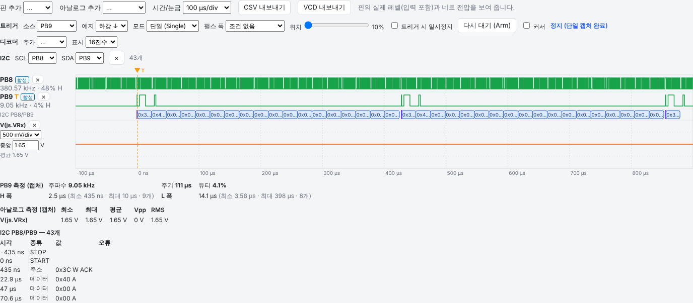

M20에서 남긴 세 가지(아날로그 채널과 레벨 트리거, 버스 해독, 캡처 내보내기)를 했다. 가장 큰 문제는 **USART·I2C·하드웨어 SPI가 바이트(트랜잭션) 단위 모델이라 핀이 비트마다 토글하지 않는다**는 것이었다(M20의 "UART TX 핀에 프레임이 보이지 않는다"). 기능 모델은 그대로 두고, 프로브가 그 핀을 볼 때만 바이트를 비트 파형으로 **합성**한다.

- [x] **핀 레벨 파형 합성**(`crates/periph-stm32f4/src/wire.rs`): 프로브 마스크에 걸린 핀으로 라우팅된 주변장치가 바이트를 옮길 때 버스가 `WireEvent`를 남긴다 — UART는 프레임이 **시작될 때**(TX는 `start_shift`, RX는 단말이 보낸 바이트가 도착할 때 그 프레임의 시작으로), SPI는 프레임이 끝날 때(교환한 MOSI·MISO 바이트, CPOL·CPHA), I2C는 START+주소·쓰기·읽기 바이트가 ACK까지 끝날 때와 STOP을 낼 때. `WireEvent::edges`가 이를 에지로 바꾼다: UART는 시작 비트·LSB 먼저 데이터·패리티(하드웨어처럼 맨 위 비트 자리)·정지 비트를 BRR이 정한 비트 시간(HCLK/baud 사이클, 소수점까지)으로, SPI는 프리스케일러가 정한 SCK 반주기마다 모드대로(CPHA 0: 데이터 뒤 앞 에지에서 샘플, CPHA 1: 앞 에지에서 바뀌고 뒤 에지에서 샘플), I2C는 CCR이 정한 SCL 주기의 9비트(SCL Low일 때 SDA 변경, ACK/NACK), (재)START는 앞 동작과 주소 사이(최대 한 주기), STOP은 SCL High에서 SDA 상승. 모델이 SB를 바로 세우므로 START는 그 틈에 끼워 넣는다
- [x] **합성 에지는 프로브에만**: `Simulator`가 핀이 USART·I2C·SPI 대체 기능으로 라우팅되면(`wire_signal`) 그 핀의 GPIO 레벨 변화 대신 합성 에지를 쓰고, 유휴 레벨(UART·I2C High, SCK는 CPOL)을 넣는다. 프레임 JSON의 `probes[].synth`, 파형 뷰의 **합성** 표시. SPI·I2C 바이트는 끝난 뒤에 알려지므로 모든 에지·샘플을 `pending`에 모아 시각 순으로 정렬하고, 가장 긴 지연(`holdback_ns`, I2C 바이트 100 kHz에서 90 µs)만큼 늦게 트리거 엔진에 넣는다(합성 핀이 없으면 0, 예전과 같음). 비트뱅잉 프로토콜(TM1637, 소프트웨어 I2C·SPI, 1-Wire)은 원래 실제 GPIO 에지다
- [x] **아날로그 채널**: 부품 핀(`pot.W`, LDR 분압점, DC 모터·코일 단자 등 프로젝트의 모든 부품 핀)이나 MCU 핀의 **넷 전압**. 회로(`CircuitSim`)가 동작점이 바뀔 때마다(해가 바뀔 때, 곧 전압이 바뀔 수 있는 유일한 순간) 프로브한 넷 전압을 사이클 시각과 함께 기록하고(`set_voltage_probes`/`take_voltage_log`, 값이 바뀐 것만), `feed_scope`가 ns로 바꿔 넘긴다. 전압은 해와 해 사이에서 일정하다(계단). 넷에 아무것도 없는 MCU 핀은 논리 레벨(0 V/3.3 V)을 따른다. 채널마다 링 버퍼(샘플 65,536개)와 캡처(65,536개), 프레임별 `analog`(라이브 보기)
- [x] **PWM은 평균하지 않는다**: 회로 해석은 핀 구동 조합마다 DC 해를 구하므로(캐시), PWM은 넷 전압에서 실제 High/Low 계단으로 보인다(평균값이 아님). LED 밝기·모터 속도·L298N 코일 전류의 듀티 평균은 표시·장치 모델에서만 하고 넷 전압에는 들어가지 않는다. 그래서 아날로그 트레이스도 디지털 트레이스와 같은 에지를 보이고, 평균이 필요하면 측정의 **평균**을 본다
- [x] **그리기와 측정**: 아날로그 줄은 높이 96 px, 4칸, **V/눈금**(10 mV–5 V)과 **중앙** 전압(오프셋), 계단 트레이스(반 픽셀 안의 샘플은 세로 막대). 캡처(또는 실시간 창) 위의 **최소·최대·평균·Vpp·RMS**(시간 가중)
- [x] **레벨 트리거**: 트리거 소스로 `V(…)` 채널을 고르면 **레벨(V)**과 **히스테리시스(V)**. 상승은 레벨 − 히스테리시스 아래에 있다가 레벨 이상이 될 때, 하강은 반대, 양쪽은 둘 다. 무장(arm)할 때와 일반 모드의 재대기 때 현재 전압으로 시작하므로, 이미 위에 있으면 한 번 내려갔다 와야 한다. 레벨은 그 줄에 점선. 디지털 트리거의 캡처에도 아날로그 채널이 들어가고, 아날로그 트리거의 캡처에도 디지털 채널이 들어간다
- [x] **디코더**(`web/src/run/decode.ts`, 순수 함수): **UART**(핀, 보드레이트, 8N1 기본, 짝수·홀수 패리티 — 프레이밍·패리티 오류), **I2C**(SCL/SDA: START·재START·STOP, 주소 + R/W, 데이터, ACK/NACK — 주소나 쓴 바이트의 NACK은 오류, 읽기 끝의 NACK은 정상), **SPI**(SCK/MOSI/MISO/CS, 모드 0–3, MSB/LSB 먼저, CS가 없으면 클럭 8주기 넘는 틈에서 새 워드). 디코더를 추가하면 기본 핀(PA2 / PB8·PB9 / PA5·PA7·PA6)이 프로브에 더해지고, 캡처(없으면 실시간 창) 위에서 돈다. 디코더마다 파형 아래 **레인**에 상자(16진수/ASCII 전환, 오류는 빨강, START·STOP은 표시), 아래에 **해독 표**(시각·종류·값·오류, 400줄까지)와 UART의 글자
- [x] **내보내기**: 캡처를 **CSV**(`time_ns`, 채널마다 0/1 또는 V, 창의 시작과 모든 변화마다 한 줄)와 **VCD**(`$timescale 1 ns`, 디지털은 1비트 wire, 아날로그는 real, 시각 0이 창의 시작, 트리거는 주석)로 내려받는다. GTKWave·PulseView에서 열린다
- [x] 테스트: Rust 단위 12개 추가(워크스페이스 213개: `wire.rs` 5개 — UART 프레임 비트와 비트 경계가 보드레이트대로, 짝수·홀수 패리티, SPI 네 모드에서 샘플 에지의 MOSI·MISO와 SCK 주기·샘플 에지에서 데이터가 바뀌지 않음, I2C START·주소 ACK·데이터·STOP 시각, NACK·읽기·재START / `scope.rs` 6개 — 상승 레벨 트리거와 프리 트리거 아날로그 샘플·디지털 채널 함께, 하강만, 히스테리시스(없으면 잡음마다, 0.2 V면 한 번), 위에서 시작하면 한 번 내려가야, 디지털 트리거 캡처의 아날로그 채널, 링 상한 / `sim.rs` 1개 — 동작점이 바뀔 때만 전압 기록, 넷 없는 핀), 펌웨어 통합 4개(`scope_firmware.rs`, 7개: `hal-uart-printf`의 PA2가 USART2.BRR의 보드레이트로 콘솔과 같은 글자, 정지 비트 정상, 모든 에지가 비트 경계 / `hal-bmp280`의 START·0xEC ACK·재START·0xED ACK·STOP과 100 kHz SCL / `hal-shift-register`의 SCK 버스트(5.25 MHz, CPOL 0)의 MOSI 바이트가 펌웨어가 찍은 값 순서대로 / `hal-adc-servo` 와이퍼와 PA0의 2.475 V, 노브를 돌리면 1.65 V 하강 레벨 트리거가 그 순간을 잡고 ADC가 같은 값), 웹 단위 13개(`web/test/decode.test.ts`, 43개: UART 연속·틈·프레이밍·틀린 보드레이트·패리티·창 끝에서 잘린 프레임, I2C 쓰기·주소 NACK·재START 읽기·읽기 끝 NACK·쓴 바이트 NACK·START 전 비트, SPI 네 모드 CS 있고 없이·CPHA를 틀리면 한 비트 밀림·LSB 먼저·워드 중간 CS, 16진수/ASCII, 시간 가중 평균·RMS와 계단 그리기, CSV·VCD 형식), E2E 5개(`web/e2e/scope2.spec.ts`, 전체 89개: 74HC595 예제의 PA2를 UART로 해독하면 `Q0-Q7 ...#....  0x08` 한 줄이 나오고 막대와 값이 맞고 오류가 없으며, 9600으로 바꾸면 깨짐 / BMP280의 0x76 W ACK·재START·0x76 R ACK·STOP / 와이퍼 평균 1.65 V가 노브를 끝까지 돌리면 3.3 V / 2.5 V 상승 레벨 트리거가 기다리다 노브를 돌릴 때 잡음 / 서보 캡처를 VCD·CSV로 내려받아 `$timescale`, PA5·PC7·V_pot.W, 펄스 에지 시각 확인). 합성의 UART 비트 순서(MSB 먼저로)·SPI 비트 순서·I2C ACK 극성, 히스테리시스 무시, 프리 트리거 아날로그 복사, 회로 전압 기록을 하나씩 깨면 해당 Rust 단위·펌웨어 테스트가, SPI CPHA를 깨면 단위 테스트가, 디코더의 프레이밍 검사·I2C ACK·SPI 샘플 에지, 시간 가중 평균, VCD timescale을 깨면 웹 단위 테스트가, UART 디코더의 비트 순서·I2C 주소 계산·아날로그 프로브 등록·레벨 트리거 설정 전달·VCD timescale을 깨면 해당 E2E가 실패하는 것을 확인했다(그대로 두면 모두 통과). 합성·디코더를 넣어도 프로브만 쓰는 실행 속도는 그대로다(1 s 시뮬레이션: NeoPixel 0.051 → 0.048 s, 서보 0.022 → 0.021 s)
- 한계: 합성 파형은 모델이 정한 시각을 따르므로 클럭 스트레칭, I2C 상승 시간(TRISE), SPI NSS 하드웨어 출력과 프레임 사이 간격, UART 프레임 도중의 비활성화는 그리지 않는다. I2C 고속 모드 듀티(2:1, 16:9)도 50 %로 그린다. SPI·I2C 합성이 있으면 트리거 엔진이 그 지연(I2C 100 kHz 바이트 90 µs)만큼 늦게 따라가므로 트리거 시 일시정지도 그만큼 늦다. 처음 라우팅되는 순간(GPIO를 대체 기능으로 바꾸는 순간)은 그 실행 조각의 시작으로 잡힌다. 아날로그 전압은 DC 해의 계단이라 RC 과도 응답·모터 역기전력의 시간 변화가 없고, M21의 코일 전류처럼 넷 해석 밖의 값은 보이지 않는다(→ M28에서 해결: 권선과 드라이버 출력이 넷 해석 안에). 디코더는 UI에서 캡처(최대 핀당 65,536 에지)나 실시간 창에 대해 돌고, 9비트 데이터·2 정지 비트는 디코더 옵션에만 있다(UI는 8N1/패리티). 파형 설정(아날로그 채널, 디코더)은 프로젝트에 저장되지 않는다(→ M25에서 해결)
- 남은 항목: ~~1-Wire·TM1637·WS2812 디코더~~(M25), ~~디코더 결과로 트리거(주소 일치 등)~~(M25), 아날로그 채널 수학(A−B, FFT), ~~파형 설정 저장~~(M25)

### M21 완료 (모터 추가)

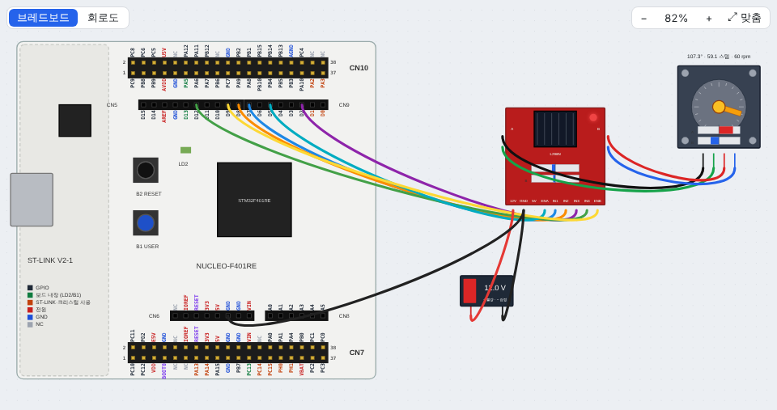

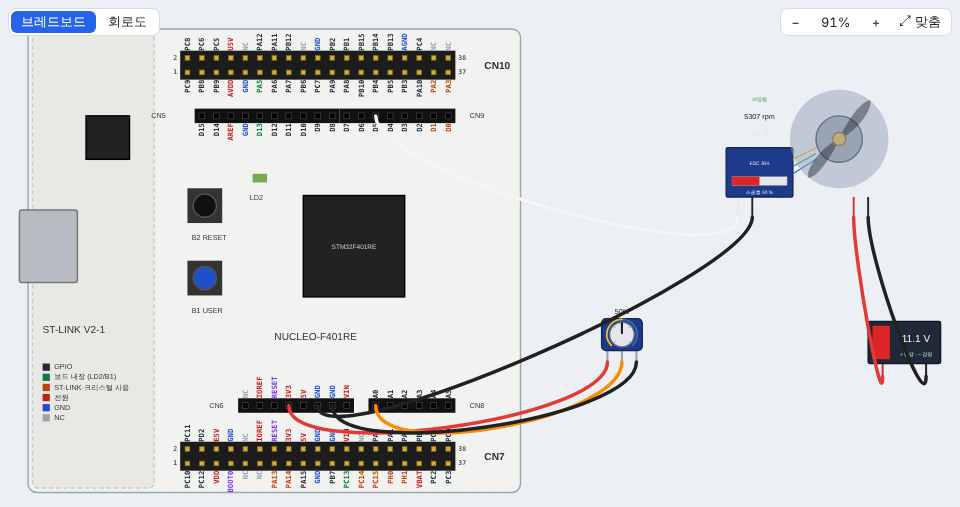

"스텝모터도 바이폴라 스텝모터도 필요해. BLDC모터도 추가되면 좋겠고."에서 시작했다. 단극 28BYJ-48(M8)과 DC 모터(M5)는 드라이버가 붙은 한 부품이었지만, 이번 모터들은 드라이버 모듈과 모터가 따로이고 **넷으로 이어진다**: 코일의 두 끝이 드라이버의 한 출력 쌍 위에 있으면 그 출력의 전류가 흐른다.

- [x] **NEMA17 바이폴라 스테퍼**(`crates/circuit/src/tier9.rs`): 회전자를 10 µs 간격으로 적분(관성, 홀딩 토크 40 N·cm, 디텐트, 마찰·감쇠, 부하 슬라이더, 축에 단 관성). 평형점은 전기각 atan2(I_B, I_A)(4스텝 = 한 주기). 초퍼 전류는 (VMOT − 역기전력)/L로, 전압 구동은 L/R로 따라가서 빠를수록 토크가 준다. 자기장에서 한 주기 넘게 벗어나면 4스텝을 잃는다(묶음으로 세어 `lost`, 경고, "탈조!"). 풀인 약 1100 풀스텝/s, 램프로 약 2000. 축을 끌어 손으로 돌리기, 멈춰 있으면 계산을 건너뛴다
- [x] **A4988 / DRV8825**: STEP 상승 에지마다 마이크로스텝(풀–1/16, DRV8825 1/32), DIR, EN·SLP·RST로 출력 끄기(모터 헐거움), RST가 떠 있으면 리셋 유지 + 경고, 최소 STEP 펄스(1 µs / 1.9 µs), VMOT 없음, VDD 5 V에 3.3 V 입력. 전류 제한(Vref) 속성. 회로도 상자
- [x] **L298N**: IN1–IN4, ENA/ENB(점퍼 또는 PWM), 전압 구동. 자기장이 180° 뒤집히는 순서는 떨림 + 경고. 코일이 두 출력 쌍에 걸치면 배선 경고
- [x] **ESC + BLDC**: 서보 펄스 폭 → 스로틀, 1 s 최저 스로틀로 아밍(삐), 스로틀이 올라간 채면 거부, 0.5 s 신호 없음 → 페일세이프, KV × 전압, 1차 지연, 프로펠러 그림
- [x] **홀 센서 BLDC + 3상 브리지**: 6스텝 별결선 전류와 역기전력, 홀 A/B/C(히스테리시스, 오픈 컬렉터 장치 출력), 다음 홀 에지 예측으로 깨우기(제때 EXTI), 관통 전류·풀업 없는 홀·정지(틀린 정류) 경고. TIM1 상보 출력(CHxN)은 periph-stm32f4에 아직 없어 GPIO 6개로(→ M23에서 해결: TIM1 상보 PWM과 데드타임, `hal-bldc-pwm`)
- [x] **DC 전원** 부품(3–24 V, 떠 있는 전압원)
- [x] **예제 4개**: `hal-stepper-a4988`, `hal-stepper-l298n`, `hal-esc-bldc`, `hal-bldc-hall`(배선된 예제 프로젝트 포함, CI 펌웨어 빌드 목록에 추가)
- [x] 테스트: Rust 단위 25개 추가(워크스페이스 201개: `tier9.rs` 14개 — 회전자 평형, 한 바퀴 정확히, 마이크로스텝, 풀인을 넘으면 탈조·램프면 정상, 부하로 정지, 손으로 돌리기, 코일 반대·틀린 순서, 펄스 폭, L298N 출력, ESC 아밍·거부·페일세이프, 홀 코드와 정류표, 6스텝 회전·홀이 바뀌면 정지, 오픈 컬렉터 / `sim.rs` 11개 — 넷을 통한 A4988–모터, 코일 반대, VMOT 없음·EN High·손으로 돌리기, 마이크로스텝·짧은 펄스·RST, 두 쌍에 걸친 코일·DRV8825 1/32, 너무 빠른 스텝, L298N 반스텝·PWM 평균·떨림, 점퍼, ESC, BLDC 정류·정지·풀업·관통 전류), 펌웨어 통합 5개(40개, `a4988_ramps…`, `a4988_with_a_brake…`, `l298n_half_steps…`, `esc_arms…`, `bldc_is_commutated…`), E2E 5개(`web/e2e/m21.spec.ts`, 전체 84개: A4988 왕복·B1·축 손으로 돌리기·회로도 / 브레이크로 탈조 경고 / L298N 반스텝 / ESC 아밍·가변저항·페일세이프 / BLDC 회전·홀 바꾸면 정지). 탈조 세기, 코일 부호, 아밍 시간, 페일세이프, 손으로 돌리기, 마이크로스텝 표, 상 모양, L298N 방향, 펄스 폭 검사를 하나씩 깨면 해당 단위·펌웨어 테스트가 실패하고, 탈조·손으로 돌리기·페일세이프 / L298N 방향·상 모양을 깨면 해당 E2E가 실패하는 것을 확인했다
- 한계: ~~코일 전류는 넷 전압이 아니라 드라이버와 모터 사이의 연결로 전달된다(전류가 회로 해석에 들어가지 않아 OUT 핀을 프로브해도 전압이 보이지 않음, 직렬 저항이나 다른 부품을 끼우면 연결이 끊긴 것으로 봄)~~(M28에서 해결: 권선이 넷 해석의 소자, A4988 뒤 직렬 저항은 아직 — M28 한계 참고). L298N의 EN Low는 느린 감쇠로 계산한다(실제로는 빠른 감쇠라 PWM 평균 전류가 듀티보다 낮다). 스테퍼의 공진·미드밴드 불안정은 감쇠로 눌러 두었고, 마이크로스텝 표는 이상적인 사인이다. DRV8825도 VDD 핀을 그대로 두고 로직 전원 검사만 건너뛴다. ESC는 BEC·스로틀 캘리브레이션·소리·역회전이 없다. 홀 BLDC는 PWM 속도 조절과 TIM1 상보 출력·데드타임이 없고(풀 전압 6스텝; M23에서 해결), 상 인덕턴스를 무시한다
- 남은 항목: ~~TIM1 상보 출력과 PWM 속도 조절 BLDC~~(M23), ~~센서리스 BLDC~~(M28), 엔코더 DC 모터 PID, ~~코일 전류를 넷 해석에 넣어 OUT 핀 전압 보기~~(M28)

### M20 완료 (오실로스코프 트리거)

"짧은 파형을 보기 힘들다"는 요청에서 시작했다. 지금까지의 파형 뷰는 최근 N ms를 흘려 보여 주는 로직 프로브라, 프레임(약 16 ms)마다 핀당 4000개까지만 에지를 보내고(넘으면 `dense`, "너무 빠름"으로 나머지를 버림) 화면 1000칸에 2–2000 ms를 그려서 µs 펄스는 한 칸도 안 되거나 지나가 버렸다.

- [x] **에지 기록은 원래 정확했다**: 버스가 프로브한 핀의 레벨 변화를 CPU 사이클 시각으로 남기고(`level_events`, IDR이 보는 레벨이라 **입력 포함** — 버튼, 센서 출력, DHT·IR 응답처럼 회로가 미는 핀도), `Nucleo::ns_at`이 클럭 변경을 반영해 ns로 바꾼다. 84 MHz에서 11.9 ns 해상도. 잃는 곳은 프레임 상한과 화면 쪽이었다
- [x] **트리거·캡처 엔진(Rust, `crates/wasm/src/scope.rs`)**: 프로브한 핀마다 링 버퍼(에지 65,536개)를 두고, 트리거는 **소스 핀의 에지에서만** 검사한다(프로브하지 않은 핀은 비용 0). 트리거가 걸리면 앞부분(프리 트리거)은 링에서 복사하고 뒷부분은 에지가 올 때마다 캡처에 쌓아, 시뮬레이션이 창의 끝을 지나면 완성된 캡처 하나를 프레임 JSON(`scope.capture`)으로 보낸다. 시각은 트리거 기준 ns. 실행 루프가 `runForMs` 조각마다 버스의 에지를 곧바로 엔진과 프레임 목록에 옮기므로(`feed_scope`) 프레임 단위 상한과 무관하다. 기존 프레임별 `probes`(라이브 보기, 채점)는 그대로
- [x] **트리거 조건**: 소스 핀, 상승·하강·양쪽 에지. **펄스 폭 조건**: 상승이면 High 펄스, 하강이면 Low 펄스가 X µs보다 좁거나(<) 넓을 때 — 펄스가 끝나는 에지에서 판단하고 t = 0은 펄스의 시작 에지. 펄스가 창보다 길어 판단 시점에 이미 창이 끝났어도 링에서 바로 캡처를 완성한다
- [x] **모드**: **자동(Auto)** 트리거가 오면 캡처를 보이고, 트리거가 끊기면(창 두 배 또는 100 ms) 예전처럼 흘러가는 실시간 보기. **일반(Normal)** 마지막 캡처를 붙잡아 두고 새 트리거에만 바뀐다(창이 끝난 뒤 다시 대기). **단일(Single)** 한 번 잡고 멈춤, **다시 대기 (Arm)** 버튼. 설정을 바꾸면 이전 캡처를 지우고 새 설정의 캡처를 기다린다(오는 중이던 이전 설정의 캡처는 창이 맞지 않아 버린다)
- [x] **트리거 시 일시정지**: 체크하면 캡처가 완성되는 순간 실행이 멈춘다(`triggerPaused`, 워커가 `paused`/`trigger`로 알림 — 소스 탭에 "멈춤: 오실로스코프 트리거"). 그동안 `runForMs`는 짧은 조각(대기 중엔 창 길이를 20 µs–1 ms로, 수집 중엔 창의 끝까지)으로 돌아 창 끝 바로 뒤에서 멈춘다. 수업에서 "이 펄스가 나온 순간"의 레지스터·변수·소스를 볼 수 있다
- [x] **시간축**: 1 µs/div–200 ms/div(1-2-5 단계), 10칸. 격자, 칸마다 단위가 붙은 시각(t = 0이 트리거), 위쪽 주황 **T** 표시를 끌어 트리거 위치(10–90%, 슬라이더도). 캡처 위에서 **휠로 확대**(포인터 아래 시각 고정)·**끌어서 이동**, **전체 보기**로 복귀. 그림은 실제 픽셀 폭으로 그려 글자가 찌그러지지 않고, 반 픽셀 안에 몰린 에지는 세로 막대 하나로 합쳐 6만 개 에지도 가볍다
- [x] **측정**: 트리거 채널의 주파수, 주기(상승 에지 사이 평균), 듀티, H·L 펄스 폭(최소·최대·마지막·개수, 양쪽 에지가 모두 창 안에 있는 펄스만). 줄마다 보이는 구간의 주파수·듀티(예전과 같은 형식). **커서** 두 개(A, B)를 끌어 Δt와 1/Δt
- [x] **경계 상황**: 에지가 없으면 "트리거 대기 중…"(일반·단일은 그림 가운데에도), 자동은 그동안 실시간 보기. 소스 핀을 프로브에서 빼면 "트리거 소스 핀이 프로브되지 않았습니다". 링이 넘쳐 창 앞부분이 없거나 캡처가 핀당 65,536개를 넘으면 그 구간을 빗금으로 칠하고 "버퍼를 넘었습니다 — 시간/눈금을 줄이세요". 리셋·새 펌웨어면 링과 캡처를 비우고 다시 대기(설정과 프로브는 유지). 일시정지 중엔 창이 끝나지 않으므로 "트리거됨 — 수집 중…". 파형 탭은 한 번 열면 다른 탭으로 가도 남아 트리거와 캡처를 지킨다(보이지 않을 땐 그리지 않음)
- [x] 테스트: Rust 단위 16개(`scope.rs`: 상승·하강·양쪽 에지, 프리 트리거 에지와 창 경계, 다른 채널도 캡처, 단일은 한 번 뒤 정지·Arm으로 재개, 일반은 매번 다시 대기·창이 끝난 뒤에만, 20 ms 주기의 2 µs 펄스(84 MHz 사이클 시각)가 사이클 해상도로 정확히, 좁은 펄스 폭 트리거, 창보다 긴 펄스, 링 넘침(잃은 구간과 그 앞 레벨), 캡처 넘침, 프로브되지 않은 소스, 일시정지 요청, 리셋), 펌웨어 통합 3개(`crates/wasm/tests/scope_firmware.rs`, 워커와 같은 진입점: 서보 펄스 폭이 펌웨어가 찍은 µs와 한 사이클 안, NeoPixel 비트가 T0H·T1H(34·67틱) 그대로·단일 뒤 정지, 트리거 시 일시정지가 창 끝 50 µs 안에서 멈춤), 웹 단위 8개(`web/test/scope.test.ts`: 시간축 단계, 단위, 펄스 측정, 그리기와 에지 합치기, 확대·이동), E2E 73개(새 4개, `web/e2e/scope.spec.ts`: 가변저항 가운데의 서보 펄스를 500 µs/div 단일로 잡아 콘솔의 `servo NNNN us`와 비교·단일이 실행 중에도 그대로·Arm으로 새 캡처·휠 확대·커서 Δt / 트리거 시 일시정지와 다시 실행하면 다음 캡처에서 또 멈춤 / NeoPixel 프레임 끝(40 µs보다 넓은 Low 펄스 트리거, 90% 위치)의 7비트가 1 µs/div에서 1.25 µs 주기·0.40/0.80 µs 폭으로, 0.6 µs보다 넓은 펄스 트리거 / 트리거 대기·자동 실시간·일반 캡처·소스가 프로브되지 않음). 새 테스트는 엔진(에지 판정, 프리 트리거 복사, 단일·일반 재대기, 캡처 시각 양자화, 링·캡처 넘침 표시), 워커(일시정지 무시), UI(단일을 일반으로 보냄), 에지 시각을 1 µs로 반올림하는 변경을 하나씩 넣으면 실패하는 것을 확인했다
- 한계: 트리거는 디지털 레벨(IDR이 보는 0/1)뿐이라 아날로그 전압·레벨 트리거는 없다. UART는 여전히 바이트 단위 모델이라 TX 핀에 프레임 비트가 보이지 않는다. 트리거 시 일시정지는 창 끝을 지난 첫 명령 경계에서 멈추며(대기 중 조각 길이만큼 늦게 알아챌 수 있음), 일반 모드에서 한 프레임에 여러 캡처가 끝나면 마지막 것만 보인다. 캡처 하나는 핀당 65,536 에지까지라 MHz SPI를 200 ms/div로 잡으면 뒷부분이 잘린다(표시됨). 커서는 측정만 하고 트리거 레벨·시간 오프셋 같은 다른 노브는 없다
- 남은 항목: 아날로그 채널(넷 전압) 표시와 레벨 트리거, 버스 해독(I2C·SPI·UART 프로토콜 표시), 캡처 내보내기(CSV·VCD)

### M19 완료 (부품 추가)

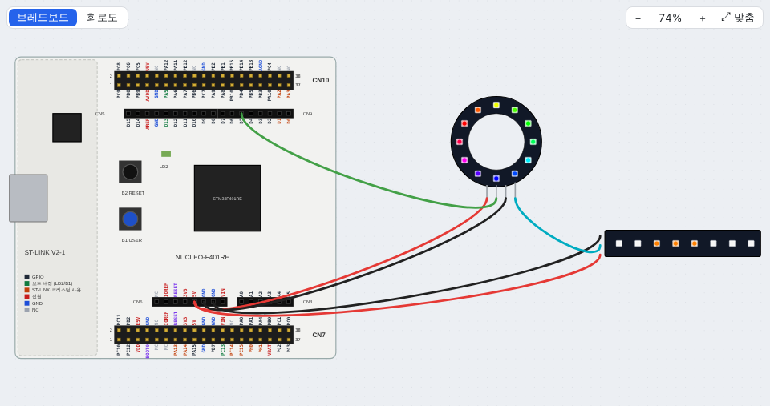

- [x] **74HC595**: SHCP 상승 에지에 시프트, STCP 상승 에지에 래치(둘이 함께 오르면 한 클럭 늦은 저장 레지스터), OE High면 Q0–Q7 하이 임피던스, MR Low면 지움. Q0–Q7과 Q7'은 장치 출력이라 저항을 거쳐 LED를 회로 해석으로 켠다. 하드웨어 SPI는 칩 선택 없이 SCK·MOSI 넷이 SHCP·DS인 칩에 바이트로 들어가고, Q7'에 DS가 있는 다음 칩으로 밀려난 바이트가 간다(MAX7219 DOUT과 같은 방식). 비트뱅잉 체인은 넷 에지로 동작(모든 칩이 에지 전의 DS를 샘플). OE·MR이 떠 있으면 경고
- [x] **장치 출력 즉시 반영**: 장치가 방금 본 것으로 출력을 바꾸면(래치, ACK, 전원 켜짐) 그 자리에서 다시 해를 구한다. 그래서 래치 뒤 MCU가 아무 핀도 바꾸지 않아도 LED가 바로 켜지고, TM1637의 ACK를 MCU가 바로 읽는다
- [x] **TM1637**: 시작·끝 조건, LSB 먼저, 8번째 하강 에지부터 9번째 하강 에지까지 DIO Low(ACK), 데이터·주소·표시 명령, 콜론, 밝기. 경고: MSB 먼저(뒤집은 값을 알려 줌), 알 수 없는 명령, 주소 없는 데이터, 바이트 중간의 시작·끝, 너무 빠른 클럭(반주기 1 µs 미만)
- [x] **조이스틱(KY-023)**: 가변저항 둘과 SW 스위치. 손잡이를 정사각형 안에서 끌고, 놓으면 가운데로, 움직이지 않고 누르거나 클릭하면 SW
- [x] **PIR(HC-SR501)**: 워밍업, H(재트리거)/L(단발) 유지 시간, 2.5 s 차단 시간, 4.5 V 미만이면 경고·동작 안 함. 사람 그림을 시야 안에서 움직이는 동안만 움직임, '움직임' 버튼
- [x] **BMP280**: I2C 0x76/0x77, 칩 ID·리셋·ctrl_meas·config·status, 데이터시트 예제 보정값, 강제·연속 모드와 변환 시간, 보정식(정수판)을 이분 탐색으로 거꾸로 풀어 만든 원시값(해상도는 오버샘플링대로, 건너뛰면 0x80000), 측정 전 읽기 경고, 손가락 데우기
- [x] **NeoPixel 체인**: 링·스트립·매트릭스에 DOUT 핀. 자기 LED 수를 넘은 비트를 DOUT 넷의 다음 부품으로
- [x] **예제 6개**: `hal-shift-register`, `hal-tm1637-clock`, `hal-joystick-oled`, `hal-pir-alarm`, `hal-bmp280`, `hal-neopixel-chain`(배선된 예제 프로젝트 포함)
- [x] 회로도: 새 부품의 상자(전원은 왼쪽, 신호는 오른쪽, 부제), 595의 Q7', NeoPixel의 DIN/DOUT. M18 회로도 배선 테스트도 그대로 통과
- [x] 테스트: Rust 단위 157개(새 19개 — tier8 11개: 595 시프트·래치·MR·묶인 클럭·SPI 바이트와 체인, TM1637 명령·ACK·고정 주소·MSB 경고·빠른 클럭·잘린 바이트, PIR H/L·워밍업·차단, BMP280 데이터시트 예제·강제/연속 모드·건너뜀·리셋; sim 8개: 비트뱅잉 595 체인이 LED를 켬, SPI 체인과 OE, OE 떠 있음 경고, TM1637 ACK와 표시, PIR 출력과 3V3 경고, 조이스틱 분압과 SW, BMP280 주소와 경고, NeoPixel 체인), 펌웨어 통합 테스트 35개(새 6개), `npm test` 22개, E2E 75개(새 6개, `web/e2e/m19.spec.ts`). 해당 코드를 하나씩 망가뜨리면(래치 끔, SPI 경로 끔, 즉시 재해석 끔, TM1637 MSB 먼저·ACK 없음, 조이스틱 저항 뒤바꿈, PIR 워밍업·차단 없음, BMP280 보정값·건너뜀, NeoPixel 전달 끔, 조이스틱 복귀·PIR 시야 판정) 해당 테스트가 실패하는 것을 확인했다. 기존 E2E 하나는 부품 이름 "시프트 레지스터"와 겹치지 않게 '레지스터' 탭 버튼을 정확히 찾도록 고쳤다
- 한계: 595 출력 High는 VCC와 상관없이 3.3 V로 계산한다. TM1637 키 스캔(0x42 읽기)은 미구현. BMP280의 IIR 필터·대기 시간·SPI 모드는 미구현(연속 모드는 읽을 때의 값). PIR은 거리·감도(Sx)를 모델링하지 않고 움직임이 있다/없다만 본다. 조이스틱 예제는 ADC를 채널마다 폴링한다(스캔+DMA 아님)
- 남은 항목: TM1637 키 입력, BME280(습도), 74HC165 입력 시프트 레지스터

### M18 완료 (회로도에서 배선)

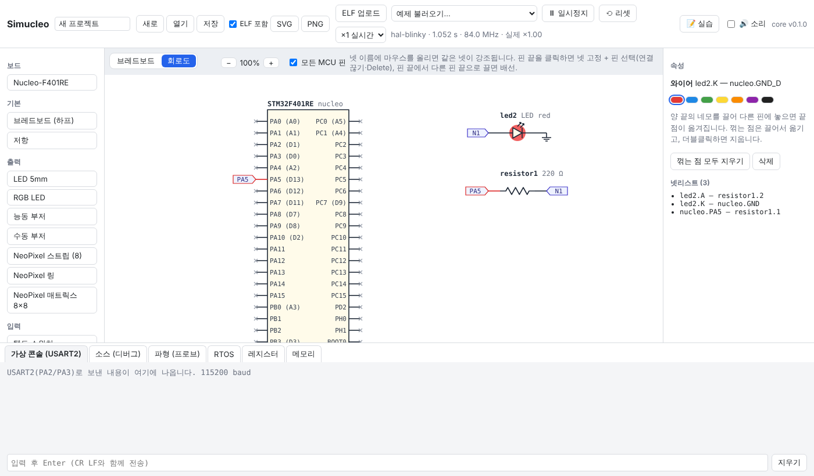

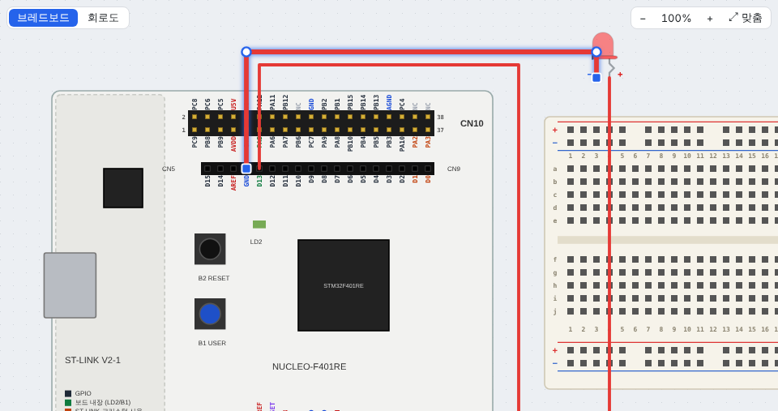

- [x] **끌어서 배선**: 회로도 기호의 핀 끝(스텁 끝, 넷 깃발, 접지·전원 기호, 연결 안 됨 ×)에서 다른 핀 끝으로 끌면 고무줄 선이 따라오고 놓을 핀 끝이 초록으로 표시된다. 놓으면 두 부품 핀 사이에 진짜 `WireModel`이 생겨 브레드보드에도 바로 나타나고, 회로도는 프로젝트에서 다시 만들어진다(원본은 프로젝트 하나). Esc나 빈 곳에 놓으면 취소. 포인터 캡처를 쓴 포인터 이벤트라 마우스와 터치 모두 되고, 끄는 동안 넷 강조·고정이나 스위치 누르기가 일어나지 않는다. 회로도 위쪽 막대는 높이가 고정되어 끄는 동안 그림이 움직이지 않는다
- [x] **어느 핀에, 어떤 길로**: 회로도 단자는 버스로 묶인 여러 핀(보드의 GND 핀 전부, 스위치 1a/1b)일 수 있어 `choosePin`이 와이어가 아직 없는 핀, Arduino 헤더(D13, GND_P1…)를 Morpho(CN7/CN10)보다 먼저, 그다음 상대 끝에 가까운 핀을 고른다. `routePoints`가 직각으로 꺾는 점을 넣는다: 부품끼리는 L자 하나, 보드 핀에서는 보드 밖(위 헤더는 위로, 아래 헤더는 아래로)으로 곧게 나간 뒤 꺾고, 보드 와이어마다 한 칸씩 다른 줄(4줄 순환)을 써서 겹치지 않는다
- [x] **같은 넷이면 와이어 없음**: 두 핀이 이미 같은 넷(와이어, 브레드보드 줄, 같은 점)이면 와이어를 더하지 않고 "이미 같은 넷(N1)에 연결되어 있어…" 알림
- [x] **모든 MCU 핀**: 회로도 막대의 체크박스. 켜면 MCU 상자가 쓰지 않는 신호와 전원 핀(3V3, 5V, GND, VIN, E5V, IOREF, VBAT, RESET, BOOT0)까지 양쪽에 보여 준다 — 왼쪽은 포트 A·B, 오른쪽은 C·D·H와 전원. 순서가 고정이라 배선해도 핀 자리가 그대로다. 기본은 꺼짐(쓰는 신호만)
- [x] **연결 끊기**: 핀 끝을 클릭하면 그 넷이 고정 강조되고 핀이 선택된다(막대에 "선택: led1.K (GND) [연결 끊기]"). **연결 끊기** 버튼이나 Delete/Backspace로 그 핀(버스면 묶인 핀 전부)에 직접 붙은 와이어를 지운다. 부품이 아니라 핀이 지워지고, 같은 핀 끝을 다시 클릭하거나 빈 곳을 클릭하거나 Esc면 선택이 풀린다. 와이어를 지워도(또는 지울 와이어가 없어도) 브레드보드 줄이나 같은 점으로 아직 이어져 있으면 "아직 브레드보드(같은 줄이나 같은 구멍)를 통해 GND에 연결되어 있습니다. 브레드보드 보기에서 부품을 옮겨…" 알림. 알림은 회로도 보기에서 막대 아래에 떠서 버튼을 가리지 않는다
- [x] **상호작용 규칙**: 넷 이름에 마우스 올리기 = 강조, 핀 끝 클릭 = 넷 고정 + 핀 선택, 핀 끝에서 끌기 = 배선, 기호 몸체 클릭 = 부품 선택(브레드보드와 공유), 스위치 레버 = 누르기. 부품을 고르면 핀 선택이 풀려 Delete가 무엇을 지울지 헷갈리지 않는다. 막대의 안내 문구와 속성 창 안내에 적어 두었다
- [x] **배치 안정**: `buildSchematic`이 이전 그림의 부품 순서를 받아(`stableOrder`) 이미 있던 부품은 그 순서를 지키고 새 부품만 MCU 핀 순위에 맞는 자리에 끼운다. 다른 프로젝트를 열거나 새로 만들면 잊는다
- [x] **양방향 동기**: 회로도에서 만든 와이어는 브레드보드에서 옮기고 꺾고 지울 수 있고, 브레드보드에서 바꾼 배선은 회로도에 바로 반영된다. 배선이 바뀔 때마다 실행 중인 시뮬레이터에 회로를 다시 보내므로 펌웨어를 멈추지 않고 배선한다
- [x] 테스트: 단위 7개(`npm test`, `web/test/schematic.test.ts`: 쓰는 신호만/모든 핀의 양쪽 나누기, 버스로 묶인 보드 핀과 스위치 다리 고르기, L자와 보드 밖으로 나가는 경로가 모두 직각, 줄 바꾸기, `stableOrder`), E2E 69개(새 4개, `web/e2e/m18.spec.ts`: 빈 프로젝트에 저항·LED를 넣고 회로도에서만 배선 → 브레드보드 와이어 3개가 직각·Arduino 핀 → hal-blinky로 LED 깜빡임 → 같은 넷 알림, 빈 곳·Esc 취소, 끌기가 넷을 고정하지 않음 → 모든 MCU 핀으로 PA5·GND에 배선 → Delete로 음극 연결 끊기, 두 보기에서 사라지고 LED 꺼짐 / 브레드보드로 이어진 핀의 알림과 스위치 1a/1b 버스 끊기, 부품 선택 동기 / 와이어를 더해도 기호 위치 그대로 / 터치 포인터로 끌기와 탭). 새 테스트는 해당 코드(배선, 경로, 같은 넷 검사, 모든 핀, 핀 고르기, 연결 끊기, 브레드보드 알림, 배치 안정, 끌기 중 넷 고정)를 하나씩 망가뜨리면 실패하는 것을 확인했다
- 한계: 회로도는 여전히 넷 이름표로 연결을 보여 주며 선으로 잇지 않는다. 배치 엔진은 그대로라 "모든 MCU 핀"을 끈 상태에서 새 MCU 신호를 쓰면 그 아래 MCU 핀 줄이 두 칸씩 내려가고(부품 위치는 그대로), MCU 상자가 길어져 열이 넘치면 부품 열이 나뉠 수 있다. 부품을 지우고 다시 넣으면 새 부품으로 취급한다. 브레드보드 경로는 다른 부품을 피해 가지 않는다(직각일 뿐). 보드 GND처럼 묶인 단자를 끊으면 그 신호의 모든 핀에 붙은 와이어가 지워진다
- 남은 항목: 넷 이름 붙이기, 같은 넷을 선으로 잇는 배치, 회로도에서 부품 옮기기

### M17 완료 (부품 추가)

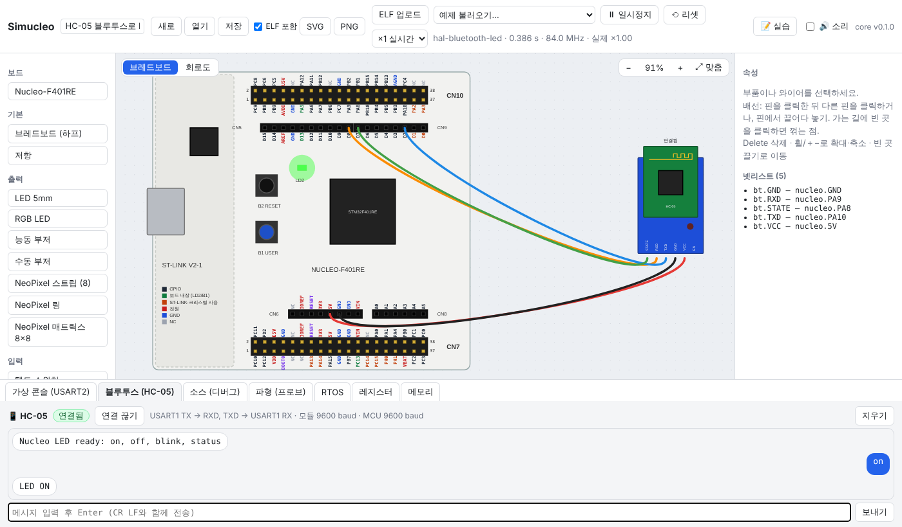

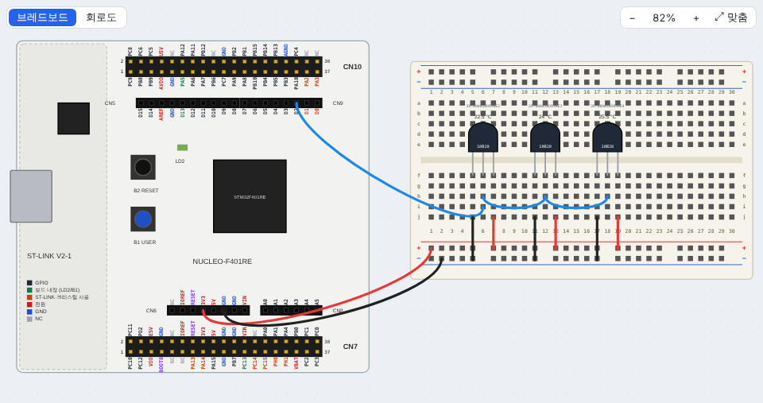

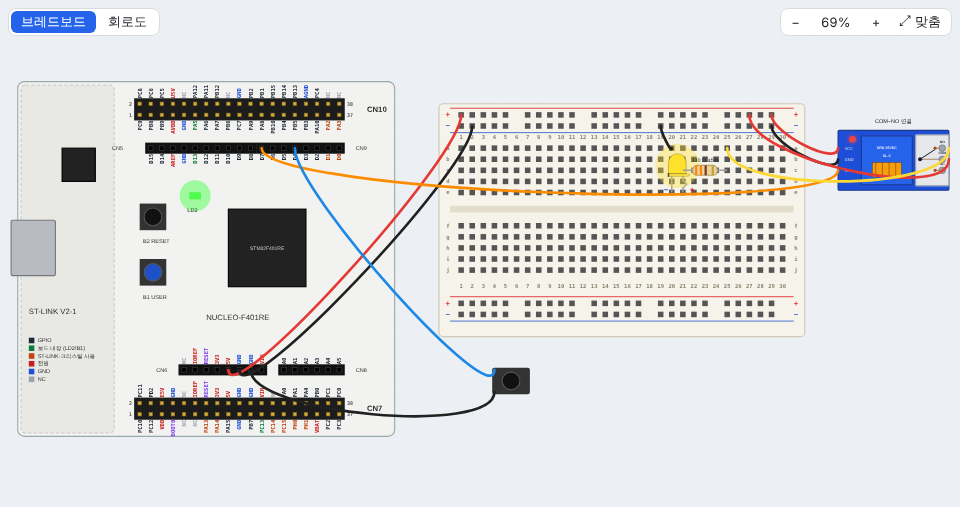

- [x] **DS18B20 멀티드롭**: 부품마다 고유 ROM 코드(0x28 + 부품 id나 `serial` 속성에서 정한 48비트 + Dallas/Maxim CRC8), 부품 위에 표시. 여러 센서가 한 데이터 넷에 있으면 각자 장치 출력으로 선을 Low로 끌고 회로 해석이 wired-AND를 낸다(누구든 Low면 Low). 지금까지는 읽기 슬롯의 상승 에지(다른 센서가 놓는 순간)를 쓰기 슬롯으로 잘못 읽을 수 있어서, 슬롯마다 읽기 슬롯인지 기억해 그 상승 에지는 비트로 치지 않는다. **SEARCH ROM**(비트 → 보수 → 호스트가 쓴 방향, 방향과 다른 센서는 다음 리셋까지 빠짐, 64비트 뒤 선택됨), **ALARM SEARCH**(마지막 측정이 TH 이상 또는 TL 이하인 센서만), MATCH ROM, SKIP ROM(모두 CONVERT T), READ ROM(뒤에 기능 명령 가능, 여럿이면 겹침)
- [x] **`hal-onewire-multi`**: 세 센서를 D2 한 선에(모듈마다 4.7 kΩ 풀업). 시작할 때 SEARCH ROM으로 모두 찾아 ROM을 찍고, 1초마다 SKIP ROM + CONVERT T 뒤 센서마다 MATCH ROM + READ SCRATCHPAD로 `#2 28-… 24.00 C`. 센서 하나를 손가락으로 누르면 그 줄만 오른다
- [x] **USART1·USART6**: 주변장치는 이미 USART2와 같은 모델(APB2 클럭, IRQ 37·71)이었다. 핀 라우팅 표(`USART_PINS`: USART1 PA9/PA10·PB6/PB7 AF7, USART6 PA11/PA12·PC6/PC7 AF8)와 `usart_pins()`를 더했다
- [x] **HC-05**: UART는 가상 콘솔처럼 바이트 단위로 모델링한다(회로 해석이 UART 프레임의 비트 에지를 보지 않으므로). 대신 배선이 중요하다: 보드가 프레임마다 모듈의 RXD 넷에 있는 MCU 핀 중 **AF로 TX에 라우팅된 핀**의 USART 바이트를 모듈로, 모듈의 출력(휴대폰 글, AT 응답)을 TXD 넷의 **RX로 라우팅된 핀**의 USART로 보낸다. 그 USART의 상대 보레이트를 모듈 보레이트로 두므로 펌웨어가 115200인데 모듈이 9600이면 기존 USART 모델이 바이트를 다시 샘플링해 깨진다(깨진 바이트 표시). TX끼리 이으면 경고. STATE는 휴대폰이 연결되면 High(장치 출력), TXD는 평소 High, EN은 풀다운 — 전원을 넣을 때 EN이 High면 38400 baud AT 모드
- [x] **블루투스 탭**: HC-05 부품마다 아래 패널에 **블루투스 (HC-05)** 탭(여럿이면 부품 이름 포함). 연결/연결 끊기, 상태, 어느 USART에 연결됐는지와 양쪽 보레이트, 말풍선(MCU가 보낸 줄, 휴대폰이 보낸 글), 보레이트 불일치·TX↔TX 경고. 연결 안 됐을 때 보내면 이유를 알려 준다
- [x] **`hal-bluetooth-led`**: USART1 9600 baud 수신 인터럽트로 줄을 모아 `on`·`off`·`blink`(2 Hz)·`status` 명령으로 LD2를 다루고 휴대폰에 답한다. STATE(D7)가 오르면 인사, 명령은 가상 콘솔에도 기록
- [x] **릴레이 모듈**: 회로 해석에 접점 원소(`Contact`)를 더했다 — 닫히면 0.1 Ω, 열리면 없음. 접점 상태는 장치 출력처럼 구동 키 뒤에 붙어 해가 캐시되고, 코일은 해에서 IN과 VCC 전압으로 정한다(active low 모듈은 IN을 10 kΩ로 VCC에, high 모듈은 GND에). 코일이 바뀌면 10 ms(놓을 때 5 ms) 뒤 접점이 움직이고 0.3 ms 간격으로 두 번 튄 뒤 자리 잡는다. VCC가 3.75 V보다 낮으면 붙지 않고 경고. 그림은 모듈 LED와 움직이는 접점, 회로도는 코일과 전환 접점(점선 연결)을 상자 안에 그린다. 소리를 켜면 접점이 움직일 때 딸깍
- [x] **`hal-relay`**: D4 버튼(EXTI)이나 B1이 D7의 active-low 릴레이를 토글, 5V → COM, NO → 330 Ω → LED. LD2가 따라 하고 콘솔에 기록
- [x] **여러 서보**: 서보마다 자기 SIG 펄스를 재는 구조라 고칠 것이 없었다. **`hal-servos-multi`**: TIM3 CH1(D5)·CH2(D9)와 TIM1 CH1(D7, MOE) 50 Hz로 세 서보가 4초 삼각파를 1/3 주기씩 어긋나게 움직인다
- [x] 테스트: Rust 단위(세 센서 SEARCH ROM이 ROM 셋을 모두 찾음·한 센서만 있으면 한 번에, MATCH ROM이 하나만 고르고 없는 코드엔 아무도 답하지 않음, READ ROM 겹침, ALARM SEARCH, ROM 코드와 CRC(응용 노트 27의 예), 릴레이 접점이 따로 전원을 받는 LED를 켜고 지연·튐·low/high 트리거, 3V3 릴레이 경고, HC-05 STATE·TXD·UART 핀 찾기와 AT 모드, USART1/6 라우팅과 APB2 보레이트, 보드 브리지가 같은 보레이트에서 양방향으로 전달하고 다르면 깨짐), 펌웨어 통합 테스트 29개(새 5개: 세 DS18B20, 휴대폰 명령으로 LD2와 답장, 보레이트 불일치, 릴레이 버튼, 서보 셋이 각자 CCR을 따름), E2E 64개(새 4개: ROM 셋과 한 센서만 데워짐, 블루투스 대화로 LD2 켜고 끄기와 보레이트 경고, 릴레이로 LED와 회로도 접점, 서보 셋이 서로 다른 각도로 움직임). 새 테스트는 해당 코드를 망가뜨리면 실패하는 것을 확인했다
- 남은 항목: UART 핀 수준 파형(프로브로 프레임이 보이지 않음), HC-05끼리 연결(마스터 모드), 여러 채널 릴레이, 블루투스 실습(레슨)

### M16 완료 (수업용 실습)

- [x] **레슨 형식**: `web/lessons/<id>.json` 하나가 실습 하나(빌드할 때 `import.meta.glob`으로 묶임). id·순서·제목·수준·목표, 시작 회로(`"empty"`, 예제 프로젝트, 직접 적은 회로), 예제 ELF 또는 `"upload"`, 채점 시간과 채점 중 조작(버튼 누르기, 속성 바꾸기), 단계(간단한 Markdown 설명 + 검사 목록). 형식 검사(`validate.ts`)가 오류를 목록에 보여 준다. 선생님용 설명은 [lessons.md](lessons.md)
- [x] **배선 검사**(`web/src/lessons/wiring.ts`, 배선할 때마다 바로): `part`, `connected`(부품 핀 → MCU 신호·GND·3V3·5V, Nucleo 핀은 `nucleoSignal`로 신호가 같으면 Arduino·Morpho 어느 핀이든), `series`(넷을 노드, 저항·LED·버튼·가변저항·RGB LED 한 색을 변으로 한 그래프에서 `from`부터 `to`까지 정확히 그 부품들로 된 단순 경로를 찾음, LED 방향 확인), `noWarnings`. 부품은 id가 아니라 종류로 찾는다. 실패하면 원인을 진단해 한국어로 안내: 빠진 부품("PA5가 GND로 가는 길에 저항이 없습니다."), 뒤집힌 LED, 다른 핀에 꽂힌 같은 사슬("…PA6 (D12)에 연결되어 있습니다. PA5 (D13)에 연결하세요."), 단락, 다른 신호에 연결된 핀. 조사(이/가, 으로/로, 와/과)는 `PA5가`·`3V3으로`처럼 영문·숫자를 읽는 소리에 맞춘다
- [x] **동작 검사**(`behaviour.ts`, **채점** 버튼): 펌웨어를 리셋(에포크를 붙여 이전 프레임과 구분)하고 시뮬레이션 시간으로 정해진 만큼 실행하며 모든 프레임을 기록한다(`runner.onFrame`, React가 건너뛰는 프레임 없이). `period`(채점 동안 그 핀을 프로브해 에지 시각으로 평균 주기, 처음 주기는 뺌), `brightness`, `duty`, `console`, `consoleValues`(콘솔에서 잡은 숫자의 변화 폭), `motion`(서보 각도·모터 rpm), `display`(OLED 켜진 픽셀, LCD 글자), `running`. 실패 안내 예: "깜빡임 주기가 1002 ms입니다. 목표는 500 ms (±5%)입니다." 진행 막대와 중지 버튼, 펌웨어가 멈추면 그때까지로 채점
- [x] **프로브 공유**: `setProbes(pins, owner)` — 파형 탭과 채점이 각자 고른 핀의 합집합을 프로브해 서로 지우지 않는다
- [x] **실습 패널**: 툴바 **📝 실습**으로 여는 오른쪽 열. 실습 목록(완료 ✅, 이어서 하기 / 처음부터), 단계와 체크리스트(✅ ❌ ⬜, 측정값, 안내), 지금 단계 강조, 끝난 단계 설명 접기, 채점 뒤 첫 실패 검사로 스크롤, 완료 표시. 저장하지 않은 작업 위에 실습을 시작하면 묻고, 그때 프로젝트를 IndexedDB에 백업해 **실습 전 프로젝트 되돌리기**로 다시 연다
- [x] **진행 상황과 제출**: 실습별 검사 결과·결과가 바뀐 시각·채점 횟수·시작·완료 시각을 IndexedDB(`idbGet`/`idbSet`)에 저장하고, 열려 있던 실습은 새로고침 뒤에도 다시 열린다. 이름 칸과 **결과 내보내기** — CSV(엑셀용 BOM, 검사 하나가 한 줄)와 JSON
- [x] **실습 6개**: LED 깜빡이 배선(`hal-blinky`, 주기 1000 ms ± 5 %), 버튼 인터럽트(`hal-button-exti`, 채점이 버튼을 두 번 누름), PWM RGB LED(`hal-pwm-led`, 듀티비와 색별 밝기), 가변저항 → 서보(`hal-adc-servo`, 채점이 노브를 돌림), I2C OLED 시계(`hal-i2c-oled`), 내 펌웨어 올리기 2 Hz(직접 빌드, 주기 500 ms ± 5 %, C 코드 힌트). 모범 답안 `firmware/lesson-blink-2hz`는 CI에서 빌드하고 테스트에만 쓴다
- [x] 테스트: Node 내장 테스트 러너로 단위 테스트 15개(`npm test`, 추가 의존성 없음 — 직렬 경로와 각 안내, 버튼 경로, 조사, 주기·밝기·콘솔·듀티비·디스플레이 판정, 모든 레슨 파일의 형식·예제·부품 종류, CSV), 펌웨어 통합 테스트 24개(답안 펌웨어가 251 ms마다 토글), E2E 58개(새 8개: 실습 1을 캔버스에서 배선하면 검사가 초록으로 바뀌고 채점·완료·CSV/JSON 내보내기·새로고침 뒤 복원, 저항 빠짐과 잘못된 핀의 안내, 직접 올리기 실습이 hal-blinky는 주기 안내로 떨어지고 답안 ELF는 통과, 실습 2–5가 예제 배선으로 모두 통과, 작업 위에 시작할 때 확인과 백업 되돌리기). 새 테스트는 해당 코드를 하나씩 망가뜨리면 실패하는 것을 확인했다
- 남은 항목: 채점 중 실행 속도 자동 조절(지금은 툴바 속도를 따름). 선생님용 결과 화면, 회로도 검사 강조, 레슨 편집기는 M24에서 했다

### M15 완료 (마무리)

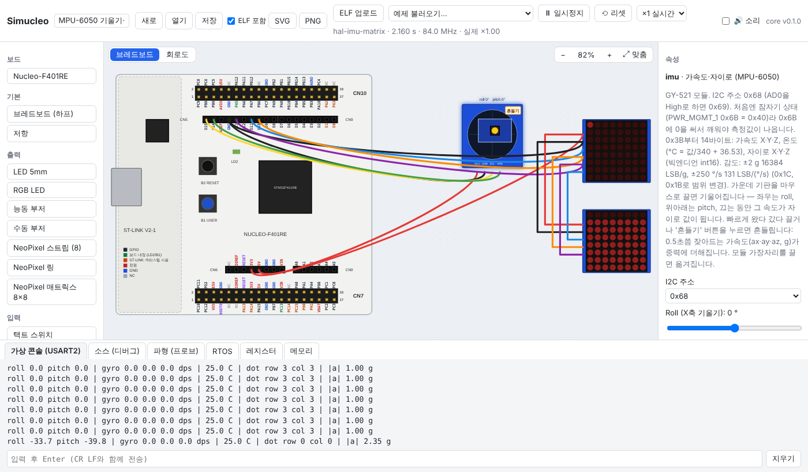

- [x] **MAX7219 DOUT → DIN 체인**: DOUT은 이제 실제 출력이다. 모듈(`count`개 칩)의 시프트 레지스터 MSB, 즉 16×`count` 클럭 전에 들어간 비트를 내보내고 CLK 하강 에지에서 바뀐다(데이터시트대로). 회로 시뮬레이터에서는 장치 출력(push-pull)이라 프로브로도 보인다
  - **비트뱅잉**: 다음 부품의 DIN은 그냥 넷으로 DOUT 레벨을 읽는다. 상승 에지의 해(解)는 직전 하강 에지에 정해진 DOUT으로 풀리므로, 다음 칩은 앞 칩에서 밀려나는 바로 그 비트를 받는다
  - **하드웨어 SPI**: SPI 주변장치는 바이트 단위로 장치에 전달될 뿐 넷에 클럭 에지가 생기지 않는다(비트마다 회로를 다시 풀면 너무 느림). 그래서 `CircuitSim::spi()`가 매트릭스의 `byte()`가 돌려주는 "그동안 DOUT으로 나간 8비트"를, DIN이 그 DOUT 넷이고 CLK이 같은 SCK인(전원이 있고 CS가 Low인) 부품에 바이트로 넘기고, 그 부품의 넘친 바이트를 다시 다음으로 넘긴다(한 바이트에 부품마다 한 번, 배선이 고리여도 끝남). 비트 단위 재현과 결과가 같고, 두 부품 모두 공유 CS 상승 에지에 각자 래치한다
  - `count`는 그대로 동작하고, `count` 2인 부품 뒤에 또 이어도 된다. 회로도에서도 체인의 앞 부품이 먼저 그려진다
- [x] **MPU-6050 흔들기**: 부품 오른쪽 위의 **흔들기** 버튼, 또는 기울이며 끄는 도중 빠르게 왔다 갔다 하면(포인터 속도 방향이 1.2 px/ms 넘게 뒤집힐 때) 약 0.45 s 동안 5 Hz로 흔들리며 시간 상수 0.18 s로 잦아드는 가속도가 중력에 더해진다. 값은 새 속성 `ax`·`ay`·`az`(g, 속성 창에 슬라이더)로 Rust `Mpu6050.extra`에 들어가 가속도 레지스터에 나오고 ±범위에서 잘린다. 흔드는 동안 기판 그림이 다이얼 안에서 흔들린다. 펌웨어가 100 ms마다 읽어도 놓치지 않게 흔들림은 둥근 사인파 대신 앞뒤로 번갈아 치는 모양
- [x] **`hal-imu-matrix` 확장**: 두 번째 MAX7219 부품(`bar`)을 첫 부품의 DOUT에 잇고(CLK·CS 공유) CS 한 번에 프레임 두 개(먼 칩 것 먼저)를 보낸다. 두 번째 매트릭스는 \|a\|를 막대로(1 g에 3줄), 콘솔 줄 끝에 `|a| 1.00 g`. 모듈이 하나뿐이면 먼 칩 프레임은 DOUT으로 빠져나가 그대로 동작
- [x] **회로도**: MPU-6050, MAX7219, IR 수신기 상자를 손으로 배치 — VCC·GND는 왼쪽, 신호는 오른쪽에 쓰는 순서대로(DIN·CLK·CS·DOUT, SCL·SDA, OUT), 부제는 `IMU (MPU-6050) · I2C 0x68`, `LED 매트릭스 ×N (MAX7219)`, `IR 수신기 (VS1838B, NEC)`. 리모컨 버튼은 핀이 아니므로 상자에 없다. 부품 순서는 MCU 핀 순위를 하나씩 비교해, 같은 SCK를 쓰는 두 매트릭스 중 MCU에 더 많이 연결된 체인의 앞 부품이 위에 온다
- [x] **SD 카드 자동 저장**: 카드 내용이 바뀔 때마다 움직이는 `generation`을 프레임에 실어 보내고, Rust가 0이 아닌 블록만 담은 스냅숏(`sdSnapshot`, "SDS1" + 블록 수 + (번호, 512바이트)…)을 만든다 — 포맷하고 로그를 쓴 32 MB 카드가 수십 KB. 웹은 프로젝트 이름 + 부품 id(`sd:<프로젝트>:<부품>`)로 IndexedDB에 저장한다: 펌웨어가 쓰기 시작하고 3 s 뒤(계속 쓰는 동안은 3 s마다 한 번), 그리고 일시정지할 때. 프로젝트를 다시 열면(새로고침 후 자동 복원 포함) 실행 전에 `sdRestore`로 되돌린다. 복원 전에는 저장하지 않아 빈 카드로 덮어쓰지 않는다. 속성 창에 **카드 비우기**(모두 0, 파일 시스템도 지움, 바로 저장)
- [x] 테스트: Rust 단위(DOUT 비트가 16클럭 뒤 나옴·바이트 넘침, 두 부품 체인이 SPI·비트뱅잉 모두 동작하고 `count` 2와 섞여도 됨 — 바꾸기 전으로 되돌리면 실패, 흔들기 가속도가 레지스터에 더해지고 포화, 회로 속성 `ay`가 레지스터까지, SD 스냅숏 왕복·generation·지우기·잘못된 스냅숏 거부), 펌웨어 통합 테스트 23개(두 번째 매트릭스가 DOUT으로만 받아 \|a\| 막대를 그리고 흔들면 5줄), E2E 48개(흔들기 버튼·빠르게 끌기로 \|a\| ≥ 1.25 g와 기판 흔들림 그리고 두 번째 매트릭스의 막대, 회로도 상자의 핀 쪽·부제·체인 순서·IR 핀 3개, SD 로거 실행 → 새로고침 → 실행 전에 이미지에 로그 줄이 있고 펌웨어가 포맷 없이 이어 씀 → 카드 비우기 → 새로고침 → 다시 빈 카드)
- 남은 항목: NeoPixel 부품끼리 DOUT → DIN 체인, 같은 이름의 다른 프로젝트는 카드 저장을 공유함(프로젝트 id가 없음), 흔들기 방향 고르기(버튼은 늘 같은 방향)

### M14 완료 (부품 직접 조작)

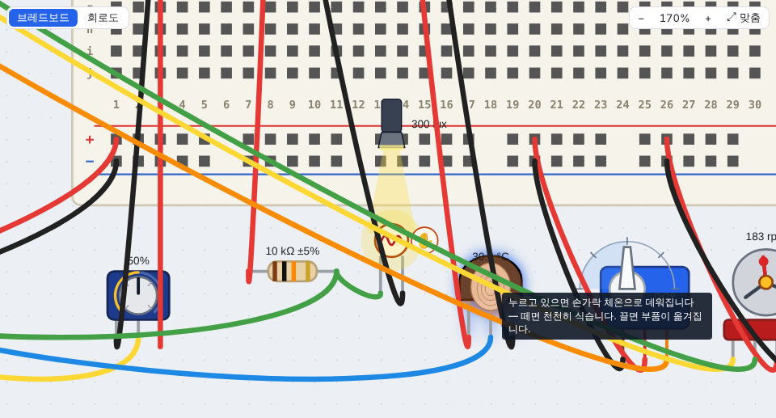

- [x] **공통 구조**: 부품 그림에서 조작하는 부분에 `data-drag="이름"`을 달고, 부품 정의(`PartDef.controls`)에 그 이름의 조작을 등록한다(`web/src/parts/controls.ts`의 노브·슬라이드 손잡이·누르는 동안 값·손가락 터치·기울이기). 편집기는 조작 부분을 끌면 그 조작으로, 나머지 몸체를 끌면 부품 이동으로 나눈다. 값은 속성 창 슬라이더와 같은 속성에 쓰므로 둘이 늘 같은 값을 보이고, 슬라이더는 정밀 조절용으로 그대로 둔다
- [x] **시뮬레이터 부담**: 속성이 바뀔 때마다 회로 전체를 다시 보내므로, 끄는 동안 그림은 바로 따라가고 시뮬레이터로는 최대 20번/초(50 ms)만 보낸다. 시간에 따라 변하는 조작(데워지고 식기)은 10번/초. 펌웨어가 실행 중이어도 동작한다. Rust 쪽 변경 없음
- [x] **안내**: 조작 부분에 마우스를 올리면 할 일을 알려 주는 말풍선과 커서(잡기·위아래·손가락)가 나오고, 조작 중인 부분은 강조된다. 마우스와 터치(포인터 이벤트) 모두
- [x] **가변저항**: 노브를 잡고 중심 둘레로 돌리면 돌린 각도만큼 움직인다(270°가 전체, 누를 때 튀지 않음). 노브 위에서 휠 한 칸이 2 %. 노브의 표시선·홈이 현재 각도로 돌고, 둘레의 호가 위치만큼 채워짐
- [x] **LDR**: 위쪽 손전등을 끌어 가까이 대면 밝아진다(거리의 제곱에 반비례, 약 100–10000 lux). 빛줄기와 손전등 옆의 lux가 거리를 보여 줌. ✋를 누르고 있는 동안 손으로 가려 약 5 lux, 떼면 원래 밝기
- [x] **온도센서**(TMP36/LM35, 서미스터, DS18B20, DHT11/22, AHT20): 누르고 있으면 손가락 체온(33 °C)을 향해 시간 상수 3 s로 데워지고, 떼면 누르기 전 온도로 3.5 s 시간 상수로 식는다. DHT·AHT20은 입김으로 습도도 85 %를 향해 오름. 누르는 동안 손가락 자국과 열기가 보이고, 짧게 클릭(선택)은 데우지 않으며, 누른 채 끌면 부품이 옮겨진다. 식는 도중 슬라이더를 움직이면 슬라이더 값이 이긴다
- [x] **초음파 센서**: 모듈 앞의 장애물(✋)을 위아래로 끌어 2–450 cm(가까운 쪽이 더 세밀한 제곱 눈금), 장애물 옆에 cm 표시와 음파 그림. 모듈을 끌면 옮겨짐
- [x] **MPU-6050**: M13의 끌어서 기울이기를 같은 구조로 옮김(자이로 값이 멈추면 0이 되는 것도 조작의 타이머로)
- [x] **서보·모터 표시**: 서보에 0–180° 눈금과 돌아간 만큼 칠한 부채꼴, DC 모터에 빨간 표시 살 하나와 회전 방향 화살표(빠를수록 진하게)
- [x] 맞춤(⤢)은 부품 상자 밖에 그린 손전등·장애물까지 보이게 맞춘다
- [x] 테스트: E2E 5개 — 노브를 돌리면 `hal-adc-servo`의 `pot` 값과 서보가 따라가고 휠로 10 %, TMP36을 누르면 몇 초에 걸쳐 데워졌다가 떼면 25 °C로 돌아옴(누른 채 끌면 이동), 손전등과 손으로 `light`가 바뀜, 장애물을 끌면 `hal-sonar-onewire`의 거리가 바뀌고 DS18B20이 데워짐, DHT22에 입김. 조작할 때 부품이 움직이지 않는지도 확인
- 남은 항목: 회로도 뷰에서의 직접 조작, 손전등 방향(지금은 위에서만), 실내 조명 아래의 어두운 쪽 범위(100 lux 미만은 손으로 가리기나 슬라이더로)

### M13 완료 (MPU-6050, MAX7219, IR 리모컨)

- [x] **MPU-6050**(I2C 0x68, AD0으로 0x69): 레지스터 포인터 쓰기 → 자동 증가 연속 읽기(`HAL_I2C_Mem_Read`), WHO_AM_I 0x68, 전원을 켜면 잠자기(PWR_MGMT_1 = 0x40, 측정값 0), DEVICE_RESET, GYRO_CONFIG(131/65.5/32.8/16.4 LSB per °/s)·ACCEL_CONFIG(16384/8192/4096/2048 LSB per g), 온도 = 값/340 + 36.53, int16로 잘림. 가속도는 roll·pitch만큼 돌린 중력
- [x] **끌어서 기울이기**: 부품 가운데 기판을 마우스로 끌면 좌우가 roll, 위아래가 pitch(1 px ≈ 1°, ±90°), 그림이 그만큼 기울고 공이 굴러감. 끄는 동안 각도 변화 속도가 자이로 X/Y가 되고, 멈추면 150 ms 뒤 0. 모듈 가장자리를 끌면 옮겨지고, 속성 창 슬라이더도 같은 값을 보여 줌
- [x] **MAX7219** 8×8 LED 매트릭스(FC-16, `count` 1–4): CS Low 동안 CLK 상승 에지마다 DIN 한 비트(비트뱅잉), 하드웨어 SPI 바이트도 같은 시프트 레지스터로, CS 상승 에지에 반영. 체인은 마지막 16×N비트, 먼저 보낸 프레임이 가장 먼 모듈로. 셧다운이면 꺼지고, 디스플레이 테스트면 모두 켜지고, 스캔 한도 밖 줄은 꺼지고, Code-B 디코드, 밝기만큼 흐리게
- [x] **IR 수신기 + 리모컨**(VS1838B, NEC): 버튼을 누르면 OUT에 9 ms Low, 4.5 ms High, 32비트(LSB부터, 562.5 µs 마크 + 562.5/1687.5 µs 스페이스), 마지막 마크. 누르고 있으면 108 ms마다 반복 코드. 17키(숫자, *, #, 화살표, OK), 주소 0x00
- [x] 예제(배선 포함): `hal-imu-matrix`(I2C1 MPU-6050 → roll·pitch, SPI1 + GPIO CS로 MAX7219에 점), `hal-ir-remote`(TIM2 입력 캡처로 하강 에지 간격을 재서 NEC 해독, 반복 코드, LD2로 숫자 깜빡임)
- [x] 테스트: MPU-6050 레지스터·잠자기·범위·리셋, MAX7219 체인·레지스터·비트뱅잉, NEC 펄스열과 반복, 회로 시뮬레이션(I2C 주소, SPI와 비트뱅잉, 수신기 출력), 펌웨어 통합 테스트 22개, E2E(끌어서 기울이면 점이 따라감, 리모컨 버튼 → 해독된 코드와 반복)
- 남은 항목: MPU-6050 FIFO·인터럽트·DMP (흔들기와 따로 놓은 MAX7219 체인은 M15에서 완료)

### M12 완료 (회로도 뷰)

- [x] **자동 회로도**: 브레드보드 배선의 넷리스트에서 회로도를 만든다. 브레드보드는 기계적인 연결이라 빼고, 보드는 STM32F401RE 상자로 쓰는 신호만(`PB3 (D3)`처럼 Arduino 이름과 함께), 저항·LED·택트 스위치·부저·LDR·서미스터는 기호로, 나머지 부품은 핀 이름이 있는 상자로(내부에서 이어진 핀은 하나로)
- [x] **넷 이름**: MCU 신호가 있는 넷은 그 신호 이름(`PA5`), 없으면 `N1`, `N2`…. GND는 접지 기호, 3V3·5V 등은 전원 깃발. 연결 안 된 핀은 ×
- [x] **넷 강조**: 넷 이름에 마우스를 올리면 같은 넷이 모두 강조되고 연결된 핀 목록이 보임(클릭하면 고정)
- [x] **실시간 표시**: 실행 중 MCU 핀의 넷은 High(빨강)·Low(파랑)·PWM(보라 점선), LED는 밝기만큼 빛남, 회로도의 스위치를 눌러 펌웨어를 움직일 수 있음
- [x] 부품을 누르면 속성 창에서 고칠 수 있고, 브레드보드/회로도를 오가도 편집 상태 유지. SVG/PNG 내보내기는 보고 있는 화면(회로도)을 저장
- [x] 테스트: E2E(기호와 신호 이름, 넷 강조와 핀 목록, 속성 창, 실행 중 PWM, 내보내기, 전원 기호, 스위치를 눌러 LED 켜기)
- 남은 항목: 회로도에서 직접 배선하기(M18에서 완료), 넷 이름 붙이기, 같은 넷을 선으로 잇는 배치

### M11 완료 (디버거 마무리)

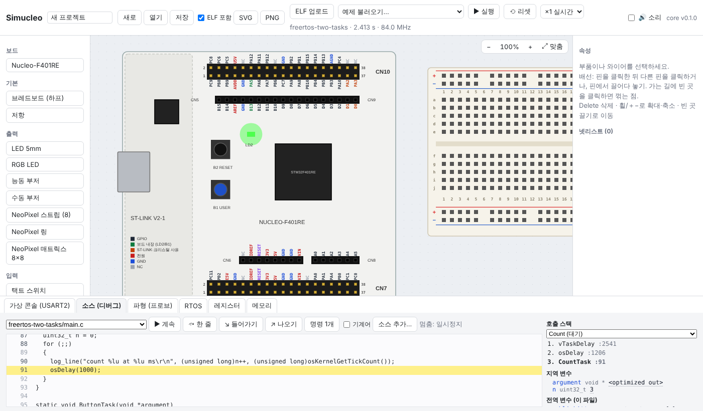

- [x] **변수 값 바꾸기**: 소스 탭의 지역·전역 변수와 감시식에서 값을 두 번 클릭해 고침. 정수·enum·포인터·실수, 구조체 멤버·배열 원소·`*포인터`, 비트 필드(주변 비트는 그대로). 값은 C 식(`FONT[8]`, `0x3F`, `'A'`). 타입 범위를 넘으면 거절. 레지스터에 사는 변수는 가장 안쪽 프레임에서만(바깥 프레임·대기 중인 태스크의 레지스터는 스택에 저장된 사본이라). 컴파일러가 상수로 바꿔 저장소가 없는 변수는 이유를 보여 줌. 주변장치 레지스터(`htim2.Instance->ARR`)는 워드 단위로 써서 칩과 같게 동작
- [x] **데이터 감시점**: 식이 가리키는 메모리(변수, 원소, 멤버, 하위 배열)에 쓰기·읽기·둘 다. 그 접근을 한 명령이 끝난 뒤 멈춤(칩의 DWT처럼 다음 명령 위치). 줄 스텝 중에도 멈춤. 시작 코드가 `.bss`를 지우는 것도 쓰기로 잡힘. GDB `watch`/`rwatch`/`awatch`(Z2/Z3/Z4) 지원
- [x] **RTOS 태스크별 호출 스택**: 멈춘 동안 태스크를 고르면 그 태스크가 전환될 때 포트가 스택에 저장한 문맥(r4–r11, EXC_RETURN, FPU를 썼다면 s16–s31, 예외 프레임)에서 되감아 호출 스택을 보여 줌(`osDelay` ← `CountTask`). 그 프레임의 지역 변수·감시식·감시점 주소도 그 태스크 기준. 스택은 태스크 함수에서 끝남
- [x] 테스트: 펌웨어 통합 테스트(멤버·주변장치 레지스터·배열 원소·레지스터 매개변수 값 바꾸기와 화면 변화, 쓰기·읽기 감시점과 스텝, 대기 중인 네 태스크의 스택과 지역 변수), GDB 프로토콜(Z2), E2E(값 바꾸기, 감시점, 태스크 선택)

### M10 완료 (디버그 확장)

- [x] **GDB 원격 서버**(`simucleo gdb <elf> [--port 3333]`): GDB 원격 직렬 프로토콜(RSP). `target.xml`로 r0–r15·xPSR·MSP/PSP·FPU(d0–d15, FPSCR)·PRIMASK/BASEPRI/FAULTMASK/CONTROL을 알려 줌. 레지스터·메모리 읽기/쓰기(플래시 쓰기 포함), 소프트웨어 중단점, 한 명령 스텝, 계속 실행과 Ctrl-C, `QStartNoAckMode`, `monitor reset`·`monitor time`. 가상 COM 포트 출력은 서버 터미널에. `gdb-multiarch`로 break/continue/bt/next/step/finish/print/x/set var 확인, VS Code Cortex-Debug는 외부 GDB 서버로 연결
- [x] **디스어셈블리**(`simucleo_elf::disasm`, yaxpeax-arm): Thumb/Thumb-2 명령을 함수 시작부터 디코드해 경계를 맞추고, 분기 대상은 절대 주소와 `<심볼>`, 리터럴 풀 읽기는 값으로 주석. 웹 소스 탭의 ‘기계어’ 상자로 현재 위치 주변 명령을 소스 줄과 섞어 보여 줌
- [x] **감시식**: C 식 평가기(`simucleo_elf` 내부) — 지역·전역 변수, enum 상수, 정수·실수·문자 리터럴(접미사, 16진), `. -> [] * & !  ~ -`, 산술·비트·시프트·비교·논리(단락 평가) 연산. 구조체·배열 값은 변수 트리와 같은 모양으로. 오류는 이유와 함께(없는 변수, 범위 밖 인덱스, 읽을 수 없는 메모리)
- [x] **조건부 중단점**: 중단점 목록에서 조건을 적으면 그 줄에 도착할 때마다 조건을 평가해 참일 때만 멈춤(평가할 수 없으면 멈춰서 보여 줌). 실행, 줄 스텝, 나오기 모두 같은 규칙. 같은 주소에 조건 없는 중단점이 있으면 항상 멈춤. 거터에서 주황색 점
- [x] 테스트: CLI GDB 프로토콜 테스트(접속 → 중단점 → 계속 → 레지스터·메모리 → 스텝 → Ctrl-C), 펌웨어 통합 테스트(감시식 값·오류, 조건이 참일 때만 1 ms 타이머 콜백에서 멈춤, 거짓이면 끝까지 실행), 식 어휘 분석 단위 테스트, E2E(기계어 보기, 감시식과 조건부 중단점)
- 남은 항목: 변수 값 바꾸기(웹), 감시점(데이터 중단점), RTOS 태스크별 호출 스택

### M9 완료 (소스 수준 디버깅)

- [x] **DWARF 읽기**(`simucleo_elf::debug`, gimli): 줄 표(주소 ↔ 파일:줄, DWARF 4/5), 함수 범위, 파일 범위 변수, `.debug_frame`
- [x] **호출 스택**: CFI로 한 단계씩 되감기, Cortex-M 예외 프레임(MSP/PSP, FP 확장 프레임, 정렬 비트)을 넘어 인터럽트가 끼어든 코드까지
- [x] **변수 값**: 위치식 평가(위치 목록, 레지스터, 프레임 베이스, 상수) → C 타입대로 표시: 정수·실수·char·enum·포인터(문자열, 함수 이름)·다차원 배열·구조체·비트 필드. 최적화로 없어진 값은 `<optimized out>`
- [x] **실행 제어**: 파일:줄 중단점(코드가 없는 줄이면 다음 줄로), 명령 1개, 한 줄 넘어가기(호출과 인터럽트는 반환 주소까지 전속력으로), 들어가기(줄 정보 없는 라이브러리는 건너뜀), 나오기
- [x] **웹 소스 탭**: 예제 소스 포함(빌드 시 `public/examples/src`), 직접 올린 ELF는 ‘소스 추가…’로 C 파일을 넣으면 파일 이름으로 맞춤, 거터 클릭으로 중단점, 현재 줄 표시, 호출 스택(프레임을 고르면 그 프레임의 지역 변수), 지역·전역 변수 트리
- [x] DWARF는 처음 쓸 때 읽음(펌웨어 로드는 그대로 빠름)
- [x] 테스트: 펌웨어 통합 테스트(중단점, 넘어가기 후 클럭 설정 확인, 들어가기·나오기, 명령 스텝, 지역·전역 변수 값, 타이머 인터럽트 안의 중단점에서 예외 프레임 너머 `main`까지), E2E(거터 중단점 → 스텝 → 호출 스택·전역 변수)
- 남은 항목: 조건부 중단점·감시식, 디스어셈블리 보기, GDB 원격 프로토콜은 M10에서 완료

### M8 완료 (추가 부품)

- [x] **7세그먼트** 1자리(공통 캐소드/애노드, COM 핀 2개)와 4자리(D1–D4 자리 공통): 세그먼트마다 LED 모델이라 멀티플렉싱하면 각 자리가 켜진 비율만큼 밝기로 보임. 저항 없으면 과전류 경고, 한 자리에 전류가 몰리면 핀 25 mA 경고
- [x] **4×4 키패드**: 키를 누르면 줄과 칸이 이어짐(오픈드레인 줄 스캔 + 풀업 칸 입력으로 확인)
- [x] **로터리 엔코더**(KY-040): 한 칸마다 CLK/DT 한 주기, 시계 방향이면 CLK가 먼저. 돌리는 동작은 시간에 맞춰 예약된 접점 변화. 누르면 SW → GND
- [x] **TIM 엔코더 모드**(SMS 001/010/011): 다른 입력의 레벨로 업/다운, DIR 비트, 넘침·모자람에서 업데이트 이벤트
- [x] **NTC 서미스터**(R25, B 상수), **HC-SR04P**(TRIG 10 µs 미만이면 경고, 1 cm당 58 µs ECHO, 범위 밖이면 38 ms), **DS18B20**(리셋/존재 펄스, 쓰기·읽기 슬롯, READ ROM·MATCH ROM·SKIP ROM, CONVERT T와 해상도별 변환 시간, 스크래치패드와 CRC, 전원 켤 때 85 °C)
- [x] **문자 LCD 16×2 (PCF8574 + HD44780)**: 4비트 초기화, DDRAM/CGRAM(사용자 문자), 주소 증감, 화면 이동, 커서, 백라이트
- [x] **스테퍼 28BYJ-48 + ULN2003**: 반스텝 순서를 따라 4096 반스텝에 한 바퀴, 너무 빠르면 탈조 경고, 핀을 하나씩 쓰는 동안 생기는 µs 단위 중간 패턴은 한 스텝으로 봄
- [x] 5 V 내성(FT) 핀 구분: 5 V 풀업이 달린 I2C 모듈(LCD)을 FT 핀에 연결해도 경고 없음, 아날로그 핀에 5 V가 걸리면 경고
- [x] 예제(배선 포함): `hal-7seg-keypad`(타이머 인터럽트 멀티플렉싱 + 키패드 스캔), `hal-encoder-stepper-lcd`(TIM3 엔코더 모드 → 스테퍼, LCD에 각도와 NTC 온도), `hal-sonar-onewire`(입력 캡처로 거리, DWT 지연으로 1-Wire 비트뱅잉)
- [x] 테스트: 엔코더 모드, 엔코더 접점 순서, DS18B20 프로토콜(호스트 시뮬레이션), 초음파 펄스 폭, LCD 4비트 디코드, 펌웨어 통합 테스트 19개, E2E(키패드 → 7세그먼트, 엔코더 → 스테퍼·LCD, 슬라이더 → 거리·온도)
- 남은 항목: 여러 DS18B20의 SEARCH ROM, LCD 바쁨 플래그 읽기와 명령 실행 시간, 키 바운스, 스테퍼 토크·관성

### M7 완료 (DMA, 입력 캡처, 타이밍 민감 장치)

- [x] **DMA1/DMA2**: 스트림 8개씩, 채널 선택으로 요청 연결(RM0368 표 28·29: USART TX/RX, SPI TX/RX, ADC1, TIM 업데이트·비교), 주변장치↔메모리·메모리↔메모리, 증가, 데이터 크기, 순환·이중 버퍼, HT/TC/TE 플래그와 인터럽트, 실행 중 끄기. 데이터는 CPU와 같은 레지스터 경로로 옮기므로 DR 읽기 같은 부수 효과가 그대로 일어남. HAL DMA 드라이버를 그대로 사용
- [x] **TIM DMA 요청**: 업데이트(UDE), 비교(CCxDE), CCDS. 업데이트에서 다시 읽힌 비교값이 그 주기의 첫 카운터 값부터 적용
- [x] **TIM 입력 캡처**: 직접·간접(TI1 ↔ IC2) 연결, 상승/하강/양쪽 엣지, 프리스케일러, 과캡처(CCxOF), CCR 읽기로 CCxIF 해제, DMA 요청. 리셋 슬레이브 모드(TI1FP1/TI2FP2)로 PWM 입력 측정 가능
- [x] **회로가 스스로 바꾸는 신호**: 회로가 다음 변화 시각을 알려 주면 버스가 그 시각에 이벤트를 예약해 핀 레벨을 갱신(EXTI·입력 캡처까지 같은 시각에 반영)
- [x] **DHT11/DHT22**: 시작 신호 길이 검사(DHT22 1 ms, DHT11 18 ms 미만이면 응답 없음 + 경고), 80/80 µs 응답, 40비트 펄스 폭, 체크섬, 음수 온도. 모듈의 10 kΩ 풀업
- [x] **NeoPixel(WS2812B)**: 핀 엣지 시각으로 High 폭을 재서 비트 판정(0.4/0.8 µs ±150 ns), GRB 순서, 50 µs Low로 표시 갱신, 어느 쪽에도 맞지 않는 펄스는 경고. 스트립(8), 링(12/16/24), 8×8 매트릭스. 5V 전원 필요(3.5 V 미만이면 전원 부족)
- [x] 예제(배선 포함): `hal-neopixel-dma`(TIM3 PWM 800 kHz + DMA로 12 LED 링에 무지개, B1 밝기), `hal-dht-capture`(TIM2 양쪽 엣지 입력 캡처 인터럽트로 DHT22 읽기, B1로 펄스 폭 출력)
- [x] 테스트: DMA(메모리→USART, 표 → PWM 듀티, 순환·이중 버퍼), 입력 캡처·PWM 입력 모드, DHT 프레임, NeoPixel 디코드, 펌웨어 통합 테스트(링 색, DHT22 값, DHT11을 DHT22로 잘못 해석하는 경우), E2E(무지개가 돎, 슬라이더 → 측정값)
- 남은 항목: NeoPixel 체인 연결(DOUT → 다음 부품 DIN), I2C DMA·ADC DMA 연속 요청(DDS)·DMA FIFO 패킹, 중앙 정렬 카운팅·반복 카운터·~~상보 출력~~(M23), 입력 필터(ICxF)

### M6 완료 (I2C/SPI 버스 장치)

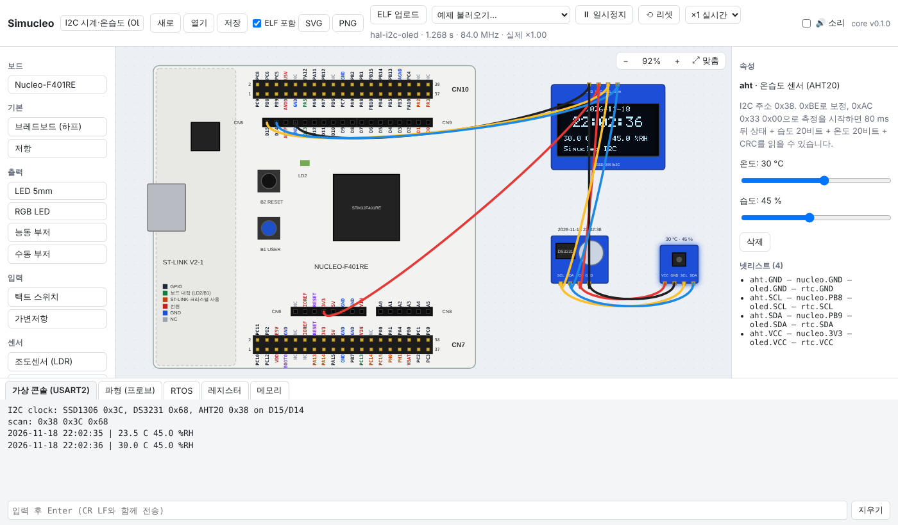

- [x] **I2C1–3 마스터**: SB/ADDR/BTF/TXE/RXNE/AF 플래그 순서, ACK/POS로 정하는 NACK 위치, DR이 차면 클럭 스트레칭, 진행 중 바이트가 끝난 뒤의 STOP/재시작, CCR·PCLK1로 정한 바이트 시간(9 SCL), 이벤트·에러 인터럽트. HAL I2C 드라이버(폴링, `Mem_Read/Write`, `IsDeviceReady`)를 그대로 사용
- [x] **SPI1–4 마스터**: 송신 버퍼와 시프트 레지스터(TXE/BSY), 분주비에 따른 프레임 시간, RXNE/OVR(DR → SR 읽기로 해제), 8/16비트, LSB 먼저, 인터럽트. 소프트웨어 NSS인데 SSI가 0이면 실제처럼 MODF로 마스터 모드가 풀림
- [x] **버스와 회로 연결**: 장치는 SCL/SDA(또는 SCK/MOSI/MISO)가 MCU 핀과 같은 넷에 있고 VCC가 들어와 있을 때만 응답. I2C 모듈은 자체 4.7 kΩ 풀업을 가지므로 모듈 전원이 없으면 버스가 Low에 머무름(경고). SCL/SDA, SCK/MOSI가 바뀐 배선과 MISO를 동시에 구동하는 두 장치도 경고. SPI 장치는 CS 넷이 Low일 때만 선택
- [x] **장치**: SSD1306(I2C·SPI 공용 코어, 주소 모드 3종, 컬럼/페이지 창, 리맵·COM 방향, 시작 줄, 반전, 차지펌프, RES 핀), DS3231(BCD 시간·날짜, 12/24시간, 세기 비트, 일부 레지스터만 써도 나머지는 계속 흐름, 온도 레지스터, 시뮬레이션 시작 시각 = PC 현지 시각, 보드 리셋·펌웨어 교체에도 배터리로 계속 감), AHT20(보정, 80 ms 측정, 바쁨 비트, CRC-8), SD 카드(SPI 모드 SDHC: CMD0/8/55/ACMD41/58/9/10/12/13/16/17/18/24/25, CMD0·CMD8 CRC 검사, 데이터 응답·바쁨, 희소 저장소)
- [x] **웹**: OLED 화면 실시간 표시, RTC 날짜·시간 표시, AHT20 온도·습도 슬라이더, SD 카드 접근 LED와 용량 선택, **디스크 이미지 내려받기/넣기**
- [x] 예제(배선 포함): `hal-i2c-oled`(버스 스캔, OLED 시계 + 온습도, B1로 RTC 쓰기), `hal-spi-sd-logger`(빈 카드를 FatFs로 포맷, RTC 시각이 찍힌 CSV 기록, SPI OLED, B1로 파일 읽기). FatFs R0.16(ST 패키지)을 vendor에 추가
- [x] 테스트: I2C·SPI 컨트롤러, 장치(OLED 주소 모드, RTC 설정·진행, AHT20 측정·CRC, SD 초기화·읽기·쓰기·이미지), 회로 연결(전원·풀업·주소), 펌웨어 통합 테스트(실제 HAL·FatFs로 포맷·기록·재부팅 후 이어 쓰기), E2E(OLED 화면, 슬라이더 → 측정값, SD 이미지 안의 LOG.CSV)
- 남은 항목: 비트뱅잉 I2C/SPI용 핀 레벨 디코더, DS3231 알람·SQW 출력, SSD1306 스크롤, I2C·SPI DMA와 슬레이브 모드(M7 이후)

### M5 완료 (아날로그·구동)

- [x] **ADC1**: 정규 그룹(단일/스캔/연속), 소프트웨어 시작, 채널별 샘플링 시간과 분해능을 반영한 변환 시간(ADCPRE), 정렬, EOC/OVR/아날로그 워치독과 인터럽트, 내부 온도센서·VREFINT·VBAT/4. 채널 0–15는 회로 해석이 계산한 핀 전압을 읽음. HAL ADC 드라이버를 그대로 사용
- [x] **회로 해석 확장**(이미 DC 노드 해석이라 MNA 솔버 추가 없이): 가변저항(노브 위치), LDR(조도 → 저항, γ = 0.7), 아날로그 온도센서 TMP36/LM35(공급 전압이 모자라면 출력 없음 + 경고), 서보(펄스 폭 0.5–2.5 ms → 0–180°, 600°/s), H-브리지 드라이버 달린 DC 모터(IA/IB 듀티 → rpm, 1차 응답)
- [x] **웹**: 노브를 위아래로 끌어 돌리기, 속성 창 슬라이더(위치·조도(로그 눈금)·온도), 서보 혼 회전과 각도, 모터 회전과 rpm, 전원 부족 표시
- [x] 예제 `hal-adc-servo`(배선 포함): 가변저항 → 서보, 빛 → 모터 속도, TMP36·칩 온도·VDDA 출력
- [x] 테스트: ADC 단위 테스트, 부품 단위 테스트(분압, LDR, 센서 전원, 서보 각도, 모터 속도), 전체 경로 통합 테스트, E2E(노브 → 서보, 어둡게 → 모터 느려짐)
- 남은 항목: ADC 주입 그룹·타이머 트리거·DMA(M7), 연속 시간 과도 해석(RC 필터 등)

### M4 완료 (FreeRTOS)

- [x] **CubeMX FreeRTOS 그대로 실행**: ST가 CubeMX용으로 배포하는 FreeRTOS V11.3.1(CMSIS-RTOS v2 래퍼, ARM_CM4F 포트, heap_4)을 수정 없이 사용. SVC로 첫 태스크 시작, PendSV 문맥 교환(FP 문맥 포함), BASEPRI 임계 구역, `configASSERT`의 인터럽트 우선순위 검사까지 통과
- [x] **TIM 타임베이스**: CubeMX처럼 HAL tick은 TIM11, SysTick은 FreeRTOS 차지
- [x] **Idle 시간 건너뛰기**: 기존 바쁜 대기 건너뛰기로 idle 태스크 루프가 다음 tick까지 건너뛰어짐. 30초 시뮬레이션이 약 0.5초(실시간의 약 60배)
- [x] **RTOS 뷰**(커널 인식, 펌웨어 수정 불필요): ELF 심볼로 FreeRTOS 리스트와 TCB를 읽어 태스크 이름, 상태(실행/준비/대기/일시중단/삭제), 우선순위(CMSIS 이름 포함), 스택 크기와 최대 사용량(high-water), CPU 사용률, 실행 타임라인(`pxCurrentTCB` 쓰기로 모든 문맥 교환 기록)
- [x] 예제: `freertos-two-tasks`(Blink/Count/Button, 뮤텍스, B1 인터럽트 → 세마포어), `freertos-queue-uart`(UART 수신 ISR → 큐 → 에코 태스크, 센서 → 큐 → 로거, 힙·스택 통계)
- [x] 테스트: 펌웨어 통합 테스트(tick 타이밍, ISR → 태스크, 큐, 태스크 상태·스택), E2E(RTOS 탭, 버튼 → 세마포어)
- 남은 항목: tickless idle(`configUSE_TICKLESS_IDLE`), 큐·세마포어 객체 뷰, 런타임 통계(`configGENERATE_RUN_TIME_STATS`) 연동

### M3 완료 (디지털 부품)
- [x] **EXTI/SYSCFG**: 핀 레벨이 바뀔 때마다(펌웨어 출력, 외부 회로, 버튼) 선택한 엣지를 감지해 EXTI0–4, 9_5, 15_10 인터럽트. 소프트웨어 트리거, 이벤트 마스크(WFE 깨우기)
- [x] **TIM1–5, TIM9–11**: 업/다운 카운팅, PSC/ARR 프리로드, UG, 원펄스, 업데이트·비교 인터럽트, 출력 비교(토글 등)와 PWM 1/2, 극성, TIM1 MOE. 카운터는 매 사이클 세지 않고 필요한 시점만 계산하고, 관찰되는 일(인터럽트, 출력 엣지)만 이벤트로 예약. AF 핀으로 출력(데이터시트 AF 표)
- [x] **회로 해석**: 배선을 넷으로 묶고 저항·LED(구간 선형 다이오드)·부저 부하·전원·핀 드라이버(푸시풀 출력, 풀업/풀다운)를 DC 노드 해석. 핀 구동 조합별로 결과를 캐시해 PWM도 빠름. 입력 핀은 회로가 만든 레벨을 즉시 읽음(EXTI 포함). 보드 내장 LD2(510 Ω)와 B1(4.7 kΩ 풀업)도 같은 모델
- [x] **부품**: LED(색별 Vf), RGB LED(공통 캐소드/애노드), 저항, 택트 스위치(실행 중 클릭), 능동/수동 부저(Web Audio로 소리, 음높이 = 신호 주파수)
- [x] **전기 규칙 검사**: LED 과전류(저항 없음), 핀 출력 25 mA 초과(단락, 출력끼리 충돌), 전원 단락. 부품에 빨간 점멸 표시와 경고
- [x] **파형 뷰**: 임의 MCU 핀의 실제 레벨(입력 포함)을 로직 분석기처럼 표시, 주파수와 듀티 측정 (M20에서 오실로스코프 트리거·캡처 추가)
- [x] **프로젝트 파일** `.simucleo.json`(버전·검증, ELF 포함 선택), IndexedDB 자동 저장과 복원, SVG/PNG 배선도 내보내기, 모두 보이게 맞춤
- [x] 예제(배선 포함): `hal-button-exti`(외부 버튼 → EXTI → LED), `hal-pwm-led`(LD2 숨쉬기, RGB 색 순환), `hal-buzzer-melody`(TIM1 PWM 멜로디)
- [x] 테스트: 타이머·EXTI·회로 단위 테스트, 펌웨어 통합 테스트(PWM 주기·듀티 정확히 84000 사이클, 음 높이, 배선된 스위치/LED, hot-plug), Playwright E2E 12개
- 남은 항목: 스위치 바운스, 풀업 없는 입력(플로팅) 경고, 중앙 정렬 카운팅·반복 카운터·입력 캡처(M7), USB-UART 모듈 부품

### M2 완료 (웹에서 실행)
- [x] **바쁜 대기 루프 건너뛰기**: 같은 상태로 반복되는 루프(`HAL_Delay`, 플래그 폴링)를 감지해 다음 변화(인터럽트, Peripheral 이벤트, SysTick 0 도달)까지 반복 단위로 시간을 건너뜀. HAL 예제 10초 시뮬레이션이 약 9초에서 0.02초로 단축되고 타이밍은 같음. 1사이클씩 실행한 결과와 정확히 같은지 검사하는 회귀 테스트 포함
- [x] Web Worker 실행 루프: 실제 시간에 맞춰 진행(×0.01~×10, 최대), 실제 배속 표시, 백그라운드 탭에서 따라잡기 방지
- [x] 프레임 스냅샷(약 60 Hz): 시간, 클럭, 핀 상태와 프레임 동안 켜진 비율(LED 밝기), 레지스터, 진단, 경고
- [x] UI: ELF 업로드와 내장 예제, 실행·일시정지·리셋, 배속, LD2 밝기, B1·B2 버튼 클릭, 가상 콘솔(입력 포함), 레지스터·메모리 뷰, 정지 원인 배너, 경고 배너
- [x] 내장 예제는 CI·Pages에서 arm-none-eabi-gcc로 빌드해 사이트에 포함(`npm run examples`)
- [x] Playwright E2E: printf와 에코, LD2 실시간 깜빡임과 B1, 클럭 설정 오류 진단, ELF 업로드와 레지스터·메모리 뷰
- 남은 항목: 외부 부품(브레드보드의 LED 등)을 실행 중인 펌웨어와 연결하는 일은 M3

### M1 완료 (기본 Peripheral)
- [x] ST SVD에서 레지스터 맵 생성(`tools/svdgen.py`). 동작 모델이 없는 Peripheral도 리셋 값과 쓴 값을 유지하고, 어떤 레지스터를 썼는지 보고
- [x] RCC: HSI/HSE/PLL/LSE/LSI 레디 플래그, SW→SWS, 분주기, 클럭 트리(SYSCLK/HCLK/PCLK1/PCLK2/타이머 클럭), 리셋 원인 플래그, 백업 도메인 유지. Nucleo 보드 조건 반영: HSE는 ST-LINK MCO 8 MHz **바이패스로만** 동작(크리스털 없음), LSE 크리스털 있음
- [x] PWR(VOS, DBP), FLASH 인터페이스(ACR 지연, 잠금 해제). 클럭에 비해 지연이 부족하면 경고
- [x] Peripheral 클럭 게이팅: 클럭을 켜지 않은 GPIO/USART/PWR 접근은 실제처럼 무시되고 경고("RCC.AHB1ENR.GPIOAEN을 먼저 켜세요")
- [x] USART1/2/6: 보레이트 기반 송수신 타이밍, TXE/TC/RXNE/ORE/IDLE, 인터럽트, 가상 콘솔(USART2 = ST-LINK VCP). 터미널 보레이트와 다르면 실제 수신기처럼 비트를 다시 샘플링해 깨진 문자 재현
- [x] Peripheral 이벤트 스케줄러, IRQ 라인 → NVIC 즉시 반영, 이벤트까지 수면 건너뛰기, 클럭 변경을 반영한 시간(ns) 타임라인
- [x] 진단: `Error_Handler()` 진입(호출 함수 표시), 폴트 핸들러 정지(폴트 명령어 위치와 CFSR 해석), 처리기 없는 인터럽트(SVD 이름), 인터럽트가 막힌 무한 루프. 인터럽트를 기다리는 `while(1);`은 수면처럼 시간 건너뛰기
- [x] B1 버튼(PC13, 외부 풀업), SYSRESETREQ/리셋 버튼(리셋 원인별 처리)
- [x] CubeMX 스타일 HAL 예제: `hal-blinky`(HSI/HSE 바이패스/HSE 크리스털 오류 변형), `hal-uart-printf`(printf + 인터럽트 에코)
- 남은 항목: 성능(HAL `HAL_Delay` 루프 기준 84 MHz 실시간의 약 1.1배) 최적화는 M2에서. EXTI/TIM/DMA는 M3 이후

### M0 완료 (CPU 코어)
- [x] Thumb/Thumb-2 전체: 데이터 처리, 로드/스토어(단일·다중·듀얼·배타), 분기(TBB/TBH, CBZ), IT 블록, 시스템 레지스터(MRS/MSR/CPS)
- [x] DSP 확장: SIMD 덧셈/뺄셈(GE 플래그, SEL), 포화 연산(Q 플래그), SMLAxy/SMLAD/SMMLA/USAD8, 64비트 곱셈 누적, PKH, 확장+덧셈
- [x] FPv4-SP: 사칙연산, 융합 곱셈-덧셈, √, 비교, 정수/고정소수점/반정밀도 변환, VLDM/VSTM/VPUSH/VPOP, VMOV, VMRS/VMSR. ARM 규칙의 NaN 전파, 기본 NaN, flush-to-zero, 반올림 모드, 누적 예외 플래그
- [x] 공용 Cortex-M 시스템 모듈(`simucleo_core::cortexm`): NVIC(4비트 우선순위, 그룹), SCB, SysTick, DWT CYCCNT, CPACR/FPCCR, 예외 진입·복귀(기본/FP 프레임, 스택 재정렬), BASEPRI/PRIMASK/FAULTMASK, SVC, PendSV, 폴트 에스컬레이션(UsageFault/BusFault → HardFault → Lockup)
- [x] WFI/WFE 시 다음 이벤트까지 시간 건너뛰기, SLEEPONEXIT
- [x] `simucleo-nucleo` 보드 크레이트, GPIO 레지스터와 핀 변화 기록, 비트밴딩
- [x] 검증
  - Unicorn과 lock-step 비교: 5가지 최적화 수준의 테스트 프로그램, 명령어 약 28만 개, 매 명령어마다 레지스터·플래그·FP 레지스터·FPSCR 비교 후 SRAM 비교
  - 예외 모델 자가 테스트 17항목: SysTick, WFI, SVC, BASEPRI, 중첩, tail-chaining, PSP, FP 프레임, 폴트, FreeRTOS 방식 문맥 교환
  - `bare-blinky`에서 LD2 토글 확인. 성능은 약 96 MIPS로 84 MHz 실시간보다 빠름
- 남은 항목: 사이클 수는 근사치(명령어당 1 + 메모리 접근·분기 가산), VMOV 스칼라와 BKPT(디버거)는 미구현

### v0 골격
- [x] Cargo workspace, ELF 로더, CLI(`info`, `run`)
- [x] 넷리스트 추출(내부 버스 + 같은 점 연결), PWM 듀티 적분기
- [x] 웹 배선 편집기 v0: Nucleo(Arduino + Morpho, 실크스크린 핀 이름)/브레드보드/LED/저항/스위치, Rust 넷리스트 연동
- [x] CI: fmt, clippy, 테스트, wasm/웹 빌드, 펌웨어 실행, Unicorn 차분 테스트
