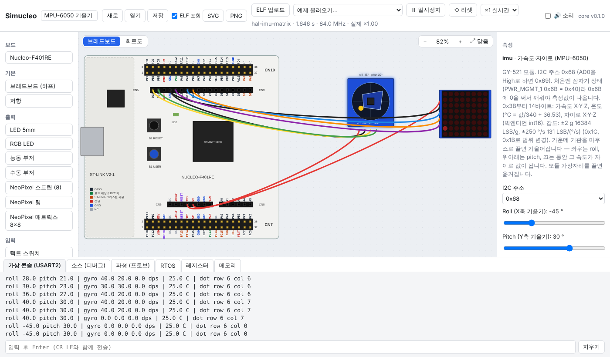
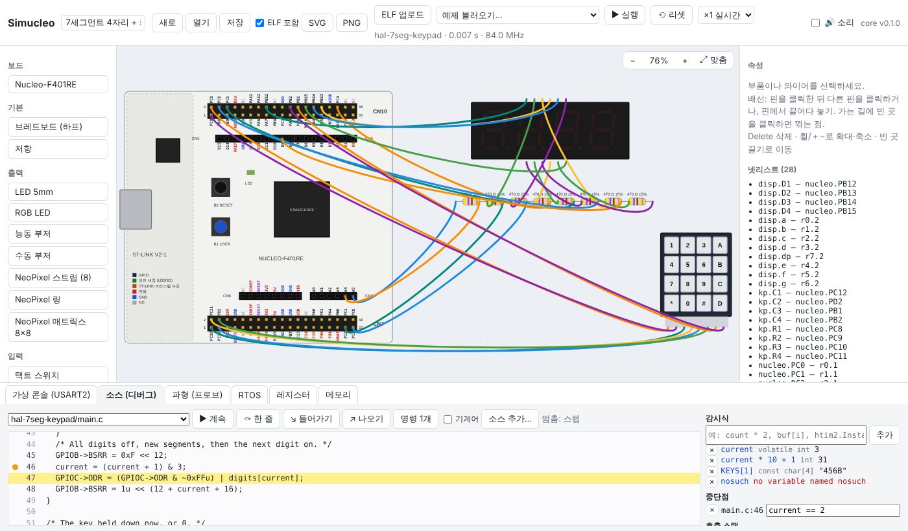
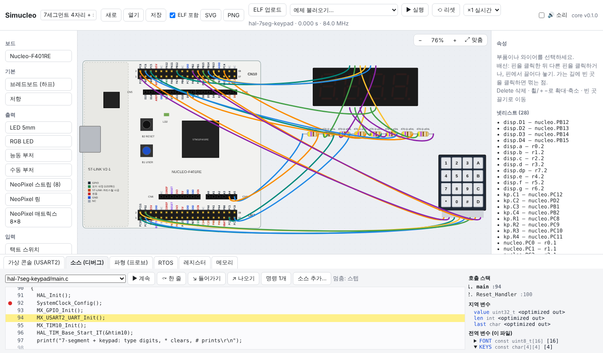
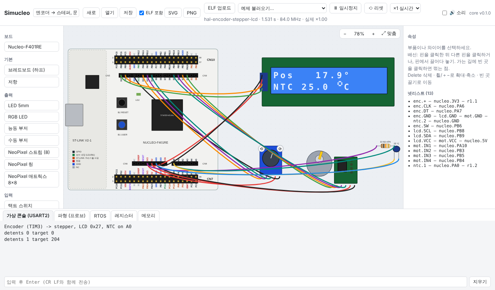
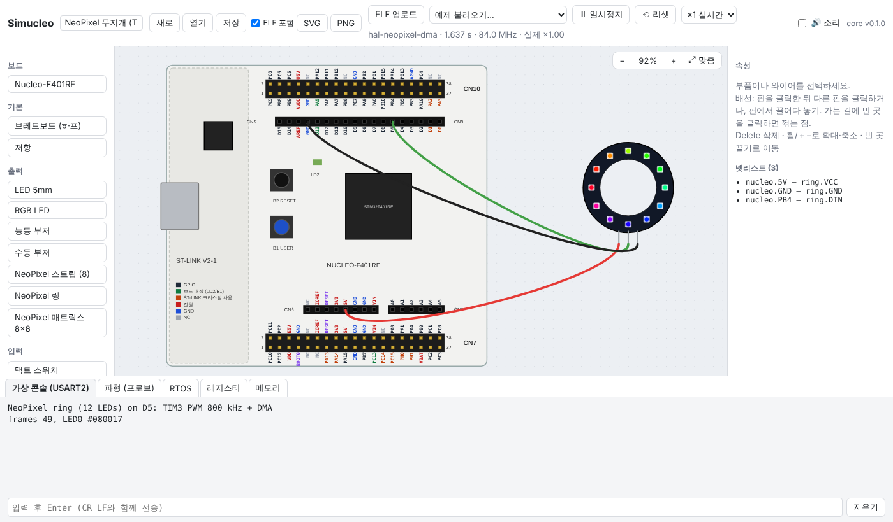
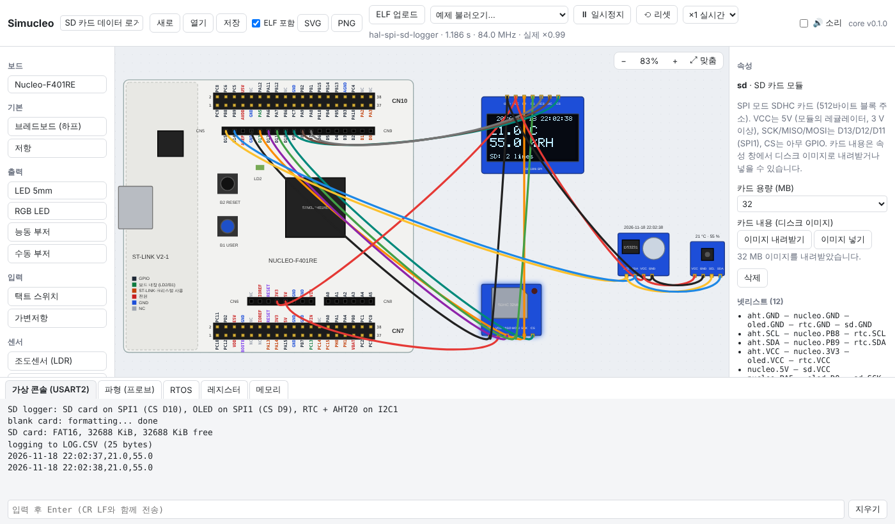

# 로드맵

| 단계 | 내용 | 완료 기준 |
|---|---|---|
| **M0 · CPU 코어** ✅ | Thumb/Thumb-2 전체, FPv4-SP, 공용 예외/NVIC 모델(SVC, PendSV, SysTick, BASEPRI, PSP, FP 프레임), Unicorn 차분 테스트 백엔드 | `bare-blinky`가 무한 루프까지 실행, 차분 테스트 통과 |
| **M1 · 기본 Peripheral** ✅ | SVD 기반 레지스터 맵, RCC/PWR/FLASH, GPIO, SysTick, USART2(VCP), 미구현 접근 리포트, `Error_Handler` 감지 | CubeMX `hal-blinky`, `hal-uart-printf`가 CLI에서 동작 |
| **M2 · 웹 실행** ✅ | Web Worker 실행 루프, 실시간 동기/배속, LD2·B1, **가상 콘솔**, 레지스터/메모리 뷰 | 브라우저에서 ELF 업로드 → LD2 깜빡임, `printf` 출력 |
| **M3 · 디지털 부품** ✅ | EXTI, TIM 기본/PWM, Tier 1 부품(LED, RGB LED, 버튼, 부저), 전기 규칙 검사, 프로브/파형 뷰, 프로젝트 저장 | 버튼 인터럽트, PWM 밝기, 부저 멜로디 예제 |
| **M4 · FreeRTOS** ✅ | CubeMX FreeRTOS 실행, TIM 타임베이스, WFI 시간 건너뛰기, **RTOS 뷰**(태스크, 스택, 전환 타임라인) | `freertos-two-tasks`, `freertos-queue-uart` |
| **M5 · 아날로그/구동** ✅ | ADC, MNA DC 솔버, Tier 2 부품(가변저항, LDR, 아날로그 온도센서, 서보, DC 모터) | 가변저항 → ADC → 서보/모터 제어 예제 |
| **M6 · 버스 장치** ✅ | I2C, SPI Peripheral, Tier 3 부품(SSD1306 I2C/SPI, I2C RTC, SPI SD 카드 + FatFs, I2C 온습도센서) | OLED 그래픽, RTC 시계, SD 카드 로깅 예제 |
| **M7 · 타이밍 민감 장치** ✅ | DMA, 입력 캡처, Tier 4 부품(NeoPixel, DHT11/22) | NeoPixel 무지개, DHT 측정 예제 |
| **M8 · 추가 부품** ✅ | 7세그먼트(1·4자리), 4×4 키패드, 로터리 엔코더(+TIM 엔코더 모드), NTC 서미스터, 초음파 거리센서, DS18B20(1-Wire), I2C 문자 LCD, 스테퍼 | 키패드 → 7세그먼트, 엔코더 → 스테퍼 + LCD, 초음파·1-Wire 예제 |
| **M9 · 소스 디버깅** ✅ | DWARF 줄 표·호출 스택·변수, 중단점, 줄 단위 스텝(넘어가기/들어가기/나오기), 웹 소스 탭 | 예제 C 소스에서 중단점 → 스텝 → 변수 확인 |
| **M10 · 디버그 확장** ✅ | GDB 원격 서버(`simucleo gdb`), 디스어셈블리 보기, 감시식(C 식), 조건부 중단점 | `gdb-multiarch`·Cortex-Debug로 접속, 웹에서 조건이 참일 때만 멈추고 감시식 확인 |
| **M11 · 디버거 마무리** ✅ | 변수 값 바꾸기, 데이터 감시점(GDB Z2–Z4 포함), FreeRTOS 태스크별 호출 스택·지역 변수 | 웹에서 값을 바꾸면 펌웨어 동작이 달라지고, 감시점이 쓰는 줄에서 멈추고, 대기 중인 태스크의 스택을 본다 |
| **M12 · 회로도 뷰** ✅ | 배선에서 자동으로 만든 회로도(MCU는 쓰는 신호만, 부품 기호, 넷 이름·전원 기호), 실시간 넷 레벨, 넷 강조, 스위치 누르기, 그림 내보내기 | 예제 회로가 회로도로 보이고 실행 중 레벨·LED가 따라 바뀐다 |
| **M13 · 추가 부품 2** ✅ | MPU-6050(I2C 가속도·자이로, 마우스로 끌어 기울이기), MAX7219 8×8 LED 매트릭스(1–4개 체인, SPI·비트뱅잉), IR 수신기 + NEC 리모컨 | 기울이면 매트릭스의 점이 굴러가고, 리모컨 버튼이 NEC 코드(반복 포함)로 해독된다 |
| 이후 | NeoPixel 체인·SD 자동 저장, 추가 부품, 회로도에서 직접 배선 등 | |

상세 부품 계획은 [parts.md](parts.md)를 참고한다.

## 현재 상태

### M13 완료 (MPU-6050, MAX7219, IR 리모컨)

- [x] **MPU-6050**(I2C 0x68, AD0으로 0x69): 레지스터 포인터 쓰기 → 자동 증가 연속 읽기(`HAL_I2C_Mem_Read`), WHO_AM_I 0x68, 전원을 켜면 잠자기(PWR_MGMT_1 = 0x40, 측정값 0), DEVICE_RESET, GYRO_CONFIG(131/65.5/32.8/16.4 LSB per °/s)·ACCEL_CONFIG(16384/8192/4096/2048 LSB per g), 온도 = 값/340 + 36.53, int16로 잘림. 가속도는 roll·pitch만큼 돌린 중력
- [x] **끌어서 기울이기**: 부품 가운데 기판을 마우스로 끌면 좌우가 roll, 위아래가 pitch(1 px ≈ 1°, ±90°), 그림이 그만큼 기울고 공이 굴러감. 끄는 동안 각도 변화 속도가 자이로 X/Y가 되고, 멈추면 150 ms 뒤 0. 모듈 가장자리를 끌면 옮겨지고, 속성 창 슬라이더도 같은 값을 보여 줌
- [x] **MAX7219** 8×8 LED 매트릭스(FC-16, `count` 1–4): CS Low 동안 CLK 상승 에지마다 DIN 한 비트(비트뱅잉), 하드웨어 SPI 바이트도 같은 시프트 레지스터로, CS 상승 에지에 반영. 체인은 마지막 16×N비트, 먼저 보낸 프레임이 가장 먼 모듈로. 셧다운이면 꺼지고, 디스플레이 테스트면 모두 켜지고, 스캔 한도 밖 줄은 꺼지고, Code-B 디코드, 밝기만큼 흐리게
- [x] **IR 수신기 + 리모컨**(VS1838B, NEC): 버튼을 누르면 OUT에 9 ms Low, 4.5 ms High, 32비트(LSB부터, 562.5 µs 마크 + 562.5/1687.5 µs 스페이스), 마지막 마크. 누르고 있으면 108 ms마다 반복 코드. 17키(숫자, *, #, 화살표, OK), 주소 0x00
- [x] 예제(배선 포함): `hal-imu-matrix`(I2C1 MPU-6050 → roll·pitch, SPI1 + GPIO CS로 MAX7219에 점), `hal-ir-remote`(TIM2 입력 캡처로 하강 에지 간격을 재서 NEC 해독, 반복 코드, LD2로 숫자 깜빡임)
- [x] 테스트: MPU-6050 레지스터·잠자기·범위·리셋, MAX7219 체인·레지스터·비트뱅잉, NEC 펄스열과 반복, 회로 시뮬레이션(I2C 주소, SPI와 비트뱅잉, 수신기 출력), 펌웨어 통합 테스트 22개, E2E(끌어서 기울이면 점이 따라감, 리모컨 버튼 → 해독된 코드와 반복)
- 남은 항목: 흔들기(짧은 가속 충격), MPU-6050 FIFO·인터럽트·DMP, 따로 놓은 MAX7219 부품끼리 DOUT → DIN 체인(지금은 `count`로)

### M12 완료 (회로도 뷰)

- [x] **자동 회로도**: 브레드보드 배선의 넷리스트에서 회로도를 만든다. 브레드보드는 기계적인 연결이라 빼고, 보드는 STM32F401RE 상자로 쓰는 신호만(`PB3 (D3)`처럼 Arduino 이름과 함께), 저항·LED·택트 스위치·부저·LDR·서미스터는 기호로, 나머지 부품은 핀 이름이 있는 상자로(내부에서 이어진 핀은 하나로)
- [x] **넷 이름**: MCU 신호가 있는 넷은 그 신호 이름(`PA5`), 없으면 `N1`, `N2`…. GND는 접지 기호, 3V3·5V 등은 전원 깃발. 연결 안 된 핀은 ×
- [x] **넷 강조**: 넷 이름에 마우스를 올리면 같은 넷이 모두 강조되고 연결된 핀 목록이 보임(클릭하면 고정)
- [x] **실시간 표시**: 실행 중 MCU 핀의 넷은 High(빨강)·Low(파랑)·PWM(보라 점선), LED는 밝기만큼 빛남, 회로도의 스위치를 눌러 펌웨어를 움직일 수 있음
- [x] 부품을 누르면 속성 창에서 고칠 수 있고, 브레드보드/회로도를 오가도 편집 상태 유지. SVG/PNG 내보내기는 보고 있는 화면(회로도)을 저장
- [x] 테스트: E2E(기호와 신호 이름, 넷 강조와 핀 목록, 속성 창, 실행 중 PWM, 내보내기, 전원 기호, 스위치를 눌러 LED 켜기)
- 남은 항목: 회로도에서 직접 배선하기, 넷 이름 붙이기, 같은 넷을 선으로 잇는 배치

### M11 완료 (디버거 마무리)

- [x] **변수 값 바꾸기**: 소스 탭의 지역·전역 변수와 감시식에서 값을 두 번 클릭해 고침. 정수·enum·포인터·실수, 구조체 멤버·배열 원소·`*포인터`, 비트 필드(주변 비트는 그대로). 값은 C 식(`FONT[8]`, `0x3F`, `'A'`). 타입 범위를 넘으면 거절. 레지스터에 사는 변수는 가장 안쪽 프레임에서만(바깥 프레임·대기 중인 태스크의 레지스터는 스택에 저장된 사본이라). 컴파일러가 상수로 바꿔 저장소가 없는 변수는 이유를 보여 줌. 주변장치 레지스터(`htim2.Instance->ARR`)는 워드 단위로 써서 칩과 같게 동작
- [x] **데이터 감시점**: 식이 가리키는 메모리(변수, 원소, 멤버, 하위 배열)에 쓰기·읽기·둘 다. 그 접근을 한 명령이 끝난 뒤 멈춤(칩의 DWT처럼 다음 명령 위치). 줄 스텝 중에도 멈춤. 시작 코드가 `.bss`를 지우는 것도 쓰기로 잡힘. GDB `watch`/`rwatch`/`awatch`(Z2/Z3/Z4) 지원
- [x] **RTOS 태스크별 호출 스택**: 멈춘 동안 태스크를 고르면 그 태스크가 전환될 때 포트가 스택에 저장한 문맥(r4–r11, EXC_RETURN, FPU를 썼다면 s16–s31, 예외 프레임)에서 되감아 호출 스택을 보여 줌(`osDelay` ← `CountTask`). 그 프레임의 지역 변수·감시식·감시점 주소도 그 태스크 기준. 스택은 태스크 함수에서 끝남
- [x] 테스트: 펌웨어 통합 테스트(멤버·주변장치 레지스터·배열 원소·레지스터 매개변수 값 바꾸기와 화면 변화, 쓰기·읽기 감시점과 스텝, 대기 중인 네 태스크의 스택과 지역 변수), GDB 프로토콜(Z2), E2E(값 바꾸기, 감시점, 태스크 선택)

### M10 완료 (디버그 확장)

- [x] **GDB 원격 서버**(`simucleo gdb <elf> [--port 3333]`): GDB 원격 직렬 프로토콜(RSP). `target.xml`로 r0–r15·xPSR·MSP/PSP·FPU(d0–d15, FPSCR)·PRIMASK/BASEPRI/FAULTMASK/CONTROL을 알려 줌. 레지스터·메모리 읽기/쓰기(플래시 쓰기 포함), 소프트웨어 중단점, 한 명령 스텝, 계속 실행과 Ctrl-C, `QStartNoAckMode`, `monitor reset`·`monitor time`. 가상 COM 포트 출력은 서버 터미널에. `gdb-multiarch`로 break/continue/bt/next/step/finish/print/x/set var 확인, VS Code Cortex-Debug는 외부 GDB 서버로 연결
- [x] **디스어셈블리**(`simucleo_elf::disasm`, yaxpeax-arm): Thumb/Thumb-2 명령을 함수 시작부터 디코드해 경계를 맞추고, 분기 대상은 절대 주소와 `<심볼>`, 리터럴 풀 읽기는 값으로 주석. 웹 소스 탭의 ‘기계어’ 상자로 현재 위치 주변 명령을 소스 줄과 섞어 보여 줌
- [x] **감시식**: C 식 평가기(`simucleo_elf` 내부) — 지역·전역 변수, enum 상수, 정수·실수·문자 리터럴(접미사, 16진), `. -> [] * & !  ~ -`, 산술·비트·시프트·비교·논리(단락 평가) 연산. 구조체·배열 값은 변수 트리와 같은 모양으로. 오류는 이유와 함께(없는 변수, 범위 밖 인덱스, 읽을 수 없는 메모리)
- [x] **조건부 중단점**: 중단점 목록에서 조건을 적으면 그 줄에 도착할 때마다 조건을 평가해 참일 때만 멈춤(평가할 수 없으면 멈춰서 보여 줌). 실행, 줄 스텝, 나오기 모두 같은 규칙. 같은 주소에 조건 없는 중단점이 있으면 항상 멈춤. 거터에서 주황색 점
- [x] 테스트: CLI GDB 프로토콜 테스트(접속 → 중단점 → 계속 → 레지스터·메모리 → 스텝 → Ctrl-C), 펌웨어 통합 테스트(감시식 값·오류, 조건이 참일 때만 1 ms 타이머 콜백에서 멈춤, 거짓이면 끝까지 실행), 식 어휘 분석 단위 테스트, E2E(기계어 보기, 감시식과 조건부 중단점)
- 남은 항목: 변수 값 바꾸기(웹), 감시점(데이터 중단점), RTOS 태스크별 호출 스택

### M9 완료 (소스 수준 디버깅)

- [x] **DWARF 읽기**(`simucleo_elf::debug`, gimli): 줄 표(주소 ↔ 파일:줄, DWARF 4/5), 함수 범위, 파일 범위 변수, `.debug_frame`
- [x] **호출 스택**: CFI로 한 단계씩 되감기, Cortex-M 예외 프레임(MSP/PSP, FP 확장 프레임, 정렬 비트)을 넘어 인터럽트가 끼어든 코드까지
- [x] **변수 값**: 위치식 평가(위치 목록, 레지스터, 프레임 베이스, 상수) → C 타입대로 표시: 정수·실수·char·enum·포인터(문자열, 함수 이름)·다차원 배열·구조체·비트 필드. 최적화로 없어진 값은 `<optimized out>`
- [x] **실행 제어**: 파일:줄 중단점(코드가 없는 줄이면 다음 줄로), 명령 1개, 한 줄 넘어가기(호출과 인터럽트는 반환 주소까지 전속력으로), 들어가기(줄 정보 없는 라이브러리는 건너뜀), 나오기
- [x] **웹 소스 탭**: 예제 소스 포함(빌드 시 `public/examples/src`), 직접 올린 ELF는 ‘소스 추가…’로 C 파일을 넣으면 파일 이름으로 맞춤, 거터 클릭으로 중단점, 현재 줄 표시, 호출 스택(프레임을 고르면 그 프레임의 지역 변수), 지역·전역 변수 트리
- [x] DWARF는 처음 쓸 때 읽음(펌웨어 로드는 그대로 빠름)
- [x] 테스트: 펌웨어 통합 테스트(중단점, 넘어가기 후 클럭 설정 확인, 들어가기·나오기, 명령 스텝, 지역·전역 변수 값, 타이머 인터럽트 안의 중단점에서 예외 프레임 너머 `main`까지), E2E(거터 중단점 → 스텝 → 호출 스택·전역 변수)
- 남은 항목: 조건부 중단점·감시식, 디스어셈블리 보기, GDB 원격 프로토콜은 M10에서 완료

### M8 완료 (추가 부품)

- [x] **7세그먼트** 1자리(공통 캐소드/애노드, COM 핀 2개)와 4자리(D1–D4 자리 공통): 세그먼트마다 LED 모델이라 멀티플렉싱하면 각 자리가 켜진 비율만큼 밝기로 보임. 저항 없으면 과전류 경고, 한 자리에 전류가 몰리면 핀 25 mA 경고
- [x] **4×4 키패드**: 키를 누르면 줄과 칸이 이어짐(오픈드레인 줄 스캔 + 풀업 칸 입력으로 확인)
- [x] **로터리 엔코더**(KY-040): 한 칸마다 CLK/DT 한 주기, 시계 방향이면 CLK가 먼저. 돌리는 동작은 시간에 맞춰 예약된 접점 변화. 누르면 SW → GND
- [x] **TIM 엔코더 모드**(SMS 001/010/011): 다른 입력의 레벨로 업/다운, DIR 비트, 넘침·모자람에서 업데이트 이벤트
- [x] **NTC 서미스터**(R25, B 상수), **HC-SR04P**(TRIG 10 µs 미만이면 경고, 1 cm당 58 µs ECHO, 범위 밖이면 38 ms), **DS18B20**(리셋/존재 펄스, 쓰기·읽기 슬롯, READ ROM·MATCH ROM·SKIP ROM, CONVERT T와 해상도별 변환 시간, 스크래치패드와 CRC, 전원 켤 때 85 °C)
- [x] **문자 LCD 16×2 (PCF8574 + HD44780)**: 4비트 초기화, DDRAM/CGRAM(사용자 문자), 주소 증감, 화면 이동, 커서, 백라이트
- [x] **스테퍼 28BYJ-48 + ULN2003**: 반스텝 순서를 따라 4096 반스텝에 한 바퀴, 너무 빠르면 탈조 경고, 핀을 하나씩 쓰는 동안 생기는 µs 단위 중간 패턴은 한 스텝으로 봄
- [x] 5 V 내성(FT) 핀 구분: 5 V 풀업이 달린 I2C 모듈(LCD)을 FT 핀에 연결해도 경고 없음, 아날로그 핀에 5 V가 걸리면 경고
- [x] 예제(배선 포함): `hal-7seg-keypad`(타이머 인터럽트 멀티플렉싱 + 키패드 스캔), `hal-encoder-stepper-lcd`(TIM3 엔코더 모드 → 스테퍼, LCD에 각도와 NTC 온도), `hal-sonar-onewire`(입력 캡처로 거리, DWT 지연으로 1-Wire 비트뱅잉)
- [x] 테스트: 엔코더 모드, 엔코더 접점 순서, DS18B20 프로토콜(호스트 시뮬레이션), 초음파 펄스 폭, LCD 4비트 디코드, 펌웨어 통합 테스트 19개, E2E(키패드 → 7세그먼트, 엔코더 → 스테퍼·LCD, 슬라이더 → 거리·온도)
- 남은 항목: 여러 DS18B20의 SEARCH ROM, LCD 바쁨 플래그 읽기와 명령 실행 시간, 키 바운스, 스테퍼 토크·관성

### M7 완료 (DMA, 입력 캡처, 타이밍 민감 장치)

- [x] **DMA1/DMA2**: 스트림 8개씩, 채널 선택으로 요청 연결(RM0368 표 28·29: USART TX/RX, SPI TX/RX, ADC1, TIM 업데이트·비교), 주변장치↔메모리·메모리↔메모리, 증가, 데이터 크기, 순환·이중 버퍼, HT/TC/TE 플래그와 인터럽트, 실행 중 끄기. 데이터는 CPU와 같은 레지스터 경로로 옮기므로 DR 읽기 같은 부수 효과가 그대로 일어남. HAL DMA 드라이버를 그대로 사용
- [x] **TIM DMA 요청**: 업데이트(UDE), 비교(CCxDE), CCDS. 업데이트에서 다시 읽힌 비교값이 그 주기의 첫 카운터 값부터 적용
- [x] **TIM 입력 캡처**: 직접·간접(TI1 ↔ IC2) 연결, 상승/하강/양쪽 엣지, 프리스케일러, 과캡처(CCxOF), CCR 읽기로 CCxIF 해제, DMA 요청. 리셋 슬레이브 모드(TI1FP1/TI2FP2)로 PWM 입력 측정 가능
- [x] **회로가 스스로 바꾸는 신호**: 회로가 다음 변화 시각을 알려 주면 버스가 그 시각에 이벤트를 예약해 핀 레벨을 갱신(EXTI·입력 캡처까지 같은 시각에 반영)
- [x] **DHT11/DHT22**: 시작 신호 길이 검사(DHT22 1 ms, DHT11 18 ms 미만이면 응답 없음 + 경고), 80/80 µs 응답, 40비트 펄스 폭, 체크섬, 음수 온도. 모듈의 10 kΩ 풀업
- [x] **NeoPixel(WS2812B)**: 핀 엣지 시각으로 High 폭을 재서 비트 판정(0.4/0.8 µs ±150 ns), GRB 순서, 50 µs Low로 표시 갱신, 어느 쪽에도 맞지 않는 펄스는 경고. 스트립(8), 링(12/16/24), 8×8 매트릭스. 5V 전원 필요(3.5 V 미만이면 전원 부족)
- [x] 예제(배선 포함): `hal-neopixel-dma`(TIM3 PWM 800 kHz + DMA로 12 LED 링에 무지개, B1 밝기), `hal-dht-capture`(TIM2 양쪽 엣지 입력 캡처 인터럽트로 DHT22 읽기, B1로 펄스 폭 출력)
- [x] 테스트: DMA(메모리→USART, 표 → PWM 듀티, 순환·이중 버퍼), 입력 캡처·PWM 입력 모드, DHT 프레임, NeoPixel 디코드, 펌웨어 통합 테스트(링 색, DHT22 값, DHT11을 DHT22로 잘못 해석하는 경우), E2E(무지개가 돎, 슬라이더 → 측정값)
- 남은 항목: NeoPixel 체인 연결(DOUT → 다음 부품 DIN), I2C DMA·ADC DMA 연속 요청(DDS)·DMA FIFO 패킹, 중앙 정렬 카운팅·반복 카운터·상보 출력, 입력 필터(ICxF)

### M6 완료 (I2C/SPI 버스 장치)

- [x] **I2C1–3 마스터**: SB/ADDR/BTF/TXE/RXNE/AF 플래그 순서, ACK/POS로 정하는 NACK 위치, DR이 차면 클럭 스트레칭, 진행 중 바이트가 끝난 뒤의 STOP/재시작, CCR·PCLK1로 정한 바이트 시간(9 SCL), 이벤트·에러 인터럽트. HAL I2C 드라이버(폴링, `Mem_Read/Write`, `IsDeviceReady`)를 그대로 사용
- [x] **SPI1–4 마스터**: 송신 버퍼와 시프트 레지스터(TXE/BSY), 분주비에 따른 프레임 시간, RXNE/OVR(DR → SR 읽기로 해제), 8/16비트, LSB 먼저, 인터럽트. 소프트웨어 NSS인데 SSI가 0이면 실제처럼 MODF로 마스터 모드가 풀림
- [x] **버스와 회로 연결**: 장치는 SCL/SDA(또는 SCK/MOSI/MISO)가 MCU 핀과 같은 넷에 있고 VCC가 들어와 있을 때만 응답. I2C 모듈은 자체 4.7 kΩ 풀업을 가지므로 모듈 전원이 없으면 버스가 Low에 머무름(경고). SCL/SDA, SCK/MOSI가 바뀐 배선과 MISO를 동시에 구동하는 두 장치도 경고. SPI 장치는 CS 넷이 Low일 때만 선택
- [x] **장치**: SSD1306(I2C·SPI 공용 코어, 주소 모드 3종, 컬럼/페이지 창, 리맵·COM 방향, 시작 줄, 반전, 차지펌프, RES 핀), DS3231(BCD 시간·날짜, 12/24시간, 세기 비트, 일부 레지스터만 써도 나머지는 계속 흐름, 온도 레지스터, 시뮬레이션 시작 시각 = PC 현지 시각, 보드 리셋·펌웨어 교체에도 배터리로 계속 감), AHT20(보정, 80 ms 측정, 바쁨 비트, CRC-8), SD 카드(SPI 모드 SDHC: CMD0/8/55/ACMD41/58/9/10/12/13/16/17/18/24/25, CMD0·CMD8 CRC 검사, 데이터 응답·바쁨, 희소 저장소)
- [x] **웹**: OLED 화면 실시간 표시, RTC 날짜·시간 표시, AHT20 온도·습도 슬라이더, SD 카드 접근 LED와 용량 선택, **디스크 이미지 내려받기/넣기**
- [x] 예제(배선 포함): `hal-i2c-oled`(버스 스캔, OLED 시계 + 온습도, B1로 RTC 쓰기), `hal-spi-sd-logger`(빈 카드를 FatFs로 포맷, RTC 시각이 찍힌 CSV 기록, SPI OLED, B1로 파일 읽기). FatFs R0.16(ST 패키지)을 vendor에 추가
- [x] 테스트: I2C·SPI 컨트롤러, 장치(OLED 주소 모드, RTC 설정·진행, AHT20 측정·CRC, SD 초기화·읽기·쓰기·이미지), 회로 연결(전원·풀업·주소), 펌웨어 통합 테스트(실제 HAL·FatFs로 포맷·기록·재부팅 후 이어 쓰기), E2E(OLED 화면, 슬라이더 → 측정값, SD 이미지 안의 LOG.CSV)
- 남은 항목: SD 카드 내용의 자동 저장(IndexedDB), 비트뱅잉 I2C/SPI용 핀 레벨 디코더, DS3231 알람·SQW 출력, SSD1306 스크롤, I2C·SPI DMA와 슬레이브 모드(M7 이후)

### M5 완료 (아날로그·구동)

- [x] **ADC1**: 정규 그룹(단일/스캔/연속), 소프트웨어 시작, 채널별 샘플링 시간과 분해능을 반영한 변환 시간(ADCPRE), 정렬, EOC/OVR/아날로그 워치독과 인터럽트, 내부 온도센서·VREFINT·VBAT/4. 채널 0–15는 회로 해석이 계산한 핀 전압을 읽음. HAL ADC 드라이버를 그대로 사용
- [x] **회로 해석 확장**(이미 DC 노드 해석이라 MNA 솔버 추가 없이): 가변저항(노브 위치), LDR(조도 → 저항, γ = 0.7), 아날로그 온도센서 TMP36/LM35(공급 전압이 모자라면 출력 없음 + 경고), 서보(펄스 폭 0.5–2.5 ms → 0–180°, 600°/s), H-브리지 드라이버 달린 DC 모터(IA/IB 듀티 → rpm, 1차 응답)
- [x] **웹**: 노브를 위아래로 끌어 돌리기, 속성 창 슬라이더(위치·조도(로그 눈금)·온도), 서보 혼 회전과 각도, 모터 회전과 rpm, 전원 부족 표시
- [x] 예제 `hal-adc-servo`(배선 포함): 가변저항 → 서보, 빛 → 모터 속도, TMP36·칩 온도·VDDA 출력
- [x] 테스트: ADC 단위 테스트, 부품 단위 테스트(분압, LDR, 센서 전원, 서보 각도, 모터 속도), 전체 경로 통합 테스트, E2E(노브 → 서보, 어둡게 → 모터 느려짐)
- 남은 항목: ADC 주입 그룹·타이머 트리거·DMA(M7), 연속 시간 과도 해석(RC 필터 등)

### M4 완료 (FreeRTOS)

- [x] **CubeMX FreeRTOS 그대로 실행**: ST가 CubeMX용으로 배포하는 FreeRTOS V11.3.1(CMSIS-RTOS v2 래퍼, ARM_CM4F 포트, heap_4)을 수정 없이 사용. SVC로 첫 태스크 시작, PendSV 문맥 교환(FP 문맥 포함), BASEPRI 임계 구역, `configASSERT`의 인터럽트 우선순위 검사까지 통과
- [x] **TIM 타임베이스**: CubeMX처럼 HAL tick은 TIM11, SysTick은 FreeRTOS 차지
- [x] **Idle 시간 건너뛰기**: 기존 바쁜 대기 건너뛰기로 idle 태스크 루프가 다음 tick까지 건너뛰어짐. 30초 시뮬레이션이 약 0.5초(실시간의 약 60배)
- [x] **RTOS 뷰**(커널 인식, 펌웨어 수정 불필요): ELF 심볼로 FreeRTOS 리스트와 TCB를 읽어 태스크 이름, 상태(실행/준비/대기/일시중단/삭제), 우선순위(CMSIS 이름 포함), 스택 크기와 최대 사용량(high-water), CPU 사용률, 실행 타임라인(`pxCurrentTCB` 쓰기로 모든 문맥 교환 기록)
- [x] 예제: `freertos-two-tasks`(Blink/Count/Button, 뮤텍스, B1 인터럽트 → 세마포어), `freertos-queue-uart`(UART 수신 ISR → 큐 → 에코 태스크, 센서 → 큐 → 로거, 힙·스택 통계)
- [x] 테스트: 펌웨어 통합 테스트(tick 타이밍, ISR → 태스크, 큐, 태스크 상태·스택), E2E(RTOS 탭, 버튼 → 세마포어)
- 남은 항목: tickless idle(`configUSE_TICKLESS_IDLE`), 큐·세마포어 객체 뷰, 런타임 통계(`configGENERATE_RUN_TIME_STATS`) 연동

### M3 완료 (디지털 부품)
- [x] **EXTI/SYSCFG**: 핀 레벨이 바뀔 때마다(펌웨어 출력, 외부 회로, 버튼) 선택한 엣지를 감지해 EXTI0–4, 9_5, 15_10 인터럽트. 소프트웨어 트리거, 이벤트 마스크(WFE 깨우기)
- [x] **TIM1–5, TIM9–11**: 업/다운 카운팅, PSC/ARR 프리로드, UG, 원펄스, 업데이트·비교 인터럽트, 출력 비교(토글 등)와 PWM 1/2, 극성, TIM1 MOE. 카운터는 매 사이클 세지 않고 필요한 시점만 계산하고, 관찰되는 일(인터럽트, 출력 엣지)만 이벤트로 예약. AF 핀으로 출력(데이터시트 AF 표)
- [x] **회로 해석**: 배선을 넷으로 묶고 저항·LED(구간 선형 다이오드)·부저 부하·전원·핀 드라이버(푸시풀 출력, 풀업/풀다운)를 DC 노드 해석. 핀 구동 조합별로 결과를 캐시해 PWM도 빠름. 입력 핀은 회로가 만든 레벨을 즉시 읽음(EXTI 포함). 보드 내장 LD2(510 Ω)와 B1(4.7 kΩ 풀업)도 같은 모델
- [x] **부품**: LED(색별 Vf), RGB LED(공통 캐소드/애노드), 저항, 택트 스위치(실행 중 클릭), 능동/수동 부저(Web Audio로 소리, 음높이 = 신호 주파수)
- [x] **전기 규칙 검사**: LED 과전류(저항 없음), 핀 출력 25 mA 초과(단락, 출력끼리 충돌), 전원 단락. 부품에 빨간 점멸 표시와 경고
- [x] **파형 뷰**: 임의 MCU 핀의 실제 레벨(입력 포함)을 로직 분석기처럼 표시, 주파수와 듀티 측정
- [x] **프로젝트 파일** `.simucleo.json`(버전·검증, ELF 포함 선택), IndexedDB 자동 저장과 복원, SVG/PNG 배선도 내보내기, 모두 보이게 맞춤
- [x] 예제(배선 포함): `hal-button-exti`(외부 버튼 → EXTI → LED), `hal-pwm-led`(LD2 숨쉬기, RGB 색 순환), `hal-buzzer-melody`(TIM1 PWM 멜로디)
- [x] 테스트: 타이머·EXTI·회로 단위 테스트, 펌웨어 통합 테스트(PWM 주기·듀티 정확히 84000 사이클, 음 높이, 배선된 스위치/LED, hot-plug), Playwright E2E 12개
- 남은 항목: 스위치 바운스, 풀업 없는 입력(플로팅) 경고, 중앙 정렬 카운팅·반복 카운터·입력 캡처(M7), USB-UART 모듈 부품

### M2 완료 (웹에서 실행)
- [x] **바쁜 대기 루프 건너뛰기**: 같은 상태로 반복되는 루프(`HAL_Delay`, 플래그 폴링)를 감지해 다음 변화(인터럽트, Peripheral 이벤트, SysTick 0 도달)까지 반복 단위로 시간을 건너뜀. HAL 예제 10초 시뮬레이션이 약 9초에서 0.02초로 단축되고 타이밍은 같음. 1사이클씩 실행한 결과와 정확히 같은지 검사하는 회귀 테스트 포함
- [x] Web Worker 실행 루프: 실제 시간에 맞춰 진행(×0.01~×10, 최대), 실제 배속 표시, 백그라운드 탭에서 따라잡기 방지
- [x] 프레임 스냅샷(약 60 Hz): 시간, 클럭, 핀 상태와 프레임 동안 켜진 비율(LED 밝기), 레지스터, 진단, 경고
- [x] UI: ELF 업로드와 내장 예제, 실행·일시정지·리셋, 배속, LD2 밝기, B1·B2 버튼 클릭, 가상 콘솔(입력 포함), 레지스터·메모리 뷰, 정지 원인 배너, 경고 배너
- [x] 내장 예제는 CI·Pages에서 arm-none-eabi-gcc로 빌드해 사이트에 포함(`npm run examples`)
- [x] Playwright E2E: printf와 에코, LD2 실시간 깜빡임과 B1, 클럭 설정 오류 진단, ELF 업로드와 레지스터·메모리 뷰
- 남은 항목: 외부 부품(브레드보드의 LED 등)을 실행 중인 펌웨어와 연결하는 일은 M3

### M1 완료 (기본 Peripheral)
- [x] ST SVD에서 레지스터 맵 생성(`tools/svdgen.py`). 동작 모델이 없는 Peripheral도 리셋 값과 쓴 값을 유지하고, 어떤 레지스터를 썼는지 보고
- [x] RCC: HSI/HSE/PLL/LSE/LSI 레디 플래그, SW→SWS, 분주기, 클럭 트리(SYSCLK/HCLK/PCLK1/PCLK2/타이머 클럭), 리셋 원인 플래그, 백업 도메인 유지. Nucleo 보드 조건 반영: HSE는 ST-LINK MCO 8 MHz **바이패스로만** 동작(크리스털 없음), LSE 크리스털 있음
- [x] PWR(VOS, DBP), FLASH 인터페이스(ACR 지연, 잠금 해제). 클럭에 비해 지연이 부족하면 경고
- [x] Peripheral 클럭 게이팅: 클럭을 켜지 않은 GPIO/USART/PWR 접근은 실제처럼 무시되고 경고("RCC.AHB1ENR.GPIOAEN을 먼저 켜세요")
- [x] USART1/2/6: 보레이트 기반 송수신 타이밍, TXE/TC/RXNE/ORE/IDLE, 인터럽트, 가상 콘솔(USART2 = ST-LINK VCP). 터미널 보레이트와 다르면 실제 수신기처럼 비트를 다시 샘플링해 깨진 문자 재현
- [x] Peripheral 이벤트 스케줄러, IRQ 라인 → NVIC 즉시 반영, 이벤트까지 수면 건너뛰기, 클럭 변경을 반영한 시간(ns) 타임라인
- [x] 진단: `Error_Handler()` 진입(호출 함수 표시), 폴트 핸들러 정지(폴트 명령어 위치와 CFSR 해석), 처리기 없는 인터럽트(SVD 이름), 인터럽트가 막힌 무한 루프. 인터럽트를 기다리는 `while(1);`은 수면처럼 시간 건너뛰기
- [x] B1 버튼(PC13, 외부 풀업), SYSRESETREQ/리셋 버튼(리셋 원인별 처리)
- [x] CubeMX 스타일 HAL 예제: `hal-blinky`(HSI/HSE 바이패스/HSE 크리스털 오류 변형), `hal-uart-printf`(printf + 인터럽트 에코)
- 남은 항목: 성능(HAL `HAL_Delay` 루프 기준 84 MHz 실시간의 약 1.1배) 최적화는 M2에서. EXTI/TIM/DMA는 M3 이후

### M0 완료 (CPU 코어)
- [x] Thumb/Thumb-2 전체: 데이터 처리, 로드/스토어(단일·다중·듀얼·배타), 분기(TBB/TBH, CBZ), IT 블록, 시스템 레지스터(MRS/MSR/CPS)
- [x] DSP 확장: SIMD 덧셈/뺄셈(GE 플래그, SEL), 포화 연산(Q 플래그), SMLAxy/SMLAD/SMMLA/USAD8, 64비트 곱셈 누적, PKH, 확장+덧셈
- [x] FPv4-SP: 사칙연산, 융합 곱셈-덧셈, √, 비교, 정수/고정소수점/반정밀도 변환, VLDM/VSTM/VPUSH/VPOP, VMOV, VMRS/VMSR. ARM 규칙의 NaN 전파, 기본 NaN, flush-to-zero, 반올림 모드, 누적 예외 플래그
- [x] 공용 Cortex-M 시스템 모듈(`simucleo_core::cortexm`): NVIC(4비트 우선순위, 그룹), SCB, SysTick, DWT CYCCNT, CPACR/FPCCR, 예외 진입·복귀(기본/FP 프레임, 스택 재정렬), BASEPRI/PRIMASK/FAULTMASK, SVC, PendSV, 폴트 에스컬레이션(UsageFault/BusFault → HardFault → Lockup)
- [x] WFI/WFE 시 다음 이벤트까지 시간 건너뛰기, SLEEPONEXIT
- [x] `simucleo-nucleo` 보드 크레이트, GPIO 레지스터와 핀 변화 기록, 비트밴딩
- [x] 검증
  - Unicorn과 lock-step 비교: 5가지 최적화 수준의 테스트 프로그램, 명령어 약 28만 개, 매 명령어마다 레지스터·플래그·FP 레지스터·FPSCR 비교 후 SRAM 비교
  - 예외 모델 자가 테스트 17항목: SysTick, WFI, SVC, BASEPRI, 중첩, tail-chaining, PSP, FP 프레임, 폴트, FreeRTOS 방식 문맥 교환
  - `bare-blinky`에서 LD2 토글 확인. 성능은 약 96 MIPS로 84 MHz 실시간보다 빠름
- 남은 항목: 사이클 수는 근사치(명령어당 1 + 메모리 접근·분기 가산), VMOV 스칼라와 BKPT(디버거)는 미구현

### v0 골격
- [x] Cargo workspace, ELF 로더, CLI(`info`, `run`)
- [x] 넷리스트 추출(내부 버스 + 같은 점 연결), PWM 듀티 적분기
- [x] 웹 배선 편집기 v0: Nucleo(Arduino + Morpho, 실크스크린 핀 이름)/브레드보드/LED/저항/스위치, Rust 넷리스트 연동
- [x] CI: fmt, clippy, 테스트, wasm/웹 빌드, 펌웨어 실행, Unicorn 차분 테스트
