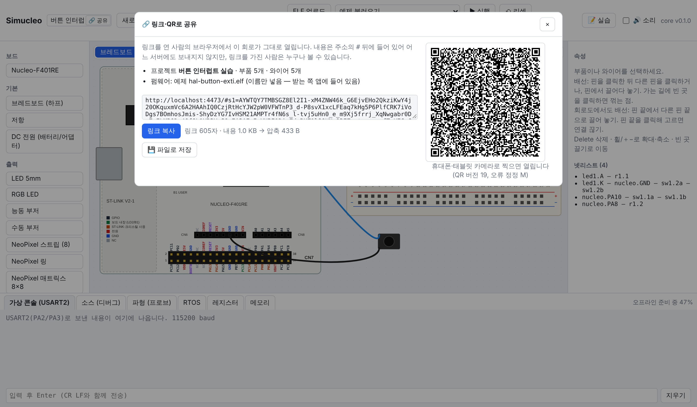

# 링크·QR로 공유하기

회로, 펌웨어, 파형 설정, 열어 둔 실습, 실습 결과를 **링크**나 **QR 코드** 하나로 보낼 수 있다(M30).
받은 사람이 링크를 열면 그 사람 브라우저에서 같은 회로가 그대로 열린다. 서버는 없다 — 내용은 모두
주소의 `#` 뒤(프래그먼트)에 들어 있고, 브라우저는 `#` 뒤를 서버로 보내지 않는다. GitHub Pages도 이 내용을
보지 못한다. 대신 링크를 가진 사람은 누구나 내용을 볼 수 있다.



## 보내기

1. 위 툴바의 프로젝트 이름 칸 오른쪽 끝에 있는 **🔗 공유**를 누른다.
2. 창에 무엇이 들어가는지(프로젝트 이름, 부품·와이어 수, 펌웨어, 실습)가 나온다.
3. **링크 복사**를 눌러 메신저·메일·학급 게시판에 붙여 넣거나, 화면의 **QR 코드**를 휴대폰·태블릿으로 찍게 한다.
   교실에서는 QR 코드를 프로젝터에 띄우면 학생들이 바로 연다.
4. 링크가 너무 길거나 QR 코드가 없으면 **💾 파일로 저장**으로 프로젝트 파일(`.simucleo.json`)을 만들어 보낸다.

펌웨어는 이렇게 들어간다.

- **예제 펌웨어**: 이름만 들어간다(앱에 들어 있으므로). 링크가 수백 자로 짧아 보통 QR 코드에 들어간다.
- **직접 올린 ELF**: **올린 펌웨어(ELF) 넣기**를 켜면 ELF가 링크에 들어간다. `-g`로 빌드한 ELF는 대부분이
  디버그 정보(DWARF)라서 기본으로 **디버그 정보 빼기**가 켜져 있다. 실행에 필요한 부분(로드 세그먼트)과
  **기호표**(함수·변수 이름: `Error_Handler` 감지, RTOS 보기에 쓰임)만 넣는다. 예를 들어 hal-blinky.elf는 829 KB →
  10 KB, 링크 약 8 000자다. 대신 받는 쪽에서는 소스 보기·중단점·변수 보기가 되지 않는다. 그것까지 보내려면 디버그
  정보 빼기를 끄거나(링크가 수십만 자가 된다) 파일로 저장한다.

### 길이 한도

| 길이 | 어떻게 되나 |
|---|---|
| 약 2 900자까지 | QR 코드도 나온다(QR 코드 하나에 들어가는 최대 2 953바이트, 가능하면 오류 정정 M, 아니면 L) |
| 4 000자 넘음 | 경고: 메일·게시판·주소창은 괜찮지만 일부 메신저·문자는 긴 링크를 자른다. 잘린 링크는 받는 쪽에서 "링크가 손상되었습니다"라고 나온다 |
| 2 000 000자 넘음 | 링크를 만들지 않는다(브라우저 주소 길이 한도). 파일로 저장한다 |

## 선생님께 보내기

실습 패널의 이름 칸 옆 **📤 선생님께 보내기**는 같은 창을 **실습 결과**를 넣은 채로 연다. 실습을 하는 중이면 그
실습의 결과만, 실습 목록에서 누르면 모든 실습의 결과가 들어간다. 결과는 **JSON** 내보내기와 같은 파일이고 같은
SHA-256 해시가 붙어 있어 선생님 쪽에서 검증된다. 지금 회로와 펌웨어, 열어 둔 실습도 함께 들어간다.
학생은 링크를 복사해 학급 게시판이나 메신저로 보낸다. 받는 방법은 [lessons.md](lessons.md#링크로-제출받기).

## 받기

링크를 열면 Simucleo가 열리고 **🔗 공유 링크 열기** 창이 먼저 나온다. 아직 아무것도 바뀌지 않았다.

- 창에는 링크에 든 것(프로젝트 이름, 부품·와이어 수, 펌웨어, 실습, 실습 결과와 검증 상태)이 나온다.
- 지금 작업 중인 회로가 있으면 그것이 바뀐다고 경고하고, **지금 프로젝트를 파일로 저장** 버튼을 준다.
- **열기**: 링크의 회로로 바꾼다. 작업 중인 회로가 있으면 평소처럼 한 번 더 묻는다. 링크에 실습이 있으면 그 실습이
  열린다(이 브라우저에 있는 실습일 때).
- **취소**: 아무것도 바꾸지 않는다.
- 연 뒤나 취소한 뒤에는 주소창에서 `#…`을 지운다. 새로 고쳐도 다시 묻지 않는다.
- 한 번 열어 둔 브라우저라면 오프라인에서도 링크가 열린다([offline.md](offline.md)). 링크의 내용은 처음부터
  네트워크를 지나지 않는다.

링크가 잘렸거나 고쳐졌으면 "링크가 손상되었습니다", 더 새 버전의 Simucleo가 만든 링크면 "새로 고쳐 최신
버전으로 여세요"라고 나오고 아무것도 바뀌지 않는다.

## 만드는 쪽: 형식

```
https://elecage.github.io/Simucleo/#s1=<base64url>
```

- `s1`: 형식 버전. 다른 버전은 읽지 않고 알려 준다.
- base64url을 풀면 첫 바이트가 방식(0 그대로, 1 `deflate-raw`)이고 나머지가 본문이다. 압축은 브라우저의
  `CompressionStream`을 쓴다(의존성 없음). 없는 브라우저에서는 압축하지 않은 링크를 만든다.
- 본문: JSON 길이(u32, 리틀 엔디언), JSON, 그리고 직접 올린 ELF의 바이트. ELF를 JSON 안의 base64로 넣지 않아
  글자로 바꾸는 것이 한 번뿐이다.
- JSON(`format: "simucleo-share"`, `version: 1`): `project`(프로젝트 파일 그대로, 펌웨어는 이름과 예제 파일 이름만),
  `elf`(크기, 원래 크기, `strip`: `none`·`debug`·`all`), `lesson`(실습 id), `result`(해시가 붙은 결과 파일).
- 디버그 정보 빼기(`web/src/share/elf.ts`): ELF 헤더, `PT_LOAD` 프로그램 헤더와 그 바이트, 그리고 기호표(함수·변수
  기호만, 섹션은 없으므로 `SHN_ABS`)와 문자열 표만 남긴 새 ELF를 만든다.
- 받을 때는 링크를 믿지 않는다: 2 000 000자가 넘으면 읽지 않고, 풀면서 8 MB를 넘는 순간 멈추며(압축 폭탄), 프로젝트는
  프로젝트 파일 검사기(모르는 부품·핀·와이어는 빼고 알림)를, 결과는 선생님용 모아보기의 검사기와 해시 검증을
  지난다. ELF는 헤더와 세그먼트가 파일 안에 있는지 확인하고, 예제 이름에 경로가 들어 있으면 쓰지 않는다. 링크의
  글자는 모두 화면에 글자로만 나온다.
- QR 코드(`web/src/share/qr.ts`): 바이트 모드만 쓰는 작은 인코더(버전 1–40, L/M/Q/H, 리드–솔로몬, 마스크 8개 중
  벌점이 가장 낮은 것). 단위 테스트가 표준의 형식·버전 정보 값, 용량 표와 비교하고, 따로 쓴 디코더로 읽어 본다.
