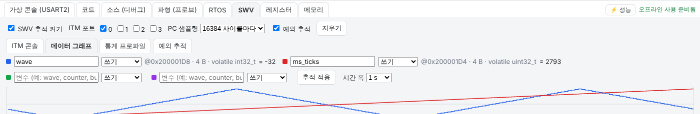
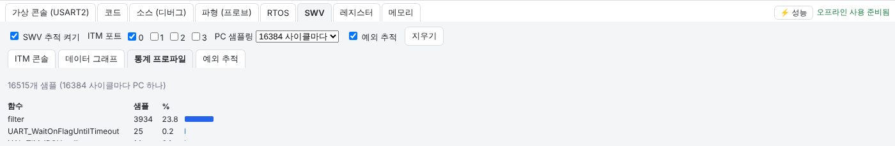
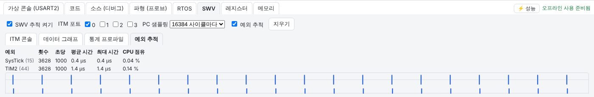

# SWV로 프로그램을 멈추지 않고 들여다보기

STM32CubeIDE의 **SWV(Serial Wire Viewer)** 처럼, 프로그램을 멈추지 않고 실행 중의 정보를 봅니다. 칩에서는 Cortex-M4의 ITM과 DWT가
정보를 패킷으로 만들어 SWO 핀으로 내보내고, 디버거가 받아서 보여 줍니다. Simucleo는 ITM·DWT 레지스터를 칩과 같이 시뮬레이션하고,
패킷을 아래 탭의 **SWV**에 보여 줍니다.

예제 **hal-swv-trace**에 네 가지가 모두 들어 있습니다.

## 켜기

1. 예제를 불러오고 아래 탭에서 **SWV**를 엽니다.
2. **SWV 추적 켜기**를 누릅니다. 디버거가 하듯이 다음을 설정합니다.
   - `DEMCR.TRCENA`
   - ITM `TCR`(ITMENA)과 `TER`(고른 포트)
   - DWT `CTRL`(PC 샘플링, 예외 추적)과 비교기
3. **▶ 실행**합니다.

설정은 펌웨어를 다시 불러와도 남습니다. 리셋해도 남습니다(칩에서도 디버그 레지스터는 시스템 리셋에 지워지지 않습니다).

## ITM 콘솔

펌웨어는 `ITM_SendChar(c)`로 자극 포트 0에 한 글자씩 씁니다(CMSIS). 포트가 꺼져 있으면 `ITM_SendChar`는 아무것도 하지 않고 바로
돌아오므로, SWV를 켜기 전에는 아무것도 나오지 않습니다. 다른 포트(1–3)에 32비트 값을 쓰면 시각과 값이 줄마다 나옵니다.
**ITM 포트** 체크 상자로 지나갈 포트를 고릅니다(ITM_TER).

```c
for (const char *p = "hello\n"; *p; p++) ITM_SendChar(*p);
```

UART와 달리 핀·보레이트·인터럽트가 필요 없고, 펌웨어 쪽 비용도 아주 작습니다.

## 데이터 그래프 (데이터 추적)



전역 변수 이름(`wave`, `buf[2]`, `s.count` 등)을 넣고 **추적 적용**을 누릅니다.
- 최대 4개까지 넣을 수 있습니다. DWT 비교기가 4개라서입니다.
- 변수마다 그 주소에 DWT 비교기가 걸립니다. 그 변수를 읽거나 쓸 때마다 값이 그래프에 찍힙니다.
- 방식은 **쓰기**, **읽기**, **읽기·쓰기** 중에서 고릅니다.
- 그래프는 변수마다 따로 눈금을 씁니다. 크기가 아주 다른 값도 함께 보입니다.
- 값은 변수의 C 형으로 읽습니다(부호, 크기, `float`).

## 통계 프로파일 (PC 샘플링)



DWT가 정해진 사이클마다 지금 실행 중인 PC를 하나씩 샘플링합니다. 샘플을 함수별로 모으면, CPU가 어느 함수에서 시간을 쓰는지 나옵니다.
- WFI/WFE로 잠든 동안의 샘플은 **(잠자기)** 로 따로 셉니다.
- 샘플 간격은 1024, 4096, 16384 사이클 중에서 고릅니다. DWT `CTRL`의 POSTPRESET·CYCTAP 값입니다.

## 예외 추적



인터럽트와 예외가 시작하고 끝날 때마다 패킷이 나옵니다. 표에는 예외마다 다음이 나옵니다.
- 이름: STM32F401 벡터 이름(`TIM2`, `EXTI15_10` 등)
- 횟수와 초당 횟수
- 평균 처리 시간과 최대 처리 시간(더 높은 우선순위의 인터럽트에 선점된 시간은 빼고 셉니다)
- CPU 점유

아래 타임라인은 최근 20 ms 동안 처리 루틴이 돈 구간을 예외마다 한 줄씩 그립니다.

## 칩과 다른 점

- SWO 핀의 대역폭은 무한하다고 봅니다. 칩에서는 패킷이 많으면 넘쳐서 사라질 수 있습니다(ITM overflow). 여기서는 화면이 한 프레임
  사이에 20만 개 넘게 받지 못한 것만 **놓친 패킷**으로 셉니다.
- 타임스탬프는 칩의 로컬 타임스탬프 패킷이 아니라 시뮬레이션 시간 그대로입니다.
- DWT 비교기 FUNCTION 값의 해석은 다음과 같습니다.
  - 0b0001–0b0011과 0b1110–0b1111: 읽기와 쓰기
  - 0b1100: 읽기만
  - 0b1101: 쓰기만

  펌웨어가 비교기를 직접 설정하는 경우에도 이 해석을 씁니다.
